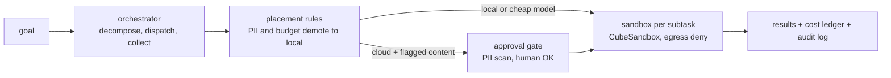

<p align="center">
  <picture>
    <source media="(prefers-color-scheme: dark)" srcset="assets/brand/logo-dark.svg">
    
  </picture>
</p>

<p align="center"><em>Logo is a proposal pending owner sign-off.</em></p>

**An open, self-hosted take on the cloud half of Perplexity Computer: route each subtask to a cheap model, run it in a disposable sandbox, hold anything sensitive for approval, and stop at a hard cost cap.**

> **Status: early runtime, not yet usable end to end.** Tested safety primitives exist (filesystem protocol,
> policy engine, PII gate with audit and approval queue, router with a decision budget, live CubeSandbox
> adapter, placement rules, orchestrator glue, a passkey-gated operator console). **It cannot yet turn a goal
> into an artifact:** there is no `oc` CLI, no worker cost ledger, no credential boundary and no golden-task
> run. Per-feature status with verified gaps: [docs/FEATURES.md](./docs/FEATURES.md). Unit board:
> [ROADMAP.md](./ROADMAP.md).

## Why

Perplexity Computer coordinates 19 models for $200/month; reviewers report simple tasks at roughly
$0.60-$0.80 and complex ones at $2-$6, with runaway-spend complaints
([research](./docs/research/2026-10-10-landscape.md)). Open projects cover single slices: browser-use for
browsers, OpenHands for coding, E2B and CubeSandbox for sandboxes. open-computer is the composition of
those slices under a cost cap and an approval gate, built from parts the owner already runs
(`orchestral`, `agentflow`, `Argus`, `jev-compact`, CubeSandbox).

It is personal infrastructure first. It does not try to match Perplexity's connectors, memory or enterprise features.

## How it works



Built: orchestrator glue, placement rule table, router, gate prefilter/queue/audit, execplane adapter,
fsproto, console. Not built: CLI, worker cost ledger, credential boundary, snapshots (see the FEATURES matrix).

Measured evidence: on a 180-fixture set the hosted `pplx-decider` reached 86.7% route and tier accuracy at
about $0.000004 per decision ([bench](./docs/router-bench-results.md)). A self-hosted router did not stay up
under load, so the router is a thin chain over the hosted decider with Jev as fallback.

## Install and quick start

No package or CLI yet. From a checkout, with [uv](https://docs.astral.sh/uv/):

```bash
# determinism matrix (no network, no model calls; sandbox rows skip without CubeSandbox)
uv run --with pytest --with fido2 pytest tests/conformance tests/opsview tests/unit -q

# operator console against fixture data (no microVMs, no models)
uv run --with fido2 python -I tests/opsview/serve_fixture.py 8851 /tmp/oc-fixture

# console browser tests (Playwright + axe)
cd tests/e2e && npm i && npx playwright install chromium && npm test
```

Live rows need `CUBE_API_URL` and `CUBE_API_KEY` for a local CubeSandbox; they boot real microVMs, so run
them by hand, never in CI. The first runnable command (`oc run "<goal>"`) is OC-039.

## Docs

- [Landscape research](./docs/research/2026-10-10-landscape.md): Perplexity Computer, Manus, ChatGPT agent, Claude computer use, browser-use, OpenHands, Open Interpreter, E2B/Cube/Daytona, routers.
- [ROADMAP.md](./ROADMAP.md): unit board, numbering map (OC-nnn to the old PR #1/#6 ids), spend rule.
- [docs/FEATURES.md](./docs/FEATURES.md): feature inventory verified against code.
- [Program roadmap plan](./docs/plans/2026-10-10-program-roadmap-plan.md)
- [ARCHITECTURE_MAP.md](./ARCHITECTURE_MAP.md): Perplexity part, open equivalent, status.
- [docs/determinism.md](./docs/determinism.md): the non-negotiable rules and test matrix.
- [docs/perplexity-open-catalog.md](./docs/perplexity-open-catalog.md): what Perplexity has open-sourced.
- [docs/harness-positioning.md](./docs/harness-positioning.md), [docs/fleet-inventory.md](./docs/fleet-inventory.md)
- [DESIGN.md](./DESIGN.md): "Flight Strip" design direction; [assets/brand](./assets/brand/README.md): logo proposal.

## Contributing

Open an issue before proposing a new service: the roadmap deliberately avoids building what an existing repo
already does. Run the test command above before sending a PR. Default branch changes go through a pull request.

## License

MIT — see `LICENSE`.
