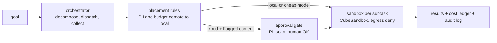

<p align="center">
  <picture>
    <source media="(prefers-color-scheme: dark)" srcset="assets/brand/logo-dark.svg">
    
  </picture>
</p>

<p align="center"><em>Logo is a proposal pending owner sign-off.</em></p>

**An open, self-hosted take on the cloud half of Perplexity Computer: route each subtask to a cheap model, run it in a disposable sandbox, hold anything sensitive for approval, and stop at a hard cost cap.**

> **Status: early runtime, not yet usable end to end.** The safety pieces are built and tested: filesystem
> protocol, policy engine, PII gate with audit and approval queue, router with a decision budget, placement
> rules, a worker cost ledger with a per-run cap, an MCP server, sandbox adapters (CubeSandbox, plus an optional
> SPACE backend), a device plane for running steps on your own machines, and a passkey-gated operator console.
> The orchestrator can decompose a goal and run its steps, and structured logging and OpenRouter cost records
> now cover every service. **It cannot yet reliably turn a goal into an artifact:** there is no `oc` CLI and no
> golden-task run, and the credential boundary is only partly done. Fixes aimed at live goal runs have just
> landed (see [Recently merged](#recently-merged-orchestrator-and-console)) but have not been proven end to end. Per-feature status with verified gaps:
> [docs/FEATURES.md](./docs/FEATURES.md) (written 2026-10-14, so parts are behind the code). Unit board:
> [ROADMAP.md](./ROADMAP.md).

## Why

Perplexity Computer coordinates 19 models for $200/month; reviewers report simple tasks at roughly
$0.60-$0.80 and complex ones at $2-$6, with runaway-spend complaints
([research](./docs/research/2026-10-10-landscape.md)). Open projects cover single slices: browser-use for
browsers, OpenHands for coding, E2B and CubeSandbox for sandboxes. open-computer is the composition of
those slices under a cost cap and an approval gate, built from parts the owner already runs
(`orchestral`, `agentflow`, `Argus`, `jev-compact`, CubeSandbox).

It is personal infrastructure first. It does not try to match Perplexity's connectors, memory or enterprise features.

## How it works



Built: orchestrator glue, placement rule table, router, gate prefilter/queue/audit, execplane adapters,
fsproto, worker cost ledger, MCP server (stdio), device plane, operator console, structured logging and
OpenRouter cost records. Not built: CLI, a finished credential boundary, snapshots and rollback (see the
FEATURES matrix and the [ROADMAP](./ROADMAP.md)).

Measured evidence: on a 180-fixture set the hosted `pplx-decider` reached 86.7% route and tier accuracy at
about $0.000004 per decision ([bench](./docs/router-bench-results.md)). A self-hosted router did not stay up
under load, so the router is a thin chain over the hosted decider with Jev as fallback.

## Observability and cost data

Stages 1 and 2 of the [observability plan](./docs/plans/2026-10-28-001-feat-observability-and-cost-telemetry-plan.md)
are merged ([#70](https://github.com/duketopceo/open-computer/pull/70) plan,
[#72](https://github.com/duketopceo/open-computer/pull/72) stage 1,
[#73](https://github.com/duketopceo/open-computer/pull/73) stage 2). Everything is configured with `OC_*`
environment variables, stays on your own disk, and nothing is sent anywhere unless you opt in.

- **Structured logs.** Every service writes the same JSON-lines format with trace, run and chat ids. Secrets
  and PII are redacted, and prompt or completion text is left out unless you set `OC_OBS_CAPTURE_CONTENT=1`.
  Useful variables: `OC_LOG_LEVEL`, `OC_DEBUG`, `OC_LOG_DIR`.
- **A record of every OpenRouter call** (model, provider, tokens, provider-reported cost, latency), written to
  `OC_OBS_DIR`. The cost ledger now uses the real reported cost, so the per-run cap reacts to actual spend.
- **App attribution** on OpenRouter requests, controlled by `OC_OPENROUTER_ATTRIBUTION` and the other
  `OC_OPENROUTER_*` variables. Set your own referer or turn it off if you prefer.
- **One-command diagnosis:** `python -m oc.obs tail --run <run-id>` merges logs, audit, ledger, call record and
  events into one timeline; `python -m services.openrouter report --by run` summarizes spend.

Full guide: [docs/runbooks/observability.md](./docs/runbooks/observability.md). Stage 3 (an optional
Postgres or Supabase sink for the same data, off unless you set `OC_OBS_SINK_POSTGRES_URL`) has its plan merged
in [#74](https://github.com/duketopceo/open-computer/pull/74) but is not built yet: no code has changed for it.

## Recently merged: orchestrator and console

- [#75](https://github.com/duketopceo/open-computer/pull/75): an orchestrator fix for live goal runs. Steps of
  a run share one sandbox, a step's prompt includes the output of the steps it depends on, a nonzero exit
  shows up as a real failure with its stderr, and steps that must run code are no longer demoted to a chat
  endpoint.
- [#76](https://github.com/duketopceo/open-computer/pull/76): the console shows how long each step took and,
  when the model returns it, a collapsible "Thinking" view.
- [#77](https://github.com/duketopceo/open-computer/pull/77): first slice of a long-horizon agent
  orchestrator in `services/agents`: a planner loop with a budget and approvals, plus a worker that drives an ACP
  agent such as OpenCode, and a read-only job trail at `/api/agent-jobs`. Sandbox-placed steps in this slice
  fail closed rather than run on the host.
- [#79](https://github.com/duketopceo/open-computer/pull/79): job trail rows are redacted and size-capped before
  the console serves them.

#75 to #77 landed on `main` together as one squash commit (`4356ff5`). Review fixes for the run sandbox lifecycle are in open PR [#80](https://github.com/duketopceo/open-computer/pull/80). Later slices (sandbox launcher, job resume,
a console submit and approve view, a live acceptance run) are listed in
`docs/plans/2026-10-29-001-feat-agent-orchestrator-plan.md`.

## Install and quick start

No package or CLI yet. From a checkout, with [uv](https://docs.astral.sh/uv/):

```bash
# determinism matrix (no network, no model calls; sandbox rows skip without CubeSandbox)
uv sync --locked
uv run pytest -m "not live"        # CI runs exactly this, plus `uv run ruff check .`

# operator console against fixture data (no microVMs, no models)
uv run python -I tests/opsview/serve_fixture.py 8851 /tmp/oc-fixture

# console browser tests (Playwright + axe)
cd tests/e2e && npm ci && npx playwright install chromium && npm test

# operator console (loopback only, port 8791 by default)
uv run python -m services.opsview.server
```

The console reads `OPENROUTER_API_KEY` if you want it to make real model calls. Add `--extra space` to
`uv sync` if you plan to use the optional SPACE sandbox backend (`OC_EXECPLANE_BACKEND=space`; the default is
`cube`).

Live rows need `CUBE_API_URL` and `CUBE_API_KEY` for a local CubeSandbox; they boot real microVMs, so run
them by hand, never in CI. The first runnable command (`oc run "<goal>"`) is OC-039.

## Docs

- [Landscape research](./docs/research/2026-10-10-landscape.md): Perplexity Computer, Manus, ChatGPT agent, Claude computer use, browser-use, OpenHands, Open Interpreter, E2B/Cube/Daytona, routers.
- [ROADMAP.md](./ROADMAP.md): unit board, numbering map (OC-nnn to the old PR #1/#6 ids), spend rule.
- [docs/FEATURES.md](./docs/FEATURES.md): feature inventory verified against code (as of 2026-10-14).
- [docs/runbooks/observability.md](./docs/runbooks/observability.md): logging, OpenRouter cost records, and the trace timeline.
- [Program roadmap plan](./docs/plans/2026-10-10-program-roadmap-plan.md)
- [ARCHITECTURE_MAP.md](./ARCHITECTURE_MAP.md): Perplexity part, open equivalent, status.
- [docs/determinism.md](./docs/determinism.md): the non-negotiable rules and test matrix.
- [docs/perplexity-open-catalog.md](./docs/perplexity-open-catalog.md): what Perplexity has open-sourced.
- [docs/harness-positioning.md](./docs/harness-positioning.md), [docs/fleet-inventory.md](./docs/fleet-inventory.md)
- [DESIGN.md](./DESIGN.md): "Flight Strip" design direction; [assets/brand](./assets/brand/README.md): logo proposal.

## Contributing

Open an issue before proposing a new service: the roadmap deliberately avoids building what an existing repo
already does. Run the test command above before sending a PR. Default branch changes go through a pull request.

## License

MIT — see `LICENSE`.
