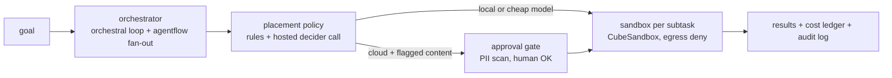

  <picture>
    <source media="(prefers-color-scheme: dark)" srcset="assets/brand/logo-dark.svg">
    
  </picture>

<em>Logo is a proposal pending owner sign-off.</em>

**An open, self-hosted take on the cloud half of Perplexity Computer: route each subtask to a cheap model, run it in a disposable sandbox, hold anything sensitive for approval, and stop at a hard cost cap.**

> **Status: research phase, no runtime code yet.** The architecture is mapped, the router question is
> answered with data, and a small vertical slice is planned. Nothing below under "How it works" is
> runnable today. See the [roadmap](./ROADMAP.md).

## Why

Perplexity Computer coordinates 19 models for $200/month; reviewers report simple tasks at roughly
$0.60-$0.80 and complex ones at $2-$6, with runaway-spend complaints
([research](./docs/research/2026-10-10-landscape.md)). Open projects cover single slices: browser-use for
browsers, OpenHands for coding, E2B and CubeSandbox for sandboxes. open-computer is the composition of
those slices under a cost cap and an approval gate, built from parts the owner already runs
(`orchestral`, `agentflow`, `Argus`, `jev-compact`, CubeSandbox).

It is personal infrastructure first. It does not try to match Perplexity's connectors, memory or enterprise features.

## How it works (planned)

What exists as measured evidence, from open PR [#2](https://github.com/duketopceo/open-computer/pull/2): on a 180-fixture
set the hosted `pplx-decider` reached 86.7% route and tier accuracy at about $0.000004 per decision, and a
self-hosted router did not stay up under load, so no router service will be built.

## Install and quick start

Not available yet. There is nothing to install. The first runnable command (`open-computer run "<goal>"`) is
unit U8 in the [program plan](./docs/plans/2026-10-10-program-roadmap-plan.md).

A screenshot or recording goes here once the CLI exists. TODO: capture from the real CLI; the design is in [DESIGN.md](./DESIGN.md).

## Docs

- [Landscape research](./docs/research/2026-10-10-landscape.md): Perplexity Computer, Manus, ChatGPT agent, Claude computer use, browser-use, OpenHands, Open Interpreter, E2B/Cube/Daytona, routers.
- [Program roadmap plan](./docs/plans/2026-10-10-program-roadmap-plan.md)
- [ARCHITECTURE_MAP.md](./ARCHITECTURE_MAP.md): Perplexity part, open equivalent, status.
- [docs/determinism.md](./docs/determinism.md): the non-negotiable rules and test matrix.
- [docs/perplexity-open-catalog.md](./docs/perplexity-open-catalog.md): what Perplexity has open-sourced.
- [docs/harness-positioning.md](./docs/harness-positioning.md), [docs/fleet-inventory.md](./docs/fleet-inventory.md)
- [DESIGN.md](./DESIGN.md): "Flight Strip" design direction; [assets/brand](./assets/brand/README.md): logo proposal.

## Contributing

Docs and plans only for now. Open an issue before proposing code: the roadmap deliberately avoids new services
where an existing repo already does the job. Default branch changes go through a pull request.

## License

AGPL-3.0. Free to use and modify, including privately. If you host or distribute a modified version, you must publish your source under the same license. See [`LICENSE`](LICENSE).

Versions of this repository before the AGPL-3.0 change were published under the MIT License, and those copies remain available under MIT.
