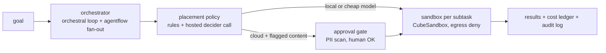

<p align="center">
  <picture>
    <source media="(prefers-color-scheme: dark)" srcset="assets/brand/logo-dark.svg">
    
  </picture>
</p>

<p align="center"><em>Logo is a proposal pending owner sign-off.</em></p>

**An open, self-hosted take on the cloud half of Perplexity Computer: route each subtask to a cheap model, run it in a disposable sandbox, hold anything sensitive for approval, and stop at a hard cost cap.**

> **Status: libraries and services on `main`, no end-to-end run yet.** The repo ships Python packages under `oc/` and `services/` (filesystem protocol, execution-plane adapter, escalation gate, router, local ops UI) plus a conformance harness that encodes `docs/determinism.md`. There is still no `open-computer run "<goal>"` command, no orchestrator loop, no packaging (`pyproject.toml`), and no CI — run tests locally. See the [roadmap](./ROADMAP.md).

## Why

Perplexity Computer coordinates 19 models for $200/month; reviewers report simple tasks at roughly
$0.60-$0.80 and complex ones at $2-$6, with runaway-spend complaints
([research](./docs/research/2026-10-10-landscape.md)). Open projects cover single slices: browser-use for
browsers, OpenHands for coding, E2B and CubeSandbox for sandboxes. open-computer is the composition of
those slices under a cost cap and an approval gate, built from parts the owner already runs
(`orchestral`, `agentflow`, `Argus`, `jev-compact`, CubeSandbox).

It is personal infrastructure first. It does not try to match Perplexity's connectors, memory or enterprise features.

## What exists today

| Area | Location | Notes |
|---|---|---|
| Determinism harness | `tests/conformance/` | Rules R1–R7 plus ROUTER and AUTH rows |
| Filesystem sub-agent protocol | `oc/fsproto/`, [spec](./docs/fs-protocol-spec.md) | Reference impl (leases, tombstones, deps) |
| Execution plane | `services/execplane/` | CubeSandbox client + policy dry-run (needs live API for R1–R3) |
| Escalation gate | `services/gate/` | PII prefilter, per-step approval, append-only audit |
| Router | `services/router/` | decider → jev → table chain, budget gate + ledger file |
| Ops UI | `services/opsview/` | Passkey-gated local web page: matrix, route tester, sandboxes, audit tail |
| Router bench | `bench/router/` | Corpus + results from [PR #2](./docs/router-bench-results.md) |

Router bench conclusion still holds for model *selection* cost/accuracy; **`services/router/` was added anyway** ([PR #10](https://github.com/duketopceo/open-computer/pull/10)) as a thin, testable service with a deterministic table fallback — not a self-hosted GPU router.

## How it works (target)



The orchestrator box is **not wired yet**; the pieces above it are libraries/services you can import and exercise via the harness and ops UI.

## Install and quick start

**Requirements:** Python 3.12+ on the host. Install [uv](https://docs.astral.sh/uv/) (recommended) or use your own venv with `pytest` available.

**Optional dependencies** (import-time or runtime — without them, related checks stay `PENDING` instead of fake-passing):

- **`fido2`** — WebAuthn for `services/opsview` login and enrollment (`pip install fido2`).
- **`cubesandbox`** — E2B-compatible SDK for `services/execplane` (`pip install cubesandbox`, or an editable install of the upstream `sdk/python` checkout). Conformance sandbox rows also need a reachable CubeSandbox API.

### Conformance matrix

From the repo root:

```bash
uv run --with pytest pytest tests/conformance -v
```

If you use a local CubeSandbox SDK checkout instead of PyPI:

```bash
uv run --with pytest --with-editable ~/src/cubesandbox/sdk/python pytest tests/conformance -v
```

The session ends with a **determinism matrix** summary (R1–R7, ROUTER, AUTH). Rows that need CubeSandbox or OpenRouter keys report `PENDING` when infra is absent.

### Ops UI (local)

Bind is **`127.0.0.1` only**. Default port **8791**.

```bash
export CUBE_API_URL=https://your-cube-api.example   # optional — fleet health + sandbox list
export CUBE_API_KEY=...                             # optional — X-API-Key for Cube API
export OC_AUDIT=/tmp/oc-audit/audit.ndjson          # optional — gate audit tail (default shown)
python -m services.opsview.server                   # or: python -m services.opsview.server 8791
```

Open `http://127.0.0.1:8791`. Unauthenticated requests redirect to **`/login`** (passkey). First credential: mint a one-time enroll token, then visit **`/enroll?token=…`**:

```bash
python -m services.opsview.auth mint localhost
# → paste token into http://127.0.0.1:8791/enroll?token=<token>
```

Authenticated **`/`** shows: Cube control-plane UP/DOWN, determinism matrix (button or **`r`** runs pytest via uv), route tester (`/route`), running sandboxes, and the last gate audit rows. WebAuthn ceremonies: `/webauthn/login/*`, `/webauthn/register/*`.

### Router (library / route tester)

For live decider/jev legs, set OpenRouter credentials (used by `services/router`, not read by the ops page except through `_route()`):

```bash
export OPENROUTER_API_KEY=...
export OPENROUTER_BASE=https://openrouter.ai/api/v1   # optional; default matches services/router/decide.py
```

The ops UI route tester writes spend to a **fixed path** `/tmp/oc-audit/router-ledger.jsonl` (not configurable via env today). Conformance uses per-test ledger files under `tmp_path`.

### Environment variables (read by code)

| Variable | Used by | Purpose |
|---|---|---|
| `CUBE_API_URL` | `services/execplane`, `services/opsview` | CubeSandbox API base URL |
| `CUBE_API_KEY` | same | API key header |
| `CUBE_TEMPLATE_ID` | `services/execplane` | Sandbox template (default `code-interpreter`) |
| `OPENROUTER_API_KEY` | `services/router`, `bench/router/*` | Decider/jev HTTP legs |
| `OPENROUTER_BASE` | `services/router` | OpenRouter API base (optional) |
| `OC_AUDIT` | `services/opsview` | NDJSON gate audit file to tail (default `/tmp/oc-audit/audit.ndjson`) |

There is **no** `OC_ROUTER_LEDGER` env var; ledger paths are constructor arguments or the ops hard-coded `/tmp/oc-audit/router-ledger.jsonl`.

### Not available yet

- **`open-computer run "<goal>"`** — orchestrator glue (program roadmap U8 / implementation plan U6).
- **Packaging / `pip install open-computer`** — no root `pyproject.toml`.
- **CI** — run pytest manually (see [ROADMAP](./ROADMAP.md)).

## Docs

- [Landscape research](./docs/research/2026-10-10-landscape.md): Perplexity Computer, Manus, ChatGPT agent, Claude computer use, browser-use, OpenHands, Open Interpreter, E2B/Cube/Daytona, routers.
- [Program roadmap plan](./docs/plans/2026-10-10-program-roadmap-plan.md)
- [Implementation plan](./docs/plans/2026-10-10-implementation-plan.md) (U0–U7 unit IDs)
- [ARCHITECTURE_MAP.md](./ARCHITECTURE_MAP.md): Perplexity part, open equivalent, status.
- [docs/determinism.md](./docs/determinism.md): the non-negotiable rules and test matrix.
- [docs/perplexity-open-catalog.md](./docs/perplexity-open-catalog.md): what Perplexity has open-sourced.
- [docs/harness-positioning.md](./docs/harness-positioning.md), [docs/fleet-inventory.md](./docs/fleet-inventory.md)
- [DESIGN.md](./DESIGN.md): Flight Strip direction + shipped ops UI tokens; [assets/brand](./assets/brand/README.md): logo proposal.

## Contributing

Open a pull request for changes. Prefer matching existing service layout under `services/` and `oc/`. The roadmap avoids duplicate services where another repo already owns the job — propose in an issue first if you are unsure.

## License

MIT — see `LICENSE`.
