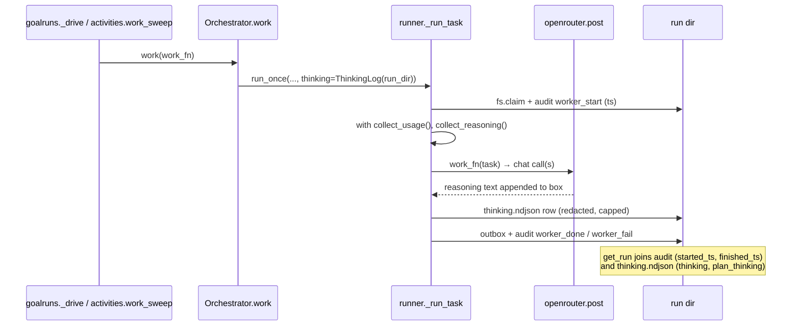

# Run Step Times and Thinking - Plan

---

## Goal Capsule

- **Objective:** Someone watching a goal run in the console can see how long every step took, including the ones that passed, see a running step's elapsed time tick, and read the reasoning the model returned for the plan and for each step.
- **Means:** record a claim-time audit row per task and capture `message.reasoning` from every OpenRouter call into a per-run thinking log, in the shared worker sweep for steps and in `Orchestrator._submit` for the planner, then surface both through `get_run` to the React run view and the server-rendered `/work` and `/goals/<id>` pages (KTD1, KTD2, KTD3).
- **Authority:** Product Contract R-IDs win on behavior; KTDs win on mechanism; units override neither.
- **Stop conditions:** stop and report if recording would require a request parameter that raises spend (Key Decision 1). Whether the models in use return reasoning text cannot be checked offline (Key Decision 2); it is confirmed on the first real run after merge (Definition of Done).
- **Execution profile:** Python services + one React component; tests are offline (fake OpenRouter, on-disk run dirs).
- **Finish and ship:** `lfg` implements, reviews, and opens a PR stacked on `wip/orchestrator-dep-results` (#75). Merging stays with Luke.

---

## Product Contract

### Summary

Each step in a goal run gets a start time, so the console shows its duration once it ends and a live elapsed while it runs. Any reasoning text the planner or a worker model returns is kept with the run and shown collapsed under a "Thinking" toggle, for the plan and for each step.

### Problem Frame

Live goal runs fail often while the orchestrator is being hardened (recent runs failed on sandbox paths, missing inputs and unapproved egress). When a run is being debugged, the console says what state each step reached but not how long it took or why the model did what it did. `get_run` has only the dispatch time and the finish time. Dispatch can happen long before a worker picks the task up, so a duration measured from dispatch is wrong, and the React run view shows no per-step time at all. Usage rows already count `reasoning_tokens`, so we pay for reasoning that is then thrown away.

### Requirements

**Step timing**

- R1. Every step that a worker claimed shows its run time (claim to finish) once it is DONE or FAILED.
- R2. A step that is running shows elapsed time since claim, and the value advances while the page refreshes.
- R3. A step that never ran (dependency tombstone, still queued) shows no duration rather than a misleading one.
- R4. Runs recorded before this change still render: steps without a claim time fall back to showing no duration and nothing errors.

**Thinking**

- R5. Reasoning text returned by the planner call is kept with the run and shown once, collapsed, as the plan's "Thinking".
- R6. Reasoning text returned by every OpenRouter call a step makes (chat worker and the sandbox script writer) is kept with that step and shown collapsed under the step, for DONE and FAILED steps alike.
- R7. Steps or plans with no reasoning returned show no "Thinking" control.
- R8. Recorded reasoning is credential-redacted and size-capped before it reaches disk.

**Surfaces and paths**

- R9. Both drive paths record timing and thinking: the inline daemon-thread drive and the Temporal durable `work_sweep`.
- R10. The React run view (`/`), the `/work` page, and the `/goals/<id>` page all show step durations; the React run view and the `/work` inspector show thinking.

### Key Decisions

- **Surface only reasoning that models already return; never request reasoning.** (session-settled: user-directed — chosen over requesting reasoning via OpenRouter's `reasoning`/`include_reasoning` params: extra reasoning tokens cost money under the cheap-models spend policy.) Governs R5, R6, R7.
- **Tests make no live or paid model calls.** (session-settled: user-directed — chosen over live OpenRouter smoke tests: spend policy.) Governs the Verification Contract.

### Scope Boundaries

- Not built: streaming reasoning while a step is still running. Reasoning lands when the call returns. Would change if steps routinely run for minutes with a single long call.
- Not built: reasoning from local model endpoints (llama.cpp/Ollama). Local is retired on Luke's box, and those calls do not go through the OpenRouter client.
- Not built: encrypted `reasoning_details` entries. They are opaque by design and are skipped.
- Not built: a server-supplied clock for the React live elapsed. The console is normally opened on the machine running opsview, so skew is negligible; revisit if it is used from other devices and running times look wrong.
- Not built: auto-refresh on `/work`. Running-step elapsed there advances on reload; the React view polls every 3s.
- Not built: showing thinking on the `/goals/<id>` page. It gets durations only. `/work` and the React view are the debugging surfaces.

---

## Planning Contract

### Key Technical Decisions

- KTD1. **Claim time is a `worker_start` audit row.** `_run_task` appends `{event: worker_start, run, task, subtask}` right after a successful `fs.claim`. `AuditLog.append` stamps `ts`. `get_run` reads it as `started_ts`. The audit log is already the source `get_run` reads for `worker_done`/`worker_fail`, so this adds one row type, not a new store. The fsproto task dir is left alone because its layout is a conformance-tested spec (`tests/fsproto/test_spec_conformance.py`).
- KTD2. **Reasoning is collected by a context-var collector beside `collect_usage`.** `services/openrouter/client.py` gains a `collect_reasoning()` context manager. `post()` appends the extracted reasoning of each successful call to the active box. The extraction uses `message.reasoning` (string), or else joins `message.reasoning_details` entries of type `reasoning.text` (`text`) and `reasoning.summary` (`summary`). This mirrors the existing usage plumbing, so neither `engines._chat` nor `sandbox_work` changes signature, and every OpenRouter call made inside a step is caught, including the sandbox script writer.
- KTD3. **Thinking is stored in `<run_dir>/thinking.ndjson`, one row per step or plan.** Rows look like `{run, task, subtask, ts, text}` and the planner row uses `subtask: "_plan"`. Text is passed through `oc.obs.redact_str` and capped at 16,000 chars with a truncation marker (R8). It is a separate file so `list_runs`, which reads the whole audit log for every run on every poll, never parses reasoning text. Stored unconditionally, like step results in the outbox: it is model output the operator already sees, not prompt content, so the `OC_OBS_CAPTURE_CONTENT` opt-in does not gate it.
- KTD4. **Recording lives in the shared sweep.** `run_once`/`_run_task` take an optional `thinking` sink, and `Orchestrator.work` passes one rooted at its run dir. Both the inline drive (`goalruns._drive` → `orch.work`) and Temporal (`activities.work_sweep` → `orch.work`) go through `Orchestrator.work`, so R9 needs no durable-specific wiring. The planner's reasoning is recorded in `Orchestrator._submit` around `decompose`, which covers `goalruns.submit` and `activities.submit_goal`.
- KTD5. **Recording never fails a step.** A thinking-log write error is logged through the obs logger and dropped. The step's outcome is unaffected (same rule as `_record` in the OpenRouter client).
- KTD6. **Durations are computed by the readers, from `started_ts`/`finished_ts`.** `get_run` returns both, plus `thinking` per step and `plan_thinking`. The React view computes live elapsed from `started_ts` against the current time on each render, and the existing 3s poll while a run is active re-renders it. `views._thought_line` switches from dispatch `ts` to `started_ts`.

### High-Level Technical Design

### Assumptions

- The default worker model (`z-ai/glm-5.3-flash`) and planner return reasoning by default through OpenRouter when they reason. If they do not, R5/R6 render nothing (R7), and the stop condition applies only if no model in use ever returns any.
- Luke wants this stacked on #75 because both touch `services/orchestrator/engines.py`. This branch leaves `engines.py` untouched (KTD2), so the stack is about ordering, not conflicts.

---

## Implementation Units

### U1. Reasoning collector in the OpenRouter client

- **Goal:** Every successful OpenRouter call's reasoning text is available to a caller-scoped collector.
- **Requirements:** R5, R6, R7, R8 (extraction only); Key Decision 1.
- **Dependencies:** none.
- **Files:** `services/openrouter/client.py`, `services/openrouter/__init__.py`, `tests/unit/fake_openrouter.py`, `tests/unit/test_openrouter_client.py`.
- **Approach:**
  1. Add `extract_reasoning(resp)` per KTD2: string `reasoning` wins, otherwise text/summary details joined with blank lines, encrypted entries skipped, non-str values ignored.
  2. Add the `collect_reasoning()` context manager and a module ContextVar, appended in `post()` after the usage sink. Empty strings are not appended.
  3. Export both from `services/openrouter/__init__.py`.
  4. Extend `chat_reply` in the fake with optional `reasoning=` and `reasoning_details=` kwargs.
- **Patterns to follow:** `collect_usage` / `_collector` in the same file.
- **Test scenarios:**
  - A reply with `message.reasoning: "think A"` inside `collect_reasoning()` yields `["think A"]`.
  - A reply with only `reasoning_details` of a text and a summary entry yields both texts joined; an encrypted entry contributes nothing.
  - A reply with neither yields an empty box.
  - A failed call (HTTP 500) appends nothing and still raises.
  - Calls outside any `collect_reasoning()` block do not error.
  - The request body sent to the fake carries no `reasoning` or `include_reasoning` field (Key Decision 1).
- **Verification:** the client tests pass offline against the fake.

### U2. Claim-time audit row and thinking log in the worker sweep

- **Goal:** Each claimed task records its start time and the reasoning its calls returned, on both drive paths.
- **Requirements:** R1, R2, R5, R6, R8, R9; KTD1, KTD3, KTD4, KTD5.
- **Dependencies:** U1.
- **Files:** `services/orchestrator/runner.py`, `services/orchestrator/thinking.py` (new), `services/orchestrator/__init__.py`, `tests/unit/test_run_thinking.py` (new).
- **Approach:**
  1. New `ThinkingLog(path)` with `append(run, task, subtask, text)` (redact, cap, single O_APPEND write, never raises) and `rows()` (tolerant of torn or garbage lines). Follow `services/gate/audit.py` for the write.
  2. `_run_task`: after a successful claim, append `worker_start`. Wrap `work_fn(task)` in `collect_reasoning()`. In both the success and the failure branch, write the joined box to the sink when one is given and the box is non-empty.
  3. `run_once` and `Orchestrator.work` take and pass a `thinking` sink. The Orchestrator builds one at `root / "thinking.ndjson"`.
  4. `Orchestrator._submit` wraps `decompose` in `collect_reasoning()` and writes a `_plan` row on success and on decompose failure.
- **Patterns to follow:** `AuditLog.append` (single O_APPEND write), the `ledger` optional-parameter threading through `run_once`.
- **Test scenarios:**
  - A work_fn that makes one fake-OpenRouter call returning reasoning leaves a `worker_start` row before `worker_done` and one thinking row with that task id and text.
  - A work_fn that raises after a call that returned reasoning still writes the thinking row, and the task is FAILED.
  - A step whose calls return no reasoning writes no thinking row.
  - Two calls in one step produce one row containing both texts in order.
  - A 50,000-char reasoning is stored capped at 16,000 with a truncation marker. A reasoning containing an `sk-or-v1-…` key is stored redacted.
  - A thinking sink whose path is unwritable does not change the task outcome (DONE stays DONE).
  - A task lost to `AlreadyLeased` writes no `worker_start`.
  - `Orchestrator.submit` with a planner engine whose call returns reasoning writes a `_plan` row.
- **Verification:** the new unit tests pass, and the existing `tests/conformance` ORCH and work checks still pass.

### U3. `get_run` returns start times and thinking

- **Goal:** The goals API carries everything the surfaces need.
- **Requirements:** R1, R3, R4, R5, R6; KTD6.
- **Dependencies:** U2.
- **Files:** `services/opsview/goalruns.py`, `tests/opsview/test_goals.py`.
- **Approach:** read `worker_start` rows into `started_ts` per task, taking the latest one when a task was claimed more than once (an expired lease can be re-claimed by a later sweep, Temporal retry, or `resume`), so the duration matches the attempt that reached the terminal state. A task with several thinking rows gets them joined in timestamp order with a blank line between. Read `thinking.ndjson` when present into `thinking` per task and a top-level `plan_thinking`. Dep-tombstoned tasks have no start row, so they get no `started_ts` (R3). Leave `list_runs` untouched.
- **Patterns to follow:** the existing `done_ts` / `fails_by_task` maps in `get_run`.
- **Test scenarios:**
  - Covers R1. A run driven through `goalruns.submit` with a fake work_fn exposes `started_ts <= finished_ts` on each DONE subtask.
  - Covers R4. A run dir with no `worker_start` rows and no thinking file renders with `started_ts` absent and `thinking` absent, without error.
  - A run dir with thinking rows returns them on the matching subtask and as `plan_thinking`.
  - A dep-failed tombstone subtask has `finished_ts` but no `started_ts`.
  - A task with two `worker_start` rows and two thinking rows reports the later start and both thinking texts in order.
- **Verification:** `tests/opsview` passes.

### U4. React run view: durations, live elapsed, Thinking

- **Goal:** The main console surface shows R1–R3 and R5–R7.
- **Requirements:** R1, R2, R3, R5, R6, R7, R10.
- **Dependencies:** U3.
- **Files:** `ui/src/lib/api.ts`, `ui/src/components/RunView.tsx`, `ui/src/lib/format.ts` (only if a helper is needed).
- **Approach:**
  1. Add `started_ts?`, `thinking?` to `SubTask` and `plan_thinking?` to `RunDetail`.
  2. `SubTaskRow` shows `dur(started_ts, finished_ts)` for DONE/FAILED, and `dur(started_ts, now)` for RUNNING/LEASED, next to cost.
  3. A collapsed `
` labelled "Thinking" renders `thinking` in a pre-wrapped muted block per step, and `plan_thinking` once under the header. The block has a bounded height (about 16rem) and scrolls. It is not rendered when the text is empty.
- **Patterns to follow:** existing result `<pre>` styling and `mono text-muted` spans in `RunView.tsx`.
- **Test expectation:** none. The UI package has no test runner; `pnpm build` (tsc + vite) in CI is the gate, plus a manual look against a run dir with thinking rows.
- **Verification:** `pnpm build` passes, and the run view shows durations and a Thinking toggle for a seeded run.

### U5. Server-rendered pages: durations and `/work` inspector Thinking

- **Goal:** `/work` and `/goals/<id>` agree with the React view.
- **Requirements:** R1, R2, R3, R5, R6, R7, R10.
- **Dependencies:** U3.
- **Files:** `services/opsview/views.py`, `tests/opsview/test_workbench.py`, `tests/opsview/test_goals.py`.
- **Approach:**
  1. `_thought_line` uses `started_ts` for DONE/FAILED and shows elapsed for running steps.
  2. `page_goal_detail` adds the duration to each step's meta line.
  3. `work_inspect`'s Duration row uses `started_ts` to `finished_ts`, omitted when `started_ts` is absent, so it agrees with the step line.
  4. `work_inspect` adds an escaped, collapsed, height-bounded "Thinking" `
` for the selected step and for the plan block.
- **Patterns to follow:** `_dur`, `e()` escaping everywhere text reaches HTML.
- **Test scenarios:**
  - A DONE step with `started_ts`/`finished_ts` 4.2s apart renders "4.2s" on `/work` and `/goals/<id>`.
  - A step with no `started_ts` renders no duration.
  - Thinking text containing `<script>` renders escaped inside the inspector.
  - The inspector Duration for a selected step equals the duration on its step line.
- **Verification:** `tests/opsview` passes.

---

## Verification Contract

- `uv run --locked ruff check .`
- `uv run --locked pytest -m "not live" -p no:cacheprovider` (CI's gate; covers unit, opsview, conformance, fsproto)
- `cd ui && pnpm install --frozen-lockfile && pnpm build`
- No test may reach a live model. OpenRouter traffic goes to `tests/unit/fake_openrouter.py`.

## Definition of Done

- R1–R10 hold. Python-side behavior is covered by the unit tests named in U1–U3 and U5; the React view by `pnpm build` plus the manual check in U4.
- After merge, the first real goal run confirms the default models return reasoning text: `thinking.ndjson` has rows, or the call store shows `tokens_reasoning` > 0 with no text (then R5/R6 render nothing by design and the PR notes it).
- CI's python and ui jobs pass on the PR.
- No request to OpenRouter carries a reasoning-enabling parameter.
- No dead-end or experimental code remains in the diff.
