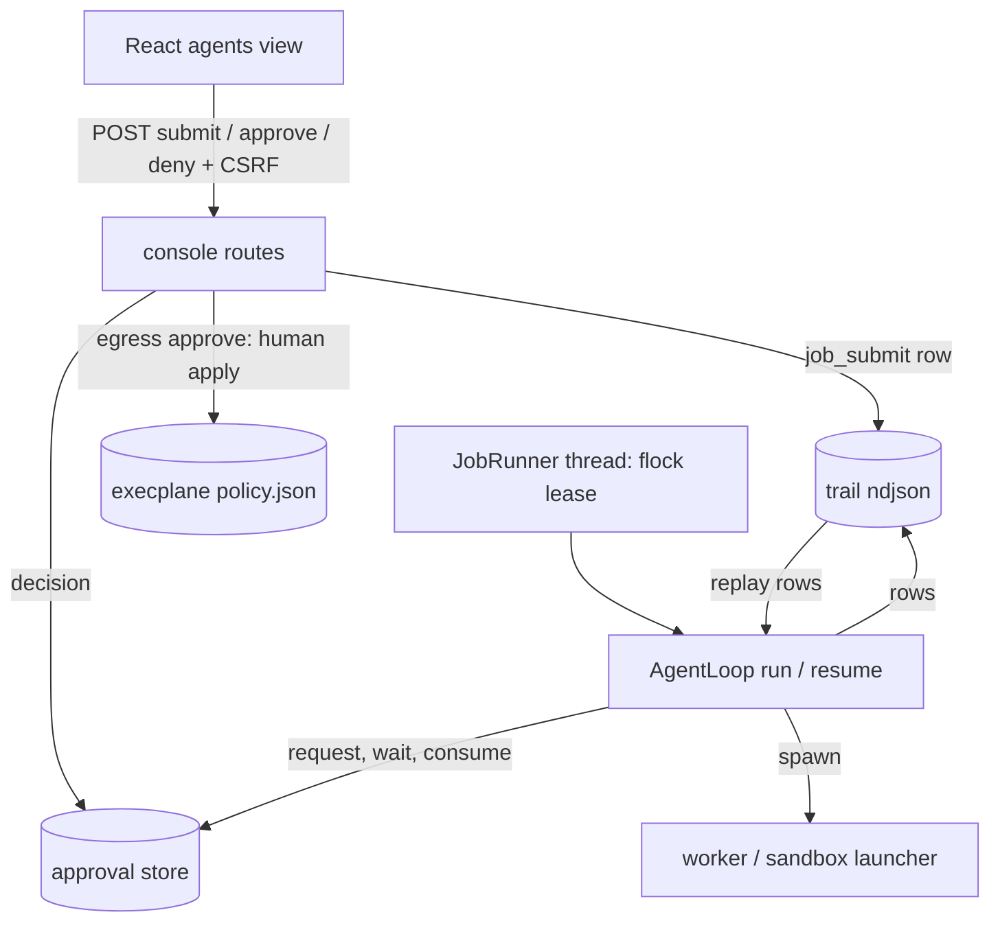

# Orchestrator Slice 3 - Job Resume and Console Approvals - Plan

**Target repo:** open-computer (`duketopceo/open-computer`), branch `feat/orchestrator-resume-console` from main 7e9852d.

## Goal Capsule

- **Objective:** the owner can submit a long-horizon job from the web console, approve its plan and each risky action there, watch its trail, and a job that was interrupted by a crash or restart continues where it left off without repeating finished work or being charged twice.
- **Means:** the trail is the job's state, replayed on restart (KTD1); approvals live in a console-backed store the job thread waits on (KTD3); the console decides them through passkey-gated, CSRF-checked POST routes bound to the exact payload (KTD4).
- **Authority:** parent plan decisions D1-D9 and the slice-2 plan are settled. This slice adds no product decision beyond the Key Decisions below.
- **Execution profile:** code. Fakes only: no live model call, no VM launch, no network egress. No credential file or production data is read.
- **Stop conditions:** a settled decision invalidated; any test that needs the network, a credential, or real money.
- **Finishes the work:** `ce-work` implements; Luke merges.

---

## Product Contract

### Summary

Slice 1 built the parent loop and a read-only console API; slice 2 built the sandbox launcher. This slice delivers the parent plan's Roadmap item 3: job lifecycle (resume), POST routes for submit and approve, and a React view of the trail and approval queue. It also folds in the #84 residuals this work touches: owner approval of an egress host creates the execplane S5 grant, and sandbox rounds are charged at least their estimate. It does not wire the production planner or a production sandbox launcher, so a submitted job is queued until a runner is configured.

### Problem Frame

Today a job dies with its process: the loop's state (spent, failures, granted hosts, history) lives in local variables, so a restart loses it, and re-running the goal would repeat finished steps and charge the budget again. Approvals have no console path: `AgentLoop` calls an injected `approve` hook that nothing production-side provides, so every risky action is denied. A host the owner approves still fails closed because no S5 grant exists (slice 2 deferred this to the approve routes). The owner has no way to start a job or see one run except reading the trail API.

### Key Decisions

- KD1. Check-ins are plan approval plus risky actions only (push, deploy, new egress host, spend crossing 80%, policy-ambiguous tool calls). Governs R4, R5. (session-settled: user-directed — chosen over per-step or per-round approval: the owner wants low interruption.)
- KD2. Default budget is $25 per working day per job. Governs R7. (session-settled: user-directed — chosen over a different fixed cap or unlimited: the owner's stated default.)
- KD3. Data policy is read prod, write staging. This slice adds no data tooling and nothing in it may widen that policy; enforcement stays on the parent Roadmap (item 6). A scope constraint: no requirement here states it. (session-settled: user-directed — chosen over prod writes or read-only everywhere: the owner's stated policy.)
- KD4. Spend ceiling is Grok-4.7-class, and the default orchestrator model is `deepseek/deepseek-v4-pro`, guarded by `tests/unit/test_spend_rule.py`. Governs R7. (session-settled: user-directed — chosen over Anthropic or other premium defaults: the owner's cost rule.)
- KD5. Submit and approve are POST routes behind the existing passkey session gate, CSRF-safe, and an approval is bound to the exact payload the owner saw. Governs R4, R5, R7, R10. (session-settled: user-directed — chosen over a new auth mechanism or approve-by-id without a payload binding: the owner's request.)

### Requirements

**Resume**

- R1. A job whose process died (no `job_end`) continues from its trail: finished rounds are not re-run, spend is recomputed from the trail, and the budget is never charged twice for a round.
- R2. A round that was spawned but has no result when the process died is not blindly replayed. It is charged its estimate once, recorded as interrupted, counted as a failed round, and the planner re-plans with that fact in its history.
- R3. At most one process drives a job at a time. A second driver finds the job leased and does nothing; a crashed driver's lease is free by construction.

**Console approvals and submit**

- R4. Plan, risky, egress, spend and tool approvals are decided from the console. A request is stored with the exact payload; a decision must carry the payload hash the owner reviewed, is single-use, and a changed payload is a new request. An approval nobody decides within its TTL (default 24 hours, `OC_AGENT_APPROVAL_TTL_S`; the clock restarts when a resumed approver attaches, so downtime never counts against the owner) is denied.
- R5. Approving an `egress` request creates the execplane S5 grant for that host (a human-applied policy change by the signed-in owner), after re-validating the host shape. A grant failure leaves the request undecided and reports the error.
- R6. After a restart, a pending plan approval is re-attached (the resumed job waits on the same request), never duplicated, and a decision recorded but not yet consumed is honored. Any other unresolved request of the job (risky, spend, egress, tool) belongs to a round the resumed planner will regenerate, so resume voids it (`expired`) and the new round asks afresh; a voided request can never be approved.
- R7. A submitted job defaults to the $25 budget and the `deepseek/deepseek-v4-pro` model; a budget above the configured maximum is refused. Submit needs an explicit confirm step, as `/goals` does.
- R8. With no runner configured, a submitted job is recorded as `queued` and is visibly not running; nothing executes and nothing is spent. When a runner is configured later, a queued job is started from its submitted goal, budget and model.
- R9. Sandbox rounds are charged `max(reported, estimate)` (a harness reporting 0 is not free).
- R10. The console shows a job's trail as a live timeline with its pending approvals as decision cards, and a form to submit a job; every state-changing action goes through the routes above.

### Acceptance Examples

- AE1. Covers R1, R2. Given a job with rounds 1-2 done and round 3 spawned without a result, when the job is resumed, then rounds 1-2 are not re-run, round 3 is charged its estimate once as interrupted, the planner is called for round 4, and `spent` equals rounds 1-2 plus the round 3 estimate.
- AE2. Covers R4, R5. Given a pending `egress` request for `api.example.com`, when the owner approves with the displayed hash, then the host appears in `approved_egress()` and the job proceeds; when the hash is stale, the route returns 409 and nothing changes.
- AE3. Covers R6. Given a pending plan approval and a restart, when the job resumes, then the console shows one pending plan approval, and approving it lets the job continue without asking the planner for a new plan.

### Scope Boundaries

**Deferred to Follow-Up Work**

- Production planner over `services.openrouter` and the `orch` key, real `services/placement`, production `SandboxLauncher` wiring (parent Roadmap item 2). Until then submit queues and the runner is injected in tests.
- Front doors other than the console (webhook, CLI, Wisp voice), finish-in-a-PR tooling, data-engineering guardrails (KD3), per-tool flag allowlist, in-flight spend cap, live acceptance run.
- Hardening carried from #84: patch header scan, content-scan entropy, `Trail.append` O(file) rescan, seed-exec cost, canonical credential list, `since`/`limit` on the job API.
- If the work outgrows one reviewable PR, U5 (React view) and the submit form are cut and recorded first; U1-U4 are the minimum this slice ships.

**Considered and not built**

- Replaying an interrupted round: a replay can spend twice; charging the estimate and re-planning closes the harm. Evidence that would change the call: workers that report cost atomically.
- A heartbeat or lease file with expiry: `flock` is released by the kernel on crash, so staleness cannot occur.
- A separate per-round state table: the trail already carries every field replay needs (KTD1).
- A cancel/abort route and push (SSE/WebSocket) updates: not requested; the view polls like the runs view.

---

## Planning Contract

### Key Technical Decisions

- KTD1. **The trail is the state.** A pure `replay(rows)` rebuilds spent, consecutive failures, warned flag, approved egress hosts, history tail, the approved plan, and the next round from the job's rows. `warned` and granted hosts come only from resolved, approved `approval` rows (never from `budget_warn` or `approval_request` rows, which are written before the owner answers), so a restart while a spend or egress request is pending asks again. The goal, budget and model come from the `job_submit` row when one exists (it holds the full goal; `job_start` clips it to 500 characters) and from `job_start` otherwise. `AgentLoop.run` and a new `AgentLoop.resume` share one drive path seeded by that state. The spawn row gains `est` so an interrupted round can be charged. (KD1, KD2 unaffected.)
- KTD2. **Interrupted round policy.** Append `round_interrupted` (round, charged estimate; `est` missing on an older spawn row falls back to the loop's 1.0 default) once, add a failed history entry, increment failures, continue at round+1. The ledger entry is written only when `by_subtask` lacks `round-N` (the ledger does not dedupe); trail-derived `spent` is what the loop budgets against, and a ledger that already holds the real cost for that round may differ from it by design. A round with a `decision` but no `spawn` spent nothing and is simply re-planned.
- KTD3. **Console approver and store.** `services/agents/approvals.py` holds an append-only NDJSON store (`request`, `decision`, `consume` events) under the goals dir, and a per-job `ConsoleApprover` used as the loop's `approve`. It finds an unconsumed request with the same job, kind and payload hash (re-attach) or creates one, polls for the decision with an injectable interval and clock, marks it consumed after the loop writes the trail row, and denies on TTL expiry. TTL is evaluated lazily by readers and `decide` as well, so an expired card is never shown as actionable. Resume voids a job's other unresolved requests (R6). Tool asks run on their own daemon threads, so the approver is thread-safe. Chosen over reusing `services/gate/queue.py` `ApprovalQueue`, which is bound to cloud-call payloads and the Gate audit.
- KTD4. **Payload binding.** The request hash is `payload_hash({job, kind, detail})` from `services/gate/gate.py` (sort-keyed sha256). The decide route recomputes it from the stored payload and requires the caller's `hash` to match both; deny is bound the same way. (session-settled: user-directed — KD5.)
- KTD5. **Routes.** `POST /api/agent-jobs` (submit; `confirm=1` gate; same path as the existing `GET /api/agent-jobs`, added to the shared-path allowance in `tests/opsview/test_routing.py` as `/goals` is), `POST /api/agent-jobs/<job>/approvals/<id>/approve` and `.../deny`. All are JSON routes for the React SPA; no server-rendered `views.py` page is added (the owner wants the console to stay one product, so unifying the remaining server-rendered pages is a separate follow-up). They live in `POST_ROUTES` so the existing session, same-origin, body-size and CSRF checks apply unchanged; handlers answer JSON. `GET /api/agent-jobs/<job>` is extended with pending approvals (id, kind, detail, hash) and stays side-effect free.
- KTD6. **S5 grant on egress approval.** Under one process lock covering all three steps, first verify the request (exists, pending, unexpired, unconsumed, caller hash equals the stored hash and the recomputed one) without writing; then, after re-validating with `valid_host`, apply `{"add_egress": [host]}` through a fresh `PolicyEngine` on the runtime `policy.json` (`OC_EXECPLANE_DIR`) with `approved_by="human"`, under a process lock (the engine rewrites its in-memory list, so concurrent requests would otherwise drop grants). Verify, then grant, then record the decision; a repeat is a no-op when the host is already approved, and a stale, replayed, denied or expired approve never writes a grant.
- KTD7. **Lease by flock.** `JobRunner` takes a non-blocking `flock` on a per-job lock file for the life of the drive thread (R3). Startup resume scans trails for jobs with no `job_end`, skips leased jobs, and drives the rest when a runner factory is configured. Only jobs whose newest row is younger than `OC_AGENT_RESUME_MAX_AGE_S` (default 24 hours) are auto-resumed, so stale work never restarts and spends unattended. A trail with `job_submit` but no `job_start` is started with `run`; one with `job_start` is continued with `resume`.
- KTD8. **Runner is injected.** `agentjobs.configure_runner(factory)` supplies planner, worker, model and cwd per job. Unconfigured, submit records `job_submit` and the job reads `queued` (R8). The default model constant `DEFAULT_ORCHESTRATOR_MODEL = "deepseek/deepseek-v4-pro"` is asserted non-premium by the spend-rule test.
- KTD9. **Sandbox rounds charge at least the estimate** (R9), computed in the loop where placement is known.
- KTD10. **UI shape.** App gains a `view` state (`runs` | `agents`) and a Sidebar entry; the agents view polls `GET /api/agent-jobs` like the runs view and mutates only through `ui/src/lib/api.ts` functions that fetch a fresh CSRF token per call, as `submitGoal` does. Agent statuses get their own style map (the run `TaskState` styles do not cover them).

### High-Level Technical Design

Resume sequence on startup: scan trails for jobs without `job_end` and recent enough -> try lease -> `replay` -> if a round is in flight, write `round_interrupted` -> void non-plan unresolved requests, re-attach the pending plan approval -> continue at the next round.

---

## Implementation Units

### U1. Trail replay and loop resume

**Goal:** a job continues from its trail with correct spend and no repeated rounds; sandbox rounds charge at least the estimate.

**Requirements:** R1, R2, R9; KTD1, KTD2, KTD9.

**Dependencies:** none.

**Files:** `services/agents/replay.py` (new), `services/agents/loop.py`, `tests/unit/test_agent_resume.py` (new), `tests/unit/test_agents.py`.

**Approach:**
- `replay(rows)` returns a state object: goal, budget, model, plan steps and approved flag, spent, failures, warned, granted hosts, history tail (last 8), last finished round, in-flight round, terminal outcome if `job_end` exists.
- Refactor `run` into start + shared drive; `resume(job)` replays, returns the recorded outcome if the job already ended, handles the in-flight round per KTD2, then drives from the next round.
- Add `est` to the `spawn` row; guard the ledger write with `by_subtask`; sandbox rounds use `max(money(res.cost, est), est)`.
- Reuse the plan from the trail when a `plan` row exists but approval is unresolved.
- Take goal, budget and model from `job_submit` when present, else `job_start`; derive `warned` and granted hosts from approved `approval` rows only (KTD1).

**Execution note:** write the replay-equivalence test first: a resumed job's rows and spend must equal an uninterrupted run's.

**Patterns to follow:** `StubWorker`, `_planner`, `_spawn`, `_loop` in `tests/unit/test_agents.py`; `Env` and `_scripted` in `tests/unit/test_sandbox_launcher.py`.

**Test scenarios:**
- Covers AE1. Crash after round 3 `spawn` (truncate the trail): resume does not call the worker for rounds 1-2, appends one `round_interrupted` charged the estimate, calls the planner for round 4, and final `spent` matches the expected sum.
- Resume of a finished job returns the recorded outcome and appends nothing.
- Resume twice in a row after an interrupted round appends `round_interrupted` once and charges the ledger once.
- Crash after `decision`, before `spawn`: the round is re-planned and nothing is charged.
- Crash before plan approval with a `plan` row: the planner is not asked for a new plan.
- `warned` and granted hosts are restored from approved `approval` rows: no second 80% ask after an approved one, no second egress ask for an approved host.
- Crash after `budget_warn` while the spend request is pending: resume asks again and does not spawn until the owner decides; the same for a pending egress request.
- A goal longer than 500 characters submitted via `job_submit` reaches the resumed planner in full.
- An older spawn row without `est` charges the 1.0 default when interrupted.
- Consecutive-failure count survives resume (stall triggers at the right round).
- Budget: a resumed job whose recomputed spend plus the next estimate passes the budget ends `budget_exhausted`.
- Sandbox round reporting cost 0 is charged the estimate; a local round reporting 0 is charged 0 only when reported (existing semantics kept); reported above the estimate is charged as reported.
- Torn last trail line does not break replay.

**Verification:** replay-equivalence holds; the full agent test files stay green.

### U2. Approval store, console approver, job lease

**Goal:** approvals persist across restarts and a job thread can wait on the console.

**Requirements:** R3, R4, R6; KTD3, KTD4, KTD7.

**Dependencies:** none (U1 consumes the approver through the existing `approve` hook).

**Files:** `services/agents/approvals.py` (new), `tests/unit/test_agent_approvals.py` (new).

**Approach:**
- Store: append-only NDJSON with flock; `request`, `decision` (approved, denied, expired, by, note), `consume`; derived status; ids `ag_` plus 8 hex; reads never create the file.
- `ConsoleApprover(store, job, poll_s, ttl_s, clock, sleep)` is callable as `(kind, detail) -> bool`.
- `decide(id, approve, by, hash, note)` raises a typed error for unknown id, already decided, stale hash (409), tampered store hash; single-use.
- `lease(path)` context manager: non-blocking flock, returns False when held.

**Test scenarios:**
- Covers R4. Approve with the right hash returns True to the waiting approver; deny returns False; a stale hash raises and leaves the request pending.
- A second decision on a decided request is refused.
- TTL expiry (injected clock) denies and records `expired`.
- Covers R6. A new approver for the same job, kind and detail attaches to the existing pending request (one request row); a decision recorded before the approver starts is returned and consumed once.
- A different detail (changed payload) creates a new request and the old one is not approvable for the new payload.
- Concurrent asks from several threads each get their own request and decision.
- Resume-void: unresolved risky, spend, egress and tool requests of a job are marked `expired` and cannot be approved; the pending plan request is kept.
- TTL clock restarts when an approver re-attaches (injected clock): a request created long ago is not expired on re-attach.
- An expired request is rejected by `decide` even if the approver thread has not yet noticed.
- Lease: a second `lease` on the same job fails while the first is held and succeeds after release.
- Reading a missing store file creates nothing.

**Verification:** no test sleeps longer than a few tens of milliseconds (injected poll interval).

### U3. Job runner, submit, startup resume

**Goal:** the console process can start, track and resume jobs with an injected runner.

**Requirements:** R3, R6, R7, R8; KTD7, KTD8.

**Dependencies:** U1, U2.

**Files:** `services/agents/runner.py` (new), `services/agents/loop.py` (model constant), `services/opsview/agentjobs.py`, `tests/unit/test_agent_runner.py` (new), `tests/unit/test_spend_rule.py`.

**Approach:**
- `JobRunner.submit(goal, budget, by)` writes `job_submit` and, when a factory is configured, starts a daemon thread that takes the lease and calls `run` (fresh job) or `resume`. `resume_all()` scans for unfinished jobs.
- `list_jobs` treats `job_submit` as the start row (status `queued` until `job_start`); `awaiting_approval` is computed from the approval store, not row counts.
- Budget: default 25.0, maximum from `OC_AGENT_MAX_BUDGET` (default 25.0), bad values refused.
- `resume_all` skips jobs older than `OC_AGENT_RESUME_MAX_AGE_S`; a queued job (submit row, no start row) is started with the submitted goal, budget and model once a factory exists.

**Test scenarios:**
- Covers R8. Submit with no factory records one `job_submit`, reads `queued`, calls no planner.
- Submit with a fake factory runs the job to `finished` on its thread, with approvals auto-decided by the test through the store.
- `resume_all` drives an unfinished job and skips a leased one; a finished job is untouched.
- A stale unfinished job (older than the age bound) is not resumed and spends nothing.
- Budget above the maximum is refused; missing budget uses 25.0.
- Covers R7. `DEFAULT_ORCHESTRATOR_MODEL` does not match the premium regex in `tests/unit/test_spend_rule.py`.

**Verification:** threads are joined in tests; no test depends on wall-clock ordering beyond bounded waits.

### U4. Console routes and the egress grant

**Goal:** the owner submits and decides from the console; approving an egress host grants it.

**Requirements:** R4, R5, R7; KTD4, KTD5, KTD6.

**Dependencies:** U2, U3.

**Files:** `services/opsview/server.py`, `services/opsview/agentjobs.py`, `services/opsview/agentgrants.py` (new), `tests/opsview/test_agent_routes.py` (new), `tests/opsview/test_routing.py` (extend `concrete()` for the new id patterns), `ui/vite.config.ts` (the existing `/api` proxy already covers the routes).

**Approach:**
- Register `p_agent_submit`, `p_agent_approve`, `p_agent_deny` in `POST_ROUTES`; id patterns follow `[0-9a-f]{10}` and `ag_[0-9a-f]{8}`.
- Submit: goal 1-4000 chars, `confirm=1` else `{needs_confirm, budget, model}`; returns `{job}`.
- Approve/deny: body `hash` required; JSON errors map the store's typed errors to 404/409/422. The identity recorded as `by` is the session identity.
- Egress approve: under one lock, verify the request is pending, unexpired and hash-matched (no writes), then `agentgrants.grant_host(job, detail)` re-validates the host, applies the human policy change and skips an already-granted host, then the decision is recorded; failure returns 500 and the request stays pending.
- Extend `GET /api/agent-jobs/<job>` with pending approvals (id, kind, detail, hash); no mutation on GET.

**Test scenarios:**
- Covers R4. Unauthenticated, no-CSRF and cross-origin POSTs are refused on each new route (the existing CSRF matrix picks them up).
- Submit without confirm returns `needs_confirm` and records nothing; with confirm returns a job id and a `queued` list entry.
- Covers AE2. Approve with the correct hash returns 200 and the waiting approver gets True; a stale hash returns 409 and the request stays pending; a replayed approve returns 409.
- Deny requires the displayed hash; the waiting approver gets False and the job ends `stalled` or `rejected` as the loop defines.
- A stale-hash, replayed, denied or expired egress approve leaves `policy.json` unchanged, and two concurrent approves of one request write one grant.
- Egress approve writes the host to `policy.json` (with `OC_EXECPLANE_DIR` set to a tmp dir); an invalid host (IP literal, wildcard) is refused with no grant and no decision; a grant failure (unwritable path) leaves the request pending.
- Two concurrent egress approvals for different hosts both end up granted.
- GET detail shows the pending approval and the existing get-side-effect tripwires stay green.
- Oversized body returns 413 on the new routes.

**Verification:** `tests/opsview` route invariants (disjoint tables, CSRF matrix, GET side effects) pass.

### U5. React trail view and approval cards

**Goal:** the owner sees a running job's trail and decides approvals in the console.

**Requirements:** R10; KTD10.

**Dependencies:** U4.

**Files:** `ui/src/App.tsx`, `ui/src/components/Sidebar.tsx`, `ui/src/components/AgentJobs.tsx` (new), `ui/src/components/primitives.tsx` (status style), `ui/src/lib/api.ts`, `tests/e2e/spa.e2e.mjs`.

**Approach:**
- `api.ts`: `listAgentJobs`, `getAgentJob`, `submitAgentJob(goal, budget, confirm)`, `decideApproval(job, id, verb, hash, note)`, all mutations through a fresh `csrf()`.
- `AgentJobs`: job list with status and spend against budget, a trail timeline (rounds, decisions, results, redacted text only as served), pending approval cards showing kind and the exact detail with Approve and Deny, a submit form with a confirm step and the $25 default shown. Egress, push and deploy cards need a second press: Approve swaps in place to a "Confirm approve <kind>" button that takes focus and reverts on blur or Esc (no modal); Deny, and the plan, spend and tool kinds, are single press (a misclick on an irreversible grant is not covered by the payload hash).
- States: empty job list and empty trail copy; Approve and Deny disabled while their POST is in flight; an expired approval renders as "expired, denied" and is not actionable; 422 and 413 submit errors show inline on the form; a list or trail fetch failure shows an inline retry message.
- A job row shows an "awaiting approval" badge and the Sidebar agents entry shows a pending count; pending cards render above the timeline.
- Reuse the runs view's polling cadence, auth/offline link handling, and drop responses for a job the user navigated away from.

**Test scenarios:**
- Mocked `**/api/agent-jobs*`: the list renders statuses, `queued` is labeled as not running, a job with a pending approval shows a card with the payload.
- Clicking Approve sends the displayed hash and CSRF header (asserted on the mocked route); a 409 response shows a reload-and-review message and keeps the card.
- Submit form: first POST without confirm shows the confirm step; confirming posts `confirm=1`.
- Keyboard-only: Tab reaches Approve and Deny; Esc never decides.
- axe: 0 violations at 1440 and 390, both themes.
- Session-expired response shows the auth banner, not a generic error.
- Double-clicking Approve sends one request; an expired card is not actionable; the list row and Sidebar show the pending badge.
- Egress card needs the second press: a single click sends nothing, Esc reverts.

**Verification:** `pnpm --dir ui build` succeeds; the SPA e2e passes.

### U6. Roadmap and plan records

**Goal:** docs match what shipped.

**Requirements:** records R1-R10 status and deferrals.

**Dependencies:** U1-U5.

**Files:** `ROADMAP.md`, `docs/plans/2026-10-29-001-feat-agent-orchestrator-plan.md`.

**Approach:**
- Update the OC-040 status row (line 96 region): what slice 3 shipped, the remaining open list (production planner, finish-in-a-PR, per-tool allowlist, in-flight spend cap, live acceptance run, plus anything cut from this slice). `main` has no "Open work" section (it lives in open PR #78), so none is edited; note the one-line follow-up for after #78 merges.
- Mark parent Roadmap item 3 done with a pointer to this plan.

**Test expectation:** none -- documentation only.

**Verification:** the OC-040 row names every deferral recorded under Scope Boundaries.

---

## Verification Contract

| Gate | Command | Applies |
|---|---|---|
| Lint | `uv run --locked ruff check .` | all units |
| Unit and route tests | `uv run --locked pytest -m "not live" -p no:cacheprovider` | U1-U4 |
| Console build | `pnpm --dir ui build` | U5 |
| Console e2e | `cd tests/e2e && npm run test:spa` and the console suite | U5 |
| Browser check | exercise `/` agents view against the fixture server | U5 |

No test makes a live model call, launches a VM, or reaches a real network host.

## Definition of Done

- U1-U4 shipped with their tests; U5 shipped or cut and recorded in ROADMAP.md.
- AE1-AE3 each covered by a passing test.
- Ruff clean; full non-live pytest green; `pnpm build` and the SPA e2e green when U5 ships.
- No abandoned-attempt code left in the diff.
- ROADMAP.md OC-040 matches what shipped and lists every deferral.

## Risks & Dependencies

- Live behavior stays unverified (no production planner or launcher wiring): the console path is proven against fakes only.
- `PolicyEngine` rewrites its in-memory list: a fresh engine per grant plus a process lock is required (KTD6); a second console process would still race, accepted for a single-console deployment.
- A pending approval blocks a job thread (daemon) for up to the TTL; a restart re-attaches (R6).
- Approval and trail files are assumed writable only by the console and the job process; local worker rounds are confined to their cwd by the permission policy, which is the only guard. A forged decision row is not detected (an HMAC on decisions is a later hardening if workers gain wider file access).
- An interrupted sandbox round is charged its estimate; the VM's own lifetime bound (`timeout=life` at create) reaps an orphaned VM.
- Trail growth: `Trail.append` rescans the file; resume reads whole file once per job. Accepted; deferred with the #84 hardening list.

## Sources & Research

- `services/agents/loop.py` (`_ask`, `run`), `services/agents/trail.py`, `services/agents/worker.py` (`money`, `valid_host`, tool-ask threads).
- `services/cost/ledger.py`: `record` does not dedupe; `by_subtask`/`total` give per-job spend.
- `services/opsview/server.py` POST dispatch order (session, route, origin, body size, CSRF); `tests/opsview/test_routing.py`, `test_csrf.py`, `test_get_side_effects.py` constraints.
- `services/execplane/policy.py` (`PolicyEngine.apply`, `approved_egress`), runtime path from `OC_EXECPLANE_DIR`.
- `services/gate/gate.py` `payload_hash`; `services/opsview/goalruns.py` daemon-thread and startup-resume pattern.
- PR #84 body: egress-grant residual, budget-accounting residual, deferred list.
