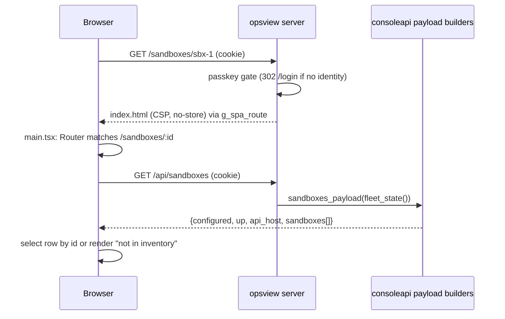

# Unify the console into the React app - Plan

**Scope of this document:** the full port plan (all page groups, ordered) plus an implementation-ready breakdown of PR 1 only. Later PRs are listed with their gates but are not planned to unit depth until they are next.

**Status (2026-10-31):** PR 1 shipped as #85. The later port order here was superseded by `docs/plans/2026-10-30-003-feat-react-full-move-plan.md`, which shipped Approvals (#92) and Runs, Goals, Overview, Skills and Automations (#93, #94). Remaining work and its order live in that plan and in ROADMAP.md (OC-053).

---

## Goal Capsule

- **Objective:** An operator opening oc.example.com sees one product: one look, one nav, every console page reachable and deep-linkable inside it.
- **Means:** Move every page into the React SPA in `ui/`; the Python server keeps serving JSON under `/api/` plus the SPA shell (KTD1, KTD2).
- **Authority:** the owner decision of 2026-10-30 (unify; retire old pages in the PR that ships their replacement). Safety properties in R7 outrank convenience.
- **Stop conditions:** stop and report if a ported page cannot keep a GET side-effect free, if a POST cannot stay CSRF-protected, or if the concurrent `feat/orchestrator-resume-console` work forces edits to `/work`, `/goals*`, `/runs*`, `/approvals` or `/api/agent-jobs*` in PR 1.
- **Execution profile:** code; PR 1 ships through `ce-work` then review, no deploy to oc.example.com.
- **Ships:** Luke merges; nothing here merges or deploys.

---

## Product Contract

### Summary

The console today is two products: a React SPA at `/` (composer plus run view, data from `/api/*`) and about a dozen server-rendered "Silver Lining" pages built in `services/opsview/views.py`. This plan moves every page into the SPA over a series of small PRs. PR 1 lands the shared SPA foundation (client router, shell and nav, API conventions, auth and CSRF handling, accessibility e2e parity) and ports four read-mostly pages: Devices, Sandboxes (with detail), Router, and Audit.

### Problem Frame

The deployed site shows two different-looking products with two navs, two design systems (`ui/` Tailwind versus `services/opsview/static/*.css`), and two test stacks. Every console change currently has to pick a side, and the older side has the keyboard layer, command palette and shortcuts the SPA lacks. A slice-3 agent is concurrently changing `/work`, `/goals*`, `/runs*`, `/approvals` and agent jobs, so those pages cannot move yet.

### Requirements

Unification
- R1. Every console page eventually renders in the React app with one look and one navigation list. Pages not yet ported appear in that nav as plain links to their server-rendered page, so no page is unreachable mid-migration.
- R2. Deep links load the SPA: a browser GET of `/devices`, `/sandboxes`, `/sandboxes/<id>`, `/router` or `/audit` returns the SPA shell, and the client router renders the right page from the URL, including the `f` and `q` query parameters on `/audit`.
- R3. The server exposes the data for each ported page as JSON under `/api/`, read-only for GET.

Retirement
- R4. In the same PR that ships a React page, its server-rendered code is deleted: the `views.py` functions, their route handlers, the tests that asserted the HTML, and any route-table entry that became dead. The route either serves the SPA shell or redirects to a path that does.
- R5. Without a UI build, a ported route answers 503 with a plain-text hint to run `pnpm --dir ui build`; it never silently falls back to a different page. `/` keeps its existing fallback to the server-rendered overview until the final retirement PR.

Parity and safety
- R6. Accessibility and keyboard parity: every ported page passes axe (WCAG 2.2 AA plus best-practice) at 1440 and 390 px, has a skip link, landmarks, a labelled nav with `aria-current`, and no horizontal scroll at 390 px. Command palette, `g`-shortcuts and theme toggle parity is scheduled (PR 8), not silently dropped.
- R7. Every existing safety property survives: GET routes stay side-effect free; every POST stays CSRF-protected and same-origin checked; the passkey gate covers every route including SPA routes; server data renders through React's default escaping and never through `dangerouslySetInnerHTML`; the paid-router confirm step before anything leaves the box stays.
- R8. The existing tests that enumerate `GET_ROUTES` and `POST_ROUTES` keep passing (updated where a page retired), and the existing console e2e stays green, extended with the ported pages.

PR 1 specifics
- R9. PR 1 does not touch `/work`, `/goals*`, `/runs*`, `/approvals`, `/api/agent-jobs*` or agent-job UI. Its edits to shared files (`services/opsview/server.py` route table and handlers, `ui/src/main.tsx`, `ui/src/components/Sidebar.tsx`, `ui/src/lib/api.ts`, `tests/e2e/spa.e2e.mjs`, `tests/opsview/test_routing.py`) are small and localised, and `ui/src/App.tsx` is not edited, so the slice-3 merge stays easy. Known conflict points: the Sidebar `OPERATOR` array replaced by `NavList`, and the `server.py` rows and handlers deleted. When slice 3 merges, its Agents entry must be carried into `nav.ts`, whose entries may be a view switch rather than an href.
- R10. `ROADMAP.md` row OC-053 describes the unification plan and what PR 1 shipped.

### Key Decisions

- Unify into the React app; keep no second UI. (session-settled: user-directed — chosen over keeping both UIs long term: the deployed site shows two different-looking products.) Governs R1.
- Retire each server-rendered page in the PR that ships its React page. (session-settled: user-directed — chosen over a later cleanup sweep behind a flag: two parallel implementations drift.) Governs R4, R5.
- Shared router, shell, API conventions, auth/CSRF and e2e parity land in PR 1. (session-settled: user-directed — chosen over introducing them incrementally per page PR: every later PR depends on them.) Governs R2, R6.
- Preserve every safety property. (session-settled: user-directed — chosen over relaxing them for speed: the safety posture is the product.) Governs R7, R8.
- Leave `/work`, `/goals*`, `/runs*`, `/approvals` and agent jobs out of PR 1. (session-settled: user-directed — chosen over porting them now: a concurrent agent is changing them.) Governs R9.

### Success Criteria

- Loading `/devices`, `/sandboxes`, `/router` or `/audit` on the fixture server shows the SPA chrome (same nav and look as `/`), with the same data the old page showed.
- `views.py` no longer contains Devices, Sandboxes, Router or Audit page code, and no test asserts their old HTML.
- A reviewer can read the "Port sequence" table below and know what each later PR contains, what it waits on, and what it deletes.

### Scope Boundaries

Non-goals (considered and not built)
- Client-side `g`-shortcuts, command palette and theme toggle in the SPA: scheduled in PR 8 with the retirement of the old shell's `console.js`; building them in PR 1 widens the diff touching `App.tsx` for no page-port value.
- Live polling on the ported pages: the old pages loaded once (sandboxes via fragment); PR 1 fetches on mount plus a Refresh button. Evidence that would change this: operators asking for live fleet state.
- A pending-approvals badge in the React nav: needs an approvals count endpoint that belongs with the Approvals port (PR 4).
- A new routing dependency (react-router): see KTD3.

### Deferred to Follow-Up Work

- Port sequence PR 2 through PR 8 below.
- Removing `registry.py`'s `PAGES`/`ACTIONS` nav entries and the `static/` console assets: only when the last server-rendered page retires (PR 8).

### Dependencies / Assumptions

- Assumption: the fixture seed (`tests/opsview/seed.py`) already provides a fake control plane with sandbox `sbx-7f3a91c2` (template `code-interpreter`) and device registry rows, as `test_routing.py` and `test_devices_route.py` rely on. Verified by those tests existing.
- Assumption: Chromium plus `axe-core` from `tests/e2e/package.json` remain the e2e stack; CI already builds `ui/` before e2e.

---

## Planning Contract

### Key Technical Decisions

- KTD1. **Server serves the SPA for an explicit list of route patterns, not a catch-all.** Each ported path is a normal `GET_ROUTES` row mapped to a new handler `g_spa_route(self, qs, **_)` (it must accept the `id` keyword the sandbox-detail row passes), one row per page, added in the page's PR. Unknown paths keep their 404, `route_label` keeps working, and the existing route-enumerating tests (including `get_paths()` in `test_get_side_effects.py`) exercise the new rows automatically. A catch-all is revisited only in PR 8. (Rejected: catch-all index.html fallback — it would hide 404s and make `GET /api/nope` ambiguous.) Governs R2, R5, R8.
- KTD2. **JSON under `/api/` is the only data contract for ported pages.** GET returns an object (never a bare array), errors are `{"error": "<message>"}` with a 4xx/5xx status, POSTs take JSON plus `X-CSRF-Token` and answer JSON. The payload builders live in a new pure module `services/opsview/consoleapi.py` so handlers stay thin and the payloads are unit-testable without HTTP. Governs R3, R7.
- KTD3. **A ~60-line hand-written history router, no new dependency.** `ui/src/lib/router.tsx` provides `RouterProvider`, `useRoute()`, `<Link>`, `navigate()`, with `popstate` handling and a plain pattern table (`/sandboxes/:id`). `<Link>` renders a real `<a href>` and only intercepts unmodified left clicks. Rationale: five-plus routes, no nested layouts, and `pnpm-lock.yaml` stays untouched so the slice-3 merge has no lockfile conflict. (Rejected: react-router-dom — dependency and lockfile churn for a tiny route table.)
- KTD4. **`App.tsx` stays the `/` page.** `main.tsx` mounts `RouterProvider` and a `Routes` component: `/` renders the existing `App` untouched, every other known path renders `<PageShell>` around a page component, unknown paths render a not-found page inside the shell. This keeps the `App.tsx` diff to zero lines and avoids colliding with slice 3, which adds a `view` state to `App.tsx`. Governs R9.
- KTD5. **One nav list, `ui/src/lib/nav.ts`.** Each entry has `label`, `href`, and `spa: boolean`. The nav component renders `<Link>` for `spa: true` and a plain `<a href>` for the rest (full page load to the server-rendered console), which is how R1's "no page unreachable" holds. `Sidebar.tsx` replaces its hard-coded `OPERATOR` array with this list (a few-line edit); `PageShell` uses the same `NavList` component. Later PRs flip one `spa` flag each. Governs R1, R9.
- KTD6. **Sandbox detail uses the list payload.** `/sandboxes/<id>` fetches `GET /api/sandboxes` and selects the row client-side, so no per-id endpoint, no second control-plane round trip, and "not in current inventory" renders from the same data. The inventory is fetched on page mount, never on the shell load. (Rejected: `/api/sandboxes/<id>` — an extra route and control-plane call for a key/value table.)
- KTD7. **The router tester moves to `POST /api/router/test` and answers JSON only.** Same ordering as today: authenticate, same-origin, body cap, CSRF, then handler. A paid router without `confirm: "1"` returns `{needs_confirm: true, dest_host, cost}` and sends nothing; with confirm (or the free table engine) it routes and returns `{result: {route, tier, engine, confidence, cost, ms}}`; a failure returns 502 `{error: "Routing failed: <detail>. Nothing was sent."}`. The old `POST /router/test` HTML form route is deleted (it would now 404 via the existing "no route" branch). Governs R7.
- KTD8. **Audit filter state lives in the URL.** `/audit?f=<all|blocked|allowed|decisions>&q=<text>` drives both the SPA page and `GET /api/audit?f=&q=`, with the same validation the old handler had (unknown `f` becomes `all`, `q` capped at 200 chars). The registry's page-scoped `audit.*` and `router.focus` palette actions only appear on those pages, so they become unreachable until PR 8; they stay in `registry.py` until then.
- KTD9. **No-build behaviour:** `g_spa_route` answers `503 text/plain` (body says to run `pnpm --dir ui build`) when `ui/dist/index.html` is absent; only `g_spa` (`/`) keeps the overview fallback. Governs R5.

### High-Level Technical Design

Request path for a deep link and for the data behind it:

Navigation model: server pages and the SPA each render the same nav list (from `registry.py` and `nav.ts`); a click from the SPA to an unported page is a full navigation, and a click from a server page to a ported page loads the SPA shell. No state is shared between the two worlds beyond the session cookie.

### Port sequence (page groups, in order)

| PR | Pages | Waits on | Deletes from `views.py` / server | Notes |
|---|---|---|---|---|
| 1 (this plan, U1-U7) | shared router + shell + nav + API conventions + e2e parity; Devices, Sandboxes (+ detail), Router (ledger + tester), Audit | nothing | `page_devices`, `page_sandboxes`, `page_sandbox_detail`, `fleet_rows`, `conn_pill`, `page_router`, `router_confirm`, `route_result`, `router_dest`, `page_audit`, `audit_match`, `AUDIT_FILTERS`; `g_frag_fleet` + `/_frag/fleet`; `POST /router/test` | `/_frag/status`, `audit_rows`, `audit_state` stay (Overview still uses them until PR 2) |
| 2 | Skills, Overview | PR 1 | `page_skills`, `page_overview`, `status_cell`, `/_frag/status`, `audit_rows`, `audit_state` | Read-only. Overview reads the approval queue but does not mutate it. |
| 3 | Automations (list plus create, pause, trigger, delete with confirm) | PR 1 | `page_automations`, `page_automation_confirm`, `_auto_row` | First mutating page: exercises the CSRF client pattern from PR 1. |
| 4 | Approvals (+ pending badge in nav) | PR 1 and slice-3 merge | `page_approvals`, `approval_row`, `risk_of` | Touches approve and send-back POSTs; sequence strictly after `feat/orchestrator-resume-console`. |
| 5 | Runs: `/runs`, `/runs/new`, `/runs/<id>` incl. windowed log viewer | PR 4 | `page_runs`, `page_run_confirm`, `page_run_detail`, `log_viewer` | Boots microVMs on confirm; POST `/runs` redirect becomes JSON. |
| 6 | Goals (`/goals`, `/goals/new`, `/goals/<id>`) and Work (`/work`) | slice-3 merge, PR 5 | `page_goals*`, `page_work`, `work_*`, `/_frag/work` | Work merges with the `/` composer and run view; overlaps agent-job UI, so last of the agent pages. |
| 7 | Workspace (`/workspace`) | PR 6 | `services/workspace` server-rendered viewers | Largest page; has its own e2e (`workspace*.e2e.mjs`) and artifact viewers with a network-free gate. |
| 8 | Shell finish and final retirement: command palette, `g`-shortcuts, `?` overlay, theme toggle, SPA catch-all, remove `views.shell`, `registry.PAGES` nav, `static/` console assets, `REDIRECTS` review, `/` no-build fallback | PRs 2-7 | `views.py` shell, `console.js`, `console.css`, `silver-lining.css` | Done when `views.py` holds no page code. |

Merge hazard: PRs 4-6 edit the same files slice 3 edits (`server.py` handlers, `App.tsx`, `Sidebar.tsx`, `api.ts`, `spa.e2e.mjs`). Start them only after that branch merges; PR 1 deliberately limits itself to a route-table addition, a Sidebar nav-array swap and additive `api.ts` exports.

### Retirement rule (applies to every PR)

When a page's React version lands:
1. Its `GET_ROUTES` row is repointed at `g_spa_route` (or the path redirects to one that is); the old handler and the `views.py` functions it used are deleted in the same PR, along with `_frag` routes and helpers that lose their last caller.
2. Tests that asserted the old HTML are deleted or rewritten against the JSON payload or the SPA e2e; tests enumerating route tables are updated, never weakened.
3. `console.e2e.mjs` loses the page from its server-rendered route list; the page gains axe and flow coverage in `spa.e2e.mjs`.
4. The page's `spa` flag flips to `true` in `ui/src/lib/nav.ts`.
5. A helper is deleted only when `rg` shows no remaining caller; shared helpers still used by unported pages stay (for example `time_tag`, `money`, `status`, `empty`, `audit_rows`, `audit_state`).

### Assumptions and risks

- Risk: `console.e2e.mjs` shortcut and palette tests navigate by key into pages that are now SPA pages with no `g` handlers, so a chained `g x`, `g u`, `g e` sequence stalls after the first SPA landing. Mitigation in U7: assert each landing from a freshly loaded server page.
- Risk: pytest "page renders 200 with CSP" checks need a built `ui/dist`. Mitigation in U3: the `console` fixture points `server.UI_DIST` at a tmp stub dist; the existing no-dist test overrides it explicitly.
- Risk: a deploy without a `ui/dist` build now returns 503 for the ported pages (and the no-build fallback overview links to them). R5 accepts this; the deploy pipeline's UI build becomes an explicit dependency, and the 503 body names the fix.
- Risk: `route_label` returns the handler name, so all SPA rows would log as `g_spa_route`. U3 makes `route_label` report `spa/<first path segment>` for those rows (low cardinality, no ids).
- Risk: `GET /api/sandboxes` performs a control-plane HTTP call. It is a read, not a side effect, and the page fetches it only on mount or Refresh.

---

## Implementation Units

Sequencing: U1, U2 and U3 are mutually independent and can land first; U4, U5 and U6 each depend on U1, U2 and U3; U7 depends on all.

### U1. Client router, nav list and page shell

- **Goal:** The SPA has client-side routing, one nav list, and a shell for non-home pages, with `/` rendering today's `App` unchanged.
- **Requirements:** R1, R2, R6, R9. KTD3, KTD4, KTD5.
- **Dependencies:** none.
- **Files:**
  - create `ui/src/lib/router.tsx`, `ui/src/lib/nav.ts`, `ui/src/components/PageShell.tsx`, `ui/src/components/NavList.tsx`, `ui/src/pages/NotFound.tsx`
  - modify `ui/src/main.tsx`, `ui/src/components/Sidebar.tsx` (replace the `OPERATOR` array with `NavList`)
  - test: `tests/e2e/spa.e2e.mjs`
- **Approach:**
  - `nav.ts` lists, in order (Sandboxes, Devices, Router and Audit start with `spa: false`; U4-U6 flip their own flag): Computer (`/`, spa), Work, Overview, Goals, Automations, Skills, Sandboxes, Devices, Runs, Approvals, Router, Audit, Workspace; labels and hrefs match `registry.ACTIONS` so the two navs agree.
  - `router.tsx` exports a pure `matchRoute(path, table)` (testable) plus the provider, `Link`, `navigate`; `Link` ignores modified clicks and `target`, and `navigate` calls `history.pushState` then updates state; `popstate` re-reads `location`.
  - `PageShell` renders: skip link to `#main`, brand, `NavList` (`aria-label="Console"`, `aria-current="page"` on the active entry), identity text, and `<main id="main" tabindex="-1">` with an `h1`; below 768 px the nav collapses to a top bar with a menu button using `aria-expanded` and `aria-controls`.
  - On navigation, move focus to `#main` and set `document.title` to `<Page> · open-computer`.
  - `main.tsx` route table: `/` renders `App`; page routes registered by U4-U6; anything else renders `NotFound` in the shell.
- **Patterns to follow:** token classes in `ui/tailwind.config.ts`, `Card`/`Button`/`Chip` in `ui/src/components/primitives.tsx`, the `Sidebar.tsx` look.
- **Test scenarios:**
  - `matchRoute("/sandboxes/sbx-1", table)` returns the detail route with `{id: "sbx-1"}`; `/sandboxes/` and `/sandboxes` match the list route; `/nope` matches nothing; an encoded id (`a%2Fb`) is decoded once.
  - Covers R6. Axe returns 0 violations on the shell at 1440 and 390 px on the not-found page.
  - Clicking the Computer (`/`) nav link from the not-found page changes the URL without a document reload (a window marker survives); a ctrl-click does not intercept; a non-SPA link (`Runs`) performs a full navigation to `/runs`.
  - Browser back and forward restore the previous page.
  - Unknown path `/nope` returns 404 from the server (unchanged), and an in-app unknown route shows the not-found page with a link to the console home.
- **Verification:** `pnpm --dir ui build` passes with no type errors; `/` renders exactly as before apart from the nav list; `App.tsx` has no diff.

### U2. API conventions and fetch helpers

- **Goal:** One typed client convention for read data and for CSRF-protected POSTs, reusing the existing `request`/`ApiError` machinery.
- **Requirements:** R3, R7. KTD2.
- **Dependencies:** none.
- **Files:**
  - modify `ui/src/lib/api.ts` (additive exports only: types plus `getSandboxes`, `getDevices`, `getRouter`, `testRoute`, `getAudit`)
  - create `ui/src/lib/useFetch.ts`, `ui/src/components/DataState.tsx` (loading, error-with-retry, empty)
  - test: `tests/e2e/spa.e2e.mjs`
- **Approach:**
  - `useFetch(fn, deps)` returns `{data, error, loading, reload}`, drops responses for superseded calls, maps `ApiError.kind === "auth"` to the existing "session expired" copy, and never retries automatically.
  - POST helper pattern: call the existing `csrf()` then send `X-CSRF-Token` with a JSON body (as `submitGoal` does); document the convention in a header comment of `api.ts`.
  - `DataState` renders `role="status"` for loading, `role="alert"` for errors with a Retry button, so every page gets consistent a11y states.
- **Patterns to follow:** `submitGoal` and `transcribe` in `ui/src/lib/api.ts`.
- **Test scenarios:**
  - Error path: a 500 JSON `{error}` from `/api/audit` shows the message in an alert with a Retry that refetches (intercepted with `page.route`).
  - Auth path: a redirect to the HTML login page surfaces the session-expired state, not a JSON parse error.
  - Stale response: changing the audit filter twice quickly renders the last filter's rows only.
- **Verification:** build passes; the three scenarios are exercised and pass in U6's and U7's SPA e2e once pages exist.

### U3. Server: SPA routes, JSON payloads and the router tester API

- **Goal:** The server serves the SPA for the ported paths and serves read-only JSON for Sandboxes, Router and Audit, plus the JSON router-test POST.
- **Requirements:** R2, R3, R5, R7, R8, R9. KTD1, KTD2, KTD7, KTD8, KTD9.
- **Dependencies:** none (the JSON shapes defined here are what U2's types follow).
- **Files:**
  - create `services/opsview/consoleapi.py`
  - modify `services/opsview/server.py` (route table rows, `g_spa_route`, `g_api_sandboxes`, `g_api_router`, `g_api_audit`, `p_api_router_test`; delete `g_sandboxes`, `g_sandbox`, `g_devices`, `g_router`, `_router_body`, `g_audit`, `g_frag_fleet`, `p_router_test`)
  - modify `services/opsview/views.py` (delete retired functions per the Port sequence table; keep helpers other pages still use, including `audit_rows` and `audit_state`)
  - modify `tests/opsview/conftest.py` (stub `UI_DIST`), `tests/opsview/test_routing.py`, `tests/opsview/test_csrf.py`, `tests/opsview/test_devices_route.py`, `tests/opsview/test_views.py` (drop `test_audit_page_uses_relative_times`), `tests/opsview/test_registry.py` (remove `/sandboxes`, `/router`, `/audit` from the embedded-`oc-actions` path lists), `tests/opsview/test_get_side_effects.py` if needed
  - create `tests/opsview/test_console_api.py`
- **Approach:**
  - Route table, additive: replace the rows for `/sandboxes`, `/sandboxes/(?P<id>[^/]+)`, `/devices`, `/router`, `/audit` with `g_spa_route`; add `/api/sandboxes`, `/api/router`, `/api/audit`; remove `/_frag/fleet`; in `POST_ROUTES` replace `/router/test` with `/api/router/test`. `/api/devices` already exists and is the Devices data source unchanged.
  - `consoleapi.py` exposes `sandboxes_payload(fleet)`, `router_payload(ledger, spend, cap, paid, base)`, `audit_payload(rows, f, q)` and `route_result_payload(d)`; `audit_match`/filter list move here from `views.py`. Audit rows carry `state` (`blocked`, `allowed`, `approved`, `sent back`, `recorded`), the event, and a `detail` string built as `k=v` pairs exactly as the old view did.
  - `g_api_audit` keeps the old validation (unknown `f` becomes `all`, `q` truncated to 200) and the 200-row newest-first cap, reporting `total` and `shown`.
  - `g_api_router` returns the newest 14 ledger rows, `spend`, `cap`, `paid`, `dest_host` (from `views.host_of`) and `per_route_cost`.
  - `p_api_router_test` follows KTD7; its confirm gate and `_route` seam are unchanged so `conftest`'s recorder still intercepts spend.
  - `g_spa_route` serves `UI_DIST/index.html` with the existing page CSP, or 503 text when absent; `route_label` reports `spa/<first path segment>` for it.
  - `conftest.py` creates a tmp dist with a minimal `index.html` and assets and monkeypatches `server.UI_DIST` for the `console` fixture.
- **Execution note:** Start with failing tests for `/api/audit`, `/api/router`, `/api/sandboxes` shapes, then reroute the pages.
- **Patterns to follow:** `g_api_devices`, `g_api_runs`, `_json`, the POST dispatch order in `_do_post`.
- **Test scenarios:**
  - `GET /api/sandboxes` with the fake control plane returns `configured: true, up: true` and a row with `sandboxID: sbx-7f3a91c2`; with `CUBE_API_URL` pointing at a closed port it returns `up: false` and an empty list (the "unknown, not empty" case is distinguishable from "no sandboxes"); with the variable unset it returns `configured: false`.
  - `GET /api/audit` with `f=blocked` returns only blocked events; `f=bogus` behaves as `all`; `q` filters case-insensitively across the row JSON; `q` over 200 chars is truncated; rows are newest first and capped at 200 with `total` counting matches.
  - `GET /api/router` returns at most 14 newest-first ledger rows plus `spend`, `cap`, `paid`, `dest_host`.
  - `POST /api/router/test`: no CSRF returns 403; cross-origin returns 403; empty `q` returns 400; `q` over 500 chars is truncated to 500; a paid router without confirm returns `needs_confirm` and the `_route` recorder is never called; with confirm it returns the route result; a `_route` exception returns 502 with "Nothing was sent."; the free table engine routes without confirm.
  - `POST /router/test` (old path) now returns 404 JSON, not a rendered page.
  - Every ported deep link (`/devices`, `/sandboxes`, `/sandboxes/sbx-7f3a91c2`, `/router`, `/audit?f=blocked&q=gpt`) returns 200 with `Content-Security-Policy` containing `script-src 'self'` and `Cache-Control: no-store`; with `UI_DIST` absent the same paths return 503 plain text, while `/` still returns the overview.
  - Unauthenticated remote GETs to each ported path 302 to `/login`; unauthenticated GET `/api/audit` also redirects, and unauthenticated POST `/api/router/test` returns 401.
  - Access-log labels for the five ported paths are distinct (`spa/devices`, `spa/sandboxes`, `spa/router`, `spa/audit`; the detail path labels as `spa/sandboxes`).
  - Existing `test_every_get_is_side_effect_free` passes with the new rows, including hostile query strings, and `test_route_tables_are_disjoint_and_named` passes.
  - Escaping: an audit row containing `<script>` in a detail value appears in the JSON verbatim (escaping is the client's job) and the JSON `Content-Type` is `application/json`.
- **Verification:** `uv run --locked ruff check .` and `uv run --locked pytest -m "not live" -p no:cacheprovider` pass.

### U4. Devices page

- **Goal:** `/devices` renders in the SPA with the same information the old page showed.
- **Requirements:** R2, R4, R6, R7.
- **Dependencies:** U1, U2, U3.
- **Files:** create `ui/src/pages/Devices.tsx`; modify `ui/src/main.tsx`, `ui/src/lib/nav.ts` (flip flag); test `tests/e2e/spa.e2e.mjs`.
- **Approach:** Fetch `/api/devices` (existing payload: `devices`, `total`, `eligible`, `parked_depth`); one table with device and OS, capabilities, granted roots, a state word (online / asleep / offline as text plus glyph, never colour alone), heartbeat as relative time with an absolute `title`, grants, inbox. Empty state keeps the "No devices paired" copy. Refresh button reloads.
- **Patterns to follow:** `ui/src/components/RunView.tsx` state-word usage, `rel()` in `ui/src/lib/format.ts`.
- **Test scenarios:**
  - Covers R6. Deep link `/devices` shows the seeded device row, `<table>` has a caption and column headers, axe 0 violations at 1440 and 390 px, no horizontal scroll at 390 px.
  - Empty registry shows the empty state (route intercepted to return `{devices: [], total: 0, ...}`).
  - A device id or root containing `` renders as literal text (route intercepted), proving default escaping.
  - Stale heartbeat device renders `offline` as the word.
- **Verification:** build passes; scenarios pass in the SPA e2e.

### U5. Sandboxes list and detail

- **Goal:** `/sandboxes` and `/sandboxes/<id>` render in the SPA with honest control-plane states.
- **Requirements:** R2, R4, R6, R7. KTD6.
- **Dependencies:** U1, U2, U3.
- **Files:** create `ui/src/pages/Sandboxes.tsx`, `ui/src/pages/SandboxDetail.tsx`; modify `ui/src/main.tsx`, `ui/src/lib/nav.ts`; test `tests/e2e/spa.e2e.mjs`.
- **Approach:** List shows the not-configured, down ("unknown, not empty"), empty and populated states with the same copy as the old page; each row links (`<Link>`) to the detail route with the id URL-encoded; the header notes the inventory source host and "Read only". Detail finds the row in the list payload and renders a sorted key/value table (non-strings via `JSON.stringify`), or a "not in current inventory, it may have been reclaimed" state with a back link; the HTTP-level response for a missing id is the SPA shell (200), the 404 is conveyed in-app.
- **Test scenarios:**
  - Deep link `/sandboxes` lists `sbx-7f3a91c2` with template `code-interpreter` and a state; clicking the row navigates client-side to the detail, which shows `templateID`.
  - Deep link `/sandboxes/does-not-exist` shows the not-found state with a working back link.
  - Down state (route intercepted `{configured: true, up: false, ...}`) says the inventory is unknown, not empty; unconfigured state names `CUBE_API_URL`.
  - A sandbox id with `/` or `<` is encoded in the link and rendered as text.
  - Axe 0 violations at 1440 and 390 px for list and detail; layout does not shift when data replaces the loading state (CLS at most 0.02), replacing the old skeleton perf test.
- **Verification:** build passes; SPA e2e passes.

### U6. Router and Audit pages

- **Goal:** `/router` (ledger plus tester) and `/audit` (filterable log) render in the SPA with the existing safety behaviour.
- **Requirements:** R2, R4, R6, R7. KTD7, KTD8.
- **Dependencies:** U1, U2, U3.
- **Files:** create `ui/src/pages/Router.tsx`, `ui/src/pages/Audit.tsx`; modify `ui/src/main.tsx`, `ui/src/lib/nav.ts`; test `tests/e2e/spa.e2e.mjs`.
- **Approach:**
  - Router: tester form (label, input, submit showing the per-route cost), destination note (paid versus local table), spend meter (`<progress>` with label), decision ledger table. A `needs_confirm` response renders a confirm panel (what leaves the box, host, cost, the utterance) with "Route it" and Cancel; only confirm re-posts with `confirm: "1"`. Result table shows route, tier, engine, confidence, cost, took. After a result the ledger refetches. Errors render in an alert; double submit is blocked while busy.
  - Audit: filter chips as links (`aria-current` on the active one) and a search form; state is read from and written to `location.search` with `navigate`; table shows when, result word, event, detail; caption states "Showing the latest N of M matching events".
- **Test scenarios:**
  - Covers R7. Router with the paid stub: submitting shows the confirm panel and no result POST with `confirm` has been sent; Cancel returns to the form; "Route it" sends `confirm: "1"` and shows the result (POSTs intercepted with `page.route`, so nothing spends).
  - Router free table engine: submit routes immediately and the new row appears in the ledger after refetch.
  - A 502 from the tester shows "Nothing was sent." in an alert and keeps the typed utterance; double-clicking Route sends one request.
  - A real POST to `/api/router/test` without the CSRF header from the page context is rejected with 403 (guards against a client regression).
  - Audit deep link `/audit?f=blocked&q=gpt` preselects the Blocked chip and the query text and fetches with those parameters; clicking another chip updates the URL and rows without a document reload; back restores the previous filter.
  - Audit rows with `<b>x</b>` in a detail render as literal text; empty result shows the "No matching events" state.
  - Axe 0 violations at 1440 and 390 px on both pages (including the confirm panel and an open error state); no horizontal scroll at 390 px.
- **Verification:** build passes; SPA e2e passes.

### U7. E2E parity, docs and roadmap

- **Goal:** The e2e suites cover the new world and stay green; the roadmap tells the story.
- **Requirements:** R6, R8, R10.
- **Dependencies:** U1-U6.
- **Files:** modify `tests/e2e/console.e2e.mjs`, `tests/e2e/spa.e2e.mjs`, `tests/e2e/shots.mjs` (default page list), `tests/e2e/README.md`, `ROADMAP.md`.
- **Approach:**
  - `console.e2e.mjs`: remove `/sandboxes`, `/router`, `/audit` from `ROUTES`; keep the palette and `?` overlay tests on server pages; in the `g`-nav test, press `g x`, `g u`, `g e` each from a freshly loaded `/overview` and assert the landing URL only (the SPA has no `g` handlers until PR 8); run the palette, Esc-focus-return and `g o` steps from a freshly loaded `/overview` using global actions only; drop the `blocked` palette assertion (page-scoped audit actions are unreachable until PR 8); change the approvals test's decision-audit check from the HTML `/audit?f=decisions` to `GET /api/audit?f=decisions` and assert on the JSON; delete the sandbox-skeleton perf test (replaced in U5).
  - `spa.e2e.mjs`: shared `axe(page)` helper over the new routes at 1440 and 390 px, the scenarios from U1-U6, and a check that the nav on every ported page matches the nav on `/`.
  - `ROADMAP.md` OC-053: state the unification plan (one React app, ordered PRs, retirement rule), link the plan path, and record PR 1 as shipped: shell, router, nav, API conventions, Devices, Sandboxes, Router, Audit.
- **Test scenarios:**
  - Test expectation: the units' scenarios live in U1-U6; this unit's own check is that `npm test` in `tests/e2e` passes end to end (console, spa, workspace, gates).
  - A single test visits every `spa: true` nav entry, asserts a 200 deep-link load, an `h1`, and that exactly one nav item carries `aria-current="page"`.
- **Verification:** the full e2e suite and the Python suite both pass locally; CI jobs `python` and `console-e2e` pass on the PR.

---

## Verification Contract

Run from the worktree root unless noted.
- Lint: `uv run --locked ruff check .`
- Python: `uv run --locked pytest -m "not live" -p no:cacheprovider` (no microVMs, no models, loopback only).
- UI build: `pnpm --dir ui install --frozen-lockfile` then `pnpm --dir ui build` (runs `tsc --noEmit` then `vite build`).
- E2E (needs `ui/dist`): in `tests/e2e`, `npm ci` then `npm test` (console, spa, workspace and workspace-gates, with `OC_PYTHON="uv run --locked python"` as in CI).
- Safety greps before opening the PR: `rg -n "dangerouslySetInnerHTML" ui/src` returns nothing; `rg -n "views\.(page_devices|page_sandboxes|page_router|page_audit|fleet_rows|route_result)" services tests` returns nothing.

## Definition of Done

- Global: U1-U7 complete; Verification Contract green locally and in CI on the final head; `/work`, `/goals*`, `/runs*`, `/approvals`, `/api/agent-jobs*` and agent-job UI untouched (`git diff --stat` shows none of their handlers or `AgentJobs` files); ROADMAP OC-053 updated; abandoned-attempt code removed from the diff.
- Per unit: its test scenarios exist and pass; retired code is deleted, not commented out.
- Not done: merge, deploy to oc.example.com (Luke's).

## Sources

- `services/opsview/server.py` (route tables, `g_spa`, `_do_post` ordering, `fleet_state`), `services/opsview/views.py` (pages being retired), `services/opsview/registry.py` (nav and palette actions), `ui/src/App.tsx`, `ui/src/components/Sidebar.tsx`, `ui/src/lib/api.ts` (`request`, `csrf`, `ApiError`).
- Tests that constrain the work: `tests/opsview/test_routing.py`, `test_get_side_effects.py`, `test_csrf.py`, `test_front_door.py`, `test_devices_route.py`; `tests/e2e/console.e2e.mjs`, `spa.e2e.mjs`.
- Concurrent work: `docs/plans/2026-10-30-1346-feat-orchestrator-resume-console-plan.md` on `feat/orchestrator-resume-console` (its KTD10 adds a `view` state to `App.tsx` and an Agents entry in `Sidebar.tsx`, which is why KTD4 leaves `App.tsx` alone).
