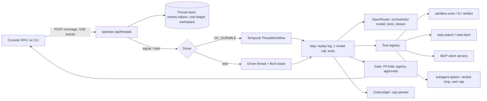
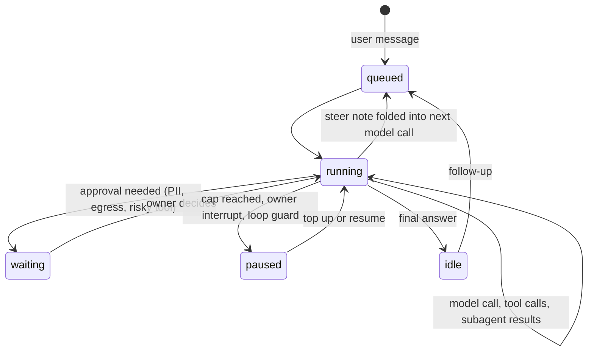
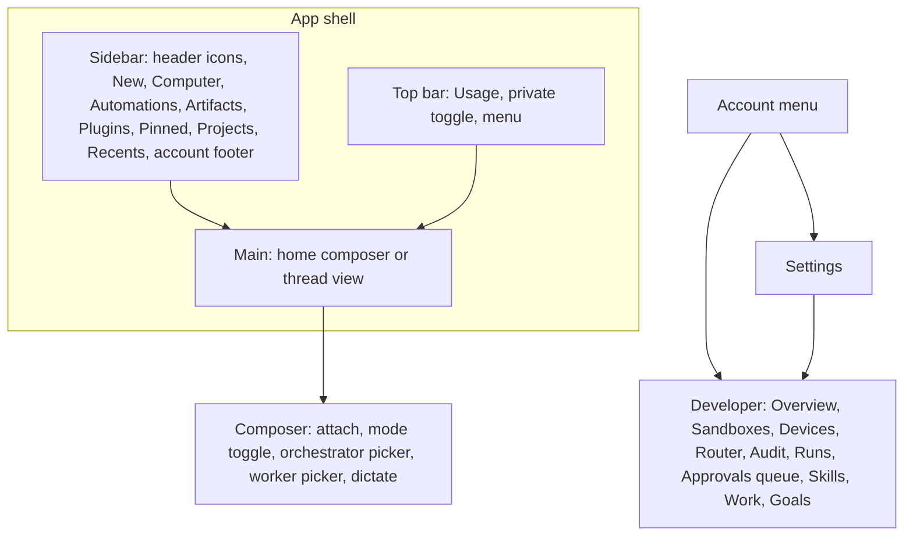
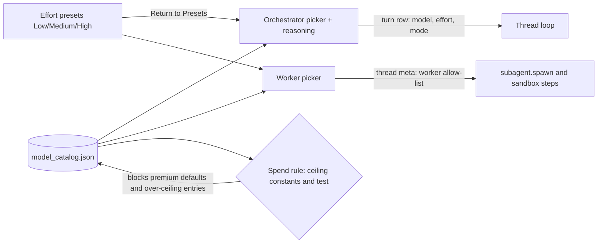
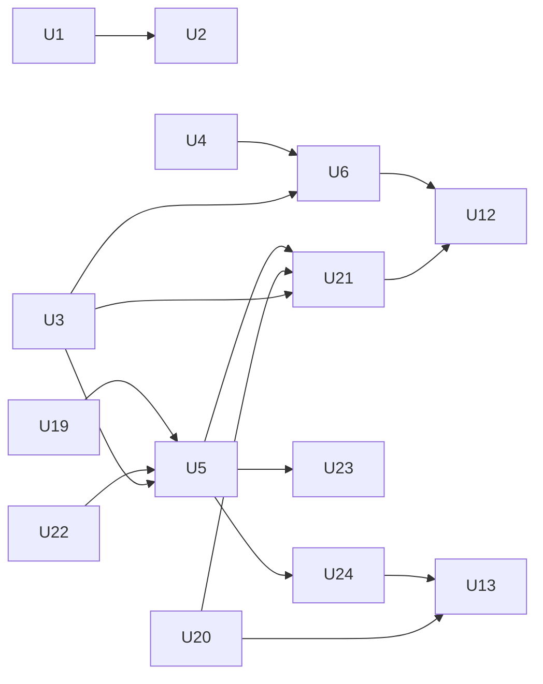

# Chat agent product: threads, a user-picked orchestrator, tools and MCP - Plan

**Target repo:** open-computer. All paths are repo-relative. Ids continue the ROADMAP: **OC-068..OC-085**, plus **OC-086..OC-091** for the units the owner's UI reference added (U19..U24, see the Unit index). Plan-local ids are R (requirement), KTD (decision), U (unit).

## Summary

The console today takes one prompt, decomposes it once into a fixed step graph, runs each step through a router and a placement table, and shows the result. It is a goal runner with no conversation, no orchestrator, no follow-ups, and no way to steer. The owner's verdict was "0/10, a one-prompt trick pony". This plan turns it into the product people expect from Perplexity Computer: **threads**, where each thread is a long-running agent session driven by an **orchestrator model the user picks** (through OpenRouter), using **tools and MCP servers**, spawning **subagents only when needed**, and surviving **very long runs** on durable workers. The approval gate, deny-by-default egress, the cost ledger and the spend rule stay exactly as strict as they are.

Phase 0 (two small PRs) first stops the console lying about where steps run. Everything after builds the thread product in small, shippable PRs, UI shell first so the owner sees progress early.

The owner's UI reference (Perplexity Computer, dark mode) fixes the shape of the front end: a left sidebar with New, Computer, Automations, Artifacts, Plugins and collapsible Pinned, Projects and Recents groups; a home screen with one large composer ("Do anything...", a Search | Computer mode toggle, an orchestrator model-and-reasoning picker, a worker-model picker, attach, dictate); threads with streaming step, tool and approval cards; Usage, a private-thread toggle and an account menu at top right. It wears Tallyline's neutral Silver Lining tokens in a dark and a light mode, and every operator page moves behind Settings and an account-menu Developer area. The model list is a curated catalog owned by this repo and gated by the spend rule. The decisions are recorded as KTD11 to KTD17 and the work as units U19 to U24 plus the revised U5, U12, U13, U15 and U17.

---

## Problem frame

### What the owner sees (screenshot, 2026-10-31)

Left nav `Computer`, `Agent jobs`, a RUNS list, then an `OPERATOR` block of 12 links (Work, Overview, Goals, Automations, Skills, Sandboxes, Devices, Runs, Approvals, Router, Audit, Workspace); a flat background; a run page whose rows say `jev`, `private`, and `Cloud model`/`Sandbox`. Note: `ui/index.html` declares `color-scheme: light` and `ui/tailwind.config.ts` has only a light "paper" palette, so the dark look in the screenshot most likely comes from a browser forced-dark mode. Either way there is no designed dark theme and no texture.

### What is wrong in the code (verified on `main` at `fd4d9da`)

| # | Finding | Evidence |
|---|---|---|
| P1 | **Goal runs have no orchestrator.** `Orchestrator.submit` calls `decompose()` once (a single model call returning a JSON DAG), then workers execute steps independently. Nothing reads results and decides what to do next. | `services/orchestrator/__init__.py`, `services/orchestrator/decompose.py` |
| P2 | **It is one prompt.** `POST /goals` starts a run and returns a run id. No endpoint accepts a second message; the UI has no thread concept. | `services/opsview/server.py` (`p_goals`), `ui/src/App.tsx` |
| P3 | **The effort model is not the step model.** The effort pick drives only the planner call and steps placed `cloud-OpenRouter`/`cloud-sandbox`. Placement can send a step elsewhere without saying so. | `services/opsview/server.py::_submit_goal`, `services/orchestrator/engines.py::work_fn` |
| P4 | **Silent local routing (root cause of "it ran on jev/local").** Placement rule 6 sends every `cheap`-tier step to `local-llamacpp` whenever a local port answers; rule 3 sends `latency=crit` local; rule 4 sends over-budget steps to `local-ollama`; rule 1 sends PII-flagged steps local. The liveness probe is a bare TCP connect to `127.0.0.1:8080`/`11434`. `work_fn` then calls `local_work` with `OC_LOCAL_MODEL` (default `qwen3-4b`). | `services/placement/rules.py`, `services/placement/health.py`, `services/orchestrator/engines.py` |
| P5 | **"jev" is a label, not the step model.** The run row prints `engine(s.engine)`, which is the router's decision engine (`RouteDecision.engine`, written into the dispatch row). The page never shows which model answered, though every OpenRouter call row records `model_served`. In the screenshot the placement column read `Cloud model` and `Sandbox`; the `jev` text is the router's classifier. | `services/orchestrator/dispatch.py`, `ui/src/components/RunView.tsx`, `ui/src/lib/friendly.ts`, `services/openrouter/client.py` |
| P6 | **Every step says "private".** The server sends `pii` as a list (`list(pii.categories)`); `RunView` tests `s.pii &&`, and an empty array is truthy. | `services/orchestrator/dispatch.py`, `services/opsview/goalruns.py`, `ui/src/components/RunView.tsx`, `ui/src/lib/api.ts` (typed `boolean`) |
| P7 | **The effort budget is silently clamped to $0.10.** `headroom_from` takes the minimum of the router's per-task cap (`Budget.task_cap`, default `$0.10`) and the run ledger, so a Medium ($0.30) run places as if it had at most $0.10. | `services/placement/rules.py::headroom_from`, `services/router/budget.py` |
| P8 | **Automations and durable workers ignore effort.** `submit_goal` builds the default engine (hard-coded `z-ai/glm-5.3-flash`, not in `TIER_MODELS`) with no ledger and no `effort_set` row. | `services/durable/activities.py`, `services/orchestrator/engines.py` |
| P9 | **A real planner loop exists but is not wired.** `AgentLoop` (plan, approve, spawn worker, read result, re-plan; `DEFAULT_ORCHESTRATOR_MODEL = deepseek/deepseek-v4-pro`) works against fakes. `configure_runner` is never called outside tests, so a submitted agent job stays `queued`. | `services/agents/loop.py`, `services/opsview/agentjobs.py` |
| P10 | **Navigation and look.** 13 nav items in two different navs, an operator block bolted under the runs list, a flat canvas, and a home page (`ui/src/App.tsx`) that owns its own layout and hash-based run selection outside the router. | `ui/src/lib/nav.ts`, `ui/src/components/Sidebar.tsx`, `ui/src/components/PageShell.tsx` |
| P11 | **No tool-calling or streaming in the model client.** `services/openrouter/client.py::chat` takes one prompt (or messages), reads `choices[0].message.content`, and discards `tool_calls`. No SSE streaming. | `services/openrouter/client.py` |
| P12 | **MCP exists only as a server.** `services/mcp/server.py` exposes safety primitives to other agents. There is no MCP client. | `services/mcp/server.py` |
| P13 | **`nav.ts` is stale.** It marks Overview, Goals, Automations, Skills, Runs and Approvals `spa:false` although `ui/src/main.tsx` routes all of them and `services/opsview/server.py` serves them through `g_spa_route`. Only Work (a server redirect) and Workspace (its own renderer) are genuinely non-SPA. | `ui/src/lib/nav.ts`, `ui/src/main.tsx`, `services/opsview/server.py` |
| P14 | **Two palettes, no dark mode in the SPA.** The React app uses hard-coded light hex tokens (`#faf9f6` canvas, `#0f766e` teal) and `<meta name="color-scheme" content="light">`; it never imports the vendored `services/opsview/static/silver-lining.css`, which only the server-rendered pages use. That vendored file is a hand-port (header: "REPLACE WITH GENERATED"; `--color-*` names only, tinted dark canvas `#0a0c10`), not the generated Tallyline package. | `ui/tailwind.config.ts`, `ui/index.html`, `services/opsview/static/silver-lining.css`, `tests/opsview/test_tokens.py` |
| P15 | **Two run pages are still server-rendered.** `/runs/new` and `/runs/run_<8hex>` go through `g_run_new` and `g_run` (`views.page_run_confirm`, `views.page_run_detail`); `run_` ids have no JSON API (`/api/runs/<id>` serves only `goal_` ids). The React full-move cutover and the deletion of `views.py` chrome and `console.css` are open. | `services/opsview/server.py`, `docs/plans/2026-10-30-003-feat-react-full-move-plan.md` |
| P16 | **No model catalog and no worker choice.** Models are the `TIER_MODELS` dict and `services/opsview/effort.py`. `sandbox_work` and the default engine hard-code `z-ai/glm-5.3-flash`, which is outside `TIER_MODELS`, so `tests/unit/test_spend_rule.py` (it scans `TIER_MODELS`, `DEFAULT_ORCHESTRATOR_MODEL` and the effort levels only) never sees it. The ceiling is prose in `ROADMAP.md`, not a constant. | `services/router/policy_table.py`, `services/orchestrator/engines.py`, `tests/unit/test_spend_rule.py` |
| P17 | **No usage, artifacts, projects or notifications surface in opsview.** Spend is visible only through `/api/overview`, `/api/router` and per-run effort; artifacts exist only in the fixture-backed workspace service. | `services/opsview/server.py`, `services/cost/ledger.py`, `services/workspace/` |

An untested WIP patch (`oc-local-routing-wip.patch`, 10 files, +283/-52; not in the repo) already sketches the Phase 0 fix: local models opt-in via `OC_LOCAL_MODELS`, the effort model for every step, PII-flagged steps held for approval instead of sent local, and the real per-step model and cost recorded. OC-068 starts from it and must land with tests.

### Owner UI reference and how it maps (2026-10-31)

The owner supplied a screenshot of Perplexity Computer in dark mode. It is described here and **not committed**: it shows the owner's private thread titles and account, and `tests/unit/test_obs_open_source_hygiene.py` scans every tracked text file for personal data. Fixtures and e2e data use neutral placeholder titles and the name "Owner".

| Reference element | In open-computer | Unit |
|---|---|---|
| Logo; header icons for notifications (bell with count), search, collapse sidebar | Bell counts threads that need the owner now (pending approval, `ask` question, paused at cap); search opens the Cmd/Ctrl+K palette over threads; collapse is a rail that remembers its state | U5, U23 |
| Primary items New, Computer, Automations, Artifacts, Plugins | New = home composer. Computer = live board of in-flight threads (running, waiting, paused), see D15. Automations, Artifacts as built. Plugins = MCP connectors plus skills | U5, U14, U15, U17 |
| Groups Pinned, Projects, Recents (titles only, truncated, collapsible) | Pinned threads, named projects, recent threads; legacy goal runs and agent jobs fill Recents read-only | U5, U23 |
| Footer: avatar, name, plan | Owner initial and name from the session, plan line reads "Self-hosted" with today's spend against the cap; the account menu holds Settings, Developer, theme and sign out | U5, U13 |
| Home: small computer icon, "What should we work on?", one large composer, "Do anything..." | Home empty state with the composer centred | U21 |
| Composer row: attach, Search / Computer toggle, model-and-reasoning chip, mic, round voice button | Attach to thread workspace; mode toggle (KTD15); orchestrator picker and a second worker picker (KTD14); mic is the existing dictate button; the round voice-mode button is not built (already deferred below) and its slot stays empty | U21 |
| "Choose a project" and "Plugins" chips; suggestion chips; dismissible promo card; Terms and Privacy footer | Project chip and Plugins chip (hidden until U15 ships); static starter chips (the `STARTERS` in `ui/src/App.tsx`); a dismissible tips slot with no promo content, dismissal kept in settings; footer links render only when configured (D17) | U21 |
| Picker popover: "Return to Presets", Model submenu with provider icon and check, Reasoning Low/Medium/High | Same structure over the curated catalog; "Return to Presets" restores the effort-level defaults | U21, U20 |
| Top right: Usage, incognito toggle, menu | Usage popover from the cost ledger; private-thread toggle (D13); account menu | U24, U21, U5 |
| Look: charcoal canvas, faint texture, lifted rounded composer, grey secondary text, off-white primary button, generous space | Silver Lining neutral dark and light tokens (KTD11), CSS-only grain, composer on surface-2 with a hairline border, `ink-muted` secondary text, primary button on `ink` | U19, U5 |

### What already exists and is reused

- **Event stream contract** (`docs/design/event-stream.md`, `oc/events/`): typed events (`run step tool_call source artifact change approval cost note error`), gapless `seq`, upsert-by-id, payload-hash-bound approvals, a loop guard that pauses at 3 repeats, cost thresholds at 80% and 100%, SSE transport with replay. Served today only by the fixture-backed `/workspace` surface (`services/workspace/`).
- **Durable infrastructure:** `services/durable/` (Temporal worker, `GoalRunWorkflow`, `GoalCronWorkflow`), `services/opsview/automations.py` (schedules).
- **Spend control:** `services/cost/ledger.py` (cap is a row, pauses never cancels, reservations), `services/opsview/effort.py` (levels and `resolve`), `tests/unit/test_spend_rule.py`.
- **Approvals:** `services/gate/` (PII scan, hash-bound single-use approvals, audit) and `services/agents/approvals.py` (`ApprovalStore`, `ConsoleApprover`, per-job `lease`).
- **Agent infrastructure:** `services/agents/` (`Trail`, `replay`, `policy.classify`, ACP worker, sandbox launcher, per-job workspace, `JobRunner` with resume).
- **Execution:** `services/execplane/` (sandbox adapter, egress policy), `services/device/` (device plane).

---

## Requirements

- R1. A **thread** holds many turns. The owner can send follow-ups, interrupt, steer mid-run, resume after a pause or restart, and see the full history. (P1, P2)
- R2. Each thread has one **orchestrator model**, chosen by effort level (defaults) or an explicit model override, called through OpenRouter in a tool-calling loop. The same model plans and acts; nothing silently substitutes another. (P3, P4, P9)
- R3. **Subagents** are spawned by the orchestrator only when it decides they help, with their own budget, tool set and context; they return a summary and artifacts. (R2)
- R4. **Local models are opt-in** and always labelled; placement never picks one by default. Private content is held for approval, never silently sent local or to the cloud. (P4)
- R5. **Super-long runs** survive restarts and crashes: durable workers, checkpoints derived from the event log, budget pauses that wait for the owner, resume with a raised cap. (P8)
- R6. The **approval gate**, deny-by-default egress, payload-hash-bound single-use approvals, human-only approval, the cost ledger hard cap, and the spend rule are unchanged or stricter. (ROADMAP scope)
- R7. **Built-in tools:** sandbox shell, files, artifacts, web search and fetch, ask-the-owner; browser later. **MCP client** with per-server approval and secrets via `OC_*` environment variables. Every tool call is visible in the stream. (P11, P12)
- R8. **App shell:** a Perplexity-style left sidebar (New, Computer, Automations, Artifacts, Plugins; Pinned, Projects and Recents groups; notifications, search and collapse in the header; account footer), a streaming thread view with collapsible step, tool and approval cards, and a mobile layout. (P10, P13)
- R12. **Palette and theme:** the console uses Tallyline's Silver Lining neutral tokens from one vendored file, a dark and a light mode that follows the system by default with a manual toggle, and a faint CSS-only texture. The warm paper light-only theme is retired. (P14)
- R13. **Home composer:** one large composer with attach, a Search | Computer mode toggle, an orchestrator picker with reasoning level, a worker picker, dictate, project and plugin chips, suggestion chips and a dismissible tips slot. (P2, P3)
- R14. **Curated models:** the models a user can pick come from one repo-owned catalog; every entry passes the spend rule (an above-ceiling entry only when explicitly flagged in the hand-edited file, never as a default), and the orchestrator and the worker models are chosen separately. (P16)
- R15. **Modes:** Search answers with web search and fetch only; Computer runs the full tool set with sandbox and subagents. The mode is recorded per turn and visible. (R7)
- R16. **Organisation and awareness:** threads can be pinned and grouped into projects; the bell shows what needs the owner; a Usage view shows spend from the cost ledger; a private-thread toggle hides a thread from lists. (P17)
- R17. **Operator pages live in Developer:** Overview, Sandboxes, Devices, Router, Audit, Runs, Approvals queue, Agent jobs, Skills and the legacy Work and Goals pages are reachable from the account menu or Settings > Developer (Skills is also a read-only tab of Plugins). Approvals also appear inline in threads and through the bell. Every old URL keeps working. (P10)
- R18. **React full move is finished:** the two server-rendered run pages are ported, the routes cut over, the page renderers and `console.css` deleted, and the nav is generated from one route table so it cannot drift again. (P13, P15)

Product-direction note: R1 to R7 and R9 to R11 are unchanged; R8 is restated for the new nav and R12 to R18 are added.
- R9. The run page and thread view always show the **real model and real cost** per step or turn, and never label a step private without PII. (P5, P6, P7)
- R10. A **CLI** (`oc`) talks to the same thread API, later. (OC-039)
- R11. Existing runs and agent jobs stay readable. No destructive data migration. (see Migration)

## Scope boundaries

**Not in this plan:** hosted multi-user SaaS, a memory product, premium-model defaults, any change to who may approve, publishing to marketplaces (OC-057..065), live acceptance of the CubeSandbox path (OC-023, OC-031).

### Deferred to follow-up work

- Browser/computer-use tool (OC-045): listed as a late unit, built after the shell and MCP tools are proven.
- Device-plane tool (`device.run`) wrapping `services/device/`: a thin tool added once the registry of tools exists; not a blocker.
- Cross-thread memory.
- Voice in the thread composer beyond today's dictate button (the reference's round voice-mode button is not built).
- The fixture-backed `/workspace` renderer: it is not one of the operator pages the owner named, so it keeps its own renderer until a decision (it could become a Developer page or be retired).
- Project-level shared files and knowledge; a project is a group plus instructions in this plan.
- Server-side full-text thread search; v1 filters titles client-side.

### Considered and not built

- A promo card: the slot exists for tips and onboarding only, with no promotional content.
- Terms and Privacy pages: this is a self-hosted tool with no hosted legal text; footer links render only when an operator configures them (D17).
- A runtime-editable model list or a live OpenRouter list in the picker: the owner asked for a curated list, and a repo-owned file keeps the spend rule enforceable by test. Evidence that would change this: the owner wants to add models without a PR.
- A confirm dialog or an in-app unlock for above-ceiling models: the owner rejected the confirm design (D2); an above-ceiling model enters the list only by a hand edit of the catalog file.
- A read or unread notification store: the bell shows current need, so there is nothing to sync or expire.

---

## Key technical decisions

- **KTD1. The thread is the product, the event log is the state.** A thread is a directory with an append-only event log in the existing event-stream format (`oc/events/`), a cost ledger row file, and a workspace. Everything the UI shows is a projection of the log (the contract's own rule), and every driver (in-process or Temporal) rebuilds state by replaying it. This is how `services/agents/replay.py` already works for jobs. *Why:* crash-resume and live streaming both fall out for free, and one contract serves console, CLI and replay tests.
- **KTD2. A new tool-calling orchestrator loop, built on the agents infrastructure; `AgentLoop` becomes one tool.** `services/agents/loop.py` is the right base for infrastructure (trail/replay, approvals with hash binding, lease, runner threads and `resume_all`, budget warn at 80%, stall guards, redact-before-truncate) but the wrong shape for chat: it speaks a JSON planner protocol, asks for plan approval on every job, and spawns exactly one ACP worker per round. The new loop (`services/threads/`) calls the model with native tool calling; the ACP coding worker becomes a subagent kind (`agent.spawn(kind="harness")`) so existing Agent-jobs work is kept, not rewritten. Plan approval becomes an opt-in "plan first" mode, not a gate on every message. Shared pieces are extracted (not copied) from `services/agents/` into a neutral package in U6.
- **KTD3. The effort picker maps to defaults; the model picker overrides.** Effort level sets orchestrator model, per-turn budget, and subagent allowance (Low 0, Medium 2, High 4 concurrent). An explicit model must be tool-call capable (OpenRouter's model list exposes supported parameters; confirm field at build time) and inside the spend rule. `services/opsview/effort.py::resolve` stays the single validator and checks the repo-owned model catalog of KTD14 rather than a live OpenRouter list.
- **KTD4. Local models are opt-in, by flag and by label.** `OC_LOCAL_MODELS=1` enables them; they appear in the model picker with a "local" badge and are never chosen by placement. Placement rules 3-6 (latency, headroom demotion, cheap-to-local) are removed from the chat path. `place()` keeps rules 0, 1.5, 2 (device, egress, sandbox) for *tool* placement. PII-flagged content is held for approval (`kind=pii-send`) before any model call, using the existing hash-bound gate. With local models off, the owner's inline approval offers two actions: send that step to the hosted model, or skip the step (D4). (session-settled: user-directed — chosen over refusing private content outright: the owner can still get the work done, with the hosted send visible and approved.)
- **KTD5. One budget model.** A turn has a cap from the effort level, clamped by the thread's own hard cap and `OC_DAILY_CAP`. The daily cap defaults to $5.00 per day (raised from $1.00 in `services/router/router.py` and `services/opsview/server.py`), and every thread carries its own hard cap row inside it; the default thread cap is a Settings > Budgets value that may not exceed the daily cap. (session-settled: user-directed — chosen over $25 per working day and over keeping $1.00 with per-thread overrides: $5.00 allows real agent work while the thread cap bounds any one thread.) Subagents get a carved sub-cap (a child ledger id) reserved from the parent at spawn and reconciled at end. Hitting any cap emits `run paused reason=cap` and **waits**; the owner tops up (`CostLedger.resume`) from the thread. The router's `task_cap` is removed from the chat path (P7).
- **KTD6. Durable long runs: Temporal workflow per thread, one idempotent step per activity.** `ThreadWorkflow` loops `step(thread_dir)`: each activity replays the log, performs exactly one model call plus its tool calls, appends events, returns `{idle|waiting|paused|continue}`. Signals carry `user_message`, `interrupt`, `approval_decided`, `resume`. `continue_as_new` bounds history. Without Temporal (`OC_DURABLE` off) the same `step` runs on a driver thread under the per-thread `flock` lease. *Why:* matches `GoalRunWorkflow`'s pattern, and restarts cost at most one in-flight step (charged its estimate once, as `AgentLoop` does today).
- **KTD7. Tool results and MCP output are untrusted DATA.** Reuse the `<<<DATA ... DATA>>>` wrapping from `Orchestrator._with_dep_results`. No tool exists that approves, grants, or applies policy (the `FORBIDDEN` words test in `tests/mcp/` is extended to the orchestrator's registry).
- **KTD8. MCP servers are sandboxed by default.** A stdio MCP server runs inside a microVM through the same in-VM relay pattern as `services/agents/sandbox.py`; a remote HTTP server needs its host in the approved egress set. Enabling a server is a hash-bound approval over its tool manifest; a changed manifest asks again. Secrets are `OC_*` env references, never written to the config file or the log.
- **KTD9. Legacy is read-through, then deleted.** The thread list includes old goal runs and agent jobs as read-only one-turn threads. A follow-up on one forks a new thread seeded with its goal and result summary. Deletion of the decompose DAG happens last (U17), after the device plane no longer depends on it.
- **KTD10. The UI follows `luke-operator-ui` where it fits a chat product:** command palette on Cmd/Ctrl+K, `j`/`k` in lists, skeletons, four status colours, every error with an action, every empty state in three parts. Model screens on Perplexity Computer (thread + side panel) and Linear (lists). Dependencies stay minimal (no new UI framework; the console's React + Tailwind remains).
- **KTD11. One design system: Tallyline's Silver Lining neutral tokens, system default with a toggle.** (session-settled: user-approved — chosen over a separate Perplexity-style charcoal and teal palette: one design system across the owner's apps, neutral deep-black dark plus a light mode, a faint texture.) Governs R12. The dark canvas is `#090909` with surfaces `#0f0f0f` to `#252525`, the light canvas `#f5f5f5`, the accent Azure `#339fee` (dark) and `#005fba` (light). The vendored `services/opsview/static/silver-lining.css` stays the single copy: it is re-synced from the Tallyline package's generated CSS (the package's own sync script copies it), and the SPA imports that file through a Vite alias instead of keeping its own hex tokens, so the server-rendered pages and React cannot diverge. The generated file carries `--sl-*` names plus `--color-*` aliases and `data-theme` selectors; `ui/tailwind.config.ts` maps its colour names to those variables. This replaces the DESIGN.md "Console surface" dark-token starting point (`#0E1113` canvas, teal accent) and the SPA's light-only paper theme. Texture, glow and two shadow tiers from the earlier direction are kept as CSS on top of the tokens. The neutral values are on Tallyline's main (PR #223, merged as `2392f7e`), so U19 syncs from main. (session-settled: user-directed — chosen over syncing from the unmerged `feat/neutral-theme-toggle` branch: the owner confirmed the merge, and main is the one source of truth.)
- **KTD12. The full thread product ships as a sequence of small PRs, not a shell-first subset.** (session-settled: user-directed — chosen over shell plus home composer first: the owner wants threads, streaming chat, step and tool cards, inline approvals, artifacts, projects and pinned/recents in this plan.) Governs R1, R8, R13, R16. Order is in the Unit index and the sequencing diagram: units with no thread-backend dependency (U19, U20, U22) land first.
- **KTD13. Operator pages sit behind a Developer area, not in the sidebar.** (session-settled: user-approved — chosen over a collapsed ops group in the sidebar.) Governs R17. The Developer pages are exactly: Overview, Sandboxes, Devices, Router, Audit, Runs (with the matrix run pages), Approvals queue, Skills, Goals (legacy), Work (redirect), and Agent jobs (today a view inside `ui/src/App.tsx`, given its own route by U22). Automations is a sidebar page, not a Developer page; Workspace is deferred; a "Self-check" page does not exist today and is not planned. Canonical paths move under `/developer/...`; the existing paths (`/overview`, `/sandboxes`, `/runs`, `/approvals`, `/router`, `/audit`, `/skills`, `/devices`, `/goals`, `/automations`) keep resolving and the SPA router replaces them with the canonical path. Server side, the `/developer/**` deep links join the `g_spa_route` patterns so the route-table tests cover them. Approvals stay approvable only by the owner through the existing CSRF-checked routes; the inline card and the bell link to the same routes and add no new approval path. Login, enroll and the passkey pages stay server-rendered with a minimal shell that uses the same token file, because they run before a session exists (R18 leaves that one exception). Governs the U22 and U5 scope.
- **KTD14. A repo-owned curated model catalog, with an orchestrator pick and a separate worker pick.** (session-settled: user-directed — chosen over showing premium models behind a confirm, an under-ceiling-only live OpenRouter list, and showing every model: "we pick our own list".) Governs R14, R2, R3. The catalog is `services/router/model_catalog.json` read by `services/router/model_catalog.py`, which also holds the ceiling constants (`$1.60` input and `$4.80` output per Mtok, Grok 4.7). Each entry has id, label, provider, roles (`orchestrator`, `worker`), `tools` (tool calling verified), prices, context size and the effort preset it belongs to. `TIER_MODELS`, the effort levels and `DEFAULT_ORCHESTRATOR_MODEL` are derived from or checked against it, so there is one list. The list is changed by a reviewed PR, not at runtime; the Settings > Models tab shows it read-only. The orchestrator picker (with reasoning level) sets the thread's orchestrator model per KTD3. The worker picker sets an ordered allow-list for subagents and sandbox steps: `subagent.spawn` may only name a model from it, the first entry is the default, legacy goal-run sandbox steps (until U17) use that default, and the hard-coded `z-ai/glm-5.3-flash` in `services/orchestrator/engines.py` is replaced by the catalog's worker default. Reasoning Low, Medium and High is the effort level of KTD3 (turn budget, subagent allowance) and, where the provider supports it, the request's reasoning parameter (field confirmed at build time). "Return to Presets" resets both pickers to the effort level's preset. `sandbox.exec` is a tool with no model call, so R2 governs orchestrator turns and the allow-list governs subagents and the legacy path. Local models stay outside the catalog's price and ceiling checks as a separate list gated by `OC_LOCAL_MODELS` (KTD4). A model above the ceiling may be added to the list, but only by a hand edit of the catalog file that sets an explicit `above_ceiling: true` flag on its entry; it is never a default, preset, `TIER_MODELS` member or worker default, and the picker shows its price and an above-ceiling mark with no confirm dialog and no in-app way to add it. (session-settled: user-directed — chosen over never allowing an above-ceiling model: the owner wants the option kept open for hard tasks without any accidental path to it.)
- **KTD15. Search and Computer are tool-set modes of one thread.** Governs R15. Search runs the orchestrator model with `web.search`, `web.fetch`, `ask` and `artifact.save` only: no sandbox, no file tools, no subagents, and a turn budget capped at the Low level, so it answers with citations quickly and cheaply. Computer is the full registry of U7, U8, U9 and U15. The mode lives on the turn row (`mode`), can change between turns, and appears on the turn header. Search is unavailable until U8 ships (the toggle hides the Search segment; U8 therefore depends on U7 for `ask` and artifacts). Web search is OpenRouter's built-in web search plugin, on the same key and bill as every other call, so there is no separate provider, key or setting: in Search mode the plugin is enabled on the orchestrator turn itself and the answer carries its citations; in Computer mode the `web.search` tool makes one plugin-enabled call on the thread's worker default and returns the cited text as DATA. (session-settled: user-directed — chosen over the Perplexity API and a Brave or Tavily key: one key, one bill, no new secret.) Search spend is whatever the provider reports in the response and goes to the ledger like any call.
- **KTD16. Notifications, Usage and the Computer board are projections, not new stores.** Governs R16. The bell count is the number of threads whose projection says `needs you` (pending approval, open `ask`, paused at cap) plus pending agent-job approvals, returned as fields on `GET /api/threads`; a private thread that needs the owner still counts and appears in the bell as an untitled "Private thread" entry; there is no unread or read state to persist. Usage is `GET /api/usage` (range `today`, `7d`, `30d`), a read-only aggregation of thread and legacy-run `cost.ndjson` ledgers by thread, model and day against `OC_DAILY_CAP`; the cost still comes from the provider response. The Computer board is the thread list filtered to running, waiting and paused. New GETs are side-effect free so `tests/opsview/test_get_side_effects.py` covers them as written.
- **KTD17. Projects and pins are meta rows.** Governs R16. A project is a named group with optional owner-written instructions, stored as latest-wins rows under `$OC_THREADS_DIR/_meta/projects.ndjson`; a thread's project and pinned flag are rows in its own `meta.ndjson`. Project instructions enter the orchestrator's system prompt as owner-authored text (not DATA-wrapped); anything a tool returns still is. Archive only, matching D9. A private thread (D13) is a flag in `meta.ndjson` that hides it from Recents, Pinned, search and the Computer board (it still raises the bell when it needs the owner). A thread's title is the first 60 characters of its first message, editable, with no model call; a private thread is titled "Private thread" in the bell.

---

## High-level technical design

### Components



### One turn



### Thread layout on disk

```text
$OC_THREADS_DIR/<thread>/
  events.ndjson     # oc/events stream: note(user/agent), turn, step, tool_call, approval, cost, artifact, error
  meta.ndjson       # title, effort, model, caps (rows; latest wins), archived
  cost.ndjson       # CostLedger rows (thread and subagent ids)
  workspace/        # files the agent owns; sandbox mounts it
  artifacts/
```

### Orchestrator step (directional)

```text
state = replay(events)                 # messages, open tool calls, spend, pending approvals
if pending approval or paused: return waiting/paused
ctx = build_context(state)             # compact old turns; wrap tool output as DATA
if pii(ctx) and not approved: request approval, return waiting
reply = model(state.model, ctx, tools) # stream tokens as note events
for call in reply.tool_calls: policy -> run | ask owner | refuse; append tool_call events
if reply.final: emit note kind=final; return idle
return continue
```

### Console layout and model selection





---

## Phases and implementation units

Phases are ordered; units inside a phase can often run in parallel (noted). Each unit is one small PR with tests. "Delete" lists what the PR removes so the codebase shrinks as it grows. Unit bodies are authoritative; the index is navigation only.

| Unit | OC | Title | Key files | Depends on |
|---|---|---|---|---|
| U1 | 068 | Routing truth | `services/placement/`, `services/orchestrator/` | none |
| U2 | 069 | Run page truth | `ui/src/components/RunView.tsx` | U1 |
| U19 | 086 | Silver Lining tokens and theme | `services/opsview/static/silver-lining.css`, `ui/tailwind.config.ts` | none |
| U20 | 087 | Curated model catalog | `services/router/model_catalog.*`, `tests/unit/test_model_catalog.py` | none |
| U22 | 089 | Finish the React move, Developer routes | `services/opsview/server.py`, `ui/src/pages/` | none |
| U3 | 070 | Thread store, API, stream, settings store | `services/threads/` | none |
| U4 | 071 | OpenRouter tools and streaming | `services/openrouter/` | none |
| U5 | 072 | App shell and nav | `ui/src/components/AppShell.tsx` | U3, U19, U22 |
| U21 | 088 | Home composer and pickers | `ui/src/components/Composer.tsx` | U5, U20, U3 |
| U6 | 073 | Orchestrator turn loop | `services/threads/loop.py` | U3, U4 |
| U7 | 074 | Built-in tools | `services/threads/tools/` | U6 |
| U8 | 075 | Web tools | `services/threads/tools/web.py` | U6, U7 |
| U9 | 076 | Subagents | `services/threads/subagent.py` | U6, U7, U20 |
| U10 | 077 | Context compaction | `services/threads/context.py` | U6 |
| U11 | 078 | Durable thread workflow | `services/durable/` | U6 |
| U12 | 079 | Thread view | `ui/src/pages/Thread.tsx` | U3, U5, U6, U21 (Search scenario waits on U8) |
| U23 | 090 | Projects, pins, bell, search | `services/threads/api.py`, `ui/src/components/ThreadList.tsx` | U3, U5 |
| U24 | 091 | Usage view | `services/opsview/server.py`, `ui/src/components/UsagePopover.tsx` | U3, U5 |
| U13 | 080 | Settings | `ui/src/pages/settings/` | U5, U20, U24 |
| U14 | 081 | Artifacts page | `ui/src/pages/Artifacts.tsx` | U7, U12 |
| U15 | 082 | MCP client and Plugins | `services/mcpclient/` | U6, U7, U13 |
| U16 | 083 | Browser tool | `services/threads/tools/browser.py` | U7, U15 |
| U17 | 084 | Automations and goal-run retirement | `services/durable/workflows.py` | U11, U12 |
| U18 | 085 | `oc` CLI | `oc/cli/` | U3, U6 |



The first visible PRs are U19, U22 and U20 (no thread-backend dependency) with U1 and U3 in parallel, then U5 once U3, U19 and U22 have landed, so the owner sees the new look and nav before the orchestrator exists.

### Phase 0: stop lying (OC-068, OC-069)

### U1. Routing truth (OC-068)

**Goal:** a run uses exactly the model its effort level names, and the record says so. Local models only when opted in.
**Requirements:** R2, R4, R9.
**Dependencies:** none. Start from the WIP patch.
**Files:** `services/placement/rules.py`, `services/placement/health.py`, `services/placement/__init__.py`, `services/orchestrator/dispatch.py`, `services/orchestrator/engines.py`, `services/orchestrator/runner.py`, `services/orchestrator/__init__.py`, `services/opsview/goalruns.py`, `services/durable/activities.py`, `services/gate/queue.py`; tests `tests/unit/test_placement_table.py`, `tests/unit/test_engines.py`, `tests/unit/test_effort.py`, `tests/unit/test_spend_rule.py`, `tests/opsview/test_goals.py`.
**Approach:**
- `OC_LOCAL_MODELS` flag (off by default); with it off, `place()` never returns a `local-*` target. Remove the cheap-to-local rule and the latency and over-budget demotions from the goal path; over-budget now pauses via the ledger.
- PII-flagged steps create a hash-bound approval (`kind=pii-send`) and hold. The inline approval has two actions (D4): send to hosted (approve) or skip the step; a skipped step is recorded as skipped with the reason and never runs on a `local-*` target.
- `OC_DAILY_CAP` defaults to $5.00 in `services/router/router.py` and `services/opsview/server.py` (KTD5); tests that assume the old $1.00 default are updated.
- Headroom comes from the run ledger only; drop the router `task_cap` from `headroom_from`'s inputs on this path.
- Record `model_served`, tokens and cost on each dispatch/step row from the usage already captured (`collect_usage`).
- `services/durable/activities.py::submit_goal` takes effort, model, budget, creates the ledger and the `effort_set` row and uses the effort model for the default engine; the `z-ai/glm-5.3-flash` constant itself is replaced by the catalog worker default in U20.
**Execution note:** characterization-first on `tests/unit/test_placement_table.py` (its 1,152-case invariant table encodes the old rules); rewrite the invariants deliberately.
**Test scenarios:**
- Local port listening, `OC_LOCAL_MODELS` unset, cheap-tier step: placement is `cloud-OpenRouter` with the effort model. Covers P4.
- `OC_LOCAL_MODELS=1`: same step may still go cloud; a local target only when explicitly requested by the thread's model choice.
- Medium run (cap $0.30), router `task_cap` $0.10: a $0.20 step is placed, not demoted. Covers P7.
- PII-flagged prompt: step held, approval row carries payload hash; approve (send to hosted) then run; skip then step recorded as skipped with a reason; never a `local-*` target.
- With `OC_DAILY_CAP` unset the daily cap is $5.00; a $5.00 total pauses the run at the cap and waits.
- Automation fire (`submit_goal`): has `effort_set`, a ledger with the cap, and the effort model.
- Spend rule: no default resolves above the price ceiling.
**Verification:** the run's step rows show the effort model and a real cost; no step runs on a local endpoint with the flag off.
**Risks:** the old table tests are the safety net for device, egress and sandbox rules; keep every invariant not tied to the removed rules.

### U2. Run page truth (OC-069)

**Goal:** the run page stops showing false labels.
**Requirements:** R9.
**Dependencies:** U1 (needs the recorded model).
**Files:** `ui/src/components/RunView.tsx`, `ui/src/lib/api.ts`, `ui/src/lib/friendly.ts`, `ui/src/components/primitives.tsx`; tests `tests/e2e/spa.e2e.mjs`, `tests/e2e/console.e2e.mjs`.
**Approach:** `pii` is `string[]`; show "Private details" only when non-empty, with the categories in the tooltip. Replace the router-engine label with the model that answered and its cost; drop the `jev`/router text from the default view (kept in Developer). Show effort, model and spend against cap in the header (already present).
**Test scenarios:** step with `pii: []` shows no private label (Covers P6); step with `["email"]` shows it; the row names the served model; an axe pass on the run page.
**Delete:** the `engine()` label mapping for the default view in `ui/src/lib/friendly.ts`.

### Phase 1a: tokens, models and the finished React move (OC-086, OC-087, OC-089)

U19, U20 and U22 are independent of each other and of the thread backend; any order, one PR each.

### U19. Silver Lining tokens and theme foundation (OC-086)

**Goal:** one token file feeds both the server-rendered pages and the SPA, in a dark and a light mode.
**Requirements:** R12.
**Dependencies:** none. The neutral values are on Tallyline's main (KTD11).
**Files:** `services/opsview/static/silver-lining.css` (re-synced), `ui/src/index.css`, `ui/tailwind.config.ts`, `ui/vite.config.ts`, `ui/index.html`, create `ui/src/lib/theme.ts`; modify `DESIGN.md`; tests `tests/opsview/test_tokens.py`, `tests/e2e/spa.e2e.mjs`, `tests/e2e/console.e2e.mjs`.
**Approach:**
- Re-sync the vendored CSS from the Tallyline package's generated output with its sync script (a plain copy, KTD11). Do not hand-edit it; its header notes two hand adjustments (`ink`, `ink-tertiary`) that the generated values replace.
- Import it from the SPA through a Vite alias; map `ui/tailwind.config.ts` colour names to the `--sl-*` variables; delete the hard-coded paper and teal hex.
- `ui/src/lib/theme.ts`: `light`, `dark` or `system`; system is the default; the choice sets `data-theme` on the root element; a browser copy avoids a flash and is the only store until U3's settings endpoint lands, after which the choice is kept there too.
- `ui/index.html`: drop `color-scheme: light`, declare both.
- Console pages that still use `console.css` keep working through the `--color-*` aliases; confirm the `status-*` names they use.
- `DESIGN.md`: replace the console dark-token starting point with the KTD11 values and a pointer to the vendored file.
**Test scenarios:**
- Token contrast gate in `tests/opsview/test_tokens.py` passes on the new file for dark and light (ink against canvas and each surface 4.5:1 or better; tertiary text floor), and the 16:1 ceiling rule is revisited if the neutral ink exceeds it.
- Dark and light home pages pass axe at 390 and 1440.
- Toggle to `dark` while the system is light changes the canvas to `#090909`; `system` follows an emulated scheme change without reload.
- A server-rendered page and an SPA page show the same canvas colour in each mode.
- No tracked file gains a string the hygiene test denies.
**Verification:** one file defines the colours in both stacks; the SPA has a designed dark mode.
**Delete:** the paper and teal palette in `ui/tailwind.config.ts`.

### U20. Curated model catalog (OC-087)

**Goal:** one repo-owned list of models, enforced by the spend rule, that every picker and default reads.
**Requirements:** R14, R2, R3. Implements KTD14.
**Dependencies:** none.
**Files:** create `services/router/model_catalog.json`, `services/router/model_catalog.py`; modify `services/router/policy_table.py` (derive `TIER_MODELS`), `services/opsview/effort.py`, `services/agents/loop.py`, `services/orchestrator/engines.py` (worker default replaces the hard-coded id), `services/opsview/server.py` (`GET /api/models`); tests create `tests/unit/test_model_catalog.py`, `tests/opsview/test_get_side_effects.py`, extend `tests/unit/test_spend_rule.py`, `tests/unit/test_effort.py`, `tests/opsview/test_effort_api.py`.
**Approach:**
- Entries (initial set): `google/gemini-2.5-flash`, `deepseek/deepseek-v4.1-flash`, `deepseek/deepseek-v4-pro`, `x-ai/grok-4.7`, and the current worker model `z-ai/glm-5.3-flash`. Price fields are filled from the provider's published list at build time and are display and gate inputs only; recorded cost still comes from the provider response.
- `model_catalog.py` exposes the ceiling constants, loads and validates the file (unknown role, missing price, a price over the ceiling without `above_ceiling: true`, an `above_ceiling` flag on an entry whose prices are at or under the ceiling, or an orchestrator entry without verified tool calling is a load error), and offers `orchestrators()`, `workers()`, `preset(level)`.
- Presets: Low, Medium, High map to today's models (D1) and budgets; High is never the default.
- `GET /api/models` returns the catalog for the pickers (labels, provider, role, price, preset, above-ceiling flag); GET only.
- Local models (`OC_LOCAL_MODELS`, KTD4) are a separate list outside the catalog's price and ceiling validation, shown with a "local" badge only when the flag is on. `TIER_MODELS` takes its `cheap`, `mid` and `frontier` tiers from the catalog and keeps its `local` tier from that separate list; the subset test covers the cloud tiers only.
- A one-off refresh script is out of scope; prices come from the provider's published list and the catalog changes by reviewed PR or an explicit hand edit.
**Test scenarios:**
- Every entry's input and output price is at or under the ceiling unless the entry is explicitly flagged `above_ceiling`; an above-ceiling price without the flag fails the test, and so does the flag on an under-ceiling entry.
- No flagged entry is the default orchestrator or worker, a preset, an effort-level model, a `TIER_MODELS` member or the fallback; adding one in any of those places fails `tests/unit/test_spend_rule.py`.
- A flagged entry added by hand loads, appears in `GET /api/models` with its price and the above-ceiling mark, and is selectable only through the picker; no API path creates or edits catalog entries.
- No entry id matches the premium pattern in `tests/unit/test_spend_rule.py`; that file now also iterates the catalog, so `z-ai/glm-5.3-flash` is covered (closes P16).
- Default orchestrator is `deepseek/deepseek-v4-pro`; default worker exists, has role `worker`, and is under the ceiling; the default effort is not High.
- The cloud tiers of `TIER_MODELS` and the effort levels are a subset of the catalog, so the old and new lists cannot disagree; the `local` tier is unaffected and absent from the picker when `OC_LOCAL_MODELS` is off.
- A malformed catalog (missing price, unknown role) refuses to load with a clear error.
- `resolve` rejects a model not in the catalog and one lacking the `orchestrator` role.
**Verification:** one list drives defaults, presets, pickers and the spend test.

### U22. Finish the React move and the Developer routes (OC-089)

**Goal:** no operator page is server-rendered any more, and they all live under `/developer/...`.
**Requirements:** R17, R18. Implements KTD13.
**Dependencies:** none (U5 consumes it).
**Files:** modify `services/opsview/server.py` (route tables: `g_run_new` and `g_run` become `g_spa_route`; add `/developer/**` patterns; add `GET /api/runs/run_<id>` for matrix runs), `services/opsview/views.py` (delete `page_run_confirm`, `page_run_detail` and the other `page_*` renderers), `services/opsview/static/console.css` (delete), `ui/src/main.tsx`, `ui/src/lib/nav.ts`, `ui/src/lib/router.tsx`, create `ui/src/pages/developer/Developer.tsx`, `ui/src/pages/developer/AgentJobsPage.tsx` (the Agent jobs view gets its own route), `ui/src/pages/RunNew.tsx`, `ui/src/pages/RunDetail.tsx`; tests `tests/opsview/test_routing.py`, `tests/opsview/test_get_side_effects.py`, `tests/opsview/test_csrf.py`, `tests/e2e/spa.e2e.mjs`.
**Approach:**
- Port `/runs/new` (matrix run confirm) and `/runs/run_<8hex>` (detail) as React pages under Developer > Runs, following the slice pattern of the full-move plan: flip the route and delete the renderer in one PR, POST plus CSRF unchanged, no change to gate or audit behaviour.
- Add the missing JSON read API for `run_` ids, GET only, with the same fields the server-rendered detail page shows.
- Canonical paths `/developer/<page>`; old paths remain served and the SPA router `replace`s them; `/work` stays a redirect; `/workspace` and its fixture-backed renderer are left as they are (see Deferred to follow-up work; the owner did not name it).
- Fix `ui/src/lib/nav.ts`: build the Developer nav from the same route table `ui/src/main.tsx` uses and drop the `spa` flag entirely, so a ported page cannot be marked wrongly (P13). Login, enroll and the passkey pages keep a minimal server-rendered shell on the token file (KTD13).
- Delete `console.css` and the chrome helpers in `views.py` once no renderer uses them; the hygiene and route tests are the safety net.
**Test scenarios:**
- Every old operator URL returns the SPA (or its existing redirect) and ends on the canonical `/developer/...` path with no 404.
- `/runs/new` and a run detail render in React; a missing run id returns 404 JSON from the API and a not-found page.
- Clicking each Developer nav link triggers no full page load (the router's `navs` counter).
- `test_routing.py` still finds every sidebar section routed; `test_get_side_effects.py` leaves the data dir byte-identical for the new GETs; `test_csrf.py` still refuses unauthenticated and CSRF-less POSTs to the run routes.
- Axe at 390 and 1440 in both colour modes on the two new pages; no horizontal scroll at 390.
**Verification:** `rg 'page_run_confirm|page_run_detail|console.css'` finds nothing; the nav lists only real routes.
**Delete:** the renderers and stylesheet above, and the `spa` field in `ui/src/lib/nav.ts`.

### Phase 1: thread foundation and the visible shell (OC-070, OC-071, OC-072, OC-088, OC-090, OC-091)

U3 and U4 can run in parallel; U5 (shell) needs U3's list endpoint, U19 and U22 and ships next; U21, U23 and U24 follow it.

### U3. Thread store, API and stream (OC-070)

**Goal:** create a thread, post messages, read the stream, with no agent behind it yet (a stub driver echoes).
**Requirements:** R1, R11.
**Dependencies:** none (the legacy adapter only reads existing run rows).
**Files:** create `services/threads/__init__.py`, `services/threads/store.py`, `services/threads/legacy.py`, `services/threads/api.py`, `services/threads/settings.py`; modify `services/opsview/server.py` (route tables, including `GET/POST /api/settings`), `oc/events/schema/event.schema.json`, `oc/events/emitter.py`, `docs/design/event-stream.md`; tests `tests/unit/test_threads_store.py`, `tests/opsview/test_threads_api.py`, `tests/opsview/test_get_side_effects.py`, `tests/opsview/test_csrf.py`.
**Approach:**
- Routes: `GET /api/threads`, `POST /api/threads`, `GET /api/threads/<id>`, `POST /api/threads/<id>/messages`, `POST /api/threads/<id>/interrupt`, `GET /api/threads/<id>/events` (SSE, `Last-Event-ID` replay). Follow the GET/POST route-table convention that the side-effect and CSRF tests enumerate.
- Stream contract changes (additive, `v` stays 1): thread id prefix allowed alongside `g_`; a `turn` type (`id`, `status`, `model`, `effort`, `cap_usd`); `note.kind` gains `steer`; the stream ends only on archive, not on a turn's end (today the SSE stream ends after a terminal `run`). Verify the schema's closed enums and update the UI projection tests.
- Settings are latest-wins rows under `OC_ROOT` read and written through `GET/POST /api/settings` (theme, last-used composer picks, tips dismissal, default effort, caps); every UI unit and the CLI use this one store, so no unit invents its own. A thread's title is the first 60 characters of its first message and is renameable; no model call.
- `legacy.py` lists old goal runs (`OC_GOALS_DIR`) and agent jobs (agent trail) as read-only threads; a follow-up forks.
**Test scenarios:** a settings row written by POST is returned by GET and survives restart; a settings POST without CSRF is refused; create then list; message appends a user `note` and returns immediately; stream replays from `Last-Event-ID`; two clients see the same `seq`; a GET never writes (existing side-effect test); a POST without CSRF is refused; legacy goal run appears as one turn with its result; follow-up on a legacy thread creates a new thread seeded from it; schema rejects an unknown type.
**Verification:** events validate against the schema; reload rebuilds the same thread.

### U4. OpenRouter tools and streaming (OC-071)

**Goal:** a model client that does tool calls and streams, with usage and cost captured exactly as today.
**Requirements:** R2, R7.
**Dependencies:** none.
**Files:** `services/openrouter/client.py`, `services/openrouter/__init__.py`, create `services/openrouter/stream.py`; tests `tests/unit/test_openrouter_client.py`, `tests/unit/test_openrouter_wiring.py`, `tests/unit/fake_openrouter.py` (add tool-call and SSE replies).
**Approach:** `chat_tools(model, messages, tools, stream)` returns text, `tool_calls`, usage, cost, `finish_reason`; streaming yields token deltas and assembles tool-call fragments; the attribution and call-record path (`post`) is reused, with a streaming variant that records the same row on completion. Cost still comes from the provider response (final usage chunk), never a local price table.
**Test scenarios:** a reply with two tool calls parses both; fragmented streamed arguments assemble to valid JSON; a malformed argument string is an error row, not a crash; usage lands in the `collect_usage` sink; a mid-stream disconnect records an error row and raises `OpenRouterError`; reasoning text still reaches `collect_reasoning`; a model without tool support is rejected before the call.

### U5. App shell, nav, texture, mobile (OC-072)

**Goal:** the owner's biggest visible complaint fixed first: one Perplexity-style shell on the Silver Lining tokens, with depth, and a usable phone layout.
**Requirements:** R8, R12, R17.
**Dependencies:** U3 (thread list; legacy runs fill it), U19 (tokens), U22 (Developer routes).
**Files:** create `ui/src/components/AppShell.tsx`, `ui/src/components/ThreadList.tsx`, `ui/src/components/AccountMenu.tsx`, `ui/src/components/CommandPalette.tsx`; modify `ui/src/App.tsx`, `ui/src/main.tsx`, `ui/src/lib/nav.ts`, `ui/src/lib/router.tsx`, `ui/src/index.css`, `DESIGN.md`; tests `tests/e2e/spa.e2e.mjs`, `tests/e2e/console.e2e.mjs`.
**Approach:**
- Sidebar top to bottom: logo with bell (count from KTD16), search and collapse; **New**, **Computer** (D15), **Automations**, **Artifacts**, **Plugins**; collapsible **Pinned**, **Projects**, **Recents** (title only, truncated, status dot, needs-you mark); footer with the owner's initial, name and plan line (D18) that opens the account menu (Settings, Developer, theme, sign out). Pinned and Projects are empty until U23; their headers hide while empty.
- One `AppShell` replaces `Sidebar` (home) and `PageShell` (other pages), and moves home's hash-based run selection into the router (P10). The Developer area renders inside the same shell with its own sub-nav from U22.
- Cmd/Ctrl+K palette for navigation and thread title search (client-side over the list).
- U5 owns a `TopBar` with slots for Usage (U24), the private toggle (U21) and a menu button that opens the same `AccountMenu`; under 768 px the slots become icon buttons in the drawer's top bar. U21 and U24 only fill the slots.
- Items whose pages arrive later render a three-part empty-state placeholder route until their unit lands: Artifacts (U14), Plugins (U15), Settings (U13). The Computer board is built here as the thread list filtered to running, waiting and paused. Legacy Recents rows open the existing run detail; native thread rows open a minimal read-only `/threads/<id>` page that projects the stub driver's events (user note and echo) with the three-part states, which U12 replaces.
- The shell polls `GET /api/threads` every 5 seconds while the tab is visible and refetches right after any local POST or approval, feeding Recents, the bell and the board from one list.
- Visual system on the KTD11 tokens: CSS-only grain (inline SVG noise at 3 to 4 percent opacity), a soft radial glow behind the composer, a vignette, a translucent sidebar over the canvas, two shadow tiers, hairline borders. `prefers-reduced-motion` and `prefers-reduced-transparency` respected. No image assets; initial CSS under budget.
- Mobile: under 768 px the sidebar is a top bar plus a slide-in drawer; focus returns to the menu button; the composer sticks to the bottom.
**Test scenarios:**
- At 1440 and 390 px, in dark and in light: primary nav shows exactly New, Computer, Automations, Artifacts and Plugins; no operator word appears outside Developer.
- Legacy runs appear under Recents as read-only titles; an empty Pinned or Projects group is not shown.
- The palette opens with Cmd+K and Esc closes it; typing a title filters Recents.
- Collapse persists across reload; at 390 px the composer is visible without horizontal scroll and the drawer traps and returns focus.
- Both modes pass axe contrast; reduced-motion removes the glow animation; reduced-transparency makes the sidebar opaque.
- Account menu reaches Developer and the Settings placeholder; Artifacts and Plugins open their empty-state placeholders; the Computer board lists only running, waiting and paused threads; every old operator URL still resolves.
- A thread that becomes `waiting` after a mock approval raises the bell within one poll.
**Delete:** `ui/src/components/Sidebar.tsx`, the duplicate nav in `ui/src/components/PageShell.tsx`, the `view === "agents"` branch in `ui/src/App.tsx`.

### U21. Home composer, mode toggle and the two model pickers (OC-088)

**Goal:** the home screen and composer from the reference, with the chosen mode and models.
**Requirements:** R13, R14, R15, R16 (private toggle).
**Dependencies:** U5, U20, U3 (a stub driver is enough).
**Files:** create `ui/src/components/ModelPicker.tsx`, `ui/src/components/WorkerPicker.tsx`, `ui/src/components/ModeToggle.tsx`, `ui/src/components/SuggestionChips.tsx`, `ui/src/components/TipsCard.tsx`, `ui/src/pages/Home.tsx`; modify `ui/src/components/Composer.tsx`, `ui/src/lib/api.ts`, `services/threads/api.py` (`POST /api/threads` accepts mode, orchestrator model and reasoning, worker allow-list, private flag, attached files; U23 adds the project field); tests `tests/opsview/test_threads_api.py`, `tests/e2e/spa.e2e.mjs`.
**Approach:**
- Home empty state: small computer icon, "What should we work on?", the composer ("Do anything..."), Project and Plugins chips (Project hidden until U23, Plugins until U15), starter chips from the existing `STARTERS`, the dismissible tips slot (no promo content; dismissal is a settings row), and footer links only when configured (D17).
- Composer row: **+** attaches files into the thread's `workspace/uploads/` (size cap, DATA-wrapped when read); **Search | Computer** (KTD15; Search hidden until U8); orchestrator chip such as "DeepSeek V4 Pro Medium" opening the popover: "Return to Presets", Model submenu (provider icon, check on the selected, price per Mtok in the row, an above-ceiling mark on any flagged entry), Reasoning submenu (Low, Medium, High); a second chip, labelled "Workers", opening a multi-select of the catalog's worker models with the first as default; the existing dictate button; no round voice-mode button.
- Pickers read `GET /api/models` (U20) and show only valid choices; the server re-validates with `effort.resolve` and the catalog (422 on a bad pick). A persisted pick absent from the catalog is replaced by the preset with a one-time inline note; the pickers show a disabled state with a retry link while the fetch fails.
- Until U6 ships, submit goes to the existing `POST /goals` with the picked model and the reasoning level as effort (both validated by `effort.resolve`), so the working run path is never replaced by the echo driver; the worker picker is hidden until U9. U12 switches submission to `POST /api/threads`, opens the thread view and deletes the old picker.
- At under 768 px the composer row wraps: textarea, then attach, mode toggle and send, with one Options button opening both pickers in a full-width bottom sheet; project and plugin chips become a scrollable row above the textarea.
- Last-used mode, models and reasoning persist in settings rows, not browser storage (so the CLI sees them).
- Private toggle lives in the top bar and sets the flag at thread creation (D13).
- Budget moves to Reasoning plus the turn cap shown in the thread header and Settings > Budgets (U13).
**Test scenarios:**
- Before U6, submit creates a goal run whose effort row records the picked model and reasoning; after U12, it creates a thread whose first turn row records mode, model, reasoning and workers.
- A stored model id that the catalog no longer lists is replaced by the Medium preset with a one-time note.
- "Return to Presets" restores the Medium preset (deepseek-v4-pro, Medium) after the model and reasoning were changed.
- The Model submenu lists only catalog orchestrators, marks the selected with a check, and never offers a model absent from the catalog; a forged POST with an uncatalogued model returns 422.
- Worker picker defaults to the catalog's worker default; deselecting all falls back to that default instead of an empty list.
- Attach rejects an oversized file with a stated reason; the file is listed on the composer and lands under `uploads/`.
- Tips card dismissal survives reload; suggestion chip fills the composer without sending.
- Keyboard path: Tab order through toggle, pickers and send; Esc closes a popover; Cmd+Enter sends. Axe at 390 and 1440 in both modes; no horizontal scroll at 390; the pickers fit the viewport at 390.
**Execution note:** start with the API validation tests so the catalog gate is proven before the UI exists.
**Delete:** nothing in this PR; U12 deletes `ui/src/components/EffortPicker.tsx` and the effort radio when submission moves to threads. The server-side `effort.resolve` and `/api/effort` stay as the validator.

### U23. Projects, pins, the bell and search (OC-090)

**Goal:** organise threads and show what needs the owner.
**Requirements:** R16. Implements KTD16, KTD17.
**Dependencies:** U3, U5.
**Files:** modify `services/threads/store.py`, `services/threads/api.py` (`GET/POST /api/projects`, `POST /api/threads/<id>/pin`, `needs_you` fields on `GET /api/threads`), `ui/src/components/ThreadList.tsx`, `ui/src/components/NotificationsPopover.tsx` (create), `ui/src/components/ProjectChip.tsx` (create); tests `tests/unit/test_threads_store.py`, `tests/opsview/test_threads_api.py`, `tests/opsview/test_csrf.py`, `tests/e2e/spa.e2e.mjs`.
**Approach:** project and pin rows per KTD17; the composer's Project chip and the `project` field of `POST /api/threads` arrive here; each Recents row has an overflow menu (Pin, Move to project, Rename, Archive) with keyboard access, and Recents shows the latest 30 with a Show more link; the project chip on the composer picks or creates a project; the Projects group lists projects with their threads; the bell popover lists threads that need the owner with the reason and a link to the inline approval card, and counts agent-job approvals too; private threads are excluded from every list.
**Test scenarios:**
- Create a project, start a thread in it, see it under that project; pin and unpin moves it between Pinned and Recents.
- Project instructions appear in the first model call's system prompt and are not DATA-wrapped; tool output in the same turn still is.
- A thread with a pending approval raises the bell count by one and links to its approval card; resolving it lowers the count.
- A private thread appears in no list, palette result or the Computer board but opens by direct URL; when it needs the owner it raises the bell and shows as an untitled "Private thread" entry that links to its approval card.
- Rename changes the shown title; Archive removes a thread from Recents; a thread past the 30th appears after Show more.
- POSTs without CSRF are refused; GETs write nothing.

### U24. Usage view (OC-091)

**Goal:** answer "what have I spent" without opening the Router page.
**Requirements:** R16. Implements KTD16.
**Dependencies:** U3, U5.
**Files:** modify `services/opsview/server.py` (`GET /api/usage`), `services/cost/ledger.py` (read helper only), create `ui/src/components/UsagePopover.tsx`; tests `tests/opsview/test_usage_api.py`, `tests/opsview/test_get_side_effects.py`, `tests/e2e/spa.e2e.mjs`.
**Approach:** the top-right Usage button opens a popover with today's spend against `OC_DAILY_CAP`, and a `today`, `7d`, `30d` switch listing spend by thread, by model and by day; legacy goal runs count. A link opens Settings > Budgets (U13). Read-only; costs are the ledger's, never recomputed from the catalog prices.
**Test scenarios:**
- A fixture with two threads and a legacy run sums to the ledger total; by-model and by-day views add up to the same total.
- A thread paused at cap shows its spend equal to the cap.
- The endpoint is a GET that leaves the data dir unchanged; an empty ledger shows an empty state with a next action.
- Axe at 390 and 1440 in both modes.

### Phase 2: the orchestrator (OC-073 to OC-077)

### U6. Orchestrator turn loop (OC-073)

**Goal:** a message produces a real agent turn: model call, tool calls, results fed back, until a final answer, with budgets, approvals, steering and interrupt.
**Requirements:** R1, R2, R4, R6.
**Dependencies:** U3, U4.
**Files:** create `services/threads/loop.py`, `services/threads/context.py`, `services/threads/driver.py`, `services/threads/policy.py`; extract shared code from `services/agents/` (`trail.py`, `approvals.py`, `replay.py`, `runner.py` pieces) into the shared package; modify `services/opsview/effort.py`, `services/opsview/server.py`; tests `tests/unit/test_thread_loop.py`, `tests/unit/test_thread_resume.py`, `tests/unit/test_agent_approvals.py`, `tests/unit/test_agents.py`.
**Approach:** the step in the technical design above. Model, reasoning level and `mode` (KTD15) come from the turn row (preset default or the composer's picks, KTD14); a Search turn gets the restricted tool set. The in-process driver runs under the per-thread `flock` lease and resumes unfinished threads at start (as `JobRunner.resume_all` does). Steer: new user messages are read before each model call and folded in; interrupt cancels the in-flight tool (process-group kill) and pauses. Loop guard at 3 identical calls. Approval kinds reuse `ApprovalStore` (egress, risky tool, spend at 80%, `pii-send`). Context builder keeps the system prompt, pinned facts and recent turns verbatim; older turns are summarised (U10).
**Test scenarios:** scripted fake model: tool call then final answer produces the expected events; a follow-up reuses prior context; a steer message arrives mid-run and appears in the next call; interrupt stops within one tool call and the thread is `paused reason=user`; a restart mid-tool charges the estimate once and replans (parity with `AgentLoop` resume tests); cap reached emits `paused reason=cap` and nothing else starts; top-up resumes; three identical calls pause; an approval denied leaves the turn waiting or failed with a reason, never proceeds; tool output containing "ignore previous instructions" stays inside the DATA wrapper; no tool in the registry matches the forbidden approval words.
**Execution note:** write the resume and cap tests first; they define the contract.

### U7. Built-in tools: sandbox, files, artifacts, ask (OC-074)

**Goal:** the orchestrator can run commands in a per-thread sandbox, read and write its workspace, save artifacts, and ask the owner a question.
**Requirements:** R7.
**Dependencies:** U6.
**Files:** create `services/threads/tools/__init__.py`, `services/threads/tools/sandbox.py`, `services/threads/tools/files.py`, `services/threads/tools/artifacts.py`, `services/threads/tools/ask.py`; reuse `services/execplane/`, `services/agents/workspace.py`, `services/agents/sandbox.py`; tests `tests/unit/test_thread_tools.py`, `tests/unit/fake_sandbox.py`.
**Approach:** one persistent sandbox per thread (the run-sandbox registry in `services/orchestrator/engines.py` is per run with a 30-minute TTL; threads need re-create on expiry with the workspace re-seeded, since snapshot and resume are still OC-030). Egress deny-by-default; a command needing a host raises the existing egress approval. File tools are confined to the thread workspace (path escape tests). `artifact.save` writes under `artifacts/` and emits an `artifact` event with a same-origin URL. `ask` emits a question note and moves the turn to `waiting`.
**Test scenarios:** exec output tail appears in `tool_call` events; path traversal and symlink escape refused; sandbox expiry mid-thread re-creates and the next command sees workspace files; egress to an unapproved host asks, deny means the command fails with the reason; artifact URL is same-origin only; `ask` blocks the turn until answered.

### U8. Web tools (OC-075)

**Goal:** `web.search` and `web.fetch` with citations and host approval.
**Requirements:** R7.
**Dependencies:** U6, U7 (for `ask` and artifacts in the Search tool set).
**Files:** create `services/threads/tools/web.py`; modify `services/threads/tools/__init__.py`; tests `tests/unit/test_thread_web.py`.
**Approach:** search through OpenRouter's web search plugin (KTD15); once this unit ships the composer shows the Search segment (KTD15); fetch runs host-side with an SSRF guard (no private or link-local ranges, redirect re-check), per-host approval ("allow this site for this thread"), content hash recorded, output size-capped and DATA-wrapped; emits `source` events with `fetched` true or false per the stream contract.
**Test scenarios:** fetch of `127.0.0.1`, metadata IPs and redirects to them refused; an unapproved host asks once per thread; `source` events carry content hashes; an oversized page is truncated with a marker; search results cited from snippets are flagged not verified.

### U9. Subagents (OC-076)

**Goal:** the orchestrator can spawn a subagent for a bounded task, only when it chooses to.
**Requirements:** R3.
**Dependencies:** U6, U7, U20.
**Files:** create `services/threads/subagent.py`; modify `services/threads/loop.py`, `services/opsview/effort.py` (allowance per level), `services/agents/worker.py` (harness kind); tests `tests/unit/test_thread_subagent.py`.
**Approach:** `subagent.spawn(task, tools, model?, budget)` runs the same loop with its own context, a restricted tool set (never `subagent.spawn`: depth 1), and a child ledger id carved from the parent cap at spawn. It returns a summary and artifact ids, not its transcript (transcript stays in the log under a `step kind=subagent` row, collapsed in the UI). `model` may only name an entry of the thread's worker allow-list (KTD14), defaulting to its first entry; sandbox steps use the same default. Concurrency capped by effort level. The system prompt tells the orchestrator to try directly first; a metric (spawns per turn, cost per spawn) is logged so over-use is visible. A `harness` kind wraps the existing ACP worker for coding tasks, so Agent-jobs behaviour survives.
**Test scenarios:** spawn naming a model outside the worker allow-list is refused and an omitted model uses the allow-list's first entry; a Search-mode turn cannot spawn; spawn with budget above the remaining parent cap is refused; child cap exhaustion pauses the child and reports to the parent, parent not charged beyond its carve-out; depth-2 spawn refused; concurrency limit queues the extra spawn; child cannot use tools outside its set; Low effort allows zero spawns; parent restart mid-child resumes the child from its own log.

### Phase 3: super-long runs (OC-077, OC-078)

### U10. Context compaction (OC-077)

**Goal:** a thread can run for hours without overflowing the model context or the budget.
**Requirements:** R5.
**Dependencies:** U6.
**Files:** `services/threads/context.py`; reuse jev-compact (OC-046) if its span-scoring fits, else a summariser turn on the effort model; tests `tests/unit/test_thread_context.py`.
**Approach:** when the context passes a threshold, summarise older turns into a checkpoint note (kept in the log, never rewriting history); the summary call is metered like any call; facts the owner pinned stay verbatim.
**Test scenarios:** a 200-turn fixture stays under the window; a pinned fact survives; summary cost is charged; replay of the log yields the same context.

### U11. Durable thread workflow (OC-078)

**Goal:** threads survive restarts and run for days.
**Requirements:** R5.
**Dependencies:** U6.
**Files:** `services/durable/workflows.py`, `services/durable/activities.py`, `services/durable/client.py`, `services/durable/worker.py`, `services/threads/driver.py`; tests `tests/unit/test_durable_threads.py` (Temporal test environment or fakes, as existing durable tests do).
**Approach:** `ThreadWorkflow` per thread (id `thread-<id>`), activity `thread_step`, signals `user_message`, `interrupt`, `approval_decided`, `resume`, `continue_as_new` every N steps, activity timeouts sized for a model call plus tools, no heartbeat for sync activities (same note as today's `work_sweep`). `ensure_durable` at startup re-adopts running threads; the in-process driver stays the fallback.
**Test scenarios:** kill the worker mid-step: a new worker continues from the log, in-flight step charged once; a signal while waiting resumes; paused-at-cap waits indefinitely at no cost until `resume`; two workers cannot drive one thread (lease); Temporal down at start falls back to the in-process driver.

### Phase 4: the chat UI (OC-079, OC-080, OC-081)

### U12. Thread view (OC-079)

**Goal:** a streaming chat where each turn shows its work as collapsible cards.
**Requirements:** R1, R7, R8, R9.
**Dependencies:** U3, U5, U6, U21.
**Files:** create `ui/src/pages/Thread.tsx`, `ui/src/components/MessageList.tsx`, `ui/src/components/StepCard.tsx`, `ui/src/components/ToolCard.tsx`, `ui/src/components/ApprovalCard.tsx`, `ui/src/lib/stream.ts`; modify `ui/src/components/Composer.tsx` (the U21 composer, reused at the bottom of a thread), `ui/src/main.tsx`; tests `tests/e2e/spa.e2e.mjs`, new `tests/e2e/thread.e2e.mjs`.
**Approach:** switches the composer to `POST /api/threads`, deletes `ui/src/components/EffortPicker.tsx` and replaces the U5 placeholder thread page. `EventSource` on `/api/threads/<id>/events` replaces polling for threads; the view is a pure projection of events (the contract's rule). Composer stays at the bottom with the U21 mode toggle and both pickers (a change applies from the next turn and shows on that turn's header); while a turn runs the send button becomes "Add a note" (steer) and a stop button interrupts. Each turn header shows mode, orchestrator model, reasoning and spend. Step and tool cards collapse by default with the output tail on expand; approval cards show who asks, what leaves, where, cost, PII and hash (the fields the Approvals page already shows, `ui/src/pages/Approvals.tsx`). A paused-at-cap banner offers "Add $X and continue". No chat bubbles for agent work: the agent's answer is a document-style block; the owner's messages are compact. Empty state in three parts per the operator-UI rules. Other states: a connection-lost chip with auto-retry, a skeleton while replay loads, a failed turn with a retry action, approval cards (a private-content card offers "Send to hosted" and "Skip step", D4) that collapse to a one-line decided state (who, when, decision), a "Private" badge in the header of a private thread, and an ended state for archived threads.
**Test scenarios:** once U8 has shipped, switching Search to Computer between turns changes the next turn's tool set and header; a dropped stream shows the connection chip and resumes without duplicate events; a failed turn offers retry; a decided approval collapses to one line; tokens stream into the answer; reload mid-stream rebuilds the same view; steer note appears and the next model call shows it; stop pauses; approval approve and deny through the existing CSRF-checked routes; cap banner top-up; keyboard path (Tab order, Esc, Cmd+Enter to send); axe in dark and light; 390 px layout; reduced motion.

### U13. Settings and the Developer area (OC-080)

**Goal:** Settings holds the few real preferences and links into the Developer area that U22 and U5 already built.
**Requirements:** R8.
**Dependencies:** U5, U20, U24 (U22 supplies the Developer routes).
**Files:** create `ui/src/pages/Settings.tsx`, `ui/src/pages/settings/General.tsx`, `ui/src/pages/settings/Models.tsx`, `ui/src/pages/settings/Budgets.tsx`, `ui/src/pages/settings/Developer.tsx`; modify `ui/src/lib/nav.ts`, `ui/src/main.tsx`, `services/opsview/effort.py`; the `/api/settings` endpoint already exists from U3; tests `tests/opsview/test_effort_api.py`, `tests/opsview/test_csrf.py`, `tests/e2e/spa.e2e.mjs`.
**Approach:** tabs: General (default effort, theme), Models (the read-only curated catalog from U20 with tool support and price shown, the default preset per effort level, a local models toggle that explains it needs `OC_LOCAL_MODELS`), Budgets (per-turn defaults, thread ceiling, today's spend against `OC_DAILY_CAP` from the U24 endpoint), Plugins link, **Developer** (the sub-nav that U22 routes; the page list is owned by KTD13). Settings use the U3 store (server-side rows under `OC_ROOT`, not browser storage), so the CLI reads the same values. Secrets are never shown or stored here (D5).
**Test scenarios:** changing the default effort changes the next thread's preset; an over-ceiling budget is refused with a recommended action; the Models tab lists exactly the catalog and offers no edit; theme choice persists server-side; the Developer area is the only place operator words appear.
**Delete:** nothing further (the operator nav entries went in U22 and U5).

### U14. Artifacts page (OC-081)

**Goal:** everything threads produced, in one place.
**Requirements:** R8.
**Dependencies:** U7, U12.
**Files:** `ui/src/pages/Artifacts.tsx`, `services/threads/api.py` (`GET /api/artifacts`); tests `tests/opsview/test_threads_api.py`, `tests/e2e/spa.e2e.mjs`.
**Test scenarios:** artifacts list across threads with a link back; same-origin URLs only; deleting is not offered (no destructive action without a decision, D9).

### Phase 5: tools and connectors (OC-082, OC-083)

### U15. MCP client and Plugins (OC-082)

**Goal:** the orchestrator uses MCP servers; the owner adds and approves them in one place, the Plugins page, which has a Connectors (MCP) tab and a read-only Skills tab fed by `GET /api/skills`.
**Requirements:** R7, R6.
**Dependencies:** U6, U7, U13. Enables the Plugins chip in the home composer (U21).
**Files:** create `services/mcpclient/__init__.py`, `services/mcpclient/client.py` (stdio and streamable HTTP, JSON-RPC), `services/mcpclient/registry.py`, `ui/src/pages/Plugins.tsx`; modify `services/threads/tools/__init__.py`, `services/agents/sandbox.py` (run a stdio server in the VM), `services/mcp/server.py` only to share the protocol constants; tests `tests/mcp/test_client.py`, `tests/mcp/test_registry_approval.py`, `tests/mcp/test_server.py`.
**Approach:** config file under `OC_ROOT` lists servers (name, command or URL, env var **names** only). Enabling shows the tool manifest and its hash; approval binds to the hash. Per-tool policy: read-only-annotated tools run after a one-time per-thread allow; others ask each call. Tool calls appear as `tool_call` events with the server name. A manifest change disables the server until re-approved. Remote servers need the host in the approved egress set.
**Test scenarios:** manifest change re-asks; a tool named like an approval action is not exposed to the model; secrets never appear in config, events or logs (extend the redaction tests); a hung server times out and the call fails with a hint; output wrapped as DATA; a stdio server runs only inside the sandbox; an agent cannot enable a server (human-only).

### U16. Browser tool (OC-083, OC-045)

**Goal:** `browser.*` tools via browser-use in the sandbox. Late and optional.
**Dependencies:** U7, U15, live sandbox acceptance.
**Files:** `services/threads/tools/browser.py`, `services/execplane/`; tests to be defined when the sandbox path is proven live. Deferred execution detail.

### Phase 6: migrate and delete (OC-084)

### U17. Automations and goal-run retirement (OC-084)

**Goal:** one execution path.
**Requirements:** R11.
**Dependencies:** U11, U12.
**Files:** `services/durable/workflows.py` (`GoalCronWorkflow` posts a message to a new thread), `services/opsview/automations.py`, `services/opsview/server.py` (retire `p_goals`), `services/opsview/goalruns.py`, `services/orchestrator/decompose.py`, `services/orchestrator/collect.py`, `services/orchestrator/__init__.py`; keep `services/device/*` and the mailbox send path used by the device plane; tests `tests/opsview/test_goals.py`, `tests/opsview/test_automations.py`, `tests/unit/test_dep_results.py`.
**Approach:** a schedule fire starts a new thread titled with the date by default (D8), in Computer mode with the preset's models and the automation's own cap; the Automations page lists each automation's last thread. Old runs remain readable through `services/threads/legacy.py` for two releases, then that adapter is deleted.
**Delete:** decompose DAG, `GoalRunWorkflow`, the `/goals` POST path, `Runs` and `Goals` pages, `AgentJobs` view; `services/placement/rules.py` entries unused after U1.
**Test scenarios:** an automation fire creates a thread with the effort model and cap; device-plane steps still dispatch (the `tests/unit/test_device_*` suite stays green); legacy threads still open.

### Phase 7: CLI (OC-085)

### U18. `oc` CLI (OC-085, absorbs OC-039)

**Goal:** the terminal client for the same API.
**Dependencies:** U3, U6, auth decision D10.
**Files:** create `oc/cli/__init__.py`, `oc/cli/main.py`, `oc/cli/stream.py`; `pyproject.toml` (entry point); tests `tests/unit/test_cli.py`.
**Approach:** `oc chat`, `oc run "goal"` (one-shot thread), `oc threads`, `oc attach <id>`, `oc resume <id>`, `oc ledger`. Output follows the Flight Strip rules in `DESIGN.md` (glyph plus word, `NO_COLOR`). Approvals in the terminal need an interactive TTY, show the payload hash, and have no `--yes` flag.
**Test scenarios:** `oc run` streams and exits nonzero on failure; exit-code contract documented; non-TTY approval attempt is refused; `NO_COLOR` honoured.

---

## Migration of existing data

- No file is rewritten. Goal run directories (`OC_GOALS_DIR`) and agent-job trails (`agent-trail.ndjson`, `agent-approvals.ndjson`) stay where they are and are surfaced read-only as one-turn threads by `services/threads/legacy.py`.
- A follow-up on a legacy thread forks a new thread whose first context is the old goal and its result summary.
- Old URLs (`/runs`, `/goals`, `/approvals`, ...) redirect into the new routes or Developer; none returns 404.
- `OC_THREADS_DIR` defaults beside `OC_GOALS_DIR`; backup is copying the directory.

## Reconciling PR #97 (general-market UX plan)

#97 is superseded for navigation and direction. Fold forward from it: its audit findings A4, A5, A7-A11 (jargon, raw internals, state words, cadence wording, list pattern, empty states, naming) and its plain-language glossary feed U5, U12 and U13 copy; its mobile drawer behaviour is reused in U5. Superseded: its five-entry IA and "Developer tools switch" (this plan uses Settings > Developer and a thread-centred nav), and its DESIGN.md line "no chat-bubble thread UI" (kept in spirit for agent work, but threads are now the product). Its five-entry IA is also replaced by the reference nav of R8. Its `DESIGN.md` hunk edits the file head; this plan appends a section at the end so the two do not collide, but the "Dark theme: not yet implemented" and "no chat-bubble" lines in #97 must change if #97 is merged instead of closed.

## Risks

| Risk | Mitigation |
|---|---|
| Long runs overspend | Per-turn caps, carved subagent caps, ledger reservations, pause and wait; daily cap clamps everything; tests in U6 and U9 |
| A $5.00 daily cap can still pause a very long run | Each thread has its own hard cap inside the daily cap (KTD5); a run at either cap pauses, waits and resumes with a raised cap |
| Prompt injection through web and MCP output | DATA wrapping, no approval tools in the registry, approval cards bound to payload hash, host approvals per thread |
| MCP servers run code | Sandboxed by default (KTD8), manifest-hash approval, secrets by env reference only |
| Model without reliable tool calling | Capability check before a thread starts; clear error with a recommended model |
| Per-thread sandbox lifetime (30-minute VM TTL today) | Re-create and re-seed from workspace (U7); real snapshots stay OC-030 |
| Temporal not running | In-process driver fallback keeps parity (U6, U11) |
| Schema change to the event stream breaks the workspace surface and replays | Additive-only change, schema and replay tests in U3 |
| Deleting the DAG breaks the device plane | U17 keeps the mailbox and device code, with the device test suite as the gate |
| Texture hurts performance or accessibility | CSS-only, reduced-motion and reduced-transparency honoured, budget checks in U5 |
| Re-syncing Silver Lining later changes variable names or values | The vendored file is a plain copy from Tallyline main (KTD11); re-syncing is one commit and the contrast gate in U19 reruns |
| Re-sync changes variable names (`--sl-*` plus `--color-*` aliases) under pages that use `console.css` | Aliases keep old names; the contrast gate and both-mode axe runs in U19 catch regressions; U22 deletes `console.css` anyway |
| Light and dark e2e coverage is thin today (`tests/e2e/spa.e2e.mjs` opens in light with no colour-scheme emulation, and the SPA had no dark mode) | U19 makes the e2e `open()` helper take a scheme and runs the matrix below; a dark-only axe failure now fails CI |
| Two pickers confuse people about who does what | Plain labels ("Model" and "Workers"), tooltips naming the role, presets as the default path; the worker picker collapses to a single line when only one is allowed |
| Catalog prices drift from the provider | Prices gate and display only; recorded cost is the provider's; a stale price cannot cause a charge to be mis-recorded; refresh is a reviewed PR |
| Private toggle read as "nothing is stored or sent" | The label and tooltip say "hidden from lists"; it changes neither egress nor model routing (D13) |
| Hygiene test blocks new files that name personal strings | Use neutral fixture titles and the name "Owner"; run `tests/unit/test_obs_open_source_hygiene.py` in every UI unit |

## Open decisions for Luke

- D1. **Orchestrator default per effort level.** Proposed: Low `google/gemini-2.5-flash` ($0.10/turn), Medium `deepseek/deepseek-v4-pro` ($0.30), High `x-ai/grok-4.7` ($1.00), as today; these become the catalog presets (U20). Keep, or change?
- D2. RESOLVED: a model above the Grok 4.7 ceiling may be added to the curated list, only by an explicit hand-edited `above_ceiling: true` entry; never a default; the picker shows its price; `tests/unit/test_spend_rule.py` enforces no above-ceiling default and that every above-ceiling entry is flagged (KTD14, U20). (session-settled: user-directed — chosen over never allowing one: the owner wants the option kept for hard tasks with no accidental path.)
- D3. RESOLVED: `OC_DAILY_CAP` defaults to $5.00 per day, with each thread holding its own hard cap inside it; no separate "Long run" option (KTD5, U1, U13). (session-settled: user-directed — chosen over $25 per working day and over keeping $1.00 with per-thread overrides: $5.00 permits real work while thread caps bound each thread.) Open detail: the default per-thread cap value, set in Settings > Budgets.
- D4. RESOLVED: local models stay opt-in; private content with local models off is held for the owner's inline approval, send to hosted or skip the step (KTD4, U1, U12). (session-settled: user-directed — chosen over refusing: the owner decides per step instead of losing the work.)
- D5. **Secrets UI.** Env-var-only (proposed, nothing stored by the console), or an encrypted store behind the passkey (OmaSeal keyring)?
- D6. RESOLVED: Search mode uses OpenRouter's built-in web search plugin on the same key and bill (KTD15, U8). (session-settled: user-directed — chosen over the Perplexity API and Brave or Tavily: no new key or provider.)
- D7. **Subagent allowance.** Proposed Low 0, Medium 2, High 4 concurrent, depth 1. OK?
- D8. **Automations.** Each fire creates a new thread (proposed) or appends to one standing thread?
- D9. **Deleting threads and artifacts.** Archive only (proposed), or permanent delete with confirmation?
- D10. **CLI auth.** Device token minted in Settings, or passkey-gated session handoff?
- D11. **Product name.** The product name stays "Open Computer" pending OC-002. (The nav word is settled: the reference's "Recents" for past threads.)
- D12. **#97.** Close it as superseded (proposed) or merge it after trimming?
- D13. **Private thread meaning.** The reference has an incognito toggle. Proposed (KTD17): hidden from Recents, Pinned, search and the Computer board but still counted in the bell, still stored and approvable, no change to egress or model routing. Or drop the toggle from v1?
- D14. **Worker picker shape.** Proposed: an ordered allow-list where the first entry is the default and the orchestrator may pick among them per spawn. Or a single worker model per thread?
- D15. **The "Computer" nav item.** The reference lists New and Computer separately. Proposed: Computer is a live board of in-flight threads (running, waiting, paused). Or fold it into New and drop the item?
- D16. RESOLVED by fact: Tallyline PR #223 merged to its main as `2392f7e`, so the neutral Silver Lining values (dark canvas `#090909`, light `#f5f5f5`, Azure accent) are on main; U19 syncs from main (KTD11). (session-settled: user-directed — chosen over syncing from the `feat/neutral-theme-toggle` branch: the merged main is authoritative.)
- D17. **Footer Terms and Privacy links.** Proposed: render only when `OC_TERMS_URL` and `OC_PRIVACY_URL` are set; none by default. Or write short local pages?
- D18. **Account footer content.** Proposed: initial and name from the session, plan line "Self-hosted" plus today's spend. Or a bare initial with no plan line?

## Deferred to implementation

- Exact tool JSON schemas and the system prompt text.
- Whether jev-compact fits compaction (U10) or a summariser turn is simpler.
- OpenRouter's field for tool support on the model list, the exact web-plugin request parameter and how it is billed, and whether its per-result fee is included in the response's `usage.cost` (if not, record the documented fee as an estimate on the ledger row).
- Exact event-schema version handling for the `turn` type and thread id prefix.
- Context window thresholds per model.
- Catalog price values and the provider's reasoning-parameter field, read from the provider's published list at U20 build time.
- Whether the Vite alias into `services/opsview/static/` needs a `server.fs.allow` entry or a build-time copy (U19).
- Texture opacity and glow strength, tuned against the axe contrast results in both modes.

## Documentation plan

`ROADMAP.md`: rows OC-086..OC-091 (U19 tokens, U20 catalog, U21 home composer, U22 React move, U23 projects and bell, U24 usage) are added by this PR, and the OC-072, OC-079, OC-080 and OC-082 row text is updated for the new nav and the Plugins page. `DESIGN.md`: the console section's dark-token starting point is superseded by KTD11 (a pointer is added here; U19 rewrites the token lines). `docs/next-tasks.md`: item 5 is updated and the first UI tasks (U19, U20, U22) are added. `docs/next-tasks.md` (this PR): the heaviest first tasks for a coding agent. Each unit's PR updates `docs/FEATURES.md` rows it changes and the OC row it ships.

## Verification Contract

| Gate | Command | Applies to |
|---|---|---|
| React build | `pnpm --dir ui build` | every UI unit (U2, U5, U12, U13, U14, U15, U19, U21, U22, U23, U24) |
| Console and SPA e2e with axe | from `tests/e2e`: `pnpm test:spa`, `pnpm test`, `pnpm test:a11y`, `pnpm test:keyboard` | every UI unit |
| e2e matrix | each UI unit's scenarios run in dark and light (emulated scheme plus the manual toggle) at 390 and 1440 px, with axe and no horizontal scroll at 390 | every UI unit |
| Spend rule | `uv run pytest tests/unit/test_spend_rule.py tests/unit/test_model_catalog.py tests/unit/test_effort.py` | U1, U20, U21 |
| Hygiene (no personal data) | `uv run pytest tests/unit/test_obs_open_source_hygiene.py` | every unit |
| Route, CSRF and side-effect tests | `uv run --with pytest --with fido2 pytest tests/opsview` | U3, U13, U14, U15, U17, U20, U21, U22, U23, U24 |
| Tokens | `uv run pytest tests/opsview/test_tokens.py` | U19 |

No test makes a live or paid model call; model replies use `tests/unit/fake_openrouter.py`. Catalog prices are read from the checked-in file, never fetched in a test.

## Definition of Done

- Each unit is merged with its listed test scenarios passing and the gates above green in both colour modes.
- The spend rule still holds: no premium default, nothing in the catalog above the ceiling unless explicitly flagged `above_ceiling` and never as a default, High never the default, and the former `z-ai/glm-5.3-flash` hard-code is gone.
- The nav, the composer, the pickers and the Developer area match the reference mapping table; no operator page is reachable from the sidebar.
- `rg 'page_run_confirm|page_run_detail'` and the `console.css` file are gone after U22; the nav is generated from the route table.
- No screenshot or tracked file contains the owner's thread titles, account or any string the hygiene test denies.
- Abandoned experiments (texture variants, unused picker code, the old effort picker) are removed from the diff.

## Sources and research

Local research only (no external research was required: the approach and technologies are settled locally, and no external model or provider review was run because the owner prohibits paid calls). Files cited inline. Evidence for the 2026-10-31 revision: `ui/src/main.tsx`, `ui/src/lib/nav.ts`, `ui/src/lib/router.tsx`, `services/opsview/server.py` route tables, `services/opsview/static/silver-lining.css`, `tests/unit/test_spend_rule.py`, `services/router/policy_table.py`, `services/opsview/effort.py`, `tests/e2e/`, `tests/unit/test_obs_open_source_hygiene.py`, and the Tallyline package `packages/silver-lining` (generator, `tokens.json`, sync script). The Perplexity Computer screenshot is a reference only and is not stored. The model-list field for tool support and the web-plugin question are deferred to build time, not asserted here.
