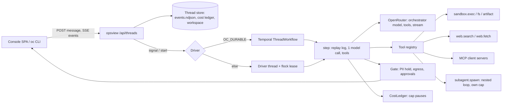
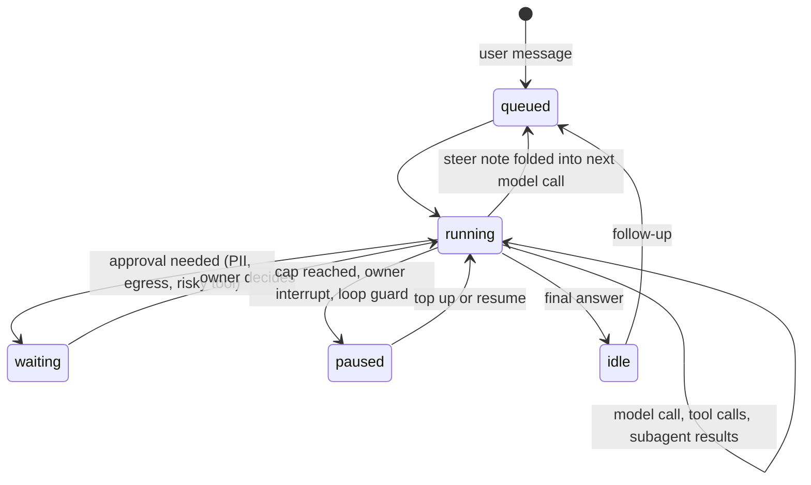

# Chat agent product: threads, a user-picked orchestrator, tools and MCP - Plan

**Target repo:** open-computer. All paths are repo-relative. Ids continue the ROADMAP: **OC-068..OC-085**. Plan-local ids are R (requirement), KTD (decision), U (unit).

## Summary

The console today takes one prompt, decomposes it once into a fixed step graph, runs each step through a router and a placement table, and shows the result. It is a goal runner with no conversation, no orchestrator, no follow-ups, and no way to steer. The owner's verdict was "0/10, a one-prompt trick pony". This plan turns it into the product people expect from Perplexity Computer: **threads**, where each thread is a long-running agent session driven by an **orchestrator model the user picks** (through OpenRouter), using **tools and MCP servers**, spawning **subagents only when needed**, and surviving **very long runs** on durable workers. The approval gate, deny-by-default egress, the cost ledger and the spend rule stay exactly as strict as they are.

Phase 0 (two small PRs) first stops the console lying about where steps run. Everything after builds the thread product in small, shippable PRs, UI shell first so the owner sees progress early.

---

## Problem frame

### What the owner sees (screenshot, 2026-10-31)

Left nav `Computer`, `Agent jobs`, a RUNS list, then an `OPERATOR` block of 12 links (Work, Overview, Goals, Automations, Skills, Sandboxes, Devices, Runs, Approvals, Router, Audit, Workspace); a flat background; a run page whose rows say `jev`, `private`, and `Cloud model`/`Sandbox`. Note: `ui/index.html` declares `color-scheme: light` and `ui/tailwind.config.ts` has only a light "paper" palette, so the dark look in the screenshot most likely comes from a browser forced-dark mode. Either way there is no designed dark theme and no texture.

### What is wrong in the code (verified on `main` at `fd4d9da`)

| # | Finding | Evidence |
|---|---|---|
| P1 | **Goal runs have no orchestrator.** `Orchestrator.submit` calls `decompose()` once (a single model call returning a JSON DAG), then workers execute steps independently. Nothing reads results and decides what to do next. | `services/orchestrator/__init__.py`, `services/orchestrator/decompose.py` |
| P2 | **It is one prompt.** `POST /goals` starts a run and returns a run id. No endpoint accepts a second message; the UI has no thread concept. | `services/opsview/server.py` (`p_goals`), `ui/src/App.tsx` |
| P3 | **The effort model is not the step model.** The effort pick drives only the planner call and steps placed `cloud-OpenRouter`/`cloud-sandbox`. Placement can send a step elsewhere without saying so. | `services/opsview/server.py::_submit_goal`, `services/orchestrator/engines.py::work_fn` |
| P4 | **Silent local routing (root cause of "it ran on jev/local").** Placement rule 6 sends every `cheap`-tier step to `local-llamacpp` whenever a local port answers; rule 3 sends `latency=crit` local; rule 4 sends over-budget steps to `local-ollama`; rule 1 sends PII-flagged steps local. The liveness probe is a bare TCP connect to `127.0.0.1:8080`/`11434`. `work_fn` then calls `local_work` with `OC_LOCAL_MODEL` (default `qwen3-4b`). | `services/placement/rules.py`, `services/placement/health.py`, `services/orchestrator/engines.py` |
| P5 | **"jev" is a label, not the step model.** The run row prints `engine(s.engine)`, which is the router's decision engine (`RouteDecision.engine`, written into the dispatch row). The page never shows which model answered, though every OpenRouter call row records `model_served`. In the screenshot the placement column read `Cloud model` and `Sandbox`; the `jev` text is the router's classifier. | `services/orchestrator/dispatch.py`, `ui/src/components/RunView.tsx`, `ui/src/lib/friendly.ts`, `services/openrouter/client.py` |
| P6 | **Every step says "private".** The server sends `pii` as a list (`list(pii.categories)`); `RunView` tests `s.pii &&`, and an empty array is truthy. | `services/orchestrator/dispatch.py`, `services/opsview/goalruns.py`, `ui/src/components/RunView.tsx`, `ui/src/lib/api.ts` (typed `boolean`) |
| P7 | **The effort budget is silently clamped to $0.10.** `headroom_from` takes the minimum of the router's per-task cap (`Budget.task_cap`, default `$0.10`) and the run ledger, so a Medium ($0.30) run places as if it had at most $0.10. | `services/placement/rules.py::headroom_from`, `services/router/budget.py` |
| P8 | **Automations and durable workers ignore effort.** `submit_goal` builds the default engine (hard-coded `z-ai/glm-5.3-flash`, not in `TIER_MODELS`) with no ledger and no `effort_set` row. | `services/durable/activities.py`, `services/orchestrator/engines.py` |
| P9 | **A real planner loop exists but is not wired.** `AgentLoop` (plan, approve, spawn worker, read result, re-plan; `DEFAULT_ORCHESTRATOR_MODEL = deepseek/deepseek-v4-pro`) works against fakes. `configure_runner` is never called outside tests, so a submitted agent job stays `queued`. | `services/agents/loop.py`, `services/opsview/agentjobs.py` |
| P10 | **Navigation and look.** 13 nav items in two different navs, an operator block bolted under the runs list, a flat canvas. | `ui/src/lib/nav.ts`, `ui/src/components/Sidebar.tsx`, `ui/src/components/PageShell.tsx` |
| P11 | **No tool-calling or streaming in the model client.** `services/openrouter/client.py::chat` takes one prompt (or messages), reads `choices[0].message.content`, and discards `tool_calls`. No SSE streaming. | `services/openrouter/client.py` |
| P12 | **MCP exists only as a server.** `services/mcp/server.py` exposes safety primitives to other agents. There is no MCP client. | `services/mcp/server.py` |

An untested WIP patch (`oc-local-routing-wip.patch`, 10 files, +283/-52; not in the repo) already sketches the Phase 0 fix: local models opt-in via `OC_LOCAL_MODELS`, the effort model for every step, PII-flagged steps held for approval instead of sent local, and the real per-step model and cost recorded. OC-068 starts from it and must land with tests.

### What already exists and is reused

- **Event stream contract** (`docs/design/event-stream.md`, `oc/events/`): typed events (`run step tool_call source artifact change approval cost note error`), gapless `seq`, upsert-by-id, payload-hash-bound approvals, a loop guard that pauses at 3 repeats, cost thresholds at 80% and 100%, SSE transport with replay. Served today only by the fixture-backed `/workspace` surface (`services/workspace/`).
- **Durable infrastructure:** `services/durable/` (Temporal worker, `GoalRunWorkflow`, `GoalCronWorkflow`), `services/opsview/automations.py` (schedules).
- **Spend control:** `services/cost/ledger.py` (cap is a row, pauses never cancels, reservations), `services/opsview/effort.py` (levels and `resolve`), `tests/unit/test_spend_rule.py`.
- **Approvals:** `services/gate/` (PII scan, hash-bound single-use approvals, audit) and `services/agents/approvals.py` (`ApprovalStore`, `ConsoleApprover`, per-job `lease`).
- **Agent infrastructure:** `services/agents/` (`Trail`, `replay`, `policy.classify`, ACP worker, sandbox launcher, per-job workspace, `JobRunner` with resume).
- **Execution:** `services/execplane/` (sandbox adapter, egress policy), `services/device/` (device plane).

---

## Requirements

- R1. A **thread** holds many turns. The owner can send follow-ups, interrupt, steer mid-run, resume after a pause or restart, and see the full history. (P1, P2)
- R2. Each thread has one **orchestrator model**, chosen by effort level (defaults) or an explicit model override, called through OpenRouter in a tool-calling loop. The same model plans and acts; nothing silently substitutes another. (P3, P4, P9)
- R3. **Subagents** are spawned by the orchestrator only when it decides they help, with their own budget, tool set and context; they return a summary and artifacts. (R2)
- R4. **Local models are opt-in** and always labelled; placement never picks one by default. Private content is held for approval, never silently sent local or to the cloud. (P4)
- R5. **Super-long runs** survive restarts and crashes: durable workers, checkpoints derived from the event log, budget pauses that wait for the owner, resume with a raised cap. (P8)
- R6. The **approval gate**, deny-by-default egress, payload-hash-bound single-use approvals, human-only approval, the cost ledger hard cap, and the spend rule are unchanged or stricter. (ROADMAP scope)
- R7. **Built-in tools:** sandbox shell, files, artifacts, web search and fetch, ask-the-owner; browser later. **MCP client** with per-server approval and secrets via `OC_*` environment variables. Every tool call is visible in the stream. (P11, P12)
- R8. **UI:** Perplexity-style left nav (New, Threads/Recents, Automations, Artifacts, Connectors, Settings), all operator pages inside one **Developer** area in Settings, streaming chat with collapsible step and tool cards, a designed light and dark theme with background texture and depth, mobile layout. (P10)
- R9. The run page and thread view always show the **real model and real cost** per step or turn, and never label a step private without PII. (P5, P6, P7)
- R10. A **CLI** (`oc`) talks to the same thread API, later. (OC-039)
- R11. Existing runs and agent jobs stay readable. No destructive data migration. (see Migration)

## Scope boundaries

**Not in this plan:** hosted multi-user SaaS, a memory product, premium-model defaults, any change to who may approve, publishing to marketplaces (OC-057..065), live acceptance of the CubeSandbox path (OC-023, OC-031).

### Deferred to follow-up work

- Browser/computer-use tool (OC-045): listed as a late unit, built after the shell and MCP tools are proven.
- Device-plane tool (`device.run`) wrapping `services/device/`: a thin tool added once the registry of tools exists; not a blocker.
- Cross-thread memory.
- Voice in the thread composer beyond today's dictate button.

---

## Key technical decisions

- **KTD1. The thread is the product, the event log is the state.** A thread is a directory with an append-only event log in the existing event-stream format (`oc/events/`), a cost ledger row file, and a workspace. Everything the UI shows is a projection of the log (the contract's own rule), and every driver (in-process or Temporal) rebuilds state by replaying it. This is how `services/agents/replay.py` already works for jobs. *Why:* crash-resume and live streaming both fall out for free, and one contract serves console, CLI and replay tests.
- **KTD2. A new tool-calling orchestrator loop, built on the agents infrastructure; `AgentLoop` becomes one tool.** `services/agents/loop.py` is the right base for infrastructure (trail/replay, approvals with hash binding, lease, runner threads and `resume_all`, budget warn at 80%, stall guards, redact-before-truncate) but the wrong shape for chat: it speaks a JSON planner protocol, asks for plan approval on every job, and spawns exactly one ACP worker per round. The new loop (`services/threads/`) calls the model with native tool calling; the ACP coding worker becomes a subagent kind (`agent.spawn(kind="harness")`) so existing Agent-jobs work is kept, not rewritten. Plan approval becomes an opt-in "plan first" mode, not a gate on every message. Shared pieces are extracted (not copied) from `services/agents/` into a neutral package in U6.
- **KTD3. The effort picker maps to defaults; the model picker overrides.** Effort level sets orchestrator model, per-turn budget, and subagent allowance (Low 0, Medium 2, High 4 concurrent). An explicit model must be tool-call capable (OpenRouter's model list exposes supported parameters; confirm field at build time) and inside the spend rule. `services/opsview/effort.py::resolve` stays the single validator and grows a model catalog fed from OpenRouter, cached.
- **KTD4. Local models are opt-in, by flag and by label.** `OC_LOCAL_MODELS=1` enables them; they appear in the model picker with a "local" badge and are never chosen by placement. Placement rules 3-6 (latency, headroom demotion, cheap-to-local) are removed from the chat path. `place()` keeps rules 0, 1.5, 2 (device, egress, sandbox) for *tool* placement. PII-flagged content is held for approval (`kind=pii-send`) before any model call, using the existing hash-bound gate.
- **KTD5. One budget model.** A turn has a cap from the effort level, clamped by the thread ceiling and `OC_DAILY_CAP`. Subagents get a carved sub-cap (a child ledger id) reserved from the parent at spawn and reconciled at end. Hitting any cap emits `run paused reason=cap` and **waits**; the owner tops up (`CostLedger.resume`) from the thread. The router's `task_cap` is removed from the chat path (P7).
- **KTD6. Durable long runs: Temporal workflow per thread, one idempotent step per activity.** `ThreadWorkflow` loops `step(thread_dir)`: each activity replays the log, performs exactly one model call plus its tool calls, appends events, returns `{idle|waiting|paused|continue}`. Signals carry `user_message`, `interrupt`, `approval_decided`, `resume`. `continue_as_new` bounds history. Without Temporal (`OC_DURABLE` off) the same `step` runs on a driver thread under the per-thread `flock` lease. *Why:* matches `GoalRunWorkflow`'s pattern, and restarts cost at most one in-flight step (charged its estimate once, as `AgentLoop` does today).
- **KTD7. Tool results and MCP output are untrusted DATA.** Reuse the `<<<DATA ... DATA>>>` wrapping from `Orchestrator._with_dep_results`. No tool exists that approves, grants, or applies policy (the `FORBIDDEN` words test in `tests/mcp/` is extended to the orchestrator's registry).
- **KTD8. MCP servers are sandboxed by default.** A stdio MCP server runs inside a microVM through the same in-VM relay pattern as `services/agents/sandbox.py`; a remote HTTP server needs its host in the approved egress set. Enabling a server is a hash-bound approval over its tool manifest; a changed manifest asks again. Secrets are `OC_*` env references, never written to the config file or the log.
- **KTD9. Legacy is read-through, then deleted.** The thread list includes old goal runs and agent jobs as read-only one-turn threads. A follow-up on one forks a new thread seeded with its goal and result summary. Deletion of the decompose DAG happens last (U16), after the device plane no longer depends on it.
- **KTD10. The UI follows `luke-operator-ui` where it fits a chat product:** command palette on Cmd/Ctrl+K, `j`/`k` in lists, skeletons, four status colours, every error with an action, every empty state in three parts. Model screens on Perplexity Computer (thread + side panel) and Linear (lists). Dependencies stay minimal (no new UI framework; the console's React + Tailwind remains).

---

## High-level technical design

### Components



### One turn



### Thread layout on disk

```text
$OC_THREADS_DIR/<thread>/
  events.ndjson     # oc/events stream: note(user/agent), turn, step, tool_call, approval, cost, artifact, error
  meta.ndjson       # title, effort, model, caps (rows; latest wins), archived
  cost.ndjson       # CostLedger rows (thread and subagent ids)
  workspace/        # files the agent owns; sandbox mounts it
  artifacts/
```

### Orchestrator step (directional)

```text
state = replay(events)                 # messages, open tool calls, spend, pending approvals
if pending approval or paused: return waiting/paused
ctx = build_context(state)             # compact old turns; wrap tool output as DATA
if pii(ctx) and not approved: request approval, return waiting
reply = model(state.model, ctx, tools) # stream tokens as note events
for call in reply.tool_calls: policy -> run | ask owner | refuse; append tool_call events
if reply.final: emit note kind=final; return idle
return continue
```

---

## Phases and implementation units

Phases are ordered; units inside a phase can often run in parallel (noted). Each unit is one small PR with tests. "Delete" lists what the PR removes so the codebase shrinks as it grows.

### Phase 0: stop lying (OC-068, OC-069)

### U1. Routing truth (OC-068)

**Goal:** a run uses exactly the model its effort level names, and the record says so. Local models only when opted in.
**Requirements:** R2, R4, R9.
**Dependencies:** none. Start from the WIP patch.
**Files:** `services/placement/rules.py`, `services/placement/health.py`, `services/placement/__init__.py`, `services/orchestrator/dispatch.py`, `services/orchestrator/engines.py`, `services/orchestrator/runner.py`, `services/orchestrator/__init__.py`, `services/opsview/goalruns.py`, `services/durable/activities.py`, `services/gate/queue.py`; tests `tests/unit/test_placement_table.py`, `tests/unit/test_engines.py`, `tests/unit/test_effort.py`, `tests/unit/test_spend_rule.py`, `tests/opsview/test_goals.py`.
**Approach:**
- `OC_LOCAL_MODELS` flag (off by default); with it off, `place()` never returns a `local-*` target. Remove the cheap-to-local rule and the latency and over-budget demotions from the goal path; over-budget now pauses via the ledger.
- PII-flagged steps create a hash-bound approval (`kind=pii-send`) and hold; denied means the step fails with a reason.
- Headroom comes from the run ledger only; drop the router `task_cap` from `headroom_from`'s inputs on this path.
- Record `model_served`, tokens and cost on each dispatch/step row from the usage already captured (`collect_usage`).
- `services/durable/activities.py::submit_goal` takes effort, model, budget, creates the ledger and the `effort_set` row; remove the hard-coded `z-ai/glm-5.3-flash` fallback or add it to `TIER_MODELS` under the spend rule.
**Execution note:** characterization-first on `tests/unit/test_placement_table.py` (its 1,152-case invariant table encodes the old rules); rewrite the invariants deliberately.
**Test scenarios:**
- Local port listening, `OC_LOCAL_MODELS` unset, cheap-tier step: placement is `cloud-OpenRouter` with the effort model. Covers P4.
- `OC_LOCAL_MODELS=1`: same step may still go cloud; a local target only when explicitly requested by the thread's model choice.
- Medium run (cap $0.30), router `task_cap` $0.10: a $0.20 step is placed, not demoted. Covers P7.
- PII-flagged prompt: step held, approval row carries payload hash; approve then run; deny then step FAILED with reason; never a `local-*` target.
- Automation fire (`submit_goal`): has `effort_set`, a ledger with the cap, and the effort model.
- Spend rule: no default resolves above the price ceiling; fallback model is covered.
**Verification:** the run's step rows show the effort model and a real cost; no step runs on a local endpoint with the flag off.
**Risks:** the old table tests are the safety net for device, egress and sandbox rules; keep every invariant not tied to the removed rules.

### U2. Run page truth (OC-069)

**Goal:** the run page stops showing false labels.
**Requirements:** R9.
**Dependencies:** U1 (needs the recorded model).
**Files:** `ui/src/components/RunView.tsx`, `ui/src/lib/api.ts`, `ui/src/lib/friendly.ts`, `ui/src/components/primitives.tsx`; tests `tests/e2e/spa.e2e.mjs`, `tests/e2e/console.e2e.mjs`.
**Approach:** `pii` is `string[]`; show "Private details" only when non-empty, with the categories in the tooltip. Replace the router-engine label with the model that answered and its cost; drop the `jev`/router text from the default view (kept in Developer). Show effort, model and spend against cap in the header (already present).
**Test scenarios:** step with `pii: []` shows no private label (Covers P6); step with `["email"]` shows it; the row names the served model; an axe pass on the run page.
**Delete:** the `engine()` label mapping for the default view in `ui/src/lib/friendly.ts`.

### Phase 1: thread foundation and the visible shell (OC-070, OC-071, OC-072)

U3 and U4 can run in parallel; U5 (shell) needs only U3's list endpoint and ships next.

### U3. Thread store, API and stream (OC-070)

**Goal:** create a thread, post messages, read the stream, with no agent behind it yet (a stub driver echoes).
**Requirements:** R1, R11.
**Dependencies:** U1.
**Files:** create `services/threads/__init__.py`, `services/threads/store.py`, `services/threads/legacy.py`, `services/threads/api.py`; modify `services/opsview/server.py` (route tables), `oc/events/schema/event.schema.json`, `oc/events/emitter.py`, `docs/design/event-stream.md`; tests `tests/unit/test_threads_store.py`, `tests/opsview/test_threads_api.py`, `tests/opsview/test_get_side_effects.py`, `tests/opsview/test_csrf.py`.
**Approach:**
- Routes: `GET /api/threads`, `POST /api/threads`, `GET /api/threads/<id>`, `POST /api/threads/<id>/messages`, `POST /api/threads/<id>/interrupt`, `GET /api/threads/<id>/events` (SSE, `Last-Event-ID` replay). Follow the GET/POST route-table convention that the side-effect and CSRF tests enumerate.
- Stream contract changes (additive, `v` stays 1): thread id prefix allowed alongside `g_`; a `turn` type (`id`, `status`, `model`, `effort`, `cap_usd`); `note.kind` gains `steer`; the stream ends only on archive, not on a turn's end (today the SSE stream ends after a terminal `run`). Verify the schema's closed enums and update the UI projection tests.
- `legacy.py` lists old goal runs (`OC_GOALS_DIR`) and agent jobs (agent trail) as read-only threads; a follow-up forks.
**Test scenarios:** create then list; message appends a user `note` and returns immediately; stream replays from `Last-Event-ID`; two clients see the same `seq`; a GET never writes (existing side-effect test); a POST without CSRF is refused; legacy goal run appears as one turn with its result; follow-up on a legacy thread creates a new thread seeded from it; schema rejects an unknown type.
**Verification:** events validate against the schema; reload rebuilds the same thread.

### U4. OpenRouter tools and streaming (OC-071)

**Goal:** a model client that does tool calls and streams, with usage and cost captured exactly as today.
**Requirements:** R2, R7.
**Dependencies:** none.
**Files:** `services/openrouter/client.py`, `services/openrouter/__init__.py`, create `services/openrouter/stream.py`; tests `tests/unit/test_openrouter_client.py`, `tests/unit/test_openrouter_wiring.py`, `tests/unit/fake_openrouter.py` (add tool-call and SSE replies).
**Approach:** `chat_tools(model, messages, tools, stream)` returns text, `tool_calls`, usage, cost, `finish_reason`; streaming yields token deltas and assembles tool-call fragments; the attribution and call-record path (`post`) is reused, with a streaming variant that records the same row on completion. Cost still comes from the provider response (final usage chunk), never a local price table.
**Test scenarios:** a reply with two tool calls parses both; fragmented streamed arguments assemble to valid JSON; a malformed argument string is an error row, not a crash; usage lands in the `collect_usage` sink; a mid-stream disconnect records an error row and raises `OpenRouterError`; reasoning text still reaches `collect_reasoning`; a model without tool support is rejected before the call.

### U5. App shell, nav, texture, mobile (OC-072)

**Goal:** the owner's biggest visible complaint fixed first: one Perplexity-style shell, a designed look with depth, and a usable phone layout.
**Requirements:** R8.
**Dependencies:** U3 (thread list; legacy runs fill it).
**Files:** create `ui/src/components/AppShell.tsx`, `ui/src/components/ThreadList.tsx`, `ui/src/lib/theme.ts`; modify `ui/src/App.tsx`, `ui/src/main.tsx`, `ui/src/lib/nav.ts`, `ui/src/index.css`, `ui/tailwind.config.ts`, `ui/index.html`, `DESIGN.md`; tests `tests/e2e/spa.e2e.mjs`, `tests/e2e/console.e2e.mjs`.
**Approach:**
- Nav, top to bottom: **New thread** button, **Threads** (recents list with status dot and a "needs you" count), **Automations**, **Artifacts**, **Connectors**, footer with spent today, **Settings**, identity. Cmd/Ctrl+K palette for navigation and thread search.
- One `AppShell` replaces `Sidebar` (home) and `PageShell` (other pages). Operator routes keep working but leave the nav; they move under Settings in U12. Python-rendered pages keep their shell until ported.
- Visual system (see DESIGN.md update): a light and a dark theme chosen by `prefers-color-scheme` with a manual override, CSS-only grain (inline SVG noise at 3-4% opacity), a soft radial glow behind the composer, a vignette, translucent sidebar over the canvas, two shadow tiers, hairline borders. `prefers-reduced-motion` and `prefers-reduced-transparency` respected. No image assets; initial CSS under budget.
- Mobile: under 768 px the sidebar is a top bar plus slide-in drawer; focus returns to the menu button; the composer sticks to the bottom.
**Test scenarios:** nav shows exactly the six entries; legacy runs appear under Threads; the palette opens with Cmd+K and Esc closes it; at 390 px the composer is visible without horizontal scroll and the drawer traps and returns focus; dark and light both pass axe contrast; reduced-motion removes the glow animation; every old operator URL still resolves.
**Delete:** `ui/src/components/Sidebar.tsx`, the duplicate nav in `ui/src/components/PageShell.tsx`, the `view === "agents"` branch in `ui/src/App.tsx`.

### Phase 2: the orchestrator (OC-073 to OC-077)

### U6. Orchestrator turn loop (OC-073)

**Goal:** a message produces a real agent turn: model call, tool calls, results fed back, until a final answer, with budgets, approvals, steering and interrupt.
**Requirements:** R1, R2, R4, R6.
**Dependencies:** U3, U4.
**Files:** create `services/threads/loop.py`, `services/threads/context.py`, `services/threads/driver.py`, `services/threads/policy.py`; extract shared code from `services/agents/` (`trail.py`, `approvals.py`, `replay.py`, `runner.py` pieces) into the shared package; modify `services/opsview/effort.py`, `services/opsview/server.py`; tests `tests/unit/test_thread_loop.py`, `tests/unit/test_thread_resume.py`, `tests/unit/test_agent_approvals.py`, `tests/unit/test_agents.py`.
**Approach:** the step in the technical design above. Model comes from the turn row (effort default or override). The in-process driver runs under the per-thread `flock` lease and resumes unfinished threads at start (as `JobRunner.resume_all` does). Steer: new user messages are read before each model call and folded in; interrupt cancels the in-flight tool (process-group kill) and pauses. Loop guard at 3 identical calls. Approval kinds reuse `ApprovalStore` (egress, risky tool, spend at 80%, `pii-send`). Context builder keeps the system prompt, pinned facts and recent turns verbatim; older turns are summarised (U10).
**Test scenarios:** scripted fake model: tool call then final answer produces the expected events; a follow-up reuses prior context; a steer message arrives mid-run and appears in the next call; interrupt stops within one tool call and the thread is `paused reason=user`; a restart mid-tool charges the estimate once and replans (parity with `AgentLoop` resume tests); cap reached emits `paused reason=cap` and nothing else starts; top-up resumes; three identical calls pause; an approval denied leaves the turn waiting or failed with a reason, never proceeds; tool output containing "ignore previous instructions" stays inside the DATA wrapper; no tool in the registry matches the forbidden approval words.
**Execution note:** write the resume and cap tests first; they define the contract.

### U7. Built-in tools: sandbox, files, artifacts, ask (OC-074)

**Goal:** the orchestrator can run commands in a per-thread sandbox, read and write its workspace, save artifacts, and ask the owner a question.
**Requirements:** R7.
**Dependencies:** U6.
**Files:** create `services/threads/tools/__init__.py`, `services/threads/tools/sandbox.py`, `services/threads/tools/files.py`, `services/threads/tools/artifacts.py`, `services/threads/tools/ask.py`; reuse `services/execplane/`, `services/agents/workspace.py`, `services/agents/sandbox.py`; tests `tests/unit/test_thread_tools.py`, `tests/unit/fake_sandbox.py`.
**Approach:** one persistent sandbox per thread (the run-sandbox registry in `services/orchestrator/engines.py` is per run with a 30-minute TTL; threads need re-create on expiry with the workspace re-seeded, since snapshot and resume are still OC-030). Egress deny-by-default; a command needing a host raises the existing egress approval. File tools are confined to the thread workspace (path escape tests). `artifact.save` writes under `artifacts/` and emits an `artifact` event with a same-origin URL. `ask` emits a question note and moves the turn to `waiting`.
**Test scenarios:** exec output tail appears in `tool_call` events; path traversal and symlink escape refused; sandbox expiry mid-thread re-creates and the next command sees workspace files; egress to an unapproved host asks, deny means the command fails with the reason; artifact URL is same-origin only; `ask` blocks the turn until answered.

### U8. Web tools (OC-075)

**Goal:** `web.search` and `web.fetch` with citations and host approval.
**Requirements:** R7.
**Dependencies:** U6.
**Files:** create `services/threads/tools/web.py`; modify `services/threads/tools/__init__.py`; tests `tests/unit/test_thread_web.py`.
**Approach:** search through a provider chosen in U12 settings (open decision D6); fetch runs host-side with an SSRF guard (no private or link-local ranges, redirect re-check), per-host approval ("allow this site for this thread"), content hash recorded, output size-capped and DATA-wrapped; emits `source` events with `fetched` true or false per the stream contract.
**Test scenarios:** fetch of `127.0.0.1`, metadata IPs and redirects to them refused; an unapproved host asks once per thread; `source` events carry content hashes; an oversized page is truncated with a marker; search results cited from snippets are flagged not verified.

### U9. Subagents (OC-076)

**Goal:** the orchestrator can spawn a subagent for a bounded task, only when it chooses to.
**Requirements:** R3.
**Dependencies:** U6, U7.
**Files:** create `services/threads/subagent.py`; modify `services/threads/loop.py`, `services/opsview/effort.py` (allowance per level), `services/agents/worker.py` (harness kind); tests `tests/unit/test_thread_subagent.py`.
**Approach:** `subagent.spawn(task, tools, model?, budget)` runs the same loop with its own context, a restricted tool set (never `subagent.spawn`: depth 1), and a child ledger id carved from the parent cap at spawn. It returns a summary and artifact ids, not its transcript (transcript stays in the log under a `step kind=subagent` row, collapsed in the UI). Concurrency capped by effort level. The system prompt tells the orchestrator to try directly first; a metric (spawns per turn, cost per spawn) is logged so over-use is visible. A `harness` kind wraps the existing ACP worker for coding tasks, so Agent-jobs behaviour survives.
**Test scenarios:** spawn with budget above the remaining parent cap is refused; child cap exhaustion pauses the child and reports to the parent, parent not charged beyond its carve-out; depth-2 spawn refused; concurrency limit queues the extra spawn; child cannot use tools outside its set; Low effort allows zero spawns; parent restart mid-child resumes the child from its own log.

### Phase 3: super-long runs (OC-077, OC-078)

### U10. Context compaction (OC-077)

**Goal:** a thread can run for hours without overflowing the model context or the budget.
**Requirements:** R5.
**Dependencies:** U6.
**Files:** `services/threads/context.py`; reuse jev-compact (OC-046) if its span-scoring fits, else a summariser turn on the effort model; tests `tests/unit/test_thread_context.py`.
**Approach:** when the context passes a threshold, summarise older turns into a checkpoint note (kept in the log, never rewriting history); the summary call is metered like any call; facts the owner pinned stay verbatim.
**Test scenarios:** a 200-turn fixture stays under the window; a pinned fact survives; summary cost is charged; replay of the log yields the same context.

### U11. Durable thread workflow (OC-078)

**Goal:** threads survive restarts and run for days.
**Requirements:** R5.
**Dependencies:** U6.
**Files:** `services/durable/workflows.py`, `services/durable/activities.py`, `services/durable/client.py`, `services/durable/worker.py`, `services/threads/driver.py`; tests `tests/unit/test_durable_threads.py` (Temporal test environment or fakes, as existing durable tests do).
**Approach:** `ThreadWorkflow` per thread (id `thread-<id>`), activity `thread_step`, signals `user_message`, `interrupt`, `approval_decided`, `resume`, `continue_as_new` every N steps, activity timeouts sized for a model call plus tools, no heartbeat for sync activities (same note as today's `work_sweep`). `ensure_durable` at startup re-adopts running threads; the in-process driver stays the fallback.
**Test scenarios:** kill the worker mid-step: a new worker continues from the log, in-flight step charged once; a signal while waiting resumes; paused-at-cap waits indefinitely at no cost until `resume`; two workers cannot drive one thread (lease); Temporal down at start falls back to the in-process driver.

### Phase 4: the chat UI (OC-079, OC-080, OC-081)

### U12. Thread view (OC-079)

**Goal:** a streaming chat where each turn shows its work as collapsible cards.
**Requirements:** R1, R7, R8, R9.
**Dependencies:** U3, U5, U6.
**Files:** create `ui/src/pages/Thread.tsx`, `ui/src/components/MessageList.tsx`, `ui/src/components/StepCard.tsx`, `ui/src/components/ToolCard.tsx`, `ui/src/components/ApprovalCard.tsx`, `ui/src/lib/stream.ts`; modify `ui/src/components/Composer.tsx`, `ui/src/components/EffortPicker.tsx`, `ui/src/main.tsx`; tests `tests/e2e/spa.e2e.mjs`, new `tests/e2e/thread.e2e.mjs`.
**Approach:** `EventSource` on `/api/threads/<id>/events` replaces polling for threads; the view is a pure projection of events (the contract's rule). Composer stays at the bottom with the effort picker and a model chip; while a turn runs the send button becomes "Add a note" (steer) and a stop button interrupts. Step and tool cards collapse by default with the output tail on expand; approval cards show who asks, what leaves, where, cost, PII and hash (the fields the Approvals page already shows, `ui/src/pages/Approvals.tsx`). A paused-at-cap banner offers "Add $X and continue". No chat bubbles for agent work: the agent's answer is a document-style block; the owner's messages are compact. Empty state in three parts per the operator-UI rules.
**Test scenarios:** tokens stream into the answer; reload mid-stream rebuilds the same view; steer note appears and the next model call shows it; stop pauses; approval approve and deny through the existing CSRF-checked routes; cap banner top-up; keyboard path (Tab order, Esc, Cmd+Enter to send); axe; 390 px layout; reduced motion.

### U13. Settings and the Developer area (OC-080)

**Goal:** Settings holds the few real preferences; every operator page lives under one Developer area.
**Requirements:** R8.
**Dependencies:** U5.
**Files:** create `ui/src/pages/Settings.tsx`, `ui/src/pages/settings/General.tsx`, `ui/src/pages/settings/Models.tsx`, `ui/src/pages/settings/Budgets.tsx`, `ui/src/pages/settings/Developer.tsx`; modify `ui/src/lib/nav.ts`, `ui/src/main.tsx`, `services/opsview/effort.py`, `services/opsview/server.py` (`GET/POST /api/settings`); tests `tests/opsview/test_effort_api.py`, `tests/e2e/spa.e2e.mjs`.
**Approach:** tabs: General (default effort, theme), Models (default orchestrator by effort, model override list with tool-support and price shown, local models toggle that explains it needs `OC_LOCAL_MODELS`), Budgets (per-turn defaults, thread ceiling, today's spend against `OC_DAILY_CAP`), Connectors link, **Developer** (Overview, Work, Approvals queue, Sandboxes, Devices, Router, Audit, Skills, Workspace, Agent jobs, Self-check, as sub-routes). Settings persist server-side in `meta` rows under `OC_ROOT`, not browser storage, so the CLI reads the same values. Secrets are never shown or stored here (D5).
**Test scenarios:** changing the default effort changes the next thread; an over-ceiling budget is refused with a recommended action; every old operator URL redirects into Developer; the Developer area is the only place operator words appear.
**Delete:** operator entries from `ui/src/lib/nav.ts`.

### U14. Artifacts page (OC-081)

**Goal:** everything threads produced, in one place.
**Requirements:** R8.
**Dependencies:** U7, U12.
**Files:** `ui/src/pages/Artifacts.tsx`, `services/threads/api.py` (`GET /api/artifacts`); tests `tests/opsview/test_threads_api.py`, `tests/e2e/spa.e2e.mjs`.
**Test scenarios:** artifacts list across threads with a link back; same-origin URLs only; deleting is not offered (no destructive action without a decision, D9).

### Phase 5: tools and connectors (OC-082, OC-083)

### U15. MCP client and Connectors (OC-082)

**Goal:** the orchestrator uses MCP servers; the owner adds and approves them in one place.
**Requirements:** R7, R6.
**Dependencies:** U6, U7, U13.
**Files:** create `services/mcpclient/__init__.py`, `services/mcpclient/client.py` (stdio and streamable HTTP, JSON-RPC), `services/mcpclient/registry.py`, `ui/src/pages/Connectors.tsx`; modify `services/threads/tools/__init__.py`, `services/agents/sandbox.py` (run a stdio server in the VM), `services/mcp/server.py` only to share the protocol constants; tests `tests/mcp/test_client.py`, `tests/mcp/test_registry_approval.py`, `tests/mcp/test_server.py`.
**Approach:** config file under `OC_ROOT` lists servers (name, command or URL, env var **names** only). Enabling shows the tool manifest and its hash; approval binds to the hash. Per-tool policy: read-only-annotated tools run after a one-time per-thread allow; others ask each call. Tool calls appear as `tool_call` events with the server name. A manifest change disables the server until re-approved. Remote servers need the host in the approved egress set.
**Test scenarios:** manifest change re-asks; a tool named like an approval action is not exposed to the model; secrets never appear in config, events or logs (extend the redaction tests); a hung server times out and the call fails with a hint; output wrapped as DATA; a stdio server runs only inside the sandbox; an agent cannot enable a server (human-only).

### U16. Browser tool (OC-083, OC-045)

**Goal:** `browser.*` tools via browser-use in the sandbox. Late and optional.
**Dependencies:** U7, U15, live sandbox acceptance.
**Files:** `services/threads/tools/browser.py`, `services/execplane/`; tests to be defined when the sandbox path is proven live. Deferred execution detail.

### Phase 6: migrate and delete (OC-084)

### U17. Automations and goal-run retirement (OC-084)

**Goal:** one execution path.
**Requirements:** R11.
**Dependencies:** U11, U12.
**Files:** `services/durable/workflows.py` (`GoalCronWorkflow` posts a message to a new thread), `services/opsview/automations.py`, `services/opsview/server.py` (retire `p_goals`), `services/opsview/goalruns.py`, `services/orchestrator/decompose.py`, `services/orchestrator/collect.py`, `services/orchestrator/__init__.py`; keep `services/device/*` and the mailbox send path used by the device plane; tests `tests/opsview/test_goals.py`, `tests/opsview/test_automations.py`, `tests/unit/test_dep_results.py`.
**Approach:** a schedule fire starts a new thread titled with the date by default (D8). Old runs remain readable through `services/threads/legacy.py` for two releases, then that adapter is deleted.
**Delete:** decompose DAG, `GoalRunWorkflow`, the `/goals` POST path, `Runs` and `Goals` pages, `AgentJobs` view; `services/placement/rules.py` entries unused after U1.
**Test scenarios:** an automation fire creates a thread with the effort model and cap; device-plane steps still dispatch (the `tests/unit/test_device_*` suite stays green); legacy threads still open.

### Phase 7: CLI (OC-085)

### U18. `oc` CLI (OC-085, absorbs OC-039)

**Goal:** the terminal client for the same API.
**Dependencies:** U3, U6, auth decision D10.
**Files:** create `oc/cli/__init__.py`, `oc/cli/main.py`, `oc/cli/stream.py`; `pyproject.toml` (entry point); tests `tests/unit/test_cli.py`.
**Approach:** `oc chat`, `oc run "goal"` (one-shot thread), `oc threads`, `oc attach <id>`, `oc resume <id>`, `oc ledger`. Output follows the Flight Strip rules in `DESIGN.md` (glyph plus word, `NO_COLOR`). Approvals in the terminal need an interactive TTY, show the payload hash, and have no `--yes` flag.
**Test scenarios:** `oc run` streams and exits nonzero on failure; exit-code contract documented; non-TTY approval attempt is refused; `NO_COLOR` honoured.

---

## Migration of existing data

- No file is rewritten. Goal run directories (`OC_GOALS_DIR`) and agent-job trails (`agent-trail.ndjson`, `agent-approvals.ndjson`) stay where they are and are surfaced read-only as one-turn threads by `services/threads/legacy.py`.
- A follow-up on a legacy thread forks a new thread whose first context is the old goal and its result summary.
- Old URLs (`/runs`, `/goals`, `/approvals`, ...) redirect into the new routes or Developer; none returns 404.
- `OC_THREADS_DIR` defaults beside `OC_GOALS_DIR`; backup is copying the directory.

## Reconciling PR #97 (general-market UX plan)

#97 is superseded for navigation and direction. Fold forward from it: its audit findings A4, A5, A7-A11 (jargon, raw internals, state words, cadence wording, list pattern, empty states, naming) and its plain-language glossary feed U5, U12 and U13 copy; its mobile drawer behaviour is reused in U5. Superseded: its five-entry IA and "Developer tools switch" (this plan uses Settings > Developer and a thread-centred nav), and its DESIGN.md line "no chat-bubble thread UI" (kept in spirit for agent work, but threads are now the product). Its `DESIGN.md` hunk edits the file head; this plan appends a section at the end so the two do not collide, but the "Dark theme: not yet implemented" and "no chat-bubble" lines in #97 must change if #97 is merged instead of closed.

## Risks

| Risk | Mitigation |
|---|---|
| Long runs overspend | Per-turn caps, carved subagent caps, ledger reservations, pause and wait; daily cap clamps everything; tests in U6 and U9 |
| `OC_DAILY_CAP` default of $1.00 makes "very long runs" impossible | Decision D3; until decided, long runs pause at the cap and wait |
| Prompt injection through web and MCP output | DATA wrapping, no approval tools in the registry, approval cards bound to payload hash, host approvals per thread |
| MCP servers run code | Sandboxed by default (KTD8), manifest-hash approval, secrets by env reference only |
| Model without reliable tool calling | Capability check before a thread starts; clear error with a recommended model |
| Per-thread sandbox lifetime (30-minute VM TTL today) | Re-create and re-seed from workspace (U7); real snapshots stay OC-030 |
| Temporal not running | In-process driver fallback keeps parity (U6, U11) |
| Schema change to the event stream breaks the workspace surface and replays | Additive-only change, schema and replay tests in U3 |
| Deleting the DAG breaks the device plane | U17 keeps the mailbox and device code, with the device test suite as the gate |
| Texture hurts performance or accessibility | CSS-only, reduced-motion and reduced-transparency honoured, budget checks in U5 |

## Open decisions for Luke

- D1. **Orchestrator default per effort level.** Proposed: Low `google/gemini-2.5-flash` ($0.10/turn), Medium `deepseek/deepseek-v4-pro` ($0.30), High `x-ai/grok-4.7` ($1.00), as today. Keep, or change?
- D2. **Model override scope.** Any tool-capable OpenRouter model at or under the price ceiling, or only the three above? Anything over the ceiling needs your explicit unlock (spend rule); allow a per-thread "premium" confirm, or never?
- D3. **Budgets for long runs.** The effort budgets are per turn and tiny for hours of agent work, and `OC_DAILY_CAP` defaults to $1.00. Add a "Long run" option where you type a budget up to a raised daily cap?
- D4. **Local models.** Confirm opt-in only. When content is private and local is not enabled: hold for approval (proposed), or refuse?
- D5. **Secrets UI.** Env-var-only (proposed, nothing stored by the console), or an encrypted store behind the passkey (OmaSeal keyring)?
- D6. **Web search provider.** Which one (a search API with a key, or OpenRouter's web plugin if it fits the spend rule)? The tool needs one key.
- D7. **Subagent allowance.** Proposed Low 0, Medium 2, High 4 concurrent, depth 1. OK?
- D8. **Automations.** Each fire creates a new thread (proposed) or appends to one standing thread?
- D9. **Deleting threads and artifacts.** Archive only (proposed), or permanent delete with confirmation?
- D10. **CLI auth.** Device token minted in Settings, or passkey-gated session handoff?
- D11. **Name.** Still "Threads" in the nav (Perplexity says "Recents" and "Threads")? And the product name stays "Open Computer" pending OC-002.
- D12. **#97.** Close it as superseded (proposed) or merge it after trimming?

## Deferred to implementation

- Exact tool JSON schemas and the system prompt text.
- Whether jev-compact fits compaction (U10) or a summariser turn is simpler.
- OpenRouter's field for tool support on the model list, and whether its web plugin satisfies D6.
- Exact event-schema version handling for the `turn` type and thread id prefix.
- Context window thresholds per model.

## Documentation plan

`ROADMAP.md` (this PR): OC-067 row marked merged, rows OC-068..OC-085, a program-track row, product-direction paragraph updated. `DESIGN.md` (this PR): appended console surface section. `docs/next-tasks.md` (this PR): the heaviest first tasks for a coding agent. Each unit's PR updates `docs/FEATURES.md` rows it changes and the OC row it ships.

## Sources and research

Local research only (no external research was required: the approach and technologies are settled locally). Files cited inline. The model-list field for tool support and the web-plugin question are deferred to build time, not asserted here.
