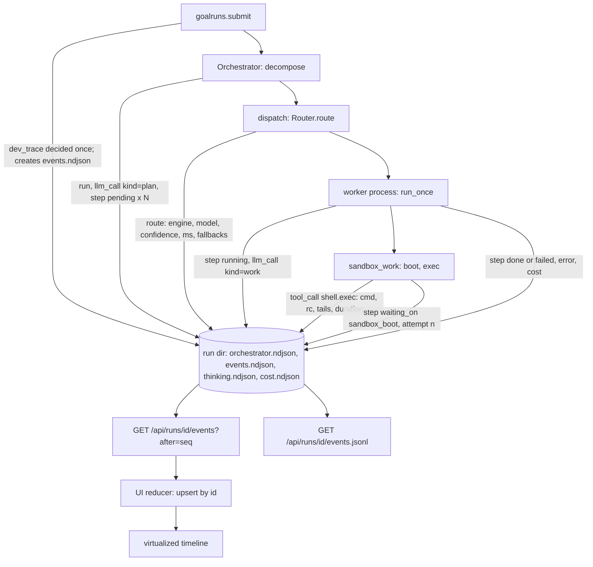
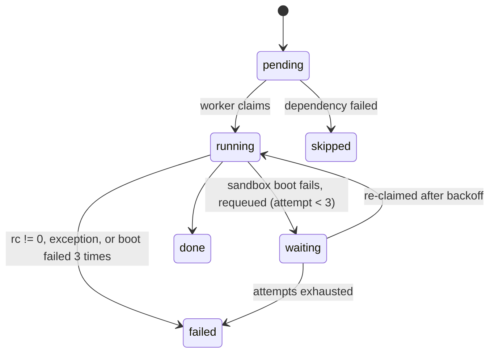

# Runtime truth, dev telemetry spine and live run timeline - Plan

## Goal Capsule

- **Objective:** When the owner runs a goal, the console tells the truth about it: which model did each step and what it really cost, why a step failed or is waiting, and (in dev mode) a live, readable timeline of every decision, model call and command, exportable as one file. Runs stop failing for reasons that are the runtime's fault, not the task's.
- **Means:** fix the runtime bugs at their source, then emit one per-run event stream through the existing `oc/events` contract behind a dev-mode gate, then render it as a timeline in the React console (KTD1, KTD4, KTD7).
- **Authority:** this Product Contract, then `ROADMAP.md`, then `docs/plans/2026-11-04-001-feat-daily-driver-roadmap-plan.md` and `docs/design/event-stream.md`. The approval gate, egress allowlist, cost ledger, spend rule and open-source hygiene test stay exactly as strict as they are.
- **Execution profile:** code, one PR per unit, each based on `main`. U7 is the only unit that is stacked on another unit's PR (KTD10).
- **Stop conditions:** stop and report before any change that needs a live model call or a live microVM to prove it, widens egress, or loosens the approval gate. The telemetry spine and timeline (U6, U7) must not change production behaviour while dev mode is off; the runtime fixes (U1-U5) change production behaviour on purpose. Do not merge or deploy; the owner merges and runs `~/bin/oc-deploy`.

---

## Product Contract

### Summary

Fix seven concrete runtime defects seen in the owner's runs on 2026-11-05, make the run page show the worker model and real cost separately from the router decision, and add a dev-mode telemetry spine plus a Perplexity-Computer-style live timeline that shows each step's model, plan or reasoning text, commands, output, timings, cost, waits and errors.

### Problem Frame

The owner's last three runs (`goal_b0d884e3`, `goal_4b1571a7`, `goal_51210395`) failed or stalled, and the console could not tell him why.
Evidence read from the run directories, the call store and the worker journal:

- Every step showed `jev` and `< $0.0001`. `jev` is the router fallback engine, not the worker model, and the cost is the router's decision call. The primary decider (`perplexity/pplx-decider-v1.1-27b`) returned HTTP 404 "No endpoints found" on all 17 recorded calls, and `Router.route` logs only the exception type, so the fallback was invisible.
- `effort.spent` was 0.0 because the worker model is billed through BYOK. OpenRouter reports `usage.cost: 0` and puts the real spend in `cost_details.upstream_inference_cost` (for example 0.0103 for one step), which `parse_response` stores as `upstream_cost` but ignores. The per-run cost cap therefore never trips for BYOK models.
- Step 2 failed because the act engine pipes whatever the model wrote into `bash`. The model answered with Python, and the fence tag was stripped without looking at it.
- Step 4 failed with a real `IndexError`. The 400-character error kept the head of stderr, which was a harmless `SyntaxWarning`, so the cause looked like "a warning treated as a failure".
- Steps 8-10 failed only as dependents. Their tombstones have no `started_ts`, so any consumer that computes a duration from it gets "now minus zero" (about 1.79e9 s).
- `goal_4b1571a7` died at planning: the planner wrote latency `critical`, the validator accepts only `crit|normal|bulk`, and there is no normalization or retry.
- `goal_51210395` waited about 46 s for a sandbox that never booted, then failed. A boot failure raises `SandboxUnavailable`, which is not retried, and nothing in the console says what it was waiting on.
- No reasoning reached the console. The deepseek calls report `tokens_reasoning: 0`: the model returned none, and nothing records that fact.

### Key Decisions

- **Bugs first, then spine, then view.** The view is only as good as the data under it. Governs R1-R9 ahead of R10-R18. (session-settled: user-directed — chosen over UI-first: the view is only as good as the data under it)
- **The spine is dev-mode gated; production behaviour is unchanged when it is off.** Governs R10, R15. (session-settled: user-directed — chosen over always-on verbose capture: production cost and noise)
- **The router decision is shown apart from the worker model.** Governs R5, R16. (session-settled: user-directed — chosen over a single "engine" label: the owner read the router label as the model)

### Requirements

**Runtime correctness**

- R1. An act step whose generated program is Python runs under `python3`, and a shell program still runs under `bash`.
- R2. A failed step's error shows the end of stderr (the traceback's last lines), not its head, and Python compile warnings do not crowd out the cause.
- R3. Planner output with a near-miss enum value (`critical`, `high`, `background`) is normalized, and a still-invalid plan gets one corrective retry before the run fails.
- R4. A sandbox that fails to boot is retried with backoff through the existing requeue path, and the step records what it is waiting on and which attempt it is on.

**Truth on the run page**

- R5. Each step shows the worker model that served it and its real cost, separately from the router decision (engine, model, confidence, and fallback cause when the primary decider failed).
- R6. BYOK calls count their upstream cost, so `effort.spent` and the per-run cap see real dollars.
- R7. A dependent-failed step has a start time equal to its failure time and renders as skipped, never with a nonsense duration.
- R8. The router logs and records why an engine was skipped (HTTP status and a short redacted reason), and the decider model is configurable.
- R9. A step that returned no reasoning says so ("no reasoning returned") instead of showing nothing.

**Dev telemetry spine**

- R10. With dev mode on, every run writes one append-only event stream recording: run lifecycle, router decision, planner output, step lifecycle, each model call (model requested and served, provider, tokens in/out/reasoning, cost, latency, reasoning text when returned), each sandbox command (command, rc, stdout/stderr tail, duration), each wait with its cause, and each error with its kind.
- R11. The stream is readable incrementally through the console API (`after` cursor) and downloadable as JSONL.
- R12. Dev mode can be turned on from the console without a restart, and also by environment variable; the choice is fixed per run when the run is submitted.
- R13. Dev trace is an explicit content-capture mode that the owner confirms when turning it on. Content in the stream (scripts, stdout, stderr, reasoning) passes through redaction before it is written.
- R14. The stream uses the documented goal event contract (`docs/design/event-stream.md`), extended additively, not a second format.
- R15. With dev mode off, no stream file is created and no extra provider parameters are sent.

**Runtime view**

- R16. The console shows a live timeline per run: one row per step with status, elapsed time, a model chip, a separate router chip, cost, a waiting-on indicator, and errors in plain words; reasoning, plan text, commands and output open on demand.
- R17. The timeline stays responsive on long runs (hundreds of steps and thousands of events): it virtualizes rows and applies only new events.
- R18. The view keeps the DESIGN.md console layer (Silver Lining tokens, one accent meaning "live or needs you", glyph plus word for state, reduced motion honored) and passes axe at 1440 and 390 in both themes.

### Acceptance Examples

- AE1. Covers R5, R8. Given the decider returns 404 and jev answers, when the owner opens the run, then each step shows "Model deepseek-v4-pro · $0.0103" and a quieter "Routed by jev — decider unavailable (404)".
- AE2. Covers R4, R16. Given the sandbox backend refuses to boot twice and boots on the third attempt, when the owner watches the run, then the step shows "Waiting for sandbox — attempt 2 of 3" with elapsed time, then runs and finishes.
- AE3. Covers R7. Given step 4 fails and steps 8-10 depend on it, then 8-10 render "Skipped — step 4 failed" with no duration.
- AE4. Covers R10, R15. Given dev mode is off at submit, then the run directory has no `events.ndjson` and the timeline is not offered; given it is on, the stream exists from the first event.

### Scope Boundaries

- Not built: a Postgres or Supabase sink for the stream (observability stage 3 stays a separate plan).
- Not built: SSE for runs. Incremental GET with an `after` cursor is enough for a single-owner console. SSE belongs to daily-driver U2, and the timeline reducer is shaped so U2 can feed it events without changes (KTD7).
- Not built: thread (chat) timelines. This plan covers goal runs. Daily-driver U5 extends the same served-model fields to threads.
- Considered and not built: asking providers to produce reasoning for models that do not reason by default. It costs tokens and changes model behaviour. The run-effort-to-reasoning mapping belongs to daily-driver U11's reasoning chip. Evidence that would change this: the owner wants dev mode to force reasoning on.
- Considered and not built: a circuit breaker with timed recovery for dead router engines. A process-lifetime skip after a "no endpoints" 404, plus a config override, closes the gap (KTD3). Evidence that would change this: decider 404s that recover within a process lifetime.
- Considered and not built: rejecting plans whose subtask ids map to the same step entity id (`a-b` and `a_b`). Planner ids are `t1`, `t2` in practice, and a collision only merges two timeline rows in dev mode. Evidence that would change this: a real plan with such ids.
- Considered and not built: changing how rc decides success. rc stays authoritative, because the `SyntaxWarning` in step 4 was not the cause.

### Deferred to Follow-Up Work

- Wiring the run event stream into the thread view's SSE (daily-driver U2) and the inline approval card (daily-driver U4).
- Moving the dev-mode toggle from its interim home into the Settings page when daily-driver U12 lands (KTD9).

### Outstanding Questions

- Q1 (owner, non-blocking): the decider model `perplexity/pplx-decider-v1.1-27b` no longer exists on OpenRouter. After U4 the router skips it with a visible reason and uses jev. Should `OC_DECIDER_MODEL` name a replacement, or should the decider leave the chain?
- Q2 (owner, non-blocking): should the run effort level (low, medium, high) request model reasoning? Today it selects only the model.

---

## Planning Contract

### Key Technical Decisions

- KTD1. Bugs are fixed at their source in small, independent PRs off `main` before the spine lands (U1-U5), so the spine records correct data from its first run. (session-settled: user-directed — chosen over UI-first: the view is only as good as the data under it)
- KTD2. Python detection is by a Python fence tag first, then a Python shebang, then a first code line (comments skipped) that starts with `import`, `from … import`, `def`, `class` or `print(`. Python content wins over a shell fence tag, because models mislabel fences. A Python program runs as `python3 - <<'OC_PY'` with `PYTHONWARNINGS=ignore::SyntaxWarning,ignore::DeprecationWarning`. The prompt still asks for bash, so detection is a safety net, not a second contract.
- KTD3. Router fallback causes are carried as data. `EngineDown` gains `status` and a short `reason` (first 160 characters, redacted). `RouteDecision` gains `fallbacks: [{engine, kind, status, reason}]`, `router_model` and `ms` in milliseconds, which fixes the seconds-named-ms bug in `decide.py`. A 404 "No endpoints found" marks that engine skipped for the life of the process, logged once. `OC_DECIDER_MODEL` overrides the decider model id.
- KTD4. Real cost: when `is_byok` is true and `upstream_inference_cost` is present, `parse_response` sets `cost = usage.cost + upstream_inference_cost` (OpenRouter's fee plus the provider's charge). It keeps `cost_source: "provider"` and adds `cost_byok_upstream: true`, so the five existing `cost_source == "provider"` checks (`services/openrouter/client.py` log level and the `Usage` gates, `services/openrouter/store.py` `no_cost_reported`) keep working unchanged. `generation.compare` adds the same two terms.
- KTD5. Step truth lives in the existing audit rows. The `dispatch` row gains a `router` object (engine, model, confidence, ms, fallbacks). `worker_done`, `worker_fail` and `worker_requeue` gain a `worker` object (model served, provider, tokens in, out and reasoning, cost). `Usage` in `services/openrouter/client.py` gains `provider` and `tokens_reasoning`, and `total_usage` sums them (first served model and provider win).
  - Usage collected before a failure is not lost. `work_fn` attaches the collected usage to the exception it re-raises (a `usage` attribute). `run_once` records it to the ledger on the fail and requeue paths as it already does on success, so failed and retried steps count toward `effort.spent` and the cap.
  - `get_run` exposes optional `router` and `worker` fields on each step, so old runs still render. The step's top-level `cost` becomes the worker cost plus the router cost, and the router part stays visible inside `router`.
- KTD6. Sandbox boot failure maps to the existing retryable `SandboxWorkerUnavailable`, so the runner's requeue applies.
  - An "attempt" is one execution of the step. The maximum is the runner's requeue guard plus one, exported as a constant (`MAX_STEP_ATTEMPTS`) that both the runner and `waiting_on.max` read, so the UI text always matches the real count.
  - Inside one attempt, the existing in-step re-create waits 2 s first. The delay between attempts is a `not_before` timestamp (now + 6 s) written on the `worker_requeue` row and honoured when the task is next claimed. Nothing sleeps in the worker sweep.
  - The generated script is cached in the task directory on the first attempt, so requeues do not pay for the model call again.
  - The `worker_requeue` audit row gains `reason` (`sandbox_boot`), `attempt` (executions already made) and `not_before`. `get_run` exposes `waiting_on: {kind, attempt, max, since, detail}` only while the latest start or requeue row for the task is a requeue, so a reclaimed step stops showing the wait.
  - The drive loops (inline `_drive`, `Orchestrator.run`, durable `work_sweep`) do not end on an empty sweep while a step is backing off: they wait until the earliest `not_before`, then sweep again.
- KTD7. The spine is the documented goal event stream (`oc/events`), extended additively, not a new format. (session-settled: user-directed — chosen over a second, parallel telemetry system: avoid duplication) Changes:
  1. Both the `goal` pattern and the event `id` pattern also accept `goal_[0-9a-f]{8}` (so `goal_b0d884e3:1` is a valid id).
  2. New event types `route` and `llm_call`, with their own `data` definitions and enum entries.
  3. `tool_call` is used for sandbox commands (`name: "shell.exec"`). Its definition gains `command`, `rc`, `stdout_tail` and `stderr_tail`, beside the existing `duration_ms`.
  4. `step` gains optional `waiting_on` and `model`. A requeued step stays `status: running` with `waiting_on` set. "Waiting" is a display state the reducer derives, cleared by the next `step` event that carries no `waiting_on`; the status enum does not change.
  5. `run.reason` gains `sandbox` and `queue`.
  6. `error` is used for errors with `code` = error kind.
  7. Entity ids must match the schema's `ref` pattern. Step ids are `step_` plus the subtask id, lowercased, with every other character replaced by `_` (subtask `t1` becomes `step_t1`). Model calls are `call_<call id>` and commands are `tool_<task>_<n>`. The UI reducer keys on these ids.
  The `v` stays 1 because every change is additive and the only readers are in this repository; the schema, `validate`, the summary fold and the docs change in the same PR.
- KTD8. One writer across processes. The orchestrator, console-hosted workers and the `oc-worker` service can all write the same run's stream, which lives at `<run dir>/events.ndjson`.
  - Only `append` takes an `fcntl.flock` on a sibling `.lock` file, mirroring `services/openrouter/store.py`. Under the lock it takes the next seq from the last complete line that parses as an event (seeking from the end; a torn tail is skipped), then writes the event with one `os.write` on an `O_APPEND` descriptor. When the file does not end in a newline, that same write starts with one, so a torn fragment stays its own unreadable line. It never re-parses the whole file.
  - The existing per-goal directory mode (`<dir>/<goal>.ndjson`, used by workspace replay and `goals()`) stays; the fixed-file mode is added beside it.
  - Readers (`read`, `last_seq`, `finished`) never open or create the lock file. They tolerate a torn trailing line, as they do today.
- KTD9. The dev-mode gate is decided once per run, at submit. (session-settled: user-directed — chosen over always-on verbose capture: production cost and noise)
  - Dev mode is on when `OC_DEV_TRACE=1`, or when `dev.json` in the parent directory of `OC_GOALS_DIR` holds `{"trace": true}`. One helper in `oc/obs/devtrace.py` resolves that path for both submit and `/api/dev`.
  - `GET /api/dev` returns `{trace, env, active}`: the file setting, whether `OC_DEV_TRACE=1` forces it, and the effective state. The console switch shows `active` and says when the environment forces it on.
  - An unreadable or invalid `dev.json` counts as off. `POST /api/dev` accepts only a strict boolean, writes the file through a temp file and rename with mode 0600, and `GET /api/dev` never creates the file or its directory.
  - Dev trace is a content-capture mode: it stores program text, command output, plan JSON and model reasoning. It is equivalent to `OC_OBS_CAPTURE_CONTENT=1` for those runs only. The console toggle says so and asks for confirmation before turning it on, and `docs/design/event-stream.md` and `docs/runbooks/observability.md` state it.
  - When dev mode is on, submit creates `events.ndjson` and records `dev_trace: true` on `run_submit`. Every producer emits only when that file exists in the run directory, so a mid-run toggle never splits a run. Producers that know only `run_id` resolve the run directory through the same helper. Daily-driver U12 later moves the toggle into Settings without changing the file.
- KTD10. API shape: `GET /api/runs/<id>/events?after=<seq>` returns `{events, last_seq, finished}`, capped at 500 events per call. `GET /api/runs/<id>/events.jsonl` streams the whole file as a download. Both return 404 `{error: "dev trace off for this run"}` when the run has no stream.
  - `finished` is true only when the terminal `run` event has been returned, so a client keeps paging (with the last seq it received) while a reply holds 500 events and stops only on a finished reply.
  - Both routes use the same `goal_[0-9a-f]{8}` route pattern as the existing run routes, parse `after` as a non-negative integer clamped to the file's range, and send `Cache-Control: no-store`.
  - They are pure reads, guarded by `tests/opsview/test_get_side_effects.py`, whose hostile-query cases cover the new routes.
- KTD11. The timeline consumes events through one pure reducer: upsert by entity id, with first-seen order fixed, as `docs/design/event-stream.md` specifies. It uses `@tanstack/react-virtual` for rows with variable, measured heights, and falls back to a plain list below 60 rows so axe and keyboard behaviour match the current view. Elapsed times come from event `ts` plus one shared 1 s clock, not per-row timers.
- KTD12. Non-dev truth (R5, R7, R9) ships in the existing `RunView`, so the owner sees the real model and cost even with dev mode off. The dev timeline is a separate view reached from the run header ("Timeline") only when the run has a stream.
- KTD13. Tests never call a live model or a live microVM. They use `tests/unit/fake_openrouter.py`, monkeypatched `engines._chat` and `engines._plane`, the fake sandboxes, and the e2e fixture server with routed JSON, as the daily-driver plan's KTD7 already requires. (session-settled: user-directed — chosen over live-call tests: no paid or live model calls)

### High-Level Technical Design

Event flow when dev mode is on (directional):

Step state as the timeline renders it. `waiting` and `skipped` are display states: the stream carries `running` plus `waiting_on`, and `skipped` comes from a dependency failure (KTD7):

### Sequencing

U1-U5 have no logical dependency on each other and each is based on `main`, but they share files:

- `services/orchestrator/engines.py`: U1 (script path) and U5 (boot and retry path).
- `services/orchestrator/runner.py`: U3/U4 (usage on fail and done rows) and U5 (requeue row).
- `services/opsview/goalruns.py` `get_run`, `tests/opsview/test_goals.py`, `ui/src/components/RunView.tsx`, `ui/src/lib/api.ts`, `ui/src/lib/friendly.ts` and `tests/e2e/spa.e2e.mjs`: U3, U4 and U5.

The merge order is fixed: U2, U3, U1, U5, U4, U6, U7. After each merge, the next PR rebases on `main` and re-runs the Python suite and the e2e suite before the owner merges it. U6 is based on `main` and does not depend on U1-U5, but it records their richer fields when they are present. U7 is stacked on U6 because it calls U6's API; its e2e tests use routed fixtures, so it can be reviewed before U6 merges and retargeted to `main` after.

### Assumptions

- The run directory layout (`OC_GOALS_DIR/<goal_id>/`) and the `orchestrator.ndjson` audit rows stay as they are on `main` at `985a182`.
- The call-store rows used as evidence reflect what OpenRouter returns for BYOK today (`is_byok`, `usage.cost_details.upstream_inference_cost`). U4 pins that shape with a recorded, anonymized fixture.
- Adding `@tanstack/react-virtual` (a small dependency with no runtime dependencies of its own) to `ui/` is acceptable. The lockfile is updated in the same PR because CI installs with `--frozen-lockfile`.
- The 1.79e9 s duration was computed by a consumer outside this repository from `started_ts` missing. In-repo renderers already guard it; U3 removes the cause at the source.

### Risks

| Risk | Mitigation |
|---|---|
| Content in the stream (scripts, stdout, reasoning) can hold secrets | Dev trace is an explicit, confirmed content-capture mode (KTD9). Every content field is redacted in full and only then capped (50 lines, 4 KB per tail), so a cut cannot leave a partial token that escapes the patterns. U6 adds `sk_live_`/`sk_test_`, `AIza` and PEM private-key patterns to `oc/obs/redact.py`. Event responses send `Cache-Control: no-store` |
| The stream grows without bound on long runs | Tails and reasoning are capped per event (reasoning 16 000 characters, as `thinking.py` does); the stream is per run and is deleted with the run by the #109 delete path |
| Cross-process seq races corrupt the gapless order, or appends slow down as the file grows | KTD8: flocked append that reads only the last line; a two-process test asserts gapless seq, and a 5 000-append test runs within a time bound |
| Parallel PRs conflict in the shared files listed in Sequencing | Fixed merge order; each later PR rebases and re-runs the Python and e2e suites |
| Treating upstream BYOK cost as spend makes caps trip sooner than before | That is the intended fix; the PR body states it so the owner expects runs to pause at the cap now |

---

## Implementation Units

### U1. Act engine runs Python as Python and reports the real error

- **Goal:** A Python reply from the act model runs under `python3`, and a failed step's error ends with the actual cause.
- **Requirements:** R1, R2; KTD2
- **Dependencies:** none
- **Files:** `services/orchestrator/engines.py`, `tests/unit/test_engines.py`
- **Approach:**
  1. Read the fence tag before stripping it. Classify the program as `python` or `shell` per KTD2.
  2. Build the exec command: `bash` for shell, a `python3` heredoc with the warnings env for Python. Keep base64 transport and fail-closed on rc != 0.
  3. Error detail on failure: the last 1 200 characters of stderr (or stdout when stderr is empty), keeping the final traceback line whole.
  4. Add one sentence to `_SCRIPT_PROMPT`: Python must be inside a `python3 - <<'PY'` heredoc.
- **Patterns to follow:** the `scripted` fixture and `_FakePlane(rc=, out=, err=)` in `tests/unit/test_engines.py`.
- **Test scenarios:**
  - A `python` fence with `import os` produces an exec command that runs `python3`, not `bash`.
  - An untagged fence that starts with `import sys` is detected as Python.
  - A `bash` fence that contains a Python heredoc stays shell.
  - Failure with stderr = 30 lines of `SyntaxWarning` followed by a traceback ending in `IndexError: list index out of range`: the raised error contains `IndexError`.
  - rc 0 with warnings on stderr succeeds, and stdout is the result.
  - Existing tests `test_nonzero_exit_fails_closed` and `test_empty_script_refused` still pass.
- **Verification:** the unit tests pass, and a replay of `goal_b0d884e3` step 2's script body through the classifier selects Python.

### U2. Planner enum normalization and one corrective retry

- **Goal:** A plan with near-miss enum values is accepted, and an invalid plan is retried once before the run fails.
- **Requirements:** R3
- **Dependencies:** none
- **Files:** `services/orchestrator/decompose.py`, `tests/unit/test_decompose.py` (new), `tests/opsview/test_goals.py`
- **Approach:**
  1. Lowercase and strip the enum values, then map aliases in `_canon`. Latency: `critical|urgent|high|realtime -> crit`, `low|background|batch -> bulk`, `medium|default -> normal`. Tier: `low -> cheap`, `medium -> mid`, `high -> frontier`, after confirming the tier set in code.
  2. Values still unknown raise `DecomposeError` as today.
  3. `decompose()` catches the first `DecomposeError`, re-asks the engine once with the validation message appended, then raises on a second failure.
  4. Both attempts' usage is recorded on the `_plan` ledger row. The retry is logged with the error text.
- **Patterns to follow:** plan construction in `tests/unit/test_dep_results.py`; failure rendering in `test_failed_decompose_renders_visible_run`.
- **Test scenarios:**
  - Latency `critical` normalizes to `crit` and the plan validates.
  - Latency `CRIT ` normalizes.
  - Latency `asap` fails the first validation; a scripted engine returning a valid plan on the second call succeeds, and the engine was called twice.
  - Two invalid replies raise `DecomposeError` naming the subtask and value, and the run renders FAILED with that message.
  - The retry prompt contains the validator message.
- **Verification:** the new and existing decompose tests pass, and the conformance check in `tests/conformance/checks/orchestrator_checks.py` still passes.

### U3. Real BYOK cost and honest dependent-failed timing

- **Goal:** `effort.spent` and the per-run cap see real dollars, and dependent-failed steps render as skipped.
- **Requirements:** R6, R7; KTD4, KTD5 (usage on failure)
- **Dependencies:** none
- **Files:** `services/openrouter/client.py`, `services/openrouter/generation.py`, `services/openrouter/store.py`, `services/orchestrator/engines.py` (attach usage to re-raised errors), `services/orchestrator/runner.py`, `services/orchestrator/__init__.py`, `services/opsview/goalruns.py`, `ui/src/components/RunView.tsx`, `ui/src/components/primitives.tsx`, `ui/src/lib/friendly.ts`, `tests/unit/test_openrouter_client.py`, `tests/unit/test_openrouter_wiring.py`, `tests/opsview/test_goals.py`, `tests/e2e/spa.e2e.mjs`
- **Approach:**
  1. `parse_response`: apply the KTD4 rule and add a short comment explaining BYOK.
  2. `generation.compare`: use the same rule.
  3. Usage on failure: `work_fn` attaches collected usage to the exception it re-raises, and `run_once` records it to the ledger on the fail and requeue paths (KTD5).
  4. `_dep_fail`: write `started_ts` equal to the failure ts (a `worker_start` row with `skipped: true`).
  5. `get_run`: mark those steps `skipped: true`.
  6. `RunView`: render a skipped step with a muted dashed-box glyph and the word "Skipped — step N failed" (from the dependency error), no accent and no duration.
- **Patterns to follow:** `test_missing_cost_is_recorded_not_guessed` and `test_full_run_ledger_sees_real_spend_and_ids_reach_openrouter`.
- **Test scenarios:**
  - A recorded, anonymized BYOK response (`is_byok: true`, `cost: 0`, `upstream_inference_cost: 0.0103`) produces call row cost 0.0103, `cost_source: "provider"` and `cost_byok_upstream: true`, with `upstream_cost` kept.
  - A BYOK response with a non-zero fee (`cost: 0.0005`, upstream 0.0103) produces cost 0.0108.
  - A BYOK call does not increment `no_cost_reported` in the store aggregate and logs at info level.
  - A non-BYOK response with `cost: 0` stays 0 and is still flagged as no cost reported.
  - A full fake run with a BYOK worker reports `effort.spent` greater than 0, and a cap of 0.001 pauses the run.
  - A step that makes a paid call and then fails with rc 1 still increases `effort.spent`.
  - Reconcile does not flag a BYOK row as a mismatch.
  - A run where step 1 fails and step 2 depends on it: step 2 has `started_ts == finished_ts` and `skipped: true`.
  - In e2e, a skipped step shows "Skipped" and no duration.
  - Old runs without the new fields still render (`test_old_runs_without_start_or_thinking_still_render`).
- **Verification:** pytest unit and opsview pass, and the SPA e2e passes after `pnpm --dir ui build`.

### U4. Router truth: fallback cause, decider override, worker model per step

- **Goal:** Each step shows its worker model and real cost, and the router decision appears separately with its fallback cause.
- **Requirements:** R5, R8, R9; KTD3, KTD5, KTD12; AE1. This is the goal-run half of ROADMAP OC-068 and OC-069; daily-driver U5 keeps the thread half.
- **Dependencies:** none for correctness. U3 makes the cost non-zero for BYOK, and U4 merges after U3 (Sequencing).
- **Files:** `services/openrouter/client.py` (`Usage` gains `provider` and `tokens_reasoning`; `total_usage`), `services/router/decide.py`, `services/router/router.py`, `services/orchestrator/dispatch.py`, `services/orchestrator/runner.py`, `services/opsview/goalruns.py`, `ui/src/lib/api.ts`, `ui/src/components/RunView.tsx`, `ui/src/components/primitives.tsx`, `ui/src/lib/friendly.ts`, `tests/unit/test_obs_stage2.py`, `tests/conformance/rules/test_router.py`, `tests/unit/test_router_fallback.py` (new), `tests/opsview/test_goals.py`, `tests/e2e/spa.e2e.mjs`, `ROADMAP.md`
- **Approach:**
  1. `EngineDown(status, reason)` from `ask_decisions`. Fix `ms` to milliseconds and remove the `ms < 10` hack in `server.py`.
  2. `Router.route` collects `fallbacks` and logs `status` and `reason` (redacted, content-gated as today), and skips a 404 "No endpoints" engine for the process lifetime.
  3. Read `OC_DECIDER_MODEL` in `default_router`.
  4. `dispatch` writes `router` onto the dispatch row. `run_once` writes `worker` onto `worker_done` and `worker_fail` from collected usage.
  5. `get_run` exposes `router` and `worker` per step and computes `cost` per KTD5. `api.ts` mirrors the types.
  6. `RunView` row: a filled model chip "deepseek-v4-pro" plus the cost first, then a quiet outline chip "routed by jev" with a tooltip line carrying the fallback reason in plain words ("decider unavailable (404)"). A DONE step whose worker reported 0 reasoning tokens shows "no reasoning returned" (R9).
  7. Update the ROADMAP OC-068 and OC-069 rows.
- **Patterns to follow:** `Chip` in `primitives.tsx`; the `error_fields`-style log fields in `oc/obs`; the `_write_run` helper in `tests/opsview/test_goals.py`.
- **Test scenarios:**
  - A decider raising `EngineDown(404, "No endpoints found for ...")` with jev answering produces a decision with engine `jev`, `fallbacks[0] == {engine: "decider", kind: "EngineDown", status: 404, ...}`, and a log line with status 404. The updated `test_router_logs_the_decision_and_every_fallback` still proves that no utterance leaks.
  - A second route call in the same process does not call the decider after a 404 "No endpoints".
  - A 500 from the decider is not skipped on the next call.
  - `OC_DECIDER_MODEL=x/y` is the model sent to `/alpha/decisions`.
  - `RouteDecision.ms` is in milliseconds (a fake 250 ms engine gives roughly 250).
  - A fake run's step has `worker.model == "deepseek/deepseek-v4-pro"` (served id from the fake), `worker.provider` and `worker.tokens_reasoning` set, and `cost` equals worker cost plus router cost.
  - A failed step's `worker_fail` row carries the `worker` object from usage collected before the failure.
  - In e2e, a DONE step with `worker.tokens_reasoning == 0` shows "no reasoning returned".
  - Old runs without `router` and `worker` render.
  - In e2e, the row shows the model chip and the "routed by jev" chip, and the tooltip names the fallback reason. Axe passes, in both themes, at 1440 and 390.
- **Verification:** the router conformance, unit, opsview and e2e tests pass, with light and dark screenshots of the row attached to the PR.

### U5. Sandbox boot retried with backoff and surfaced as a wait

- **Goal:** A sandbox that fails to boot is retried, and the console says the step is waiting for a sandbox and on which attempt.
- **Requirements:** R4; KTD6; AE2
- **Dependencies:** none
- **Files:** `services/orchestrator/engines.py`, `services/execplane/space.py`, `services/execplane/client.py`, `services/orchestrator/runner.py`, `services/opsview/goalruns.py`, `ui/src/lib/api.ts`, `ui/src/components/RunView.tsx`, `ui/src/lib/friendly.ts`, `tests/unit/test_engines.py`, `tests/unit/test_space_adapter.py`, `tests/opsview/test_goals.py`
- **Approach:**
  1. In `sandbox_work`, a `SandboxUnavailable` from boot or exec-refused becomes `SandboxWorkerUnavailable` with the underlying message, after the existing in-step re-create has also failed. Wait 2 s, through an injectable sleep, before that re-create.
  2. Cache the generated script in the task directory on the first attempt and reuse it on requeues (KTD6).
  3. Log the error message, not only its type, in `space.py` and `client.py` "sandbox boot failed".
  4. Export `MAX_STEP_ATTEMPTS` from the runner. On requeue, write `worker_requeue{reason, attempt, not_before}` and skip claiming the task before `not_before`, without sleeping in the sweep.
  5. `get_run` derives `waiting_on` from the latest requeue row when the step is not finished.
  6. `RunView` shows a non-accent leased-dash glyph with "Waiting for sandbox — attempt N of MAX" and elapsed time; `friendly.ts` maps `SandboxUnavailable`.
- **Patterns to follow:** `test_exec_exception_twice_raises`, the requeue tests in the runner, and `fake_space.py`.
- **Test scenarios:**
  - Boot fails (including the in-step re-create) on the first two attempts and succeeds on the third: the step finishes DONE, with two `worker_requeue` rows of reason `sandbox_boot` and attempts 1 and 2.
  - The model is called once across all three attempts (the cached script is reused).
  - Boot fails on every attempt: after `MAX_STEP_ATTEMPTS` executions the step fails with kind `SandboxUnavailable` and a message containing the backend error text.
  - While requeued, `get_run` returns `waiting_on.kind == "sandbox_boot"`, `attempt == 1` and `max == MAX_STEP_ATTEMPTS`.
  - A requeued task is not claimed before its `not_before`, and other ready steps are claimed meanwhile.
  - Sleeps and the clock are injectable, so tests never wait in real time.
  - Existing `test_exec_exception_evicts_the_run_vm` still passes.
- **Verification:** the unit and opsview tests pass.

### U6. Dev telemetry spine: per-run event stream and API

- **Goal:** With dev mode on, every run writes one event stream covering decisions, model calls, commands, waits and errors, readable incrementally and as a JSONL export.
- **Requirements:** R10-R15; KTD7-KTD10, KTD13; AE4
- **Dependencies:** none (records the U3-U5 fields when they are present)
- **Files:**
  - `oc/events/schema/event.schema.json`, `oc/events/log.py`, `oc/events/emitter.py`, `oc/events/summary.py`, `oc/events/validate.py`
  - `oc/obs/devtrace.py` (new: gate check plus a run-scoped emitter lookup bound through `oc.obs.context`)
  - `services/opsview/goalruns.py`, `services/orchestrator/__init__.py`, `services/orchestrator/dispatch.py`, `services/orchestrator/runner.py`, `services/orchestrator/engines.py`, `services/openrouter/client.py`, `services/opsview/server.py`
  - `oc/obs/tail.py` (add `events.ndjson` as a source)
  - `docs/design/event-stream.md`, `docs/runbooks/observability.md`
  - `tests/unit/test_devtrace.py` (new), `tests/opsview/test_run_events_api.py` (new), `tests/opsview/test_events_contract.py`, `tests/opsview/test_get_side_effects.py`
- **Approach:**
  1. Schema: add the KTD7 extensions (both id patterns, `route` and `llm_call` definitions, the `tool_call` fields, entity-id rule) and document them in `event-stream.md`.
  2. `FileLog`: accept a fixed file path (`events.ndjson`) beside the existing per-goal `<goal>.ndjson` mode, and implement the KTD8 append (flock, last-line seq, `O_APPEND` write) with lock-free readers.
  3. Gate: `devtrace.enabled_for(run_dir)` is true only when `events.ndjson` exists. `goalruns.submit` creates it per KTD9 and records `dev_trace` on `run_submit`. `devtrace` also owns the `dev.json` path helper and the run-directory lookup from `run_id`.
  4. Emit points, each a no-op when the gate is off:
     - submit and decompose: `run`, plus `llm_call` kind `plan` with the plan JSON as a redacted `detail`
     - each declared step: `step` pending
     - dispatch: `route`
     - claim: `step` running
     - `post()`: `llm_call` for every call with the bound `run_id`, including reasoning text and `tokens_reasoning`
     - `sandbox_work`: `tool_call` `shell.exec` with the program text, rc and tails
     - requeue: `step` with `waiting_on`
     - done or fail: `step` done or failed, `error`, `cost`
  5. Redaction: every content field is redacted in full through `oc.obs.redact` and only then capped per the Risks table. Add the `sk_live_`/`sk_test_`, `AIza` and PEM private-key patterns to `oc/obs/redact.py`.
  6. API: the KTD10 endpoints, plus `GET /api/dev` and `POST /api/dev` (session, Origin and CSRF, as other POSTs) to read and write `dev.json` per KTD9.
  7. Run delete (#109) removes `events.ndjson` with the run directory, which needs no change.
- **Execution note:** start with a failing contract test that validates a hand-built dev-run stream (one of each new type) against the schema, then wire the emit points.
- **Patterns to follow:** `services/openrouter/store.py` flock; `ThinkingLog` placement beside `orchestrator.ndjson`; `oc.obs.context.bind`; `tests/opsview/conftest.py` `console` fixture; `services/workspace/routes.py` event reads.
- **Test scenarios:**
  - Covers AE4. With dev off, a full fake run creates no `events.ndjson`, sends no extra provider body fields, and leaves `/api/runs/<id>/events` returning 404.
  - Covers AE4. With dev on, a full fake run with two steps (one fails with rc 1) produces a schema-valid stream. The stream holds, in order: `run` running, `llm_call` plan, two `step` pending, `route` with fallbacks, `step` running, an `llm_call` work call carrying model served and cost, a `tool_call` `shell.exec` with rc 1 and a stderr tail, `step` failed, `error` with the kind, and `run` done or failed.
  - Two processes append 200 events each concurrently, and seq is gapless 1..400.
  - 5 000 appends to one stream finish within a fixed time bound (no whole-file re-parse per append).
  - `GET /api/runs/<id>/events` on a run with a stream creates no lock file (the data directory is byte-identical afterwards), and `after=-3` or `after=abc` returns 200 with a clamped cursor or a 400, never a 500.
  - A secret-shaped string (`sk-…`, `sk_live_…`, `AIza…`, a PEM private-key block) in the program text and stderr is redacted in the stream, including when it straddles the 4 KB tail cut.
  - Subtask id `t1` produces step entity id `step_t1`, and the event id `goal_0123abcd:1` validates.
  - `POST /api/dev` with `{"trace": "yes"}` returns 400 and leaves the file unchanged; a corrupt `dev.json` reads as off.
  - Reasoning longer than 16 000 characters is truncated, with a marker.
  - Toggling `dev.json` off mid-run does not stop that run's stream, and the next run has none.
  - `GET .../events?after=5` returns only seq above 5 and `last_seq`; more than 500 pending events pages correctly.
  - `GET .../events.jsonl` returns every line with content type `application/x-ndjson` and a download filename.
  - `POST /api/dev` without CSRF is rejected; with CSRF it flips the file. `GET /api/dev` has no side effects.
  - `python -m oc.obs tail --run <id>` includes the stream's events.
  - The existing workspace event contract tests still pass with the widened schema.
- **Verification:** pytest unit, opsview and conformance pass, ruff is clean, and the hygiene test passes.

### U7. Live run timeline in the console

- **Goal:** In dev mode, the owner can open a clean, live timeline of a run showing each step's model, router decision, reasoning or plan, commands, output, timings, cost, waits and errors.
- **Requirements:** R16-R18; KTD11, KTD12
- **Dependencies:** U6 (API); stacked on U6's branch
- **Files:**
  - `ui/package.json`, `ui/pnpm-lock.yaml` (`@tanstack/react-virtual`)
  - `ui/src/lib/devmode.ts` (new, shaped like `lib/theme.ts`, backed by `/api/dev`)
  - `ui/src/lib/runEvents.ts` (new: types, fetch with `after` cursor, pure reducer)
  - `ui/src/components/runtime/Timeline.tsx`, `ui/src/components/runtime/StepCard.tsx`, `ui/src/components/runtime/CallRow.tsx`, `ui/src/components/runtime/ExecRow.tsx` (new)
  - `ui/src/components/RunView.tsx` ("Timeline" link in the header when the run has a stream), `ui/src/App.tsx` (route `#goal_x/timeline`), `ui/src/components/Sidebar.tsx` (dev-mode switch in the Operator group)
  - `ui/src/lib/friendly.ts`, `tests/e2e/spa.e2e.mjs`, `tests/e2e/shots.mjs`, `DESIGN.md` (one paragraph: the timeline pattern)
- **Approach:**
  1. Reducer: fold events into `{run, steps (ordered, by id), calls by step, execs by step, errors}` with upsert semantics.
  2. Polling: 1 s while the run is live, stopped when `finished`; only events after `last_seq` are fetched.
  3. Header: run status word and glyph, total elapsed, total cost against budget, the "Export JSONL" link, and the dev-mode badge.
  4. Each step card, collapsed, shows: state glyph and word, title, model chip, router chip, elapsed, cost, and a waiting-on line when waiting.
  5. Expanded, a card adds plan or reasoning (a `
` default-closed, with "no reasoning returned" when it is empty), each model call (model served, provider, tokens in/out/reasoning, latency, cost), each command (program in a mono block, rc, stdout and stderr tails), and the error in plain words with the raw text under "Details".
  6. Virtualize with measured rows above 60 steps. Announce state changes politely through `aria-live`. Animate a new row with the 160 ms slide and keep the running line static under reduced motion.
  7. Display states: "waiting" (derived from `waiting_on`, KTD7) uses the leased-dash glyph and the words "Waiting for sandbox"; "skipped" uses a muted dashed box and "Skipped". Neither uses the accent. The `DESIGN.md` paragraph records both.
  8. The dev-mode switch shows the content-capture warning from KTD9 and turns on only after confirmation.
- **Patterns to follow:** `RunView`'s `Thinking` and `StepResult`; the `Chip`, `StateWord` and `Dot` primitives; `pollMs` and the stale-response guard in `App.tsx`; the `open()` helper and routed fixtures in `tests/e2e/spa.e2e.mjs`.
- **Test scenarios:**
  - A routed fixture stream with 3 steps renders 3 cards in first-seen order with model and router chips.
  - A second poll returning only seq above `last_seq`, which moves step 2 to running, updates that card in place without reordering.
  - A step with `waiting_on` sandbox_boot attempt 2 shows "Waiting for sandbox — attempt 2 of 3".
  - A failed exec shows rc 1 and the stderr tail ending in `IndexError`, with the plain-words error first.
  - A step with no reasoning shows "no reasoning returned".
  - A 400-step fixture renders fewer than 80 DOM rows, and scrolling to the end shows step 400.
  - With dev mode off (`/api/dev` false and no stream), no "Timeline" link appears and `#goal_x/timeline` shows an honest empty state.
  - Turning dev mode on shows the content-capture warning, and cancelling leaves it off with no POST sent.
  - "Export JSONL" links to `/api/runs/<id>/events.jsonl`.
  - Keyboard: Tab reaches each card, Enter toggles it, and focus is visible.
  - Axe reports 0 violations at 1440 and 390 in light and dark; screenshots come from `shots.mjs`.
- **Verification:** `pnpm --dir ui typecheck` and `pnpm --dir ui build` pass, `npm test` in `tests/e2e` passes, and screenshots are attached to the PR.

---

## Verification Contract

| Gate | Command | Applies to |
|---|---|---|
| Python lint | `uv run --locked ruff check .` | U1-U6 |
| Python tests | `uv run --locked pytest -m "not live" -p no:cacheprovider` | U1-U6 |
| UI types and build | `pnpm --dir ui typecheck` then `pnpm --dir ui build` | U3, U4, U5, U7 |
| Console e2e | `npm test` in `tests/e2e` (fixture server, routed JSON, Playwright plus axe) | U3, U4, U7 |
| Hygiene | `tests/unit/test_obs_open_source_hygiene.py` passes | all |

Check each command's exit code on its own, not through a pipe. No test may call a live model, live sandbox or network host other than loopback.

## Definition of Done

- Global: R1-R18 satisfied; each unit is its own PR with green CI. The ROADMAP rows OC-068 and OC-069 (goal-run half) are updated, and new rows OC-094 (runtime fixes, U1-U5), OC-095 (dev telemetry spine, U6) and OC-096 (live run timeline, U7) are added in the PRs that complete them. Abandoned-attempt code is removed from every diff. Nothing is merged or deployed by the agent.
- Per unit: its test scenarios exist and pass, its verification commands exit 0, and UI units attach light and dark screenshots at 1440 and 390.
- Owner check after deploy: turn on dev mode in the console, run a two-step goal, open Timeline, and confirm the model chip, router chip, a command with rc, and the JSONL export.

## Appendix

### Evidence pointers

- Act script path: `services/orchestrator/engines.py` (`_SCRIPT_PROMPT`, fence strip, `base64 -d | bash`, rc check).
- Planner validator: `services/orchestrator/decompose.py` (`_LATENCY`, `_canon`, `decompose`).
- Dependent tombstones: `services/orchestrator/__init__.py` (`_dep_fail`); step timing in `services/opsview/goalruns.py` (`get_run`).
- Cost extraction: `services/openrouter/client.py` (`parse_response`, `upstream_cost`); reconcile in `services/openrouter/generation.py`.
- Router chain and logging: `services/router/router.py` (`Router.route`, `default_router`), `services/router/decide.py` (`ask_decisions`, `ms`).
- Dispatch row fields: `services/orchestrator/dispatch.py`; worker rows: `services/orchestrator/runner.py` (`run_once`, requeue).
- Sandbox boot: `services/execplane/space.py` (`make_sandbox`), `services/execplane/client.py` (`_FailedSandbox`).
- Event contract: `oc/events/`, `docs/design/event-stream.md`; observability runbook: `docs/runbooks/observability.md`.
- Run view: `ui/src/components/RunView.tsx`, `ui/src/lib/format.ts`, `ui/src/lib/friendly.ts`, `ui/src/lib/api.ts`.
