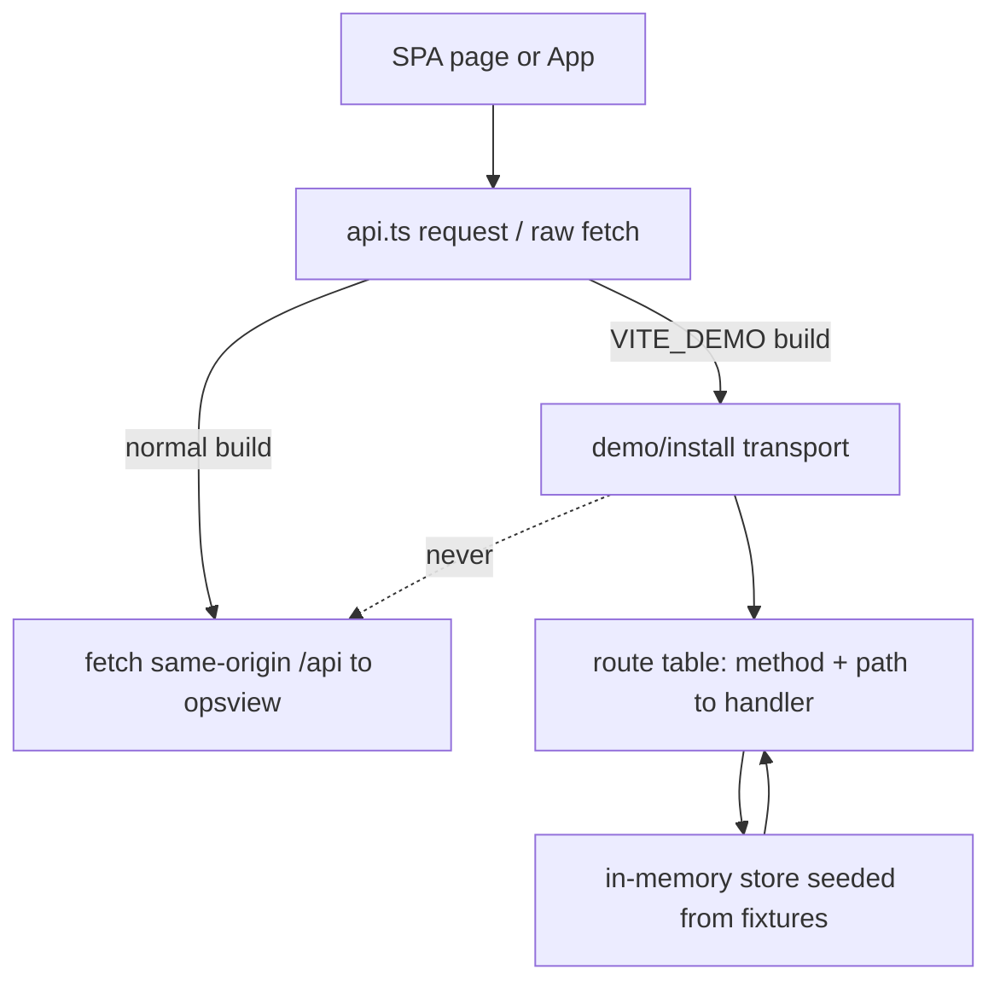

# UI baseline, quiet background, original icon set and a public fixtures demo - Plan

## Goal Capsule

- **Objective:** a stranger can open a public link, sign in through a gate the owner controls, and use a calm, legible, consistent console that behaves like the real product, with no way for that visit to spend the owner's money, run code or read the owner's keys.
- **Means:** a build-time demo mode where the SPA's API layer is answered by in-bundle fixtures, shipped as static assets behind Cloudflare Access (KTD1, KTD2). The UI baseline work lands in the same branch so the demo shows the finished look.
- **Authority:** the owner request of 2026-11-10 (four items). `DESIGN.md` is amended in the same change where the request supersedes it (the 2026-11-08 shader sign-off).
- **Stop conditions:** no Cloudflare API call, resource, DNS record or deploy; no merge; no force-push; no secret in code, logs, fixtures or screenshots; no paid model call. Draft PR only.
- **Finishes the work:** the owner runs the Cloudflare steps in `docs/runbooks/demo-deploy.md` and answers the open questions below.

## Product Contract

### Summary

Four linked changes to the web console in `ui/`: a quiet background, one original icon set, a UI/UX baseline across every page, and a public demo path that runs on fixtures only.

### Problem Frame

The console background is loud: a WebGL dot shader, a carbon-weave pattern, a drifting sheen and a glowing composer edge (`ui/src/components/Ambient.tsx`, `ui/src/lib/ambient.ts`, `ui/src/index.css`). The nav has no icons, the few inline SVGs are ad hoc (`PageShell.tsx` brand, `Composer.tsx`, `StepMark.tsx`), and state is mostly text. Page quality varies: each page rolls its own empty, loading and error handling around `DataState`. The product is not ready for market, but the owner wants to show it. Today every real call goes to opsview on the owner's machine (`ui/src/lib/api.ts`), so a public copy cannot simply point at it.

### Requirements

**Background**

- R1. The canvas is flat: one solid token colour, no pattern, no shader, no drifting layer. Cards and the sidebar stay opaque, text never sits on a pattern.
- R2. No continuous animation runs on the page while idle. The composer "working" ring is kept (see Assumptions A2) and is static under reduced motion and "Reduce effects".

**Icons**

- R3. One original SVG icon set on a 16 grid, square caps, 1.5 px stroke, `currentColor`, covering the actions and entities in the Icon inventory below. No stock pack, no copied brand mark.
- R4. Icons are used through one typed `Icon` component. Nav items, composer actions, run and step states, and entity headings use it; ad hoc inline SVGs are removed.
- R5. An icon never stands alone for meaning: it has a visible word or an accessible name (DESIGN.md "Glyph plus word").
- R6. The same set ships as a reviewable sheet in `assets/brand/`.

**Baseline**

- R7. Type uses the DESIGN.md scale 12 / 13 / 14 / 16 / 20 / 28 and spacing uses one 4 px-based scale, both as named tokens or utility classes, not ad hoc values on pages.
- R8. Every interactive element has a visible `:focus-visible` indicator with at least 3:1 contrast against its neighbours, and the page has a skip-to-content link.
- R9. Every page and the thread view are fully operable by keyboard: logical tab order, nothing focus-trapped, Escape closes any layer it opens, lists with row actions are reachable.
- R10. Every data page has explicit loading, empty and error states with one shared component set, and the error state offers Retry.
- R11. Every page lays out without horizontal scroll and with tap targets of at least 40 px at 390 px width, and uses the width sensibly at 1440 px.
- R12. Text and non-text contrast pass WCAG 2.2 AA in light and dark; the existing token test and axe e2e stay green.

**Demo**

- R13. A demo build (`pnpm build:demo`) answers every API call from in-bundle fixtures. It performs no network request to `/api`, `/goals`, `/automations`, `/_frag` or any other origin, and the page says it is a demo.
- R14. The demo cannot be switched on in the normal build and cannot be switched off in the demo build at runtime: the choice is made at build time, and the production bundle contains no fixture code.
- R15. Writes (send a message, approve, connect, create an automation) are simulated: they change in-memory demo state only, are labelled as simulated, and never leave the page. Nothing persists across reload except theme and effects preferences.
- R16. The demo ships as static assets with a Worker Static Assets config and security headers, and a runbook that tells the owner how to put Cloudflare Access (sign-in, and sign-up through an IdP policy) in front of it. The repo never deploys it.
- R17. Pages that only exist server-side (`/work`, `/workspace`) are not linked in the demo.

### Scope Boundaries

- Not changing how real runs, sandboxes, devices, routing or approvals execute; not touching `services/`.
- Not building a hosted backend, per-visitor sandboxes, quotas or billing. That is the production-backend decision (Open Questions).
- Not redesigning the server-rendered pages (`services/opsview/static/console.css`, `/work`, `/workspace`); only the React SPA.
- Not changing the Iris palette values or Silver Lining tokens.

#### Deferred to Follow-Up Work

- Worker + tunnel proxy for an owner-only live console (OC-092, existing plan `docs/plans/2026-11-01-001-feat-cloudflare-hosted-frontend-plan.md`). This plan does not alter it; the demo is a separate static deployment.
- Moving `/work` and `/workspace` into the SPA (OC-089).

### Assumptions

- A1. "Sign-up" means a visitor can create access without the owner adding each email by hand. Cloudflare Access has no native password sign-up, so the demo plan uses an IdP login method (GitHub or Google) with an `Everyone` include policy, or one-time-PIN to an email allow list. Which one is an owner choice (Open Question 2); the code is identical either way.
- A2. The thinking ring on the composer stays. The request names the background, and `DESIGN.md` records the ring as the one ambient "working" signal the owner likes. Removing it is a one-line change if the owner disagrees.
- A3. "Mostly flat" allows the existing 1 px hairline borders and the two card shadow tiers; it forbids patterns, glows used as decoration, gradients on the canvas and any idle motion.
- A4. The demo is read-mostly with scripted behaviour: one canned thread reply streams in, approvals flip state in memory, and a "Run" is a replay of a stored run. It never calls a model.

## Planning Contract

### Research findings (verified in the repo)

- All SPA data goes through two helpers in `ui/src/lib/api.ts`: `request()` (used by `json()` and `postJson()`), plus raw `fetch` in `getArtifactText` and the transcribe call. There is no `EventSource`; run progress is polled (`pollMs`). A demo can intercept at `request()` and those two sites, so no page needs to know about it.
- Endpoints used by the SPA (from `api.ts`, `devmode.ts`, `runEvents.ts`): `/api/session`, `/api/runs*`, `/api/threads*`, `/api/runtime`, `/api/brain`, `/api/memory*`, `/api/effort`, `/api/devices`, `/api/sandboxes`, `/api/router`, `/api/audit`, `/api/approvals*`, `/api/overview`, `/api/skills`, `/api/automations`, `/api/agent-jobs*`, `/api/openrouter*`, `/api/account`, `/api/connectors*`, `/api/voice`, `/api/dev`, plus `POST /goals` and `POST /automations`.
- The route table in `ui/src/main.tsx` already holds Approvals, Runs, Overview, Skills, Automations and Goals as SPA pages; `ui/src/lib/nav.ts` still flags several as `spa: false`, which makes them full page loads. Only Work and Workspace are server-only.
- Existing gates: `ui/budget.json` (main 133120 B gzip, `motionFeatures` 40960, `ambient` 8192), vitest, `tests/e2e` (Playwright and axe, WCAG 2.2 AA, both themes, 1440 and 390) against `tests/opsview/serve_fixture.py`, CI jobs `python` and `console e2e` in `.github/workflows/ci.yml`.
- `docs/runbooks/accounts-and-connectors.md` states the real site already sits behind Cloudflare Access and the Access email is the identity; so Access is the house auth.
- No `wrangler` config, `edge/` directory or Cloudflare workflow exists yet in the repo; the 2026-11-01 plan is design only.
- Tests asserting the old background: `ui/src/components/Ambient.test.tsx`, `ui/src/lib/ambient.test.ts`, `ui/src/lib/effectsCss.test.ts`, the `ambient` entry in `ui/budget.json`, and `ui/src/vendor/threeui/`.

### Key Technical Decisions

- KTD1. **Demo = fixtures, not a capped sandbox.** Chosen over a rate-limited hosted sandbox because a sandbox needs per-visitor isolation, spend caps, abuse handling and a threat model, none of which exist, and the owner said the market launch is not near. Fixtures give a faithful UI with zero compute and zero keys by construction. Governs R13, R15.
- KTD2. **Static hosting, no Worker code.** The demo is `ui/dist-demo` served by Workers Static Assets (`not_found_handling: single-page-application`) with a `_headers` file. No Worker script means no code path that could proxy to the owner's tunnel or read a secret. Chosen over Pages because the owner's other plan (2026-11-01) already standardises on Workers Static Assets, and Access attaches to either. Governs R16.
- KTD3. **Build-time flag.** One compile-time constant `__OC_DEMO__` is set in `ui/vite.config.ts` `define` from `mode === "demo"` (exact comparison, never truthiness of an env string); `pnpm build:demo` is `vite build --mode demo`. The normal build throws if `process.env.VITE_DEMO` is set at all. The fixtures module is reached only through `if (__OC_DEMO__) await import("@/demo/install")`, so Vite dead-code-eliminates it from the normal build. A build check (U6) additionally fails if the normal bundle contains the fixture marker or the demo bundle lacks it. Rejected: hostname-gated runtime switch (could be flipped on the real console by a crafted host; leaves fixture code in prod). Governs R14.
- KTD4. **Intercept at the transport, answer by route table.** `ui/src/demo/install.ts` swaps the transport used by `request()`, and the two raw `fetch` sites, for `demoFetch(url, init)`, which matches `(method, path)` against a table of handlers returning real response-shaped data typed by the existing `api.ts` interfaces. Unknown route returns a 404-shaped `ApiError("Not part of the demo")`, never a real fetch. The demo build fails closed: its default `transport()` is a statically bundled stub that rejects with that same error, and `main.tsx` awaits installation before first render, so a failed chunk load can never fall through to real `fetch`. Navigation-style requests that bypass `request()` (artifact and export download `href`s from `artifactUrl`/`exportUrl`, `window.location.assign` in Settings, AccountSection and ConnectorsSection, and sign-out) are rendered as disabled-with-reason or handled by fixture `blob:`/`data:` URLs in demo mode, and the demo e2e clicks each. A test spies on `globalThis.fetch` and fails on any call in demo mode. Governs R13.
- KTD5. **Demo state is in memory.** A small store seeded from fixtures; simulated writes mutate it and tag results `simulated: true`; the UI banner and write-confirmation toasts say "Demo: nothing was sent". Reload resets. Governs R15.
- KTD6. **Flat canvas.** Delete the shader, vendor copy, weave, sheen and the `ambient` budget entry; body keeps `bg-canvas`. `data-effects` / `getEffects` stay, because they still gate the composer ring, step pulses and View Transitions. Amend `DESIGN.md` "Motion and depth (2026-11-08)" and "Look" accordingly (supersession note with date and reason). Governs R1, R2.
- KTD7. **Icons are data plus one component.** `ui/src/components/icons/paths.ts` maps a typed `IconName` to path data on a 16 grid; `Icon.tsx` renders `<svg viewBox="0 0 16 16" fill="none" stroke="currentColor" strokeWidth="1.5" strokeLinecap="square" strokeLinejoin="miter" aria-hidden>`; `assets/brand/icons.svg` is generated from the same data by a script and a test asserts they match, so the sheet cannot drift. The existing glyphs in `assets/brand/glyphs.svg` (queued, leased, running, blocked, denied, done) are reused as the state icons so state vocabulary stays one family. Governs R3, R4, R6.
- KTD8. **Baseline by shared primitives, not per-page rewrites.** Add `EmptyState`, a `Skeleton` row, a `PageHeader` with the type scale, a global focus ring in `index.css` base layer, a skip link in `PageShell` and `App`, and fold the loading/error/empty trio into `DataState` (extended, existing API kept). Pages are then audited against one checklist (U4) and fixed in place. Governs R7 to R12.
- KTD9. **Demo nav is derived.** `NAV` gains `server: true` on Work and Workspace; the demo build filters them out, and `spa: true` is set on every item that has a route in `main.tsx`, so the demo never full-page-loads to a path the static host cannot serve. Governs R17.

### High-Level Technical Design

Directional sketch, not implementation specification.

State of a simulated write: handler mutates store, returns typed payload, UI shows normal success plus the "Demo: nothing was sent" note.

### Icon inventory (R3)

| Group | Names |
|---|---|
| Navigation | chat, work, overview, goals, automations, skills, sandboxes, devices, runs, approvals, router, audit, workspace, settings |
| Actions | send, stop, plus (new), search, retry, archive, delete, approve, deny, copy, download, attach, mic, expand, collapse, close, menu, external |
| Entities | thread, run, step, sandbox, device, connector, artifact, model, memory, account |
| State | reused from `assets/brand/glyphs.svg`: queued, leased, running, blocked, denied, done; new in the same family: awaiting, failed, skipped |

### Backend recommendation (owner asked "IDK what to do about backend")

| Option | What | Verdict |
|---|---|---|
| A. Fixtures in the bundle (this plan) | No backend. Static assets only. | **Do now.** Zero attack surface, zero cost, deterministic, safe to leave public. Limit: not real, so it cannot answer "does it work". |
| B. Worker + Cloudflare Tunnel to the owner's machine | Real console, owner-only behind Access (OC-092 plan). | **Next, private only.** Reuses the existing opsview and passkey model; do not expose to strangers because a visitor would run on the owner's hardware and keys. |
| C. Capped hosted sandbox | Per-visitor microVM or container, egress deny, spend cap, quota, abuse controls. | **Later, only for real launch.** Needs a threat model, billing and an owner decision; see Open Questions. |

Recommendation: ship A publicly now; keep B for the owner's own remote use; decide C when there is a launch date.

### Cloudflare deploy shape (documented, not executed)

- `edge/wrangler.jsonc`: `name` placeholder, `assets: { directory: "../ui/dist-demo", not_found_handling: "single-page-application" }`, `workers_dev: false`, `preview_urls: false` (so no ungated `*.workers.dev` URL exists), `compatibility_date` pinned, no `main`, no bindings, no vars, no secrets.
- `ui/public/_headers` (copied into both builds): CSP `default-src 'none'; script-src 'self'; style-src 'self'; img-src 'self' data: blob:; font-src 'self'; connect-src 'self'; base-uri 'none'; frame-ancestors 'none'; form-action 'none'`, plus `X-Content-Type-Options`, `Referrer-Policy`, `Permissions-Policy` (camera/mic/geolocation off). The existing inline-script-free build is already compatible; U6 checks it.
- Runbook steps for the owner (Zero Trust dashboard or Terraform, owner's choice): create the Worker from `edge/` with `wrangler deploy` (manual, owner present); add an Access self-hosted application on the demo hostname; login methods: GitHub and/or Google (sign-up through the IdP) or one-time PIN; policy: Include Everyone for open sign-up, or Include listed emails for invite-only; session 24 h; no bypass; verify by an incognito visit and that the `*.workers.dev` URL returns 404 and the Access app covers every route the Worker serves; rollback is removing the Access app and the Worker route.

### Sequencing

U1 and U2 are independent. U3 (primitives) before U4 (page audit) before U5 (demo, needs final page set and nav). U6 (build checks, runbook, docs) last. One PR, one commit per unit.

## Implementation Units

### U1. Flat background

- **Goal:** remove every decorative background layer and its tests and budget.
- **Requirements:** R1, R2; KTD6.
- **Files:** delete `ui/src/components/Ambient.tsx`, `ui/src/components/Ambient.test.tsx`, `ui/src/lib/ambient.ts`, `ui/src/lib/ambient.test.ts`, `ui/src/vendor/threeui/`; modify `ui/src/main.tsx` (drop `<Ambient/>` and `STILL`), `ui/src/index.css` (remove weave, sheen, `--fx-*` vars, `body::before/::after`, `fx-sheen`), `ui/budget.json` (drop `ambient`), `ui/src/lib/effectsCss.test.ts`, `DESIGN.md`.
- **Approach:** keep the `fx-working` ring, step pulses and View Transition rules; remove the box-shadow glow from `.fx-edge:focus-within` and the `fx-edge` keyframe (focus keeps a 1 px accent border), per A3; update comments. Add a supersession note in `DESIGN.md` under "Motion and depth (2026-11-08)": flat canvas as of 2026-11-10, shader and weave retired, budgets updated, reason "owner: background too loud".
- **Patterns:** existing effects gating in `index.css`; `ui/scripts/budget.mjs` behaviour (a chunk with no budget fails the build).
- **Test scenarios:**
  - `effectsCss.test.ts` asserts `index.css` contains no `repeating-linear-gradient`, `conic-gradient` on `body`, `body::before`, `body::after`, `fx-sheen`, `data-ambient`.
  - Rendering `main` routes mounts no `canvas[data-testid=ambient]`.
  - `scripts/budget.test.mjs` still passes with the `ambient` entry removed; a stray `ambient` chunk would fail "no budget".
  - Under `data-effects="off"` and reduced motion the ring is static (existing assertion kept).
- **Verification:** `pnpm test`, `pnpm build` green; before/after screenshots show a flat canvas with no pattern at 1440 and 390.

### U2. Original icon set

- **Goal:** ship the icon set, the component and the sheet, and replace ad hoc glyphs.
- **Requirements:** R3 to R6; KTD7.
- **Files:** create `ui/src/components/icons/paths.ts`, `ui/src/components/icons/Icon.tsx`, `ui/src/components/icons/Icon.test.tsx`, `ui/scripts/icon-sheet.mjs`, `assets/brand/icons.svg`, `assets/brand/icons-dark.svg`; modify `ui/src/components/NavList.tsx`, `ui/src/lib/nav.ts` (icon name per item), `ui/src/components/PageShell.tsx` (Brand mark), `ui/src/components/Composer.tsx`, `ui/src/components/runtime/StepMark.tsx`, `ui/src/components/primitives.tsx` (`Dot` stays for lists), `assets/brand/README.md`.
- **Approach:** draw each icon fresh on the 16 grid with straight and arc primitives only (box, bar, tick, cross, triangle, dashed box), consistent 1.5 px square-cap stroke, 2 px safe margin, no fills except the running triangle. Entities lean on the product concepts: sandbox as an open square (the existing mark idea), device as a box with a base bar, router as one line splitting into two, approval as a box with pause bars, audit as ruled lines with a tick. No glyph copies a stock pack; each is composed from the Flight Strip vocabulary. Nav shows icon plus word; the collapsed rail shows icon with `aria-label` and tooltip title. `Icon` takes `name`, optional `size` (16 default, 20), `title` (renders `<title>` and drops `aria-hidden`).
- **Patterns:** `StepMark.tsx` `Glyph` (square cap, 16 grid, already matches DESIGN.md); `assets/brand/glyphs.svg`.
- **Test scenarios:**
  - Every `IconName` renders an `svg` with `viewBox="0 0 16 16"`, `stroke-linecap="square"`, `stroke-width="1.5"`, `fill="none"` (except declared filled), and a non-empty path.
  - `Icon` without `title` is `aria-hidden`; with `title` has an accessible name.
  - Path data stays inside the 16 grid (parse numbers, all within 0 to 16).
  - `assets/brand/icons.svg` equals the output of `icon-sheet.mjs` (drift test).
  - Collapsed sidebar rail items each have an accessible name; expanded items show text.
  - All nav entries resolve to an existing `IconName` (type-level plus runtime test).
- **Verification:** screenshot of the sheet and of the nav in light and dark; `pnpm typecheck`.

### U3. Baseline primitives and tokens

- **Goal:** shared type, spacing, focus, skip link and state components.
- **Requirements:** R7 to R10, R12; KTD8.
- **Files:** modify `ui/tailwind.config.ts` (fontSize scale 12/13/14/16/20/28 with line heights, spacing notes), `ui/src/index.css` (global `:focus-visible` ring using `--sl-accent` with a 2 px offset in the `base` layer, reduced-motion safe), `ui/src/components/PageShell.tsx` (skip link, `<main id="main" tabIndex={-1}>`, `PageHeader`), `ui/src/App.tsx` (skip link), `ui/src/components/DataState.tsx` (loading skeleton, error with Retry, optional `empty` slot), create `ui/src/components/EmptyState.tsx`, `ui/src/components/Skeleton.tsx`, tests `DataState.test.tsx`, `EmptyState.test.tsx`; modify `ui/src/components/primitives.tsx` (`Button` min height 40 at narrow width, icon prop).
- **Approach:** remove the indeterminate spinner in favour of a skeleton of strip rows plus a word, per DESIGN.md "no indeterminate spinners" (`role="status"`, text "Loading"). Existing `DataState` callers keep working; the new props are optional.
- **Patterns:** current `DataState`, `Card`, `Chip`; palette tests in `ui/src/lib/palette.test.ts`.
- **Test scenarios:**
  - `DataState` with `loading && !hasData` renders a `status` region with the word "Loading" and no spinner element; with `error` renders `alert` and Retry calls `onRetry` once; with data and no error renders nothing.
  - `EmptyState` renders icon, title, one-line reason and an optional action button reachable by Tab.
  - Skip link is the first focusable element and moves focus to `#main` on activation.
  - Focus ring: computed style of a focused `Button` has a non-`none` outline (jsdom: class contract test) and axe `focus-order` clean in e2e.
  - Tailwind scale: a test reads `tailwind.config.ts` and asserts the six sizes exist.
- **Verification:** `pnpm test`, `pnpm typecheck`.

### U4. Page-by-page baseline pass

- **Goal:** apply the baseline checklist to every SPA surface.
- **Requirements:** R7 to R12; KTD8.
- **Files:** modify under `ui/src/pages/` (`Approvals`, `Audit`, `Automations`, `Devices`, `NotFound`, `Overview`, `Router`, `Runs`, `SandboxDetail`, `Sandboxes`, `Settings`, `Skills`, `settings/*`) and `ui/src/App.tsx`, `ThreadView.tsx`, `Composer.tsx`, `Sidebar.tsx`, `RunView.tsx`, `AgentJobs.tsx`, `Artifacts.tsx`, `DataTable.tsx`; extend `tests/e2e/spa.e2e.mjs`.
- **Approach:** audit each surface at 1440x900 and 390x844 in light and dark, record defects against the checklist, fix in place. Checklist per surface: header uses `PageHeader`; type on the scale; spacing on the scale; loading, empty and error use the shared states; every control has a name and visible focus; row lists reachable by Tab, with row actions not hover-only; tables become stacked rows or scroll within their own container at 390 (no page-level horizontal scroll); tap targets at least 40 px at 390; no information by colour alone; Escape closes menus and dialogs and returns focus to the trigger. Record the defect list and the result in the PR body.
- **Test scenarios:**
  - e2e, each SPA route at 390: `document.documentElement.scrollWidth <= innerWidth`.
  - e2e, each route: keyboard-only tab walk reaches skip link, nav, main controls; no element receives focus without a visible indicator (check outline via computed style on `:focus-visible`).
  - e2e, each data route with the fixture server: empty fixture shows `EmptyState`; forced 500 shows alert with Retry that refetches.
  - Collapsed rail on 390 is operable by keyboard (Ctrl/Cmd+B kept).
  - axe WCAG 2.2 AA zero violations on every route, both themes, both widths (existing `@a11y` suite extended to the routes it does not yet list).
  - Escape closes the account menu / palette and restores focus to the opener.
- **Verification:** `npm run test:spa`, `npm run test:a11y`, `npm run test:keyboard` in `tests/e2e`.

### U5. Demo mode and fixtures

- **Goal:** the SPA runs fully on fixtures when built with `VITE_DEMO=1`.
- **Requirements:** R13 to R15, R17; KTD1, KTD3, KTD4, KTD5, KTD9.
- **Files:** create `ui/src/demo/install.ts`, `ui/src/demo/routes.ts`, `ui/src/demo/store.ts`, `ui/src/demo/fixtures/*.ts` (session, threads, one multi-step run with timeline events, devices, sandboxes, router decisions, audit rows, approvals, skills, automations, connectors, effort catalog, overview), `ui/src/demo/DemoBanner.tsx`, `ui/src/demo/demo.test.ts`; modify `ui/src/lib/api.ts` (transport indirection: `request()`, `getArtifactText`, transcribe use `transport()` which defaults to `fetch`), `ui/src/main.tsx` (conditional install and banner), `ui/src/lib/nav.ts` (`server` flag, `spa` corrections), `ui/vite.config.ts` (`define` for `__OC_DEMO__`, `--mode demo` outDir `dist-demo`, `manualChunks` putting all of `src/demo/` into one chunk named `demo`, a plugin copying `services/opsview/static/theme-init.js` to `dist-demo/static/theme-init.js`), `tests/e2e/demo.e2e.mjs` (new: serves `dist-demo` with a static server, fails on any request to `/api` or a non-same-origin host, clicks the download, export, sign-out and connector controls), `ui/package.json` (`build:demo` = `vite build --mode demo && node scripts/budget.mjs dist-demo`, `dev:demo`), `ui/budget.json` (`demo` chunk budget), `ui/src/vite-env.d.ts` if needed.
- **Approach:** fixtures are typed with the `api.ts` interfaces so schema drift fails `tsc`. Fixture content is plainly fictional (example hosts, `demo@example.com` visitor, "Acme" style data), contains no real keys, hosts, emails or hostnames, and no PII. Behaviours: send message returns a canned agent reply revealed over a few polls; approving or denying flips store state; "New run" creates a replay of the stored run with timeline events; connectors "Connect" shows a simulated confirmation, not an OAuth redirect; OpenRouter connect, voice, transcribe return a clear "Not available in the demo" state, and the UI renders it as disabled with the reason. The banner is a persistent, non-dismissable strip: "Demo: sample data, nothing runs and nothing is sent." Identity is always the constant fixture `demo@example.com` / "Demo visitor"; the demo never calls any Cloudflare Access endpoint.
- **Patterns:** `ui/src/lib/api.ts` types; `tests/opsview/seed.py` and `tests/e2e/timeline-fixture.mjs` for realistic shapes.
- **Test scenarios:**
  - `demo.test.ts`: with the demo transport installed and `globalThis.fetch` replaced by a throwing spy, calling every exported `api.ts` getter resolves with typed data and the spy is never called.
  - Every route string in `api.ts` (extracted by a test that greps the source for `"/api/` and `/goals`, `/automations`) has a handler; a new endpoint without one fails the test.
  - Unknown route rejects with `ApiError` kind `client` and message "Not part of the demo", and never calls `fetch`.
  - Simulated write: `createThread` adds a thread visible to the next `listThreads`; reload semantic (store reset) restores seed.
  - Approve flow: `decideApproval` moves an item out of pending and records an audit row; second decision on the same hash is refused as in the real API.
  - Banner renders on every route and cannot be removed (no dismiss control).
  - Demo nav omits Work and Workspace.
  - Fixture scan test: no string in fixtures matches secret patterns (`sk-`, `ghp_`, `AKIA`, `Bearer `, `-----BEGIN`) or the owner's real domains and email.
- **Verification:** `pnpm build:demo`, then Playwright against `vite preview --outDir dist-demo` with request interception counting any non-same-origin and any `/api` request: zero.

### U6. Static deploy assets, build checks, runbook, docs

- **Goal:** the demo is deployable by the owner and provably clean; docs are current.
- **Requirements:** R14, R16; KTD2, KTD3.
- **Files:** create `edge/wrangler.jsonc`, `ui/public/_headers`, `ui/scripts/check-demo-bundle.mjs`, `ui/scripts/check-demo-bundle.test.mjs`, `docs/runbooks/demo-deploy.md`; modify `ui/package.json` (`test` runs the check test), `.github/workflows/ci.yml` (add `pnpm build:demo`, the bundle check and `node --test demo.e2e.mjs` to the existing console job, no secrets, no deploy), `ROADMAP.md` (new unit row OC-097, relation to OC-092), `docs/FEATURES.md` (demo mode entry), `DESIGN.md` (icons section pointer, baseline section, demo note), `README.md` (one line).
- **Approach:** `check-demo-bundle.mjs <dist> <expect: demo|prod>` scans emitted JS for a marker string exported by `demo/install`; prod must not contain it, demo must; both must contain no inline `<script>` in `index.html` (CSP), every same-origin script or stylesheet `index.html` references (including `/static/theme-init.js`) must exist in the dist, and no `https?://` fetch targets outside an allowlist (docs links). The runbook lists the Cloudflare steps from "Cloudflare deploy shape", marks each as owner-run, and names rollback. CI runs steps only on `pull_request`, matching the existing workflow.
- **Test scenarios:**
  - Check script on a synthetic prod dist containing the marker fails; on a synthetic demo dist missing it fails; on correct dists passes.
  - `index.html` with an inline script fails the check.
  - Real `pnpm build` output passes `prod`; real `pnpm build:demo` output passes `demo`.
  - `wrangler.jsonc` parse test: no `main`, no `vars`, no bindings, `workers_dev` and `preview_urls` false, assets directory is `../ui/dist-demo`.
  - Normal `vite build` with `VITE_DEMO` set in the environment fails.
  - `dist-demo/index.html` references `/static/theme-init.js` and the file exists in `dist-demo/static/`.
  - `_headers` parse test: CSP present, `connect-src 'self'`, no `unsafe-eval`, no `unsafe-inline` unless a measured violation is recorded in the runbook.
- **Verification:** `pnpm test`, `pnpm build`, `pnpm build:demo`, check script both modes; `uv run --locked ruff check .` unaffected.

## Verification Contract

| Gate | Command (cwd) | Proves |
|---|---|---|
| Types | `pnpm typecheck` (`ui`) | fixtures match `api.ts` types, `IconName` coverage |
| Unit | `pnpm test` (`ui`) | U1 to U3, U5, U6 scenarios, budget script |
| Build and budget | `pnpm build` (`ui`) | main chunk and each lazy chunk within `budget.json` |
| Demo build | `pnpm build:demo` (`ui`) then `node scripts/check-demo-bundle.mjs dist-demo demo` and `node scripts/check-demo-bundle.mjs dist prod` | demo only in demo bundle, CSP-clean |
| E2E and a11y | `npm test`, `npm run test:a11y`, `npm run test:keyboard` (`tests/e2e`, after `pnpm build`) | baseline R8 to R12 on every route, both themes and widths |
| Demo network | Playwright run on `dist-demo` counting requests | zero `/api` or cross-origin requests |
| Python | `uv run --locked ruff check .` and `uv run --locked pytest -m "not live" -p no:cacheprovider` | no regression outside `ui/` (expected untouched) |
| Screenshots | Playwright at 1440x900 and 390x844, dark and light, before (main build on the fixture server) and after (fixture server and demo build) into `~/Downloads/claude/open-computer-ui/` | visual evidence for the PR; every changed screen |
| Cloudflare | none executed | the repo has no deploy step; runbook only |

## Definition of Done

- All four requirement groups R1 to R17 met and covered by the tests above; every gate in the table green locally, CI decided on the PR.
- Before and after screenshots exist for every changed screen at both widths.
- `DESIGN.md`, `ROADMAP.md`, `docs/FEATURES.md` and the runbook match the code.
- No Cloudflare resource, DNS record, deploy or credential was created or used; no secret in the diff or screenshots.
- Dead code from abandoned attempts is removed (no leftover ambient shader files, no unused icon paths).
- Draft PR opened, residual review findings and the open questions are in the PR body.

## Risks

- **Fixture drift:** the real API changes and the demo lags. Mitigated by typed fixtures and the route-coverage test; residual risk that fixture content looks stale.
- **Icon quality is subjective:** an original set drawn in one pass may need owner taste review. Mitigated by the sheet and before/after shots; the set is data, cheap to revise.
- **Scope breadth:** U4 touches many files. Mitigated by shared primitives first and one checklist; review is by screenshots and the e2e suite rather than per-line reading.
- **Access misconfiguration by the owner** could leave the demo ungated. Impact is low by design: the demo holds fixtures only, so an open demo exposes nothing sensitive.
- **Open sign-up through an IdP** invites arbitrary visitors; harmless for fixtures, but the owner decides whether that is wanted (Open Question 2).

## Open Questions

### Resolve before launch (owner)

1. **Production backend:** after the demo, which path serves real users, B (tunnel to own hardware, owner-only), C (hosted capped sandbox), or something else? Needs a threat model, per-user cost cap and a hosting choice. Not decided here.
2. **Sign-up model:** open sign-up through GitHub/Google (Include Everyone), one-time-PIN to an invited list, or both?
3. **Demo hostname and Cloudflare account/zone:** placeholders are used (`demo.example.com`); the owner supplies the real one when running the runbook.

### Deferred to implementation

- Exact icon drawings and fixture copy: authored in U2 and U5 and reviewed through screenshots.
- Whether `nav.ts` `spa` flags correct cleanly for all pages that already have routes (verify per page while in U5).
