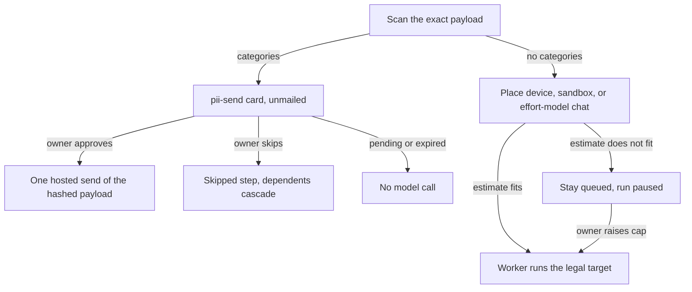
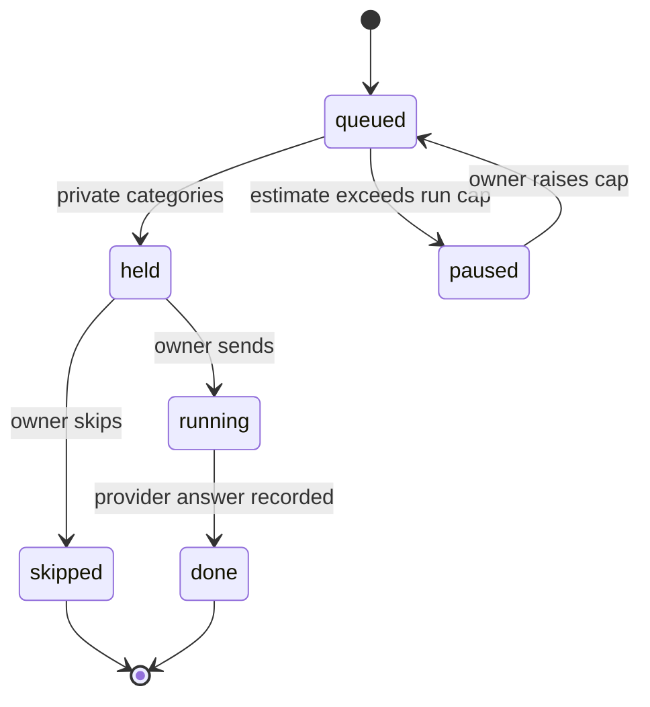

# Goal-run routing truth - Plan

**Target repo:** open-computer. Paths are repo-relative. This plan implements parent unit U1 / OC-068 from `docs/plans/2026-10-31-003-feat-chat-agent-product-plan.md`. It does not edit that file. Parent R2, R4, R6, R9, KTD4, and KTD5 stay the product authority for this slice.

## Goal Capsule

- **Objective:** An owner who submits a goal gets that work on the model the effort level names, is asked before private text is sent, and can wait out a cap instead of watching the run fail or move to a local model.
- **Means:** Withhold hosted calls the way egress already waits, and let the run ledger pause a step that no longer fits (KTD1, KTD3).
- **Authority:** Parent KTD4 and KTD5 govern product behavior. This plan's R-IDs state the slice. This plan's KTDs choose the mechanism inside those constraints. A unit overrides neither.
- **Execution profile:** Characterize the placement table, then change it. Tests use fakes. No live or paid model call is part of done.
- **Stop conditions:** Do not merge a placement-only diff that still sends flagged text to the decider, to jev, or to decompose. Do not turn an egress denial into a pause. Do not weaken hash-bound single-use approval, the spend rule, or human-only decisions. Do not include the uncommitted private-runner newline.
- **Ships:** One pull request. The owner separately approves any live run. This plan's done signal is the fake-backed suite.

---

## Product Contract

### Summary

Goal runs still demote cheap, latency-critical, over-budget, and unapproved private steps onto local models, and `dispatch` asks the router to classify the prompt before the privacy scan. This pull request makes the effort model the only hosted model on that path, holds private text for a send-or-skip decision, and pauses a run that hits its own cap. The run page's false labels stay parent U2 / OC-069.

Product Contract for this slice is new text bound to the parent ids above. The parent plan is unchanged.

### Problem Frame

On committed `HEAD` `1ab40b9`, `place()` in `services/placement/rules.py` still returns `local-llamacpp` or `local-ollama` when a local port is up. `OC_LOCAL_MODELS` only filters the catalog list in `services/router/model_catalog.py`. `services/orchestrator/dispatch.py` calls `router.route` on the step prompt, then scans, then mails the worker even when the target is `blocked`, and then tombstones that task as `NoPlacement`.

`router.route` tries a hosted decider and then jev before the offline table, and it bills `services/router/budget.py`. `Orchestrator.submit` calls decompose on the goal before any privacy scan. The console path already stores effort, a model, and a ledger. `services/durable/activities.py` `submit_goal` does not. `services/orchestrator/runner.py` writes `worker_done` as event and task id, and drops provider usage after the ledger write.

The catalog, effort presets, and worker default from parent U20 / OC-087 are on `HEAD` (`5632d20`). Silver Lining tokens from parent U19 / OC-086 are on `HEAD` (`6043f1b`). `ROADMAP.md` still marks OC-068 and OC-069 open. No `oc-local-routing-wip.patch` is in the tree. Uncommitted edits to the parent plan, `deploy/private_runner_bridge.py`, and `tests/unit/test_private_runner_bridge.py` are not this work.

### Requirements

**Routing**

- R1. A goal step runs on the effort level's model. Placement never selects `local-ollama` or `local-llamacpp`. Parent R2, R4, and parent U1 / OC-068.
- R2. Private categories on the goal, or on a step after dependency data is attached, wait for the owner. Approve sends that exact payload to the effort model once. Skip records the note and runs the payload nowhere. Parent R4 and parent KTD4.

**Spend and record**

- R3. A run pauses at its own ledger cap and waits. The owner can raise that cap. An over-budget step stays queued. It is not `FAILED` and not `NoPlacement`. Parent KTD5 and parent U1.
- R4. When the provider reports usage, the completion record stores the served model, token counts, and cost from that report. A missing usage block leaves those fields off. Parent R9 and parent U1.
- R5. An automation fire starts with an effort level, that level's model, a budget, and a ledger. A schedule with none of those fields uses the console default effort. Parent U1, finding P8.

**Gates**

- R6. Deny-by-default egress, hash-bound single-use approval, human-only approval, the cost ledger hard cap, and the spend rule stay as strict as they are. No agent, MCP tool, or automation caller can approve a send, skip a step, or raise a cap. Parent R6.

### Key Decisions

- **Local models stay opt-in, and private text is send-or-skip.** (session-settled: user-directed — chosen over refusing private content outright: the owner can still get the work done, with the hosted send visible and approved.) Governs R1, R2. Inherited from parent KTD4. Conflict: parent U1's test that a local target appears when the thread names one cannot be met here, because no goal field names a local model. That choice is parent U21. Conflict: parent U1's approach edits `place()` and still lets `router.route` and decompose run first. Parent KTD4's "before any model call" wins.
- **The unset daily cap is $5.00, and a cap pauses the run.** (session-settled: user-directed — chosen over $25 per working day and over keeping $1.00 with per-thread overrides: $5.00 allows real agent work while a cap bounds the run.) Governs R3, R5. Inherited from parent KTD5. Conflict: a run pauses at its effort budget (Low $0.10, Medium $0.30, High $1.00), not at $5.00. $5.00 is the default daily ceiling `effort.resolve` clamps to. Conflict: parent KTD4 says keep placement rule 2, whose over-budget branch tombstones a sandbox step. A tombstone cannot be resumed. R3's pause wins for over-budget. Egress denial stays a block. The per-thread cap in parent KTD5 is parent U13. Parent D3's default value stays open there.

### Actors

- A1. Owner. The session that approves, skips, and raises a cap.
- A2. Automation. Fires a stored goal on a cadence and cannot decide a hold.
- A3. MCP client. May list runs, cost, audit, and a placement preview. It cannot decide.

### Key Flows

- F1. Clean goal
  - **Trigger:** A1 confirms a goal whose scan has no categories, and the estimate fits the run cap.
  - **Actors:** A1
  - **Steps:** Decompose and each step call only the effort model. Placement is `cloud-OpenRouter` or, when the step needs it, `cloud-sandbox` or `device`.
  - **Outcome:** The completion record matches R4.
  - **Covered by:** R1, R4
- F2. Private text
  - **Trigger:** The goal, or a step prompt after dependency data, has categories.
  - **Actors:** A1, A3
  - **Steps:** No decider, jev, decompose, or worker chat runs on that payload. A1 approves or skips. A3 sees the pending card and cannot decide it.
  - **Outcome:** One hosted send of the hashed payload, or a skipped step whose dependents finish through the existing dependency failure path.
  - **Covered by:** R2, R6
- F3. Cap
  - **Trigger:** The run ledger would refuse the next estimate, including a later sandbox step while the run is paused.
  - **Actors:** A1
  - **Steps:** The step is not mailed. The run waits. A1 raises the cap. Nothing else unpauses it.
  - **Outcome:** The step then runs on its legal target. It was never `FAILED`.
  - **Covered by:** R3, R6

### Acceptance Examples

- AE1. Covers R1. Given `OC_LOCAL_MODELS` unset and a listener on `127.0.0.1:8080`, when a cheap step is placed, then the target is `cloud-OpenRouter` on the effort model and not `local-llamacpp`.
- AE2. Covers R2. Given a goal the scanner flags, when it is submitted, then decompose has not been called and no worker mailbox row exists until A1 approves that hashed planner payload.
- AE3. Covers R3. Given a chat step that pauses the run at its cap, when a dependent sandbox step becomes ready, then that step stays queued for `cloud-sandbox` until A1 raises the cap.
- AE4. Covers R5. Given a schedule stored as goal and cadence only, when it fires, then the run has `effort_set`, a ledger at the default effort budget, and the default effort model.
- AE5. Covers R6. Given a pending `pii-send` card, when an MCP client lists approvals and requests some other approval, then the held step is still unsent.

### Success Criteria

- A flagged payload does not appear in a decider call, a jev call, a decompose call, or `local_work` before the owner decides.
- After the cap is hit, reloading the run still shows the next step queued, not failed.
- The spend-rule tests still reject an above-ceiling default.

### Scope Boundaries

**In this pull request**

Parent U1 / OC-068, deepened so the hold happens before hosted calls. Units U1 through U5 below ship together. Landing U1 alone would still leak flagged text.

**Deferred to Follow-Up Work**

- Parent U2 / OC-069. The run page still treats `pii: []` as private and still prints the router engine. This pull request only writes the fields that page will read.
- Parent U21. An explicit local model on a thread. Until then `OC_LOCAL_MODELS` does not change `place()`.
- Parent U3 and later. Threads, the orchestrator loop, tools, and MCP client.
- Parent U13 and open D3. The default per-thread cap.
- The uncommitted newline fix in `deploy/private_runner_bridge.py` and `tests/unit/test_private_runner_bridge.py`. Credential rotation and runner restart stay owner-gated in the parent milestone. This plan does not do them.
- A live paid acceptance run. Parent milestone A requires the owner's separate approval. Fixture tests do not claim it.

**Outside this slice**

- Hosted multi-user SaaS, memory, premium defaults, and any change to who may approve. Same boundary as the parent plan's "Not in this plan".
- The router test box. It may still call `router.route` on text the operator typed there. It is not a goal step.

**Considered and not built**

- Turning rules 3 to 6 back on when `OC_LOCAL_MODELS=1`. There is no per-step local choice to honor. Evidence that would change this: parent U21 lands a field `place()` can read.
- Filling a missing provider usage block from catalog prices. The ledger's rule is that the provider response is the cost. Evidence: the provider documents a fee that is absent from `usage`.
- A new MCP tool that approves, skips, or resumes. The existing server is forbidden from approving. Evidence: the product allows an agent to decide a `pii-send`.
- A third card action that runs the step on a local model. Parent KTD4's two actions are send and skip.
- Deleting `Budget.task_cap` for every caller. The router test path still uses it. Goal placement stops reading it (KTD6).
- Relabeling the capabilities card that mentions local GPU. That card does not place work. Evidence: an operator treats the card as the placement result.
- A confirm dialog for above-ceiling models. Parent D2 already forbids that path.

---

## Planning Contract

### Key Technical Decisions

- KTD1. **A private hold is an egress-style wait, not a placement target.** Governs R2, R6. Scan the exact decompose request before `engine` runs, and scan the step prompt after dependency data is attached, before `router.route`, `place`, and `fs.send`. On the goal path, do not call `router.route` for that step. The subtask's stored tier is enough. Device steps are not hosted calls: do not route them and do not require `pii-send`. Egress and sandbox steps are hosted calls and do require `pii-send` when flagged. An egress host approval does not satisfy it. The card hashes the payload bytes plus the effort model id. `Gate` consumes the approval once on send. A retry that finds it consumed does not post again. A pending card sends nothing. Expiry supersedes the card and opens a new one. It does not skip and does not fall through to local. Empty categories create no card. Two shapes were close: a new placement target, or this wait. Dispatch already mails every non-device target and tombstones `blocked`. The egress hold already stays unmailed, survives `recover`, and makes `work_sweep` return held. That is the mechanism to copy. A prototype bake-off would not change the shape.
- KTD2. **`place()` never returns a local target.** Governs R1, R2. Rules 3, 4, and 6 are removed for every caller of this function, including the MCP preview. Rule 0 (device), rule 1.5 (egress deny), rule 5 (`gate_required` on frontier), and rule 2's `cloud-sandbox` target stay. `local_up` does not change a target. If `place()` is called with unapproved private categories, it returns `blocked` with a hold reason, never `cloud-*` and never `local-*`. Dispatch must not be the caller in that case. If a mailbox row already says `local-*` and `OC_LOCAL_MODELS` is off, `work_fn` fails that task closed. It does not call `local_work` and does not call hosted chat. Flag on, `local-*` may still run `local_work`. This path does not create those rows.
- KTD3. **Over-budget work waits on the run ledger.** Governs R3, R6. Remove the headroom branch that makes rule 2 return `blocked`. A sandbox step that does not fit stays `cloud-sandbox` and is not mailed. Chat that does not fit is not mailed and is not demoted. `headroom_from` on this path takes the run ledger only. Dispatch does not pass the router budget. `blocked` plus `NoPlacement` remain for egress denial and for a device or egress step with no legal target. The owner session gets one CSRF-checked action that calls `CostLedger.resume` with a higher cap. MCP and automations cannot call it. `goalruns.resume` is the worker sweep, not this action.
- KTD4. **Completion copies provider usage.** Governs R4. When `WorkResult` carries usage, `worker_done` gains the served model, token counts, and cost from that object. The run detail JSON copies those fields onto the step. When usage is absent, omit them. Do not fail the step. The ledger write stays as it is.
- KTD5. **Automation fires resolve effort the way the console does.** Governs R5. Extend the cron input and `submit_goal` with optional effort, model, and budget. Missing fields use `effort.resolve` with empty inputs and `daily_cap()`, which is Low unless `OC_EFFORT_DEFAULT` names another level. High is never that fallback. Always write `effort_set` and create the ledger. Persist the resolved plan on new schedules at create time. In-flight workflows that still pass only goal and actor must deserialize. Create still asks the owner only for a goal and a cadence in this pull request.
- KTD6. **The $5.00 default is the daily ceiling, and goal steps do not consult `task_cap`.** Governs R1, R3. The unset default becomes $5.00 in `services/router/router.py`, `services/opsview/server.py` `daily_cap`, and `Budget`'s daily default. `task_cap` stays $0.10 for the router budget. Goal dispatch does not call `router.route`, so that halt is not the goal path. Effort level budgets stay $0.10, $0.30, and $1.00.

### High-level technical design

A durable sweep that finds a pending `pii-send` or egress card returns the existing held signal. `GoalRunWorkflow` already sleeps on that signal. A sweep that returns zero ends the workflow, so a hold must not look like an empty queue. `recover` rebuilds the card from its audit row, including a hold that exists before `plan.json`.

### Assumptions

- The console default effort is the right plan for an old schedule. `effort.resolve` already defines it. Refusing those schedules would strand them.
- For `kind=pii-send` only, the existing session send-back, which requires a note, is the skip action. The approvals card for that kind says which model would receive the payload, and the second button says Skip. Other kinds keep today's send-back copy.
- A skipped step uses a terminal task state the dependency walker already treats as failed, with kind `skipped` rather than `NoPlacement`. Dependents cascade. The run can finish.
- Device placement still wins over a private hold. The prompt is not sent to a hosted classifier first.
- Uncommitted parent-plan edits and the private-runner newline are absent from this pull request. Implementation starts from committed source plus this plan.
- `STRATEGY.md`, `PRODUCT.md`, `VISION.md`, and `CONCEPTS.md` are absent. `ROADMAP.md` is the status list.

### Sequencing

Ship U1 through U5 as one pull request, in that order. U1 without U2 still classifies flagged text on the decider. U2 without U3 still tombstones a sandbox step after a normal pause. U4 and U5 can be committed after U2 inside the same branch. Do not open parent U2's page work on this branch.

### System-wide impact

`place()` is shared by the MCP preview, conformance checks, and `place_live`. Agent-loop placement is a different function and stays put. The MCP preview of an unapproved private step must say held, not cloud. Agents that already read audit will see `pii-send`, `skipped`, `paused_cap`, and, when the provider sent it, the served model. Public approval objects that omit `kind` need `what` or the audit line to say `pii-send`, or a reader cannot tell the card from egress.

### Risks

| Risk | Mitigation |
|---|---|
| The 1,152-row placement table encodes local demotion | Characterize, then replace I1 to I3 on purpose. Keep device, egress deny, frontier `gate_required`, determinism, and sandbox to `cloud-sandbox` |
| A Temporal retry sends a payload twice | Single-use consumption. A consumed grant fails closed |
| A hold returns zero from `work_sweep` and the workflow exits | Return the existing held signal for a pending `pii-send`, and rebuild it in `recover` |
| Skipping leaves dependents `QUEUED` forever | Cascade with the existing dependency failure path and a `skipped` kind |
| Raising the daily default looks like raising every run to $5.00 | Effort budgets stay. Tests that assumed the $1.00 default are updated. A Medium run still pauses at $0.30 |
| `work_fn` sends an unrecognized target to hosted chat | A `local-*` row with the flag off fails closed. Other unrecognized targets stay on today's chat path |

### Sources and research

Evidence is committed `HEAD` `1ab40b9` unless a line above says dirty. Local patterns were enough. No external research was run. The parent plan already forbids paid calls for this kind of planning, and egress, the ledger, and `place()` are the patterns to copy.

- `services/placement/rules.py` `place` and `headroom_from`
- `services/orchestrator/dispatch.py` route, then scan, then mail, then `NoPlacement`
- `services/router/router.py` decider, then jev, then table
- `services/orchestrator/engines.py` `work_fn` and `decompose_engine`
- `services/orchestrator/egress.py` and `Orchestrator.recover`
- `services/orchestrator/runner.py` `held_cost_cap` and `worker_done`
- `services/cost/ledger.py` `resume`
- `services/durable/activities.py` `submit_goal` and `work_sweep`
- `services/durable/workflows.py` sleep only when the sweep returns held
- `services/opsview/effort.py` `resolve` and level budgets
- `ui/src/pages/Approvals.tsx` send-back copy
- `tests/unit/test_placement_table.py`
- Parent plan `docs/plans/2026-10-31-003-feat-chat-agent-product-plan.md` reliability-first milestone A, step 3

---

## Implementation Units

### U1. Stop local demotion

- **Goal:** `place()` stops selecting local models, and the execution path refuses a stale local row when the flag is off.
- **Requirements:** R1. Parent U1 / OC-068. Key Decision on local opt-in.
- **Dependencies:** none
- **Files:** `services/placement/rules.py`, `services/placement/health.py`, `services/router/router.py`, `services/router/budget.py`, `services/opsview/server.py`, `services/orchestrator/engines.py`, `tests/unit/test_placement_table.py`, `tests/unit/test_effort.py`, `tests/unit/test_spend_rule.py`
- **Approach:**
  - Characterize `tests/unit/test_placement_table.py` before editing invariants.
  - Remove rules 3, 4, and 6. Ignore `local_up` inside `place`.
  - Unapproved private input returns `blocked` with a hold reason, not a cloud or local target (KTD2). Dispatch's use of that reason is U2.
  - Remove rule 2's headroom branch so sandbox stays `cloud-sandbox` (KTD3). Tombstone behavior for that case changes in U3.
  - Set the unset daily default to $5.00 in the three readers KTD6 names. Leave effort budgets and `task_cap` alone.
  - In `work_fn`, a `local-*` placement with the flag off fails closed.
- **Execution note:** Add characterization coverage of the current table, then change I1 to I3 deliberately. Keep every invariant that is not a local demotion.
- **Patterns to follow:** `place` stays a pure function. `place_live` only probes. The capabilities page may keep its own local-port line.
- **Test scenarios:**
  - Cheap tier, `local_up` true, flag unset: target is `cloud-OpenRouter`, not `local-llamacpp`. Covers AE1.
  - The same cheap step with `OC_LOCAL_MODELS=1`: target is still `cloud-OpenRouter`.
  - Latency `crit`, local up: target is not `local-llamacpp`.
  - Estimate above headroom, local up, no sandbox: target is not `local-ollama`.
  - Sandbox, estimate above headroom, local up: target is `cloud-sandbox`, not `blocked` and not local.
  - Unapproved private categories, local up: target is `blocked` with a hold reason, not `local-*` and not `cloud-*`.
  - Frontier tier: `cloud-OpenRouter` and `gate_required`.
  - `needs_device`: target `device` and nothing else lands on `device`.
  - Unapproved egress host: `blocked` with the host reason.
  - Same arguments twice: the same target and reason.
  - `work_fn` task placement `local-ollama`, flag unset: no `local_work` and no hosted chat. The task fails closed.
  - `work_fn` task placement `local-ollama`, flag on: `local_work` runs.
  - Unset `OC_DAILY_CAP`: `daily_cap()` and a default `Budget` both report $5.00. An explicit High plan still resolves to $1.00.
  - Spend rule: no default model is above the ceiling.
- **Verification:** The named tests pass. A grep of `place()` shows no return of `local-ollama` or `local-llamacpp`.

### U2. Hold private text before any hosted call

- **Goal:** Flagged goal and step payloads wait for the owner, and the wait survives a sweep and a restart.
- **Requirements:** R2, R6. Parent KTD4.
- **Dependencies:** U1
- **Files:** `services/orchestrator/__init__.py`, `services/orchestrator/dispatch.py`, `services/orchestrator/decompose.py`, `services/gate/queue.py`, `services/durable/activities.py`, `services/opsview/goalruns.py`, `ui/src/pages/Approvals.tsx`, `tests/unit/test_placement_table.py`, `tests/opsview/test_goals.py`
- **Approach:**
  - Add a hold beside `EgressApproval` for `kind=pii-send`. Do not add a placement target.
  - Scan before decompose and before dispatch's route and mail (KTD1). Do not call `router.route` on a goal step.
  - Leave the step unmailed while the card is pending. `work_sweep` returns the existing held signal. The in-process drive waits on the same condition instead of stopping.
  - `recover` rebuilds the card from its audit row when `plan.json` is absent.
  - Approve sends once through the hash-bound gate, on the effort model. Send-back on this kind only is skip: required note, audit reason, terminal `skipped`, dependency cascade, no mail.
  - Branch `ui/src/pages/Approvals.tsx` on this kind so the buttons say send to the named model, and Skip. Other kinds keep send-back.
  - Do not add an MCP decide tool. A `place` preview of unapproved private input stays the U1 hold reason.
- **Patterns to follow:** `EgressApproval.request`, `egress_approval_requested`, `Orchestrator.recover`, and `work_sweep` returning held.
- **Test scenarios:**
  - Flagged goal: decompose's engine is not called, and no mailbox row exists. Covers AE2.
  - Approve that card: the planner engine is called once with the hashed payload. A second sweep does not call it again.
  - Flagged step after dependency data is attached: `router.route` is not called, and the hash covers the data-wrapped prompt plus the effort model id.
  - Skip with a note: no `local_work`, no hosted chat, the step is `skipped`, and a dependent becomes dependency-failed.
  - Skip with an empty note: the decision is rejected and the step stays held.
  - `work_sweep` while the card is pending: the held signal, not zero.
  - Process restarts from the audit row before `plan.json` exists: the card is pending and still unsent.
  - Expired grant: a new card, no send, no skip.
  - Device step: no `pii-send` and no `router.route`. The device mailbox is still the target.
  - Flagged sandbox step: no `sandbox_work` until approve. An egress approval for a host does not release it.
  - Empty categories: no card, and the step can mail.
  - MCP lists the card and submits a different approval: the held step stays unsent. Covers AE5.
  - Approvals page for this kind: the second action is Skip, and the copy names the effort model. An egress card still says send back.
- **Verification:** A test double records hosted calls. Flagged submit produces zero hosted calls until approve, and one call after it.

### U3. Pause over-budget steps without failing them

- **Goal:** A step the run cap cannot cover stays queued until the owner raises the cap.
- **Requirements:** R3, R6. Parent KTD5.
- **Dependencies:** U1
- **Files:** `services/orchestrator/dispatch.py`, `services/orchestrator/runner.py`, `services/opsview/server.py`, `services/opsview/goalruns.py`, `tests/opsview/test_goals.py`, `tests/unit/test_placement_table.py`
- **Approach:**
  - Before `fs.send`, if the run ledger cannot cover the estimate, do not mail. Append the existing held-cap audit. Leave the task queued.
  - Do not tombstone that case as `NoPlacement`. Egress `blocked` still tombstones.
  - Add one owner-session POST that calls `CostLedger.resume` with a higher cap. CSRF and session match the approval routes. No MCP wrapper.
- **Patterns to follow:** `runner._run_task` writing `held_cost_cap` when `ledger.check` misses. `CostLedger.resume` requires a cap above current spend.
- **Test scenarios:**
  - Medium run cap $0.30, router `task_cap` $0.10, chat estimate $0.20: the step is placed on the effort model and mailed. It is not demoted.
  - Chat estimate above the run remainder: no mailbox row, audit `held_cost_cap`, task not `FAILED`.
  - That run's later sandbox dependency: target `cloud-sandbox`, still queued, not `NoPlacement`. Covers AE3.
  - Owner resume with a higher cap: the queued step can mail. A second resume that does not raise the cap is rejected.
  - An MCP caller has no route that calls `CostLedger.resume`.
  - Estimate zero while the run is under its cap: the step may still start. Do not add a new estimator.
  - Egress denial: still `blocked`, still `NoPlacement`, still no pause.
- **Verification:** A paused run's step states stay queued across a sweep that would previously have tombstoned the sandbox dependency.

### U4. Record the model that answered

- **Goal:** The completion audit and the run detail JSON carry provider usage when the provider sent it.
- **Requirements:** R4. Parent R9. Parent U2 reads these fields later.
- **Dependencies:** U2
- **Files:** `services/orchestrator/runner.py`, `services/opsview/goalruns.py`, `tests/unit/test_engines.py`, `tests/opsview/test_goals.py`
- **Approach:**
  - Copy served model, tokens, and cost from usage onto `worker_done` when usage is present (KTD4).
  - Copy those fields into the step object the run detail already builds from audit rows.
  - Do not change `ui/src/components/RunView.tsx`. The false private label and the engine label remain until parent U2.
- **Patterns to follow:** `collect_usage` and the ledger `record` that already runs in `_run_task`.
- **Test scenarios:**
  - Chat result with usage: `worker_done` and the detail JSON show that served model and cost, even when the served id differs from the requested id.
  - Chat result with no usage: the step completes, and those fields are absent. Cost is not taken from the catalog.
  - Sandbox result with usage: the same fields are stored.
  - `local_work` string result, flag on: completion has no fabricated cost.
- **Verification:** The detail JSON for a faked chat step names the served model. The React run page is untouched.

### U5. Give automation fires an effort plan

- **Goal:** `submit_goal` creates the same effort row and ledger the console already creates.
- **Requirements:** R5, R1. Parent U1.
- **Dependencies:** U2
- **Files:** `services/durable/activities.py`, `services/durable/workflows.py`, `services/opsview/automations.py`, `services/opsview/effort.py`, `tests/opsview/test_goals.py`
- **Approach:**
  - Optional effort, model, and budget on the cron input and on `submit_goal` (KTD5).
  - Missing values go through `effort.resolve` and `daily_cap()`.
  - Write `effort_set`, create the ledger, and pass that model to decompose and to the worker.
  - New schedules store the resolved plan. Existing rows that only have goal and cadence still fire.
  - A caller-supplied budget above the daily cap is clamped by `resolve`, not honored.
  - The private hold from U2 applies to these runs.
- **Patterns to follow:** `services/opsview/server.py` `_submit_goal` and `services/opsview/goalruns.py` `submit`.
- **Test scenarios:**
  - Fire with a stored Medium plan: `effort_set`, ledger cap $0.30, and the Medium model. No `local-*` placement. Covers the stored half of R5.
  - Fire with only goal and actor: Low, unless `OC_EFFORT_DEFAULT` names Medium. Ledger and `effort_set` exist. Covers AE4.
  - `OC_EFFORT_DEFAULT=high`: the fire still does not use High. It uses Low.
  - Budget argument above the daily cap: the ledger cap is the daily cap.
  - Flagged automation goal: held, and the sweep returns the held signal. The fire caller cannot approve.
  - An old two-argument workflow payload still deserializes and uses the default plan.
- **Verification:** A fired run directory contains `effort_set` and a ledger row. Decompose receives the resolved model, not a bare worker default with no ledger.

---

## Verification Contract

| Gate | Command | Applies to |
|---|---|---|
| Placement, engines, effort, spend | `uv run --locked pytest tests/unit/test_placement_table.py tests/unit/test_engines.py tests/unit/test_effort.py tests/unit/test_spend_rule.py -p no:cacheprovider` | U1, U4 |
| Goal and approval routes | `uv run --locked pytest tests/opsview/test_goals.py -p no:cacheprovider` | U2, U3, U5 |
| Lint | `uv run --locked ruff check .` | every unit |
| Hygiene | `uv run pytest tests/unit/test_obs_open_source_hygiene.py` | every unit |
| Non-live suite | `uv run --locked pytest -m "not live" -p no:cacheprovider` | before the pull request |
| UI build | `pnpm --dir ui build` | U2, because `Approvals.tsx` changes |

No test makes a live or paid model call. Model replies use the existing fake OpenRouter helper. Parent U2's Playwright matrix is out of scope. Run it when that unit lands.

---

## Definition of Done

- U1 through U5 are in one branch. The scenarios above pass, and the non-live suite, Ruff, and the UI build are green or the failures are reported.
- A flagged submit performs no hosted call before approve, and approve performs one.
- With local ports open and the flag unset, no new goal step is placed on `local-*`.
- An over-budget sandbox dependency stays queued until the owner raises the cap.
- `worker_done` carries provider usage when the fake reports it.
- An automation fire without stored effort still has a ledger and `effort_set`.
- The diff does not include `deploy/private_runner_bridge.py`, the parent plan, or `RunView.tsx`.
- Abandoned experiments and unused placement branches are not left in the diff.
- `ROADMAP.md`'s OC-068 row can be marked done only when the above is merged. OC-069 stays open.
