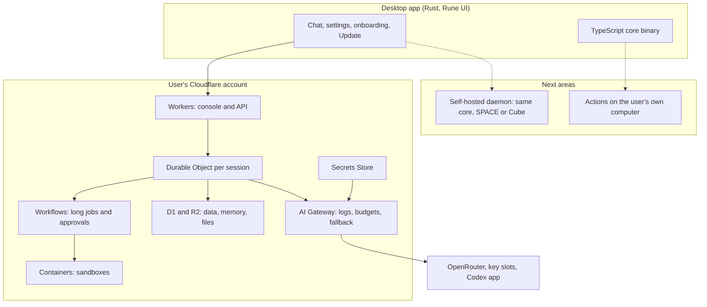

# Open Computer v1 - Desktop App and Cloudflare Core - Plan

## Goal Capsule

- **Objective:** A mid-level technical person (IT staff or another office professional) installs Open Computer, connects their own Cloudflare account, picks a model and turns memory on, then gets a finished agent task back. They never open a terminal on a server or touch Docker.
- **Means:** One TypeScript agent core that runs on the user's Cloudflare account and inside a native desktop app, replacing today's Python services.
- **Product authority:** This plan covers the placement map and v1 cloud mode. The self-hosted daemon and actions on the user's own computer are the next areas (see How This Work Fits Together) and are not active scope here.
- **Open blockers:** None for planning. Outstanding Questions below are all deferred to planning.

---

## Product Contract

### Summary

Open Computer v1 is a native desktop app (Rust, built the way Hex is built on the Rune UI toolkit) paired with one TypeScript agent core that installs into the user's own Cloudflare account. The core runs tasks in Cloudflare Containers, reaches models through OpenRouter first, and ships with built-in memory, voice and search. The same core later runs as a one-click self-hosted daemon and drives actions on the user's own computer.

### Problem Frame

Open Computer today is a set of Python services, a durable-workflow engine and its database, run with Docker on one server behind a tunnel. Its sandboxes need a KVM-capable host. Every piece except the API keys needs someone to run a server, which rules out the people the product is for.

The runtime also grew five ways to run an agent, three approval stores, three event formats and three UIs (see `docs/plans/2026-11-15-unified-runtime-plan.md`). The live worker has no tool loop, and the agent-job path built on OpenCode never ran in production. Fixing that in place would still leave a product that only a server operator can install.

Cloudflare now runs each Container in its own Firecracker microVM, and its Workers, Durable Objects, Workflows, D1, R2, AI Gateway and Secrets Store cover everything the backend does today. That makes a no-server product possible for the first time.

### Actors

- A1. User: IT staff or a white-collar professional. Comfortable with apps, accounts and API keys; never runs a server, a terminal session on a server, or Docker.
- A2. Agent core: the TypeScript runtime that plans, calls models, runs tools and records everything.
- A3. Sandbox: an isolated microVM where agent code, tools and plugins run.
- A4. Model providers: OpenRouter by default, optional direct providers, and OpenAI's own Codex app.
- A5. Maintainer: runs a private profile on top of the public product.

### Key Decisions

- **One TypeScript core instead of evolving the Python services.** The same core runs on Cloudflare and inside the desktop app; the workflow engine, its database and the server go away. Governs R6, R7, R8. (session-settled: user-directed — chosen over running the Python backend inside a Container or making the desktop the only backend: one core everywhere is the simplest result.)
- **Desktop app plus the user's own Cloudflare.** The user hosts everything in accounts they own; the maintainer hosts nothing. Governs R1, R2, R6. (session-settled: user-approved — chosen over desktop-only, browser plus one-click deploy, and hosted-by-maintainer: no server to touch, agents keep running while the laptop is closed.)
- **Two languages: a Rust desktop shell and the TypeScript core.** The desktop follows Hex's build (Rust, Rune UI, MIT) and launches the core as one bundled binary; no first-party Go. Governs R3, R7. (session-settled: user-directed — chosen over all-TypeScript and Rust-everywhere: keeps Hex's native feel without writing the agent core twice.)
- **Cloudflare Containers are the default sandbox.** They already give each sandbox its own microVM and need no KVM. SPACE and Cube remain as the self-hosted options. Governs R8, R9. (session-settled: user-directed — chosen over dropping SPACE and Cube or keeping only one: cloud with Cloudflare, self-hosted with a choice of SPACE or Cube.)
- **Cloud mode ships first.** Self-hosted and own-computer actions follow on the same core. (session-settled: user-approved — chosen over local-first and growing beside the current system: shortest path to the ten-minute onboarding.)
- **Memory is built into the core.** Hermes-style tiers plus Kurultai-style hybrid search, stored wherever the backend lives. Governs R14, R15. (session-settled: user-directed — chosen over running Kurultai as a separate service and Hermes tiers alone: nothing extra to install. Kurultai is the maintainer's own code, so it can be reused without clearance.)
- **OpenRouter first, plus key slots and the Codex app.** Governs R10, R11, R12. (session-settled: user-approved — chosen over OpenRouter-only and custom provider sign-in: Anthropic forbids subscription logins and OpenAI's third-party sign-in terms are unconfirmed.)
- **Enterprise-ready basics, not full enterprise.** Governs R19, R20, R21, R22. (session-settled: user-approved — chosen over full enterprise and personal-grade: these are hard to add once data is stored.)
- **One button updates everything in step.** Governs R5. (session-settled: user-approved — chosen over silent and per-part updates: no version drift between app, cloud core and daemon.)
- **Plugins are MCP servers, skills and plugin folders.** Governs R16, R17. (session-settled: user-approved — chosen over MCP-only and a full marketplace.)
- **The maintainer's setup is a private profile on clean public defaults.** Governs R23. (session-settled: user-approved — chosen over shipping the maintainer's setup as defaults or a separate private build.)

### Placement map

### Requirements

**Onboarding and updates**

- R1. First run asks for exactly three things: connect Cloudflare (one sign-in), add a model (OpenRouter key by default), and switch memory on.
- R2. Connecting Cloudflare deploys the core into the user's account without the user running commands, creating resources by hand, or touching Docker.
- R3. The desktop app is a native Rust app built like Hex, on the Rune UI toolkit, for macOS, Windows and Linux.
- R4. A "Test connection" check confirms the backend, the model and memory, and names the failing piece in plain words when one fails.
- R5. One Update action brings the desktop app and the user's cloud core to the same version, checks health, and rolls back automatically on failure; security fixes may install on their own.

**Runtime and placement**

- R6. Agent tasks keep running in the user's Cloudflare account while the desktop app is closed.
- R7. One TypeScript agent core is the only agent runtime; the same core runs on Cloudflare and as a binary the desktop app launches.
- R8. Every task runs its tools, code and plugins in a fresh sandbox, a Cloudflare Container in cloud mode.
- R9. Sandboxes never hold API keys; keys are added to outbound requests outside the sandbox.

**Models and search**

- R10. OpenRouter is the default provider, with reasoning and tool calls streamed live into the chat.
- R11. Optional key slots exist for Anthropic, OpenAI, Google and Groq, plus one custom OpenAI-compatible endpoint for local or other providers.
- R12. "Use my ChatGPT plan" launches OpenAI's own Codex app, which the user signs into; Open Computer never handles that login or its tokens.
- R13. Web search uses Perplexity Sonar through the user's OpenRouter key by default.

**Memory, voice and plugins**

- R14. Memory ships inside the core: a small always-loaded memory and user profile the agent edits, plus searchable history of past tasks.
- R15. Memory search combines keywords and vectors over notes, files and past tasks, and every recalled item cites its source.
- R16. Users install MCP servers, markdown skills and plugin folders from inside the app, choosing from a curated list.
- R17. Plugins run in the sandbox under the same approval rules as any other tool.
- R18. Voice input uses the WordInk SDK with Groq Whisper Large v3 Turbo.

**Trust, cost and quality**

- R19. Every action, approval and model call is written to an audit log the user can read and export.
- R20. Keys live only in Cloudflare Secrets Store or the operating system's keyring; the UI shows only whether a key is set, plus a test button.
- R21. Spend caps apply per task and per day, and a task stops when it would exceed its cap.
- R22. Logs and traces can be exported in OpenTelemetry format, and a policy file lets IT lock settings.
- R23. The public product ships no maintainer-specific defaults; a private profile can add providers, models, voice, search and devices on top.
- R24. A golden-task suite runs through Orchestral against the agent core before every release, and a release is blocked when it regresses.

### Key Flows

- F1. First run
  - **Trigger:** A1 opens the freshly installed desktop app.
  - **Actors:** A1, A2, A4
  - **Steps:** Connect Cloudflare; the core deploys; add an OpenRouter key; switch memory on; Test connection passes; A1 types a first task and watches reasoning and tool calls stream.
  - **Outcome:** A finished task with its audit entries, cost and any files.
  - **Covered by:** R1, R2, R4, R10, R14, R19
- F2. Task while the laptop is closed
  - **Trigger:** A1 starts a long task and closes the laptop.
  - **Actors:** A1, A2, A3
  - **Steps:** The core keeps working in Cloudflare; steps that need approval wait; A1 reopens the app, approves, and the task continues.
  - **Outcome:** The task finishes without the desktop staying open.
  - **Covered by:** R6, R8, R19
- F3. Update
  - **Trigger:** The app shows that an update is available.
  - **Actors:** A1, A2
  - **Steps:** A1 clicks Update; the app updates itself and then the cloud core; health checks run; on failure both roll back.
  - **Outcome:** App and core run the same version.
  - **Covered by:** R5

### Acceptance Examples

- AE1. **Covers R4.** Given a revoked OpenRouter key, when A1 runs Test connection, then the check names the model key as the failing piece and the backend and memory checks still pass.
- AE2. **Covers R5.** Given an update whose cloud health check fails, when A1 clicks Update, then both the app and the cloud core return to the previous version and A1 sees one plain message saying so.
- AE3. **Covers R9.** Given a tool inside the sandbox that prints its environment, when it runs, then no API key appears in its output.
- AE4. **Covers R21.** Given a task with a $0.50 cap that has spent $0.48, when the next model call is estimated at $0.05, then the task pauses and asks before spending.
- AE5. **Covers R12.** Given a user who picks "Use my ChatGPT plan", when sign-in completes, then Open Computer holds no OpenAI token of its own and model calls for that choice run through the Codex app.

### Success Criteria

- A first-time user completes F1 in about ten minutes without opening a terminal.
- A task keeps running and finishes with the desktop app closed.
- The desktop app feels as quick and native as Hex.

<!-- ce-section: work-relationships -->
### How This Work Fits Together

This plan covers the placement map and v1 cloud mode. The broader breakdown below is the current understanding, not a committed roadmap.

- Self-hosted daemon: the same TypeScript core installed by one script on the user's own server, with SPACE or Cube as the sandbox and Cloudflare Tunnel plus Access as the connection. Depends on R7. Shares the onboarding of R1 and R4 (pick the device, test connection).
- Actions on the user's own computer: through the desktop app. When the laptop is closed, a step runs in a cloud browser or sandbox when that is safe (with a setting to turn the fallback off); otherwise it pauses as "needs your computer", notifies the user and resumes after approval. Depends on R7.
- The Python services and `docs/plans/2026-11-15-unified-runtime-plan.md`: frozen, then retired once v1 cloud mode replaces them. That plan's parity analysis and OpenRouter streaming findings still apply; its phases do not.
- Enterprise beyond the basics (teams, SSO, admin console, org policies): Still to decide. Builds on R19 to R22.

### Scope Boundaries

**Deferred for later**

- The self-hosted daemon and own-computer actions, per How This Work Fits Together.
- Teams, roles, SSO, shared projects and an admin console.
- A plugin marketplace with publishing and ratings.
- Local models as a default; they stay reachable through the custom endpoint slot of R11.

**Outside this product's identity**

- A hosted Open Computer service run by the maintainer.
- Custom "Sign in with ChatGPT" or "Sign in with Claude" flows, and any use of Claude subscription credentials.
- Matching Perplexity's own search index or proprietary models.

### Dependencies / Assumptions

- Cloudflare Containers and the Sandbox SDK (generally available since 2026-04-13) give each sandbox its own microVM; nested KVM is not available, so SPACE and Cube cannot run inside Cloudflare.
- Containers are amd64-only with no GPU, ephemeral disk, and up to 4 vCPU, 12 GiB memory and 20 GB disk per instance.
- Secrets Store is in open beta.
- Rune is MIT-licensed (per its repository page); its LICENSE file text was not read.
- Hex and WordInk's desktop app already show the Rust and Rune build working.

### Outstanding Questions

**Deferred to Planning**

- Which embedding model memory uses on Cloudflare and on the desktop, and whether the router keeps a hosted decision model.
- How the Cloudflare sign-in grants deploy rights: an OAuth app versus a scoped API token the user creates in one guided step.
- Whether the desktop app's local core runs tasks itself in v1 or only drives the cloud core.
- How OpenCode fits as a coding worker inside the sandbox: its HTTP server and SDK versus ACP.
- Which golden tasks the Orchestral suite runs and what counts as a regression.
- How WordInk's SDK attaches to the Rust desktop app.

### Sources / Research

- `docs/plans/2026-11-15-unified-runtime-plan.md`: runtime audit, three-way parity matrix, OpenRouter streaming findings.
- `ARCHITECTURE_MAP.md`, `docs/runbooks/runtime.md`, `docs/runbooks/approved-deployment.md`: where each piece runs today.
- `edge/wrangler.jsonc`: today's Cloudflare footprint (static assets only).
- `services/opsview/server.py`: current Groq voice path. `services/orchestrator/tools/web.py`: current Sonar search path.
- Cloudflare docs, accessed 2026-11-15: Containers architecture and limits, Sandbox SDK, Workflows, AI Gateway, Secrets Store.
- Hermes Agent memory docs: https://hermes-agent.nousresearch.com/docs/user-guide/features/memory
- Anthropic usage policy on API keys versus subscription credentials; OpenAI Codex authentication docs.
- github.com/anomalyco/hex and github.com/anomalyco/rune (MIT).
