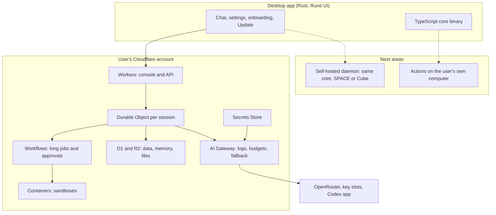
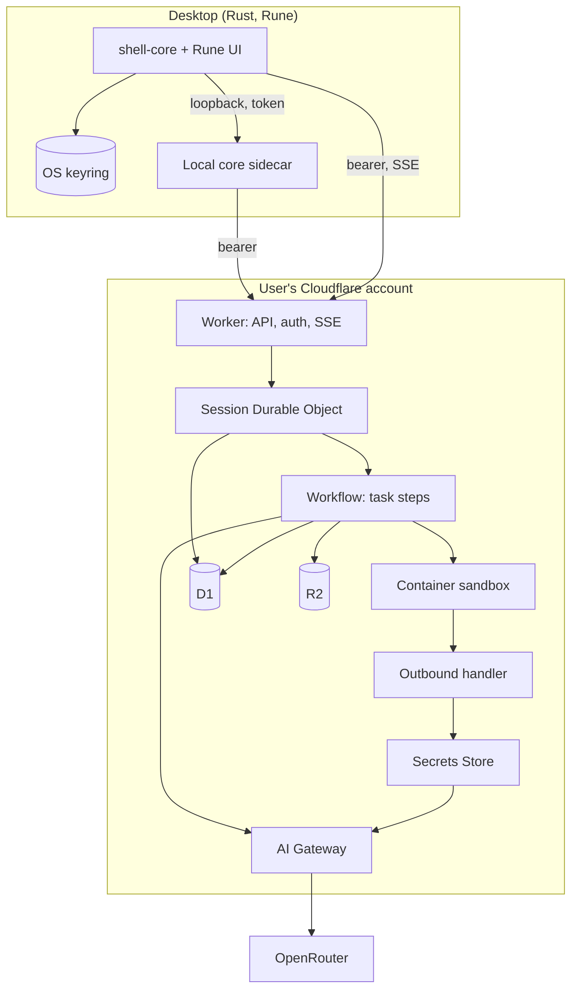
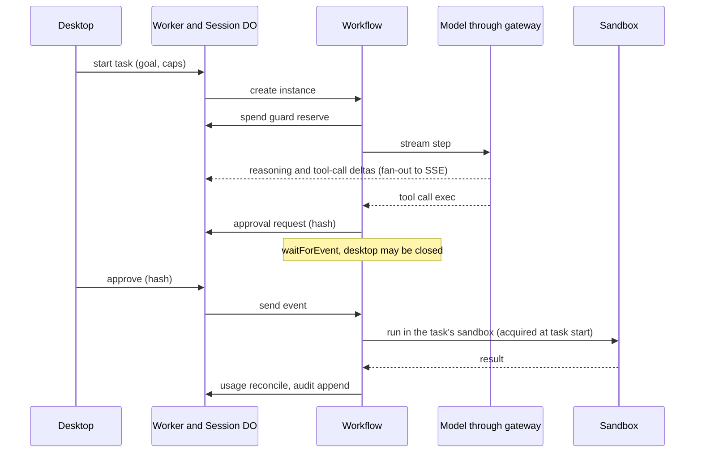
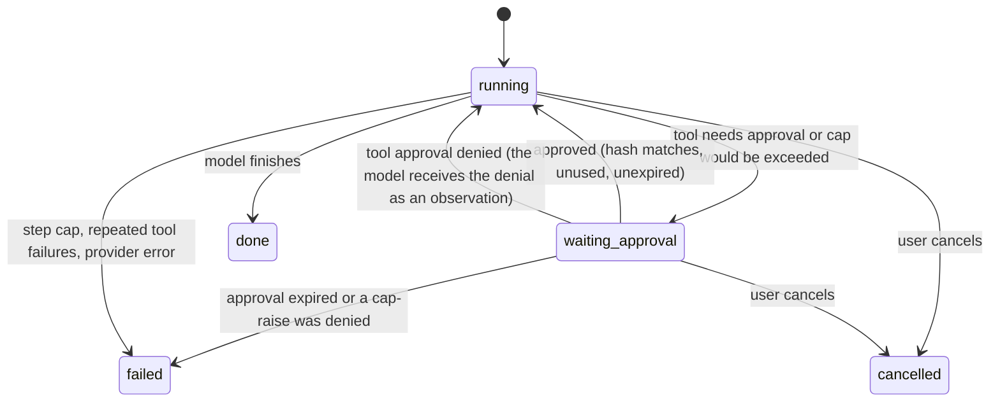
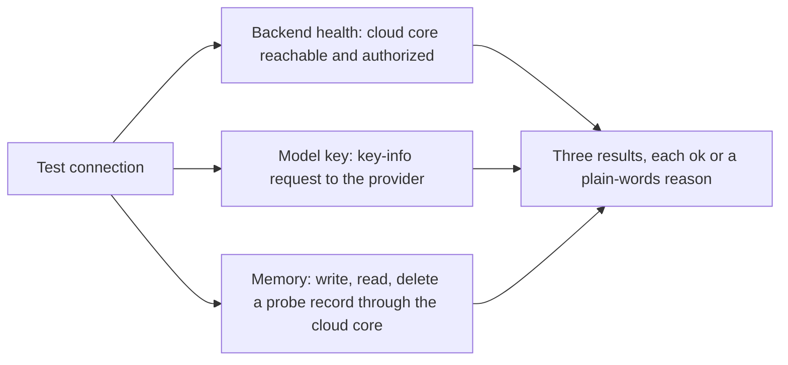

# Open Computer v1 - Desktop App and Cloudflare Core - Plan

## Goal Capsule

- **Objective:** A mid-level technical person (IT staff or another office professional) installs Open Computer, connects their own Cloudflare account, picks a model and turns memory on, then gets a finished agent task back. They never open a terminal on a server or touch Docker.
- **Means:** One TypeScript agent core that runs on the user's Cloudflare account and inside a native desktop app, replacing today's Python services (KTD1).
- **Product authority:** This plan covers the placement map and v1 cloud mode. The self-hosted daemon and actions on the user's own computer are the next areas (see How This Work Fits Together) and are not active scope here.
- **Authority hierarchy:** Product Contract requirements win on behavior; Key Technical Decisions win on mechanism; a unit overrides neither.
- **Execution profile:** `execution: code`, TypeScript plus Rust. Core packages are built test-first against recorded fixtures; the deployment and desktop scaffolds are verified by miniflare runs, config checks and headless state output.
- **Stop conditions:** Any step that would deploy, authenticate to a real Cloudflare account, create cloud resources or spend on live models; a settled decision shown infeasible.
- **Who ships:** The first PR carries U1 to U15 (the first vertical slice). U16 to U27 are the next PRs, in the order the Phased Delivery table gives.
- **Open blockers:** None.

---

## Product Contract

### Summary

Open Computer v1 is a native desktop app (Rust, built the way Hex is built on the Rune UI toolkit) paired with one TypeScript agent core that installs into the user's own Cloudflare account. The core runs tasks in Cloudflare Containers, reaches models through OpenRouter first, and ships with built-in memory, voice and search. The same core later runs as a one-click self-hosted daemon and drives actions on the user's own computer.

### Problem Frame

Open Computer today is a set of Python services, a durable-workflow engine and its database, run with Docker on one server behind a tunnel. Its sandboxes need a KVM-capable host. Every piece except the API keys needs someone to run a server, which rules out the people the product is for.

The runtime also grew five ways to run an agent, three approval stores, three event formats and three UIs (see `docs/plans/2026-11-15-unified-runtime-plan.md`). The live worker has no tool loop, and the agent-job path built on OpenCode never ran in production. Fixing that in place would still leave a product that only a server operator can install.

Cloudflare now runs each Container in its own Firecracker microVM, and its Workers, Durable Objects, Workflows, D1, R2, AI Gateway and Secrets Store cover everything the backend does today. That makes a no-server product possible for the first time.

### Actors

- A1. User: IT staff or a white-collar professional. Comfortable with apps, accounts and API keys; never runs a server, a terminal session on a server, or Docker.
- A2. Agent core: the TypeScript runtime that plans, calls models, runs tools and records everything.
- A3. Sandbox: an isolated microVM where agent code, tools and plugins run.
- A4. Model providers: OpenRouter by default, optional direct providers, and OpenAI's own Codex app.
- A5. Maintainer: runs a private profile on top of the public product.

### Key Decisions

- **One TypeScript core instead of evolving the Python services.** The same core runs on Cloudflare and inside the desktop app; the workflow engine, its database and the server go away. Governs R6, R7, R8. (session-settled: user-directed — chosen over running the Python backend inside a Container or making the desktop the only backend: one core everywhere is the simplest result.)
- **Desktop app plus the user's own Cloudflare.** The user hosts everything in accounts they own; the maintainer hosts nothing. Governs R1, R2, R6. (session-settled: user-approved — chosen over desktop-only, browser plus one-click deploy, and hosted-by-maintainer: no server to touch, agents keep running while the laptop is closed.)
- **Two languages: a Rust desktop shell and the TypeScript core.** The desktop follows Hex's build (Rust, Rune UI, MIT) and launches the core as one bundled binary; no first-party Go. Governs R3, R7. (session-settled: user-directed — chosen over all-TypeScript and Rust-everywhere: keeps Hex's native feel without writing the agent core twice.)
- **Cloudflare Containers are the default sandbox.** They already give each sandbox its own microVM and need no KVM. SPACE and Cube remain as the self-hosted options. Governs R8, R9. (session-settled: user-directed — chosen over dropping SPACE and Cube or keeping only one: cloud with Cloudflare, self-hosted with a choice of SPACE or Cube.)
- **Cloud mode ships first.** Self-hosted and own-computer actions follow on the same core. (session-settled: user-approved — chosen over local-first and growing beside the current system: shortest path to the ten-minute onboarding.)
- **Memory is built into the core.** Hermes-style tiers plus Kurultai-style hybrid search, stored wherever the backend lives. Governs R14, R15. (session-settled: user-directed — chosen over running Kurultai as a separate service and Hermes tiers alone: nothing extra to install. Kurultai is the maintainer's own code, so it can be reused without clearance.)
- **OpenRouter first, plus key slots and the Codex app.** Governs R10, R11, R12. (session-settled: user-approved — chosen over OpenRouter-only and custom provider sign-in: Anthropic forbids subscription logins and OpenAI's third-party sign-in terms are unconfirmed.)
- **Enterprise-ready basics, not full enterprise.** Governs R19, R20, R21, R22. (session-settled: user-approved — chosen over full enterprise and personal-grade: these are hard to add once data is stored.)
- **One button updates everything in step.** Governs R5. (session-settled: user-approved — chosen over silent and per-part updates: no version drift between app, cloud core and daemon.)
- **Plugins are MCP servers, skills and plugin folders.** Governs R16, R17. (session-settled: user-approved — chosen over MCP-only and a full marketplace.)
- **The maintainer's setup is a private profile on clean public defaults.** Governs R23. (session-settled: user-approved — chosen over shipping the maintainer's setup as defaults or a separate private build.)

### Placement map



### Requirements

**Onboarding and updates**

- R1. First run asks for exactly three things: connect Cloudflare (one sign-in), add a model (OpenRouter key by default), and switch memory on.
- R2. Connecting Cloudflare deploys the core into the user's account without the user running commands, creating resources by hand, or touching Docker.
- R3. The desktop app is a native Rust app built like Hex, on the Rune UI toolkit, for macOS, Windows and Linux.
- R4. A "Test connection" check confirms the backend, the model and memory, and names the failing piece in plain words when one fails.
- R5. One Update action brings the desktop app and the user's cloud core to the same version, checks health, and rolls back automatically on failure; security fixes may install on their own.

**Runtime and placement**

- R6. Agent tasks keep running in the user's Cloudflare account while the desktop app is closed.
- R7. One TypeScript agent core is the only agent runtime; the same core runs on Cloudflare and as a binary the desktop app launches.
- R8. Every task runs its tools, code and plugins in a fresh sandbox, a Cloudflare Container in cloud mode.
- R9. Sandboxes never hold API keys; keys are added to outbound requests outside the sandbox.

**Models and search**

- R10. OpenRouter is the default provider, with reasoning and tool calls streamed live into the chat.
- R11. Optional key slots exist for Anthropic, OpenAI, Google and Groq, plus one custom OpenAI-compatible endpoint for local or other providers.
- R12. "Use my ChatGPT plan" launches OpenAI's own Codex app, which the user signs into; Open Computer never handles that login or its tokens.
- R13. Web search uses Perplexity Sonar through the user's OpenRouter key by default.

**Memory, voice and plugins**

- R14. Memory ships inside the core: a small always-loaded memory and user profile the agent edits, plus searchable history of past tasks.
- R15. Memory search combines keywords and vectors over notes, files and past tasks, and every recalled item cites its source.
- R16. Users install MCP servers, markdown skills and plugin folders from inside the app, choosing from a curated list.
- R17. Plugins run in the sandbox under the same approval rules as any other tool.
- R18. Voice input uses the WordInk SDK with Groq Whisper Large v3 Turbo.

**Trust, cost and quality**

- R19. Every action, approval and model call is written to an audit log the user can read and export.
- R20. Keys live only in Cloudflare Secrets Store or the operating system's keyring; the UI shows only whether a key is set, plus a test button.
- R21. Spend caps apply per task and per day, and a task stops when it would exceed its cap.
- R22. Logs and traces can be exported in OpenTelemetry format, and a policy file lets IT lock settings.
- R23. The public product ships no maintainer-specific defaults; a private profile can add providers, models, voice, search and devices on top.
- R24. A golden-task suite runs through Orchestral against the agent core before every release, and a release is blocked when it regresses.

### Key Flows

- F1. First run
  - **Trigger:** A1 opens the freshly installed desktop app.
  - **Actors:** A1, A2, A4
  - **Steps:** Connect Cloudflare; the core deploys; add an OpenRouter key; switch memory on; Test connection passes; A1 types a first task and watches reasoning and tool calls stream.
  - **Outcome:** A finished task with its audit entries, cost and any files.
  - **Covered by:** R1, R2, R4, R10, R14, R19
- F2. Task while the laptop is closed
  - **Trigger:** A1 starts a long task and closes the laptop.
  - **Actors:** A1, A2, A3
  - **Steps:** The core keeps working in Cloudflare; steps that need approval wait; A1 reopens the app, approves, and the task continues.
  - **Outcome:** The task finishes without the desktop staying open.
  - **Covered by:** R6, R8, R19
- F3. Update
  - **Trigger:** The app shows that an update is available.
  - **Actors:** A1, A2
  - **Steps:** A1 clicks Update; the app updates itself and then the cloud core; health checks run; on failure both roll back.
  - **Outcome:** App and core run the same version.
  - **Covered by:** R5

### Acceptance Examples

- AE1. **Covers R4.** Given a revoked OpenRouter key, when A1 runs Test connection, then the check names the model key as the failing piece and the backend and memory checks still pass.
- AE2. **Covers R5.** Given an update whose cloud health check fails, when A1 clicks Update, then both the app and the cloud core return to the previous version and A1 sees one plain message saying so.
- AE3. **Covers R9.** Given a tool inside the sandbox that prints its environment, when it runs, then no API key appears in its output.
- AE4. **Covers R21.** Given a task with a $0.50 cap that has spent $0.48, when the next model call is estimated at $0.05, then the task pauses and asks before spending.
- AE5. **Covers R12.** Given a user who picks "Use my ChatGPT plan", when sign-in completes, then Open Computer holds no OpenAI token of its own and model calls for that choice run through the Codex app.

### Success Criteria

- A first-time user completes F1 in about ten minutes without opening a terminal.
- A task keeps running and finishes with the desktop app closed.
- The desktop app feels as quick and native as Hex.

<!-- ce-section: work-relationships -->
### How This Work Fits Together

This plan covers the placement map and v1 cloud mode. The broader breakdown below is the current understanding, not a committed roadmap.

- Self-hosted daemon: the same TypeScript core installed by one script on the user's own server, with SPACE or Cube as the sandbox and Cloudflare Tunnel plus Access as the connection. Depends on R7. Shares the onboarding of R1 and R4 (pick the device, test connection).
- Actions on the user's own computer: through the desktop app. When the laptop is closed, a step runs in a cloud browser or sandbox when that is safe (with a setting to turn the fallback off); otherwise it pauses as "needs your computer", notifies the user and resumes after approval. Depends on R7.
- The Python services and `docs/plans/2026-11-15-unified-runtime-plan.md`: frozen, then retired once v1 cloud mode replaces them. That plan's parity analysis and OpenRouter streaming findings still apply; its phases do not.
- Enterprise beyond the basics (teams, SSO, admin console, org policies): Still to decide. Builds on R19 to R22.

### Scope Boundaries

**Deferred for later**

- The self-hosted daemon and own-computer actions, per How This Work Fits Together.
- Teams, roles, SSO, shared projects and an admin console.
- A plugin marketplace with publishing and ratings.
- Local models as a default; they stay reachable through the custom endpoint slot of R11.

**Outside this product's identity**

- A hosted Open Computer service run by the maintainer.
- Custom "Sign in with ChatGPT" or "Sign in with Claude" flows, and any use of Claude subscription credentials.
- Matching Perplexity's own search index or proprietary models.

### Dependencies / Assumptions

- Cloudflare Containers and the Sandbox SDK (generally available since 2026-04-13) give each sandbox its own microVM; nested KVM is not available, so SPACE and Cube cannot run inside Cloudflare.
- Containers are amd64-only with no GPU, ephemeral disk, and up to 4 vCPU, 12 GiB memory and 20 GB disk per instance.
- Secrets Store is in open beta.
- Rune is MIT-licensed (per its repository page); its LICENSE file text was not read.
- Hex and WordInk's desktop app already show the Rust and Rune build working.

### Outstanding Questions

All six questions that were deferred to planning are resolved in the Planning Contract; none blocks implementation.

| Question | Resolved in |
|---|---|
| Embedding model and the hosted decision model | KTD8 |
| How the Cloudflare sign-in grants deploy rights | KTD10 |
| Whether the desktop's local core runs tasks in v1 | KTD11 |
| How OpenCode fits inside the sandbox | KTD12 |
| Which golden tasks Orchestral runs and what counts as a regression | U24 |
| How WordInk's SDK attaches to the desktop app | U22 |

### Sources / Research

- `docs/plans/2026-11-15-unified-runtime-plan.md`: runtime audit, three-way parity matrix, OpenRouter streaming findings.
- `ARCHITECTURE_MAP.md`, `docs/runbooks/runtime.md`, `docs/runbooks/approved-deployment.md`: where each piece runs today.
- `edge/wrangler.jsonc`: today's Cloudflare footprint (static assets only).
- `services/opsview/server.py`: current Groq voice path. `services/orchestrator/tools/web.py`: current Sonar search path.
- Cloudflare docs, accessed 2026-11-15: Containers architecture and limits, Sandbox SDK, Workflows, AI Gateway, Secrets Store.
- Hermes Agent memory docs: https://hermes-agent.nousresearch.com/docs/user-guide/features/memory
- Anthropic usage policy on API keys versus subscription credentials; OpenAI Codex authentication docs.
- github.com/anomalyco/hex and github.com/anomalyco/rune (MIT).

---

## Planning Contract

Product Contract preservation: Product Contract unchanged except that Outstanding Questions now points to the decisions that resolve them. One wording tension is recorded as an assumption rather than a product edit: R1 says "one sign-in" and KTD10 delivers it as one guided API-token step in v1.

**Target repo:** this repository. Python services under `services/`, `oc/` and `ui/` stay as they are and are frozen, not edited (How This Work Fits Together).

### Key Technical Decisions

- KTD1. **One platform-neutral agent-core library with a pure step function and two drivers.** Agent-core exposes a step that performs one model call plus the tool calls it asks for and returns the next state. The cloud driver runs steps as Workflow steps; the local driver loops in process. No Cloudflare or Node API is imported inside agent-core. Governs R6, R7, R8. (session-settled: user-directed — chosen over running the Python backend inside a Container or making the desktop the only backend: one core everywhere is the simplest result.)
- KTD2. **Raw Durable Objects and Workflows, not the Cloudflare `agents` SDK.** The SDK carries no GA label and some pieces are marked experimental (research dossier, section 3), and the core must also run outside Cloudflare. Revisit when the SDK reaches GA and the daemon exists.
- KTD3. **Division of state.** The Session Durable Object holds live session state, the approval inbox and event fan-out over SSE; a Workflow instance executes the steps durably; D1 holds the audit log, memory, the spend ledger and a task index, with one account-level Ledger Durable Object as the only writer of audit appends and spend reservations; R2 holds artifacts and transcript spillover. Workflow step outputs carry references and small summaries, never full transcripts. Governs R6, R19.
- KTD4. **OpenRouter over Chat Completions streaming, through AI Gateway when configured.** The core parses the SSE stream itself, maps `reasoning` and `reasoning_details` to reasoning events, assembles streamed tool-call deltas, sets `provider.require_parameters` whenever tools are sent, replays `reasoning_details` unmodified on the next turn, and takes cost from the final usage chunk. The Responses API is out until a provider needs it. Findings are from `docs/plans/2026-11-15-unified-runtime-plan.md` section 8. Governs R10. (session-settled: user-approved — chosen over OpenRouter-only and custom provider sign-in: Anthropic forbids subscription logins and OpenAI's third-party sign-in terms are unconfirmed.)
- KTD5. **One approval queue, human-only, hash-bound and single-use.** An approval binds to a hash of the tool name, normalized arguments and sandbox id, expires, and can be decided only through the human-facing decision path, never from inside the agent loop. Any write, network or exec tool needs approval by default; read-only tools are allowed. Governs R17, R19, R21.
- KTD6. **Spend caps reserve before they spend.** Before each model call the guard reserves an estimate (prompt tokens times input price plus the output limit times output price; a conservative default when the price is unknown), compares task and day totals against their caps, and raises a cap-raise approval instead of calling when the reservation would exceed a cap. The final usage chunk replaces the reservation with actual cost. Reservations and the day-total check run inside the Ledger Durable Object so concurrent tasks cannot both pass the same cap. Governs R21.
- KTD7. **Audit log is append-only with one account-wide hash chain.** Each record carries a sequence number and the previous record's hash, is redacted before write, and exports as NDJSON. The Ledger Durable Object serializes read-last-then-append because D1 has no interactive transactions; D1 enforces a unique sequence number as a backstop. Chain fields go in now because they change the stored format, which is expensive to alter later (structure.md 3.8). Signing and external anchoring are considered and not built.
- KTD8. **Memory tiers live in the core; hybrid search arrives in a later PR.** Tier 1 is a small always-loaded pair of blocks (agent notes, user profile) with character caps that the agent edits through tools. Tier 2 is a history of finished tasks, recalled by keyword in this slice and by keywords plus vectors in U20; every recalled item cites its source. Embeddings run through Workers AI on Cloudflare and through the user's OpenRouter key on the desktop, with keyword-only recall when neither is available. No hosted decision model ships in v1: effort is the user's setting, and the Python router stays frozen. Governs R14, R15. (session-settled: user-directed — chosen over running Kurultai as a separate service and Hermes tiers alone: nothing extra to install. Kurultai is the maintainer's own code, so it can be reused without clearance.)
- KTD9. **Each task gets a fresh Container sandbox, and secrets never reach it or the UI.** In the cloud, keys sit in Secrets Store bindings (open beta; binding access is isolated in one small module so a change in beta shape touches one file). On the desktop, the shell owns the operating-system keyring and hands values to the local core in memory at launch. The sandbox environment is built from an allowlist, and an outbound handler outside the sandbox adds credentials to requests for a minimal allowlist of hosts that excludes model-provider endpoints, so model calls and their spend stay in the Workflow. Provider keys reach Secrets Store only through the local core using the deploy token (U16), never through task or request bodies. Governs R8, R9, R20. (session-settled: user-directed — chosen over dropping SPACE and Cube or keeping only one: cloud with Cloudflare, self-hosted with a choice of SPACE or Cube. Containers give each sandbox its own microVM and need no KVM.)
- KTD10. **Cloudflare access is a scoped API token created in one guided step.** A Cloudflare OAuth application would need the maintainer to register and operate one and its availability for third-party deployers is unverified, so it is deferred. The token step is the one "sign-in" of R1. The token is used to deploy and kept only in the keyring. Governs R1, R2.
- KTD11. **The local core is a sidecar in v1 and does not run tasks.** It holds the provider, memory and cost modules from agent-core, answers connection tests, and later drives deploy and update; tasks run in the cloud core. Because the same package can host the loop, the daemon and own-computer areas reuse it unchanged. Governs R4, R7.
- KTD12. **OpenCode is a coding worker inside the sandbox through `opencode serve`.** One server per sandbox, reached over its HTTP API and event stream, with its permission requests mapped to the approval queue. ACP is not used. Per-sandbox concurrency and load behavior are untested (research dossier, section 4, 80 percent confidence), so U26 starts with a measured spike.
- KTD13. **Desktop to local core is loopback HTTP with a per-launch bearer token and shared JSON contract fixtures.** The core binds to 127.0.0.1 on a random port, prints one JSON line with the port, and the shell supplies the token on stdin. Fixture files under `core/contracts/local-api/` are asserted by TypeScript tests (what the server emits) and Rust tests (what the client parses), so the two languages cannot drift. Governs R3, R4.
- KTD14. **The shell mirrors Hex's dependency set rather than copying Hex code.** Rust edition 2024, Rune crates at the same pinned revision Hex uses, `keyring` for secrets and `ureq` for HTTP. Logic that does not need a window lives in a pure `shell-core` crate so tests run without a display or GPU. Hex and Rune are MIT; Rune's LICENSE text has not been read, so U13 reads it and records the notice before the first commit that depends on it. Governs R3. (session-settled: user-directed — chosen over all-TypeScript and Rust-everywhere: keeps Hex's native feel without writing the agent core twice.)
- KTD15. **The local core ships as one compiled binary.** `bun build --compile` per target, with Node's single-executable support as the fallback if bun's output fails the smoke test. Tests run the TypeScript source under Node, so the binary is a packaging concern, not a test dependency.
- KTD16. **No live anything in tests, and nothing deploys from this plan.** Provider tests replay SSE cassettes stored as fixtures, hand-authored from the documented chunk shapes and labeled synthetic. Cloudflare code runs under miniflare. `wrangler deploy` appears only with `--dry-run`, and `wrangler dev` only locally. A live capability probe is owner-run with a spend cap and lives in U24.
- KTD17. **New CI jobs are deploy gates like every other job.** The core and desktop jobs join `ci.yml` beside the Python jobs. `tests/unit/test_approved_deploy.py` requires every non-deploy job name in `ci.yml` to be registered in the deploy controller's `REQUIRED_JOBS`, so U15 registers both names there and lists them in `production-approval`'s `needs`; nothing in this plan changes what server-001 deploys.

### Assumptions

- Cloud-to-desktop auth in v1 is one shared bearer secret generated at deploy time (256-bit random, constant-time comparison, throttled after repeated failures, rotatable in U16); Cloudflare Access in front of the Worker is optional hardening, tracked in U23.
- Owner defaults (2026-11-15), kept in `core/contracts/defaults.json`: default model `z-ai/glm-5.3`, worker model `z-ai/glm-5.3-flash`, and a required daily spend cap that defaults to 5 US dollars per user per day. The user can set their own (a positive number up to 1000), an IT policy maximum overrides it when present, and a task can lower the cap in effect but not raise it.
- Until U16 lands, a pre-deployed core gets its provider key and access secret set by the owner as Secrets Store entries; the first PR never writes to Cloudflare.
- Character caps for tier-1 memory default to 2,200 for agent notes and 1,400 for the user profile and are settings, not product requirements.
- Workflows step output is small enough when it carries references (the exact per-step output limit is checked in U10 against current Cloudflare docs).
- `wrangler deploy --dry-run` builds the bundle without authentication; if the Containers image step requires Docker or auth under dry-run, U8 validates the configuration with a schema test instead.
- Embedding model on Cloudflare is a small BGE-class model from Workers AI; the exact model id is picked in U20 against the then-current catalog.
- The desktop builds and runs on Linux in CI; macOS and Windows build verification arrives with packaging in U17. R3 is therefore scaffolded, not complete, after the first PR.

### High-Level Technical Design

The pieces and who may talk to whom:



One task step in the cloud, including the approval pause that lets the task outlive the desktop (R6, F2):



Task and approval lifecycle (states are the user-visible ones; the existing `oc/events` task statuses map onto them):



The local core test-connection flow (R4, AE1) checks three independent pieces and reports each:



### Output Structure

```text
core/
  package.json, pnpm-workspace.yaml, tsconfig.base.json, pnpm-lock.yaml
  contracts/
    events.schema.json
    local-api/            shared JSON fixtures for TypeScript and Rust tests
  packages/
    agent-core/           events, provider, loop, approvals, cost, audit, memory, sandbox env
    local/                loopback server, test connection, compile script
    cloud/                Worker, Session DO, Workflow, storage adapters, sandbox, gateway
desktop/
  Cargo.toml              workspace
  crates/shell-core/      onboarding state machine, core client, process launch, keyring trait
  src/                    Rune application
docs/runbooks/core.md
```

---

## Implementation Units

### Unit Index

| U-ID | Title | Key files | Depends on |
|---|---|---|---|
| U1 | Workspace scaffold and event contract | `core/packages/agent-core/src/events.ts` | none |
| U2 | OpenRouter streaming provider | `core/packages/agent-core/src/provider/` | U1 |
| U3 | Agent loop and tool dispatch | `core/packages/agent-core/src/agent/` | U1, U2 |
| U4 | Approval queue, policy and spend caps | `core/packages/agent-core/src/approvals/`, `src/cost/` | U1, U3 |
| U5 | Audit log, redaction and sandbox environment guard | `core/packages/agent-core/src/audit/` | U1 |
| U6 | Memory tiers | `core/packages/agent-core/src/memory/` | U1, U5 |
| U7 | Local core sidecar | `core/packages/local/` | U2, U5, U6 |
| U8 | Cloud Worker and Session Durable Object | `core/packages/cloud/src/worker.ts` | U3, U4, U5 |
| U9 | D1 and R2 storage adapters | `core/packages/cloud/src/storage/` | U5, U6, U8 |
| U10 | Workflow task driver | `core/packages/cloud/src/task-workflow.ts` | U8, U9 |
| U11 | Container sandbox and outbound credential handler | `core/packages/cloud/src/sandbox/` | U5, U8 |
| U12 | AI Gateway and Secrets Store bindings | `core/packages/cloud/src/models/` | U2, U8 |
| U13 | Desktop shell scaffold | `desktop/` | none |
| U14 | Onboarding screens wired to the local core | `desktop/crates/shell-core/`, `desktop/src/` | U7, U13 |
| U15 | CI, hygiene and runbook | `.github/workflows/ci.yml`, `docs/runbooks/core.md` | U1 to U14 |
| U16 | Connect Cloudflare and one-step deploy | `core/packages/local/src/deploy/` | U8 to U12, U14 |
| U17 | Update with health check and rollback; packaging | `core/packages/local/src/update/` | U16 |
| U18 | Key slots, custom endpoint and Codex app launch | `core/packages/agent-core/src/provider/` | U2, U14 |
| U19 | Web search tool through Sonar | `core/packages/agent-core/src/tools/web-search.ts` | U3, U18 |
| U20 | Hybrid memory search with embeddings and citations | `core/packages/agent-core/src/memory/hybrid.ts` | U6, U9 |
| U21 | Plugins: MCP servers, skills, plugin folders | `core/packages/agent-core/src/plugins/` | U4, U11 |
| U22 | Voice input through the WordInk SDK | `desktop/crates/shell-core/src/voice.rs` | U14 |
| U23 | OpenTelemetry export and policy file | `core/packages/agent-core/src/policy/` | U5, U9 |
| U24 | Golden-task suite through Orchestral and capability probe | `core/evals/` | U3, U10 |
| U25 | Private profile overlay and public-defaults check | `core/packages/agent-core/src/profile/` | U18 |
| U26 | OpenCode coding worker in the sandbox | `core/packages/cloud/src/sandbox/opencode.ts` | U11 |
| U27 | Retire the Python services | `services/`, `docs/` | U24 and owner approval |

### Phase A: First vertical slice, agent core (U1 to U7)

### U1. Workspace scaffold and event contract

- **Goal:** Create the `core/` pnpm workspace and the typed event stream every later unit emits and consumes.
- **Requirements:** R7, R10, R19.
- **Dependencies:** none.
- **Files:** `core/package.json`, `core/pnpm-workspace.yaml`, `core/tsconfig.base.json`, `core/pnpm-lock.yaml`, `core/packages/agent-core/package.json`, `core/packages/agent-core/tsconfig.json`, `core/packages/agent-core/src/index.ts`, `core/packages/agent-core/src/events.ts`, `core/contracts/events.schema.json`, `core/packages/agent-core/test/events.test.ts`.
- **Approach:**
  - Event type names follow `oc/events` v1 plus the additive v1.1 types in the unified runtime plan section 8: reasoning delta and done, tool call, usage, approval, cost, step, run, error, memory recall and write.
  - Events carry task id, a per-task monotonic sequence number (the SSE `Last-Event-ID`), a timestamp and a type-specific body.
  - Runtime validation uses a schema library; the JSON Schema under `core/contracts/` is generated from the same definitions and checked in.
  - Pin exact dependency versions and the Node version CI uses; engines field matches.
- **Patterns to follow:** `oc/events/schema/event.schema.json` names; `ui/package.json` for pnpm and scripts shape.
- **Execution note:** Test-first; the schema test is the contract.
- **Test scenarios:**
  - Each event type round-trips through serialize and parse with identical content.
  - An event with an unknown type or a missing sequence number fails validation with a named field.
  - The generated JSON Schema file equals the checked-in file (guards drift).
  - Every emitted type name appears in the documented list of `oc/events` v1 and v1.1 names.
- **Verification:** Typecheck and tests pass in a clean install with the frozen lockfile.

### U2. OpenRouter streaming provider

- **Goal:** A provider adapter that turns an OpenRouter streaming response into core events, tested only against recorded cassettes.
- **Requirements:** R10; KTD4.
- **Dependencies:** U1.
- **Files:** `core/packages/agent-core/src/provider/openrouter.ts`, `core/packages/agent-core/src/provider/sse.ts`, `core/packages/agent-core/src/provider/types.ts`, `core/packages/agent-core/test/provider/openrouter.test.ts`, `core/packages/agent-core/test/fixtures/openrouter/` (cassettes).
- **Approach:**
  - The adapter takes an injected fetch and an abort signal; nothing in it names a runtime.
  - It skips SSE comment lines, stops at the done marker, treats a final chunk with a top-level error as a provider error even after a 200, and treats `length` as a finish reason rather than an error.
  - Reasoning text and summary go out as reasoning events; encrypted blocks are kept in a replay record the loop sends back on the next turn and are never emitted publicly.
  - Tool-call deltas are assembled per index so parallel calls stay separate.
  - A 401 maps to a typed key-invalid error and a 402 or 429 to typed errors the loop and Test connection can name; the adapter has no retry logic of its own (considered and not built: a retry layer, because Workflow steps retry transient failures and U10 marks these typed errors non-retryable).
- **Patterns to follow:** documented chunk shapes in `docs/plans/2026-11-15-unified-runtime-plan.md` section 8; `services/openrouter/client.py` for the headers OpenRouter expects.
- **Execution note:** Cassettes are hand-authored from documented shapes and labeled synthetic; the live capability probe is U24.
- **Test scenarios:**
  - A text-only stream yields ordered text deltas and one usage event with cost.
  - A stream with plain `reasoning` deltas yields reasoning deltas then a done event with the token count.
  - A stream with `reasoning_details` of text and summary types yields matching kinds; an encrypted block yields nothing public and is present in the replay record.
  - Two parallel tool calls with interleaved argument deltas assemble into two complete calls in index order.
  - A comment line and the done marker are ignored without error.
  - A mid-stream error chunk after partial text yields the partial text, then an error event with the provider message.
  - Aborting the signal mid-stream stops reading and yields no further events.
  - The request body carries `stream`, the reasoning setting, the tool list and `require_parameters`, and no key appears in it or in any thrown error text.
  - A 401 response yields the key-invalid error that Test connection reports as the model key failing.
- **Verification:** All scenarios pass with fetch replaced by the cassette player; no network socket is opened.

### U3. Agent loop and tool dispatch

- **Goal:** The pure step function, the in-process driver, and the tool registry with step, wall-clock and failure caps.
- **Requirements:** R7, R10; KTD1.
- **Dependencies:** U1, U2.
- **Files:** `core/packages/agent-core/src/agent/step.ts`, `core/packages/agent-core/src/agent/loop.ts`, `core/packages/agent-core/src/agent/state.ts`, `core/packages/agent-core/src/agent/tools.ts`, `core/packages/agent-core/test/agent/loop.test.ts`.
- **Approach:**
  - State is plain data (messages, replay records, step count, spend, pending approval) so a Workflow can persist it by reference.
  - A tool result that is an error returns to the model as an observation; N consecutive failures stop the task.
  - Tools declare a risk class (read, write, network, exec) that the policy in U4 reads; the loop never decides approval itself.
  - Assistant messages keep their replay records in the original order for the next turn.
- **Patterns to follow:** loop caps and failure handling in the unified runtime plan section 2 (Unified design table, Loop row).
- **Execution note:** Test-first with a scripted fake provider.
- **Test scenarios:**
  - A single-turn answer emits step, text and run-done events in order.
  - A tool call round trip appends the assistant tool-call message, the tool result and replay records, then a second model turn finishes.
  - Parallel tool calls execute and report in call order.
  - An unknown tool name returns an error observation and the loop continues.
  - Reaching the step cap ends the run as failed with the cap named.
  - Three consecutive tool failures end the run as failed.
  - Aborting during a model stream ends the run as cancelled and keeps events already emitted.
  - The event sequence for a fixed script matches a stored golden file.
- **Verification:** Loop tests pass; the golden event file is reviewed in the diff.

### U4. Approval queue, policy and spend caps

- **Goal:** Hash-bound human approvals, risk-based policy, and reserve-before-spend caps per task and per day.
- **Requirements:** R17, R21; AE4; KTD5, KTD6.
- **Dependencies:** U1, U3.
- **Files:** `core/packages/agent-core/src/approvals/queue.ts`, `core/packages/agent-core/src/approvals/policy.ts`, `core/packages/agent-core/src/approvals/hash.ts`, `core/packages/agent-core/src/cost/guard.ts`, `core/packages/agent-core/src/cost/pricebook.ts`, `core/packages/agent-core/test/approvals/queue.test.ts`, `core/packages/agent-core/test/cost/guard.test.ts`.
- **Approach:**
  - The queue exposes request and decide as separate entry points; the loop receives only the request side, which makes agent self-approval impossible by construction.
  - Policy maps risk class to allow, ask or deny, with ask as the default for write, network and exec.
  - A cap-raise is an approval kind; approving it raises that task's cap for the stated amount only.
  - The price book is injected; this slice ships a static table and a conservative default, and U18 fills it from the provider's model list.
- **Patterns to follow:** approval and budget rules in the unified runtime plan section 2 (Unified design table, permission and budget rows).
- **Execution note:** Test-first; AE4 is the first test written.
- **Test scenarios:**
  - Covers AE4. With a 0.50 cap and 0.48 spent, a call estimated at 0.05 pauses with a cap-raise approval and makes no provider call.
  - Approving the cap-raise lets the call proceed and records the new cap; denying it ends the task as failed with the cap reason.
  - A per-day cap totals spend across two tasks and blocks the second when the day total would exceed it.
  - An unknown model price reserves the conservative default and flags the step as estimated.
  - The final usage chunk replaces the reservation, and a lower actual cost frees the difference for the day total.
  - An approval whose arguments changed after the request fails the hash check.
  - A second decision on the same approval is rejected as already used.
  - An approval past its expiry is rejected and the task fails with the expiry reason.
  - A deny result reaches the model as an observation, not as an exception.
  - The loop-facing object has no decide function (type-level check plus a runtime check).
- **Verification:** Queue and guard tests pass, including the AE4 scenario.

### U5. Audit log, redaction and sandbox environment guard

- **Goal:** A tamper-evident, redacted, exportable audit log and an allowlist environment builder for sandboxes.
- **Requirements:** R9, R19, R20; AE3; KTD7, KTD9.
- **Dependencies:** U1.
- **Files:** `core/packages/agent-core/src/audit/log.ts`, `core/packages/agent-core/src/audit/redact.ts`, `core/packages/agent-core/src/audit/export.ts`, `core/packages/agent-core/src/sandbox/env.ts`, `core/packages/agent-core/test/audit/log.test.ts`, `core/packages/agent-core/test/sandbox/env.test.ts`.
- **Approach:**
  - The log takes a storage interface (append, read range, last record); U9 supplies D1, this unit supplies an in-memory one.
  - Redaction removes configured secret values and common key shapes from any string in a record, including nested fields and header maps.
  - Model-call records hold model, tokens, cost and latency; prompt and completion text stay out unless content capture is switched on.
  - The environment builder returns only allowlisted names with explicit values.
- **Patterns to follow:** content-off default and redaction stance in `README.md` observability section.
- **Execution note:** Test-first.
- **Test scenarios:**
  - A chain of 100 records verifies; changing one field in record 50 fails verification at record 50.
  - Export then re-import yields identical records and the same chain verdict.
  - A record containing an `Authorization` header and a configured key value is stored with both replaced.
  - A model-call record has token and cost fields and no content field by default.
  - The environment builder given a process-like environment with three secrets returns none of them.
  - Covers AE3. A fake sandbox tool that prints its environment returns text with no secret value anywhere in it.
- **Verification:** Audit and environment tests pass.

### U6. Memory tiers

- **Goal:** Tier-1 always-loaded blocks the agent edits and a tier-2 history of finished tasks with cited keyword recall, behind a storage interface.
- **Requirements:** R14; KTD8.
- **Dependencies:** U1, U5.
- **Files:** `core/packages/agent-core/src/memory/store.ts`, `core/packages/agent-core/src/memory/blocks.ts`, `core/packages/agent-core/src/memory/history.ts`, `core/packages/agent-core/src/memory/recall.ts`, `core/packages/agent-core/src/memory/tools.ts`, `core/packages/agent-core/test/memory/memory.test.ts`.
- **Approach:**
  - Blocks are injected into the system prompt as a data-only memory section the model is told never to obey as instructions.
  - Edits go through tools (append, replace, remove) that reject writes over the character cap with an error observation the model can act on.
  - History stores one summary per finished task; recall ranks by keyword overlap and returns each item with its task id as the source.
  - A memory-off setting disables injection, recall and writes together.
  - Text is redacted with the U5 redactor before any write.
- **Patterns to follow:** data-only `<memory>` handling in `docs/runbooks/memory.md`.
- **Test scenarios:**
  - An append that would exceed the block cap is rejected with the remaining capacity in the message.
  - A replace persists and appears in the next turn's system prompt.
  - With memory off, no block is injected, no recall runs and no summary is written.
  - A finished task writes one summary; a later query with shared keywords returns it with the task id as source.
  - A summary containing a key-shaped string is stored redacted.
  - Recall returns at most the configured number of items, best match first.
- **Verification:** Memory tests pass against the in-memory store.

### U7. Local core sidecar

- **Goal:** The loopback server the desktop launches, with health, settings, in-memory secret handoff and a three-piece Test connection.
- **Requirements:** R4, R7, R20; AE1; KTD11, KTD13, KTD15.
- **Dependencies:** U2, U5, U6.
- **Files:** `core/packages/local/package.json`, `core/packages/local/src/main.ts`, `core/packages/local/src/server.ts`, `core/packages/local/src/test-connection.ts`, `core/packages/local/src/messages.ts`, `core/packages/local/test/server.test.ts`, `core/packages/local/scripts/build.mjs`, `core/contracts/local-api/` (health, settings, test-connection fixtures).
- **Approach:**
  - Endpoints: health, settings read and write, secret load (values held in memory only, used for the cloud bearer now and for deploy in U16), test connection.
  - The server binds to 127.0.0.1 on a random port, prints one JSON line with the port, and reads the bearer token from stdin.
  - Test connection runs three independent checks and always returns all three: backend health with the cloud bearer, the cloud core's own provider key-info request using its stored key binding (so the check proves the key the cloud will use), and a write-read-delete probe of memory through the cloud core.
  - Failure text comes from one table of plain-words messages keyed by failure code, so the UI never shows raw errors.
  - The build script compiles one binary and runs a health smoke check on it.
- **Patterns to follow:** KTD13 contract fixtures; `ui/scripts/*.mjs` for script style.
- **Execution note:** Test-first against fakes for the cloud core and the provider.
- **Test scenarios:**
  - Every path, health included, returns 401 without the token, and health with the token returns the version.
  - A wrong token returns 401 and the response body names no secret.
  - Loading a secret (the access secret now; provider keys and the deploy token in U16) never echoes it in any response, log line or settings read.
  - Covers AE1. With a cloud core whose key-info request reports a 401 from the provider, the model result is failed with "model key" as the piece and the backend and memory results are still ok.
  - Backend unreachable yields a failed backend result with a plain message and a timeout shorter than the whole request budget.
  - Memory probe failure yields a failed memory result while the other two stay as measured.
  - The settings write rejects an unknown field and a non-boolean memory flag.
  - The server refuses to bind to a non-loopback address even when asked.
  - Server output equals the stored contract fixtures for each endpoint.
  - The compiled binary prints its port line and answers health within 5 seconds (build smoke, run in the core CI job when the build tool is available).
- **Verification:** Server tests pass under Node; the compile smoke check passes locally.

### Phase B: First vertical slice, Cloudflare deployment as code (U8 to U12)

### U8. Cloud Worker and Session Durable Object

- **Goal:** The Worker entry, bearer auth, Session Durable Object, SSE event stream with resume, and the task and approval routes, all under miniflare.
- **Requirements:** R6, R7, R19; KTD1, KTD2, KTD3.
- **Dependencies:** U3, U4, U5.
- **Files:** `core/packages/cloud/package.json`, `core/packages/cloud/wrangler.jsonc`, `core/packages/cloud/vitest.config.ts`, `core/packages/cloud/src/worker.ts`, `core/packages/cloud/src/session-do.ts`, `core/packages/cloud/src/auth.ts`, `core/packages/cloud/src/routes/`, `core/packages/cloud/test/worker.test.ts`, `core/packages/cloud/test/entry.ts`.
- **Approach:**
  - Routes: create task, task event stream, decide approval, health, model key check, memory probe, audit export. The bearer comparison is constant-time and repeated 401s from one source are throttled.
  - One Durable Object per session id holds events, the approval inbox and subscribers; SSE replays from `Last-Event-ID`.
  - Test doubles (fake provider, fake sandbox) enter only through a test entry module that constructs the Durable Object with injected dependencies; production code has no environment flag that selects a fake.
  - `wrangler.jsonc` declares the Worker, Durable Object (SQLite-backed), Workflow, D1, R2, AI Gateway variables and Secrets Store bindings with placeholder ids that are clearly inert; no account id is committed.
  - The demo deployment in `edge/wrangler.jsonc` stays separate and gains no bindings.
- **Patterns to follow:** `edge/wrangler.jsonc` comment style for inert placeholders; Cloudflare docs for Durable Object SQLite classes.
- **Test scenarios:**
  - A request without the bearer token gets 401 on every route, health included.
  - Repeated wrong-token requests from one source are throttled, and the comparison function does not short-circuit on the first differing byte.
  - The model key check route returns the provider key-info result for the stored binding and never the key.
  - Creating a task returns an id and the first events arrive over SSE in sequence order.
  - Reconnecting with `Last-Event-ID` replays only later events, with no gaps or duplicates.
  - Two session ids do not see each other's events.
  - An approval decision with the wrong hash is rejected and leaves the task waiting.
  - The audit export returns NDJSON whose chain verifies.
  - `wrangler.jsonc` parses and contains no account id, no real database id and no secret value (config test).
- **Verification:** Worker tests pass under the Workers test pool with no network.

### U9. D1 and R2 storage adapters

- **Goal:** The Ledger Durable Object, D1-backed audit, memory and spend-ledger stores, an R2 artifact store, and the migration that creates the tables.
- **Requirements:** R14, R19, R21; KTD3, KTD7.
- **Dependencies:** U5, U6, U8.
- **Files:** `core/packages/cloud/migrations/0001_init.sql`, `core/packages/cloud/src/storage/ledger-do.ts`, `core/packages/cloud/src/storage/d1-audit.ts`, `core/packages/cloud/src/storage/d1-memory.ts`, `core/packages/cloud/src/storage/d1-spend.ts`, `core/packages/cloud/src/storage/r2-artifacts.ts`, `core/packages/cloud/test/storage.test.ts`.
- **Approach:**
  - One migration creates audit, memory blocks, history with a full-text index, spend ledger and task index tables.
  - Audit appends and spend reservations go through the Ledger Durable Object, which reads the last record, writes the row and runs the day-total check as one serialized step; D1 holds the rows with a unique constraint on sequence number.
  - Spend writes use the step id as an idempotency key.
  - Artifacts are stored under a per-task key prefix with a size cap.
- **Test scenarios:**
  - The migration applies cleanly to an empty miniflare database and is a no-op on a second run.
  - Audit records appended from two separate invocations form one verifying chain.
  - Fifty concurrent appends from separate contexts produce a gap-free sequence and a verifying chain.
  - Two concurrent reservations that each fit the day cap but together exceed it result in exactly one pause.
  - Day spend sums across tasks and ignores the previous day.
  - Writing the same step's spend twice records it once.
  - Memory blocks round-trip, and a history query ranks a stored summary by keyword.
  - An artifact over the size cap is rejected; one under it round-trips under its task prefix.
- **Verification:** Storage tests pass on miniflare D1 and R2.

### U10. Workflow task driver

- **Goal:** Run each task step as a Workflow step with approval waits, so tasks continue with the desktop closed.
- **Requirements:** R6, R19, R21; F2; KTD1, KTD3.
- **Dependencies:** U8, U9.
- **Files:** `core/packages/cloud/src/task-workflow.ts`, `core/packages/cloud/test/task-workflow.test.ts`.
- **Approach:**
  - Each step calls the agent-core step function; when it reports a pending approval the Workflow waits for the matching event with a timeout.
  - Step outputs hold references to state in the Session Durable Object and D1, within the per-step output limit checked against current Cloudflare documentation.
  - A retried step must not charge twice: the spend reservation and the audit append are keyed by step id.
  - Streamed events carry step id and attempt number; the Session Durable Object supersedes events from a failed attempt so subscribers never see a delta twice.
  - Typed key-invalid, payment and cap errors are non-retryable and fail the task at once; transient errors retry within a small limit.
- **Test scenarios:**
  - A two-step task with no approvals completes and its events are all stored.
  - A task that needs approval pauses, and an event sent later resumes it from the same step.
  - Covers F2. With no subscriber connected the whole time, the task completes and a later subscriber replays every event.
  - An approval wait that times out ends the task as failed with the expiry reason.
  - Forcing a step retry leaves one spend row and one audit record for that step.
  - A mid-stream failure followed by a retry shows the subscriber each delta once.
  - A key-invalid error ends the task without a retry and without a second reservation.
  - Cancelling while waiting ends the instance as cancelled.
- **Verification:** Workflow tests pass using the Workers test pool's Workflow introspection.

### U11. Container sandbox and outbound credential handler

- **Goal:** A fresh Container sandbox per task with allowlisted environment, and an outbound handler that adds credentials outside the sandbox.
- **Requirements:** R8, R9; AE3; KTD9.
- **Dependencies:** U5, U8.
- **Files:** `core/packages/cloud/src/sandbox/container.ts`, `core/packages/cloud/src/sandbox/outbound.ts`, `core/packages/cloud/src/sandbox/tools.ts`, `core/packages/cloud/sandbox/Dockerfile`, `core/packages/cloud/test/sandbox.test.ts`.
- **Approach:**
  - Sandbox access sits behind a small port interface (exec, read file, write file, destroy); the Cloudflare Sandbox SDK implements it, a fake implements it for tests.
  - Tools for exec and file access declare exec and write risk classes so the U4 policy asks first.
  - The outbound handler allows only listed hosts, strips credential headers a sandbox process set itself, and adds the configured credential for that host. The credentialed list is minimal and excludes model-provider endpoints; every credentialed request writes an audit record.
  - The image is amd64 and minimal; it contains no keys.
  - Containers do not run under miniflare; behavior is proven through the port and a configuration test, and a local `wrangler dev` smoke run with Docker is an optional manual check recorded in the runbook.
- **Test scenarios:**
  - Each task id gets a new sandbox, and destroy is called when the task ends in any terminal state.
  - Exec returns stdout, stderr and the exit code, and a nonzero exit becomes an error observation.
  - Covers AE3. Running an environment-printing command through the sandbox port returns no secret value.
  - A request to an unlisted host is denied and audited.
  - A sandbox request to the model provider host is denied and audited, so it cannot spend outside the task cap.
  - A request to a listed host reaches the upstream with the credential added and no credential that the sandbox process supplied.
  - A file write over the size limit is rejected.
  - The wrangler configuration declares the container class, the image path and a Durable Object binding for it (config test).
- **Verification:** Sandbox tests pass; the optional local smoke result is noted in the runbook.

### U12. AI Gateway and Secrets Store bindings

- **Goal:** Route provider calls through AI Gateway when configured and resolve provider keys only from Secrets Store bindings, never from request or task bodies.
- **Requirements:** R10, R20; KTD4, KTD9.
- **Dependencies:** U2, U8.
- **Files:** `core/packages/cloud/src/models/gateway.ts`, `core/packages/cloud/src/models/secrets.ts`, `core/packages/cloud/test/gateway.test.ts`.
- **Approach:**
  - When a gateway id is configured the provider base URL points at the gateway's OpenRouter route and requests carry the gateway authorization header; otherwise the direct OpenRouter URL is used.
  - Secret access goes through one module that reads the binding and returns a typed error naming the missing slot, never the value.
  - The gateway account and id come from non-secret variables.
- **Test scenarios:**
  - With a gateway id set, the built URL and headers match the documented gateway shape; with none set, the direct URL is used.
  - A missing secret yields an error that names the slot and contains no value.
  - A resolved key never appears in logs, events or audit records produced during a provider call.
  - A task body that includes a key field is rejected with a plain message and stores nothing.
- **Verification:** Gateway tests pass with a fake binding.

### Phase C: First vertical slice, desktop shell (U13 to U14)

### U13. Desktop shell scaffold

- **Goal:** A Cargo workspace with a pure `shell-core` crate and a Rune application that opens a themed window, built the way Hex is built.
- **Requirements:** R3; KTD14.
- **Dependencies:** none.
- **Files:** `desktop/Cargo.toml`, `desktop/rust-toolchain.toml`, `desktop/crates/shell-core/Cargo.toml`, `desktop/crates/shell-core/src/lib.rs`, `desktop/src/main.rs`, `desktop/THIRD_PARTY_NOTICES.md`, `desktop/README.md`.
- **Approach:**
  - Read the Rune repository's LICENSE at the pinned revision and record the notice before the first commit that depends on it.
  - Use Hex's crate versions and the pinned Rune revision for `rune`, `rune-kit` and `rune-theme-opencode`; edition 2024; the same shared lint block and release profile as Hex's manifest.
  - A `--print-state` flag prints the onboarding state as JSON without opening a window, so the application is testable headless.
  - No code is copied from Hex; the dependency set and the structure are the shared part.
- **Patterns to follow:** the dependency and lint sections of Hex's desktop manifest; Hex's Rune UI module layout for window and theme setup.
- **Execution note:** Mostly scaffolding; prefer a build and headless smoke check over unit tests for the UI crate.
- **Test scenarios:**
  - `shell-core` builds and its placeholder state serializes to the same JSON that `--print-state` prints.
  - Test expectation: none for the window itself -- it needs a display; the headless flag and `cargo check` are the proof.
- **Verification:** `cargo check` passes for the workspace and the headless flag prints valid JSON.

### U14. Onboarding screens wired to the local core

- **Goal:** The four onboarding screens (connect Cloudflare, add model key, memory toggle, Test connection) driven by a tested state machine and talking to the local core sidecar.
- **Requirements:** R1, R4, R20; F1; AE1; KTD11, KTD13, KTD14.
- **Dependencies:** U7, U13.
- **Files:** `desktop/crates/shell-core/src/onboarding.rs`, `desktop/crates/shell-core/src/core_client.rs`, `desktop/crates/shell-core/src/core_process.rs`, `desktop/crates/shell-core/src/secrets.rs`, `desktop/crates/shell-core/tests/contract.rs`, `desktop/src/screens/`, `desktop/src/app.rs`.
- **Approach:**
  - The state machine moves connect, model key, memory, test, done; it cannot reach done until a Test connection result has all three pieces ok.
  - The connect screen in this slice takes the cloud core's URL and access secret for an already deployed core; the guided token step that deploys one is U16, so no deploy button exists yet.
  - Secrets go to the keyring through a trait with a fake for tests; the UI shows only set or not set and a test button.
  - The core process launcher starts the sidecar, reads the port line, passes the token on stdin and stops it on exit.
  - Failed pieces show the core's plain-words message next to the piece's name.
  - Contract tests parse the shared fixtures from `core/contracts/local-api/`.
- **Patterns to follow:** KTD13 fixtures; Hex's keyring and `ureq` usage for the same crates.
- **Test scenarios:**
  - The state machine rejects done before a passing test and allows going back to fix a failed piece.
  - Covers AE1. Given the fixture for a revoked model key, the state shows the model key as the failing piece and the other two as passing.
  - Every fixture under `core/contracts/local-api/` parses into the client types without loss.
  - The fake keyring never exposes a stored value through any state or log output, only a set flag.
  - The process launcher parses a valid port line, rejects a malformed one, and returns an error if the sidecar exits first.
  - An end-to-end test (ignored unless the sidecar binary path is provided) launches the built core, loads a fake secret and runs health.
- **Verification:** Shell-core tests pass without a display; the ignored end-to-end test passes locally with the built sidecar.

### U15. CI, hygiene and runbook

- **Goal:** Put the new tests in CI, keep the operator-string hygiene test covering the new file types, and document how the pieces fit and run.
- **Requirements:** R23 (public defaults stay clean), supports all units.
- **Dependencies:** U1 to U14.
- **Files:** `.github/workflows/ci.yml`, `deploy/approved_deploy.py`, `tests/unit/test_approved_deploy.py`, `tests/unit/test_obs_open_source_hygiene.py`, `docs/runbooks/core.md`, `README.md`, `ARCHITECTURE_MAP.md`.
- **Approach:**
  - Add a `core` job (frozen install, typecheck, tests for all packages, build the sidecar and run its smoke check, `wrangler deploy --dry-run` for the cloud package) and a `desktop` job (format check, clippy with warnings denied, shell-core tests, `cargo check` for the workspace) using the same pinned-action style as existing jobs.
  - Extend the hygiene test's scanned suffixes to cover `.rs` and `.jsonc`, and add a check that no core or desktop file contains a Cloudflare account id pattern.
  - The runbook states, in plain words, that nothing here deploys: how to run tests, `wrangler dev` locally, and what each package is for.
  - `README.md` and `ARCHITECTURE_MAP.md` get a short pointer that v1 core is in progress beside the frozen Python services.
- **Test scenarios:**
  - The hygiene test passes with the new files and fails if a denied string is added to a `.rs` or `.jsonc` file (temporary-file check).
  - A pattern check fails on a 32-hex-character Cloudflare account id in any tracked core file.
  - Test expectation: none for the workflow file itself -- the PR's CI run is its proof.
- **Verification:** Python gates (`ruff`, `pytest -m "not live"`) still pass; the new jobs are green on the PR.

### Phase D: Next PRs (planned, not implemented in the first PR)

### U16. Connect Cloudflare and one-step deploy

- **Goal:** After the guided token step, the local core deploys the cloud core into the user's account by API, with no commands run by the user.
- **Requirements:** R1, R2, R4; F1; KTD10.
- **Dependencies:** U8 to U12, U14.
- **Files:** `core/packages/local/src/deploy/`, `core/packages/local/test/deploy.test.ts`, `desktop/src/screens/connect.rs`.
- **Approach:** Verify token permission scopes first and name any missing scope in plain words; upload the prebuilt bundle, create D1, R2 and bindings idempotently, run migrations, generate the access secret, and store it in Secrets Store and the keyring. The local core writes the user's model key and each key slot into Secrets Store through the API with the deploy token, and again whenever a key changes; a rotate-access-secret action updates Secrets Store and the keyring together and invalidates the old value. Start with a spike that confirms the Workers, Workflows, Containers and Secrets Store APIs can be driven without wrangler; if Containers need wrangler, bundle it into the update path decision for U17.
- **Test scenarios:**
  - A token missing the D1 scope fails before any resource is created and names the scope.
  - Running deploy twice against a recorded Cloudflare API cassette creates each resource once.
  - A failure midway leaves a resumable record and the next run continues from it.
  - Test connection passes against the deployed core in a recorded flow.
  - After a task, no provider key appears in Session Durable Object storage, event replay or the audit export.
  - After rotating the access secret, the old secret is refused and the new one works.
- **Verification:** Cassette-based tests pass; the owner's first real deploy is a manual, approved step.

### U17. Update with health check and rollback; packaging

- **Goal:** One Update action moves the app and the cloud core together, health-checks, and rolls both back on failure; build installers for macOS, Windows and Linux.
- **Requirements:** R3, R5; F3; AE2.
- **Dependencies:** U16.
- **Files:** `core/packages/local/src/update/`, `desktop/crates/shell-core/src/update.rs`, `.github/workflows/`.
- **Approach:** Version pairing is a compatibility contract between app and core; the cloud core keeps the previous version available for rollback; security-fix auto-install is a setting with a default decided at the start of the PR.
- **Test scenarios:**
  - Covers AE2. A cloud health failure after update returns both app and core to the previous version with one plain message.
  - A mismatched app and core version is reported before any task starts.
  - Rollback is idempotent when run twice.
- **Verification:** Update tests pass against recorded API flows; installer builds succeed in CI on all three systems.

### U18. Key slots, custom endpoint and Codex app launch

- **Goal:** Optional Anthropic, OpenAI, Google and Groq key slots, one custom OpenAI-compatible endpoint, and a "Use my ChatGPT plan" action that launches OpenAI's Codex app.
- **Requirements:** R11, R12; AE5; KTD4.
- **Dependencies:** U2, U14.
- **Files:** `core/packages/agent-core/src/provider/`, `desktop/crates/shell-core/src/codex.rs`, `desktop/src/screens/models.rs`.
- **Approach:** Fill the price book from each provider's model list; for the Codex choice the shell launches the unmodified Codex app and the core talks to it only through Codex's own interface, so no OpenAI token is ever stored or read by Open Computer.
- **Test scenarios:**
  - Covers AE5. After the Codex sign-in flow, nothing in the keyring, settings or core memory holds an OpenAI token (scan test).
  - Each key slot validates through its provider's key-info call without spending.
  - The custom endpoint accepts a loopback URL and rejects a non-HTTP scheme.
- **Verification:** Provider and shell tests pass; confirm OpenAI's current terms on third-party launching before release.

### U19. Web search tool through Sonar

- **Goal:** A search tool that uses Perplexity Sonar through the user's OpenRouter key by default, with citations.
- **Requirements:** R13.
- **Dependencies:** U3, U18.
- **Files:** `core/packages/agent-core/src/tools/web-search.ts`, `core/packages/agent-core/test/tools/web-search.test.ts`.
- **Approach:** Network risk class, so the policy asks first; results carry their citations into the event and the memory source field.
- **Test scenarios:**
  - A recorded Sonar response yields a result with its citations.
  - The tool is asked about before the first use under the default policy.
  - A provider error becomes an error observation, not a crash.
- **Verification:** Tool tests pass against cassettes.

### U20. Hybrid memory search with embeddings and citations

- **Goal:** Memory search that combines keywords and vectors over notes, files and past tasks, with a cited source on every recalled item.
- **Requirements:** R14, R15; KTD8.
- **Dependencies:** U6, U9.
- **Files:** `core/packages/agent-core/src/memory/hybrid.ts`, `core/packages/agent-core/src/memory/embedder.ts`, `core/packages/cloud/src/storage/vector.ts`.
- **Approach:** Pick the Cloudflare embedding model from the current Workers AI catalog; choose a vector store (Vectorize or D1-backed) with a short measured spike; reciprocal-rank fusion of keyword and vector results; keyword-only fallback when no embedder is available.
- **Test scenarios:**
  - A query that matches by meaning but not by keyword returns the right item through the vector side.
  - Every returned item has a source id and kind.
  - With no embedder, recall equals keyword recall and no error appears.
- **Verification:** Recall-quality fixtures pass; the spike result is recorded in the runbook.

### U21. Plugins: MCP servers, skills, plugin folders

- **Goal:** Install and run MCP servers, markdown skills and plugin folders from a curated list, inside the sandbox under the same approval rules.
- **Requirements:** R16, R17; KTD5.
- **Dependencies:** U4, U11.
- **Files:** `core/packages/agent-core/src/plugins/`, `core/plugins/catalog.json`, `desktop/src/screens/plugins.rs`.
- **Approach:** Pin catalog entries by hash, in the spirit of the existing hash-verified provisioning in `docs/plans/2026-11-13-2336-feat-oc-skill-catalog-and-provisioning-plan.md`; plugin tools declare risk classes like any tool.
- **Test scenarios:**
  - An installed plugin whose hash differs from the catalog is refused.
  - A plugin tool that writes needs approval exactly like a built-in write tool.
  - A plugin cannot read any secret from its sandbox environment.
- **Verification:** Plugin tests pass; the curated list is reviewed by the owner.

### U22. Voice input through the WordInk SDK

- **Goal:** Push-to-talk input where the shell captures audio and the local core transcribes with Groq Whisper Large v3 Turbo.
- **Requirements:** R18.
- **Dependencies:** U14.
- **Files:** `desktop/crates/shell-core/src/voice.rs`, `core/packages/local/src/voice.ts`.
- **Approach:** The shell captures audio; the core owns the provider call and the Groq key through the existing secret handoff; the WordInk TypeScript SDK is used inside the core for the transcription call. Confirm the SDK's current entry point at the start of the PR.
- **Test scenarios:**
  - A recorded audio fixture returns a transcript through a fake provider.
  - A missing Groq key yields a plain-words message naming the key.
  - Audio is never written to disk by default.
- **Verification:** Voice tests pass; a manual dictation check on a real microphone is recorded.

### U23. OpenTelemetry export and policy file

- **Goal:** Export logs and traces in OpenTelemetry format and let a policy file lock settings.
- **Requirements:** R22; KTD5.
- **Dependencies:** U5, U9.
- **Files:** `core/packages/agent-core/src/policy/`, `core/packages/cloud/src/otel.ts`.
- **Approach:** Policy file schema covers allowed models, spend ceilings, plugin allowlist and whether keys may be added; the UI greys out locked settings with the reason; optional Cloudflare Access in front of the Worker is documented here.
- **Test scenarios:**
  - A policy that locks the model list makes a settings write for a different model fail with the policy named.
  - Exported spans carry task and step ids and no content when content capture is off.
  - An invalid policy file is rejected at start with the offending field named.
- **Verification:** Policy and export tests pass.

### U24. Golden-task suite through Orchestral and capability probe

- **Goal:** A release-blocking golden-task suite that runs the agent core through Orchestral, plus the owner-run capability probe per catalog model.
- **Requirements:** R24, R10.
- **Dependencies:** U3, U10.
- **Files:** `core/evals/`, `core/evals/golden/*.json`, `core/evals/baseline.json`, `.github/workflows/`.
- **Approach:** Start with eight to ten tasks across answering, tool use, approval, cap, memory recall and secret hygiene; a regression is any hard-fail (a secret in output, a cap breach, an unapproved write) or a pass-rate drop of more than a set margin against the stored baseline; runs go through the `orch` wrapper with a cap and are never part of the default CI path; the probe writes per-model reasoning and tool-stream capabilities.
- **Test scenarios:**
  - A seeded hard-fail task makes the gate fail.
  - A run within the margin passes and updates nothing.
  - The suite refuses to start without a spend cap.
- **Verification:** The gate logic is tested on fixtures; the first real run is owner-approved.

### U25. Private profile overlay and public-defaults check

- **Goal:** A private profile mechanism that adds providers, models, voice, search and devices on top of clean public defaults.
- **Requirements:** R23.
- **Dependencies:** U18.
- **Files:** `core/packages/agent-core/src/profile/`, `core/packages/agent-core/test/profile.test.ts`.
- **Approach:** A profile is a file outside the repository that the core merges over defaults; a test fails if the public defaults name any maintainer-specific value.
- **Test scenarios:**
  - With no profile, the defaults contain only the public providers and models.
  - A profile adds a provider and it appears; removing the profile removes it.
  - The defaults check fails on a denied string.
- **Verification:** Profile tests pass.

### U26. OpenCode coding worker in the sandbox

- **Goal:** Run OpenCode as a coding worker inside a sandbox over its HTTP API, with its permission requests surfaced as approvals.
- **Requirements:** R8, R17; KTD12.
- **Dependencies:** U11.
- **Files:** `core/packages/cloud/src/sandbox/opencode.ts`, `core/packages/cloud/test/opencode.test.ts`.
- **Approach:** Begin with a measured spike on per-sandbox concurrency and startup time; one server per sandbox; map its event stream and permission responses to core events and the approval queue.
- **Test scenarios:**
  - An OpenCode permission request appears as a hash-bound approval and its decision is relayed.
  - The worker's events appear in the task stream in order.
  - Destroying the sandbox stops the server.
- **Verification:** Worker tests pass against a recorded server stream; the spike report is stored with the runbook.

### U27. Retire the Python services

- **Goal:** Remove the frozen Python runtime once v1 cloud mode passes the golden-task suite and the owner approves.
- **Requirements:** supports the "frozen, then retired" statement in How This Work Fits Together.
- **Dependencies:** U24 and owner approval.
- **Files:** `services/`, `oc/`, `docs/`, `.github/workflows/ci.yml`.
- **Approach:** Archive rather than delete history; update the deploy controller gate names deliberately, not as a side effect.
- **Test scenarios:**
  - Test expectation: none until scoped -- this unit is planned at the start of its own PR with the owner.
- **Verification:** Owner sign-off.

---

## Phased Delivery

| PR | Units | Exit condition |
|---|---|---|
| 1 (this run, draft) | U1 to U15 | Core, cloud-as-code and desktop scaffold green in CI; nothing deployed |
| 2 | U16, U17 | One-step deploy and update with rollback, on recorded API flows, then one owner-approved real run |
| 3 | U18, U19, U20 | Key slots, Codex launch, Sonar search, hybrid memory |
| 4 | U21, U23, U25 | Plugins, policy and telemetry, private profile |
| 5 | U22, U26 | Voice, OpenCode worker |
| 6 | U24, then U27 | Golden-task gate first; retirement last, with the owner |

## Plan Scope Boundaries

The Product Contract's Deferred for later and Outside this product's identity lists stand as written.

### Deferred to Follow-Up Work

- U16 to U27 above, each as its own PR in the order of Phased Delivery.
- Running tasks inside the desktop's local core (KTD11); the daemon and own-computer areas build on the same package.

### Considered and not built

- A provider retry layer in the loop: failures surface to the user at once and Workflow steps retry; evidence that would change this is frequent transient provider errors in the golden-task runs.
- Audit-log signing or external anchoring: the hash chain detects edits; add signing if a customer needs non-repudiation.
- Hosted decision model for routing: the Python router is frozen and effort is a user setting; add it when the golden-task suite shows effort selection is the main quality gap.
- Cloudflare OAuth application: needs a maintainer-operated app and unverified third-party availability; revisit once the token flow is measured in real use.

## System-Wide Impact

- Python services, `ui/` and `edge/` are untouched; the demo deployment keeps its no-bindings rule.
- `ci.yml` gains two jobs, registered as gates in the deploy controller (`deploy/approved_deploy.py`) and in `production-approval`'s `needs`; the Python gates and the deploy steps are unchanged, and a red core or desktop job now blocks a production deploy.
- The hygiene test now scans two more file types, so future `.rs` and `.jsonc` files are checked too.
- New secrets surface: a cloud bearer secret and provider keys; the plan keeps both out of logs, events, audit records and the sandbox (U5, U7, U11, U12).

## Risks and Dependencies

| Risk | Effect | Mitigation |
|---|---|---|
| Secrets Store is open beta | Binding shape or limits could change | One access module (KTD9); direct secret bindings are the fallback |
| Containers do not run under miniflare | Sandbox behavior is only proven through the port | Port plus config tests; optional local `wrangler dev` smoke with Docker; real Cloudflare run waits for an owner-approved PR |
| Rune API is unfamiliar and pinned to one revision | Scaffold effort could exceed the estimate | Read the pinned source and Hex's module layout first (U13); keep logic in `shell-core` |
| Rust CI needs system libraries for the UI crate | The desktop job could be slow or fail on a fresh runner | Tests run on `shell-core` only; the UI crate gets `cargo check`; cache dependencies |
| Cassettes are synthetic until the probe runs | Real provider shapes could differ | Shapes follow documented examples; U24's probe records real ones with a cap |
| Workflow step output size and step limits | Large state could break steps | References instead of payloads (KTD3); limit checked in U10 |
| Outbound interception for HTTPS to allowlisted hosts is unproven until a real Containers run | AE3 and R9 could rest on a fake port | U11 proves the port and config; the first owner-approved real run in U16 includes an interception check before any credentialed host is enabled |
| Cloudflare token may lack scopes for Containers or Secrets Store APIs | One-step deploy could need a different mechanism | U16 opens with a spike and falls back to wrangler in the update path |

## Documentation Plan

- `docs/runbooks/core.md` (U15): what each package does, how to run tests, how to run `wrangler dev` locally, and the statement that nothing deploys from the repository.
- `README.md` and `ARCHITECTURE_MAP.md`: one pointer each (U15).
- `desktop/THIRD_PARTY_NOTICES.md` (U13): Rune and Hex notices.

## Sources and Research

- `docs/plans/2026-11-15-unified-runtime-plan.md`: runtime audit, parity matrix, section 8 OpenRouter streaming findings (KTD4, U2).
- Cloudflare Containers, Sandbox SDK, Workflows, Durable Objects, D1, AI Gateway and Secrets Store documentation, accessed 2026-11-15 and summarized in the research dossier prepared during brainstorming (KTD2, KTD3, KTD9, U8 to U12).
- Anthropic and OpenAI authentication policy findings from the same dossier (KTD4, U18).
- OpenCode server and SDK documentation findings from the same dossier (KTD12, U26).
- Hex's desktop manifest and Rune module layout, as the build pattern for KTD14 (U13).
- External research for this planning pass was not rerun: the brainstorm dossier above already covers the external questions and no new ones arose; no Slack or pack sources were used.

---

## Verification Contract

| Gate | Command | Applies to |
|---|---|---|
| Python lint | `uv run --locked ruff check .` | all PRs |
| Python tests | `uv run --locked pytest -m "not live" -p no:cacheprovider` | all PRs, includes the hygiene test |
| Core install | `pnpm --dir core install --frozen-lockfile` | U1 to U12 |
| Core typecheck | `pnpm --dir core typecheck` | U1 to U12 |
| Core tests | `pnpm --dir core test` (agent-core and local under Node, cloud under the Workers test pool) | U1 to U12 |
| Sidecar build smoke | `pnpm --dir core --filter local build` | U7 |
| Cloud bundle check | `pnpm --dir core --filter cloud exec wrangler deploy --dry-run --outdir dist` (never without `--dry-run`) | U8 to U12 |
| Desktop format and lint | `cargo fmt --check` and `cargo clippy --workspace -- -D warnings` in `desktop/` | U13, U14 |
| Desktop tests | `cargo test -p shell-core` in `desktop/` | U13, U14 |
| Desktop build check | `cargo check --workspace` in `desktop/` | U13, U14 |
| Headless state | the desktop binary with `--print-state` prints valid JSON | U13, U14 |
| Hygiene and secrets | the hygiene test plus the account-id pattern check | U15 |

Run heavy builds with `nice` and a memory ceiling. The CI run on the PR is the final gate for the first PR.

## Definition of Done

- Global: every unit U1 to U15 lands with its test scenarios implemented; every Verification Contract gate passes locally and in CI; nothing was deployed, no Cloudflare account was contacted and no live model call was made.
- Global: no secret, account id or operator-specific string is in any tracked file; no code or text from proprietary sources is in the repository.
- Global: abandoned-attempt code and experimental files are removed from the diff.
- Per unit: its test scenarios exist and pass, its Files list matches what changed, and its cited R-IDs and KTDs are honored.
- First PR: the draft PR description lists U16 to U27 as the next PRs and carries any unapplied review findings.
