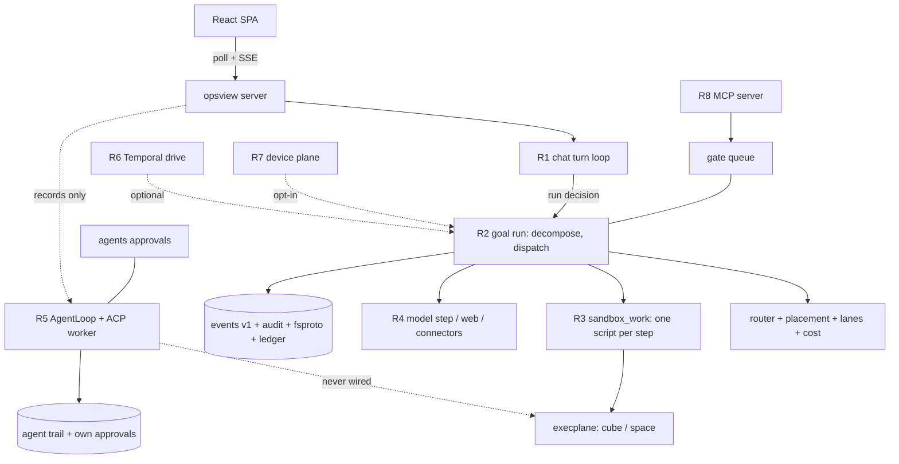
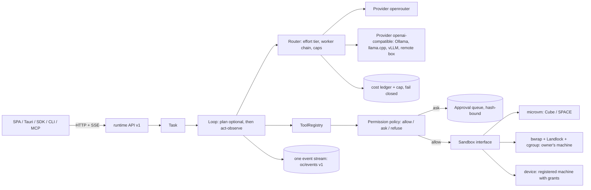

# Unified runtime, high-contrast UI and full settings - Plan

**Source:** Luke, 2026-11-15: "take a look at all of the open computer agent run time and let's plan a final unified ... no purple ... super high contrast white black or black white ... still easy to look at and use, full settings page needed too with SDK as needed." Later the same day he put the local "personal computer" runtime ahead of the desktop chat UI as the model to learn from.
Verified against `main` at `b72e9a0` (after #164). This is a plan. No product code changes in this PR.

Clean-room note: the study of a proprietary desktop product behind the local-runtime section is kept outside this repo (owner's machine). This plan
contains our own design only: no code, strings, prompts, assets or screenshots from that product.

## Summary

Today Open Computer has five ways to "run an agent", three approval stores, three event/trail formats, two sandbox lifecycles, two model-choice systems and three UIs.
The live path works but its worker is a one-shot script generator, not an agent loop; the long-horizon loop (`services/agents`) is built and tested but never wired in production.
This plan picks ONE runtime: a task runs a tool-calling loop, tools run in a per-task sandbox (microVM in the cloud tier, bubblewrap on the owner's own machine),
every model call goes through one provider/router layer (OpenRouter by default, any OpenAI-compatible endpoint opt-in), every action emits one event stream (including streamed reasoning, tool-call arguments and per-step cost from OpenRouter), and every approval is one object in one queue.
The UI becomes strictly black-on-white / white-on-black with no hue anywhere, and Settings becomes a real page with ten sections. The UX follows a transcript-first, tool-card, permission-mode style the owner likes in Ori Grok, in our own black and white design. A three-way parity matrix against Perplexity's cloud and local products is in section 7. A TypeScript SDK is deferred until the HTTP+SSE contract is stable (phase 3).

## 1. Audit: every runtime path on `main`

Status key: live = reachable from the console today; opt-in = needs env or hardware; unwired = built and tested, not reachable in production; legacy = superseded but still served.

| # | Name | Location | What it does | Model routing | Status |
|---|---|---|---|---|---|
| R1 | Chat turn loop | `services/opsview/threads.py` `run_turn`, `services/orchestrator/chat.py` | JSON decision per pass: reply, ask, or start a run; re-asks after a run finishes; max passes | effort preset (Low/Medium/High) from `services/router/model_catalog.json` via `services/opsview/effort.py`; every call via OpenRouter lanes | live |
| R2 | Goal run (plan, dispatch, collect) | `services/orchestrator/{decompose,dispatch,runner,collect,egress,privacy}.py`, driven by `services/opsview/goalruns.py` on a daemon thread | goal to validated step DAG, each step routed and placed, mailboxed through fsproto, results tombstoned | stored effort tier (#159); `services/router` `decide` only when classifying | live |
| R3 | Step worker "sandbox_work" | `services/orchestrator/engines.py` | model writes ONE script, a microVM runs it under deny egress, stdout is the result; run-scoped VM pool with idle reaper | worker chain (`z-ai/glm-5.3-flash` then fallbacks) | live (no tool loop, no iteration) |
| R4 | Step worker "model step" / web / connectors | `engines.py` `work_fn`, `services/orchestrator/tools/web.py`, `services/connectors/apps_tools.py` | OpenRouter completion; host-side search/fetch mini-loop; read-only connector tools | worker chain; Sonar opt-in | live |
| R5 | Long-horizon agent job | `services/agents/{loop,runner,worker,acp,opencode,policy,approvals,replay,trail,workspace,sandbox,relay}.py`, `services/opsview/agentjobs.py` | planner loop, plan approved once, spawn ACP worker (OpenCode) inside a microVM, diff returns as checked patch | planner/worker injected by factory | unwired: no production `configure_runner`; `/api/agent-jobs` records a job that stays queued; `resume_all` runs at startup |
| R6 | Durable drive loop | `services/durable/*`, `services/opsview/automations.py`, `deploy/temporal.compose.yml` | Temporal workflow repeats orchestrator sweeps; cron automations | same as R2 | opt-in (needs Temporal) |
| R7 | Device plane | `services/device*`, `services/device_agent/*` (exec, grants, wisp actuator, relay client) | signed steps run on a registered machine inside folder grants; app/browser actions via wisp socket | n/a (step is already planned) | opt-in |
| R8 | MCP server | `services/mcp/server.py` | stdio; reads runs, requests (never decides) approvals, cost, audit | none | live (agent-facing surface) |
| R9 | Sandbox backends | `services/execplane/{client (cube), space, cassette, policy, egress_defaults}.py` | CubeSandbox microVM; SPACE (E2B-compatible); cassette replay for CI; propose/dry-run/apply egress policy | n/a | cube live, space opt-in, cassette test-only |
| R10 | Model/router layer | `services/router/*`, `services/placement/*`, `services/openrouter/*`, `services/cost/ledger.py` | tiers, hosted decider with fallback, placement table, lanes, cost ledger with cap | see R1/R2 | live |
| R11 | Skills catalog | `services/skills/*`, `services/orchestrator/skills.py` | catalog, capability vocabulary, per-run resolution, refusal | n/a | live; resolved body not yet injected into worker prompt |
| R12 | Replay and fixtures | `services/workspace/replay.py`, `ui/src/demo/*`, `edge/wrangler.jsonc` | recorded goal streams, fixtures-only public demo | none | live (demo) |

Approvals, events and UIs, which cut across the runtimes:

| Concern | Instances today |
|---|---|
| Approval stores | `services/gate/queue.py` (payload-hash bound, console); `services/agents/approvals.py` (own NDJSON, `ag_` ids, leases, TTL); `services/device/grants.py` (folder grants); `services/execplane/policy.py` (egress dry-run diff); orchestrator egress and privacy cards (`egress.py`, `privacy.py`) layered on the gate queue |
| Event/trail formats | `oc/events` schema v1 (types: run, step, tool_call, llm_call, route, approval, cost, source, artifact, change, error, memory, note); `orchestrator.ndjson` audit; `thinking.ndjson`; `skills.ndjson`; fsproto mailbox; `services/agents/trail.py`; opsview `runs.py` conformance history |
| Cost | `services/cost/ledger.py` per run; `services/openrouter/store.py` call records; agent jobs carry their own budget in the trail |
| UIs | React SPA `ui/` (the product); vanilla console (`services/opsview/static/console.js`, `work.js`, `silver-lining.css`); workspace page (`services/workspace/static/*`, route `/workspace`) |
| Permission policy | `services/agents/policy.py` (allow/ask/refuse for worker tool calls) only covers R5; R3 relies on sandbox + egress |
| Stale branch | draft PR #158 (Oct 31 console shell), superseded |

### Duplication and conflict list

1. **Two planners**: `orchestrator/decompose` (R2, live) vs `agents/loop` (R5, unwired). Same job, different state formats, different approval stores.
2. **No agent loop in the live worker**: R3 writes one script and runs it once. A failure is a failed step, not an observation the model can react to. This is the largest quality gap for "computer use".
3. **Three approval systems** with different ids, expiry rules and hash binding. The determinism rule "approval bound to payload hash" is enforced in one of them.
4. **Two sandbox lifecycles**: run-scoped pooled VM with idle reaper (`engines.py`) vs per-round VM seeded from a host workspace with patch return (`agents/sandbox.py`). Both need the same `acquire / exec / snapshot / close` interface.
5. **Two model-choice systems**: effort catalog (chosen by the owner) vs router tiers and `policy_table` (chosen by a classifier). #159 made goal steps follow effort; the router is now only a classifier for odd paths. Precedence is implicit.
6. **Three event formats** and **three UIs**; the vanilla console and `/workspace` page have unknown live use (verify access logs before deleting).
7. **Permission policy only guards R5**; the live path has no per-tool allow/ask/refuse because it has no tools.
8. **Credential boundary unfinished** (`docs/CREDENTIALS.md`): placeholders exist, no caller passes `secrets=`.
9. **Local tier is absent**: "never runs models locally" is a product rule (kept as the default), but there is no way to run tools on the owner's own box without a registered device (R7, a signed-step design, not a general local sandbox).
10. Docs drift: README still says "no CLI"; `ARCHITECTURE_MAP.md` status column dates to 2026-10-11.

## 2. Unified design

One vocabulary: **Task** (a goal in a thread) runs a **Loop** over **Steps**; a step is a model call plus **Tool** calls; tools run in a **Sandbox**; models come from a **Provider** chosen by the **Router**; everything is an **Event**; anything risky is an **Approval**.

| Piece | Decision |
|---|---|
| **Loop** | Tool-calling loop with a step cap, a cost cap and a wall-clock cap. Plan step is optional (High effort or explicit request) and reuses `decompose` + validation; low-effort chat tasks skip it. Replaces R3's single script and R5's planner. A failed tool call returns to the model as an observation; N consecutive failures stop the task fail-closed. |
| **Tool protocol** | Closed, typed registry: `shell`, `read`, `write`, `edit`, `web.search`, `web.fetch` (host-side, egress rules as today), `connector.*` (read-only today), `load_skill`, `spawn` (named subagents, depth 1 enforced by omitting the tool, per next-wave U8), `harness.code` (the ACP/OpenCode worker, optional), plus registered MCP tools and SDK-registered tools. Each tool declares a risk class; the permission policy (today's `agents/policy.py`, generalised) answers allow / ask / refuse deterministically, and refuse wins. |
| **Sandbox lifecycle** | One interface: `acquire(task, egress_hosts) -> exec / read / write / snapshot / close`, with typed unavailability reasons and a canary probe. Cloud tier: today's run-scoped microVM pool and the workspace seed/patch return from R5 (kept as the `harness.code` path). Local tier: bubblewrap + Landlock + cgroup per task workspace on Linux. Fail closed everywhere: if the sandbox cannot be proven, `shell` is not in the request. |
| **Model router** | One precedence rule, written down and tested: owner effort selects the tier model and its fallbacks; worker chain for sub-calls; the hosted decider is advisory (classification and diagnostics), never overriding effort. Providers: `openrouter` (default), `openai-compatible` (any base URL), with per-provider health and a per-provider concurrency limit. Spend rule and ceiling tests stay. |
| **Event stream** | `oc/events` v1 becomes the only stream. R1, R2, R5 and R7 all emit through `Emitter`; `thinking.ndjson`, `skills.ndjson` and the agent trail become views or event types. One SSE endpoint per task with `Last-Event-ID` resume; the UI, SDK, CLI and demo replay read the same shape. |
| **Approvals** | One queue (`services/gate/queue.py`), one id space, hash-bound payloads, single-use, with kinds (egress, privacy, push/deploy, tool-ask, spend 80%, device grant). `agents/approvals.py` leases and TTL move into the queue. Approval stays human-only; the MCP server and SDK can request and read, never decide (existing test stays). |
| **State** | Files and NDJSON under `OC_ROOT` stay for phase 1-2; fsproto stays as the on-disk spine for step mailboxes; SQLite is a later migration (next-wave U10), not part of this plan. |

### Kept, merged, deleted

| Keep | Merge | Delete (after parity checks) |
|---|---|---|
| `oc/events`, `oc/fsproto`, `oc/obs`; `services/gate`; `services/cost`; `services/router` + effort catalog; `services/openrouter`; `services/execplane` (all three backends); `services/skills`; `services/connectors`; `services/memory`; `services/compact`; `services/mcp`; `services/device*` (as a sandbox backend); `services/durable` (automations only); `ui/` SPA; demo build | `agents/policy.py` into the shared permission policy; `agents/approvals.py` and `device/grants.py` approval parts into the gate queue; `agents/sandbox.py` + `engines.py` pooling into one Sandbox interface; `agents/loop.py` plan-approval and budget-warning logic into the Loop; `agents/trail.py` and the `thinking`/`skills` sidecars into event types; `agents/acp.py`, `opencode.py`, `relay.py`, `workspace.py` become the `harness.code` tool | R3's single-shot `sandbox_work` (after the loop passes golden tasks); `AgentLoop` as a separate planner; `/api/agent-jobs` as a separate surface (alias onto tasks, then remove); vanilla `console.js`/`work.js` pages and `/workspace` static page (if no live use); draft PR #158 |

## 3. Local versus cloud execution

Our own design; the lesson taken from studying a local agent runtime is structural: one runtime process owns the agent, the UI stays dumb, the sandbox is per task and provable, hardware eligibility is computed rather than assumed, and engines are probed and typed rather than assumed.

| | Cloud tier (default) | Local tier (opt-in) |
|---|---|---|
| Models | OpenRouter, effort presets, fallbacks | same provider interface; `openai-compatible` base URL (Ollama on `127.0.0.1:11434`, llama.cpp server with Vulkan, vLLM on a Spark-class box, a remote box) |
| Tools run in | microVM (CubeSandbox, or SPACE), deny-all egress plus approved hosts | bubblewrap + Landlock + cgroup on a per-task workspace folder; reads outside the workspace refused with a clear result; network off unless approved; or the existing device plane for another machine |
| Who holds secrets | the host; the guest never does | the host; the sandbox gets none |
| Approval defaults | ask for egress hosts, push/deploy, spend 80% | additionally ask for writes outside the workspace and any network |
| When chosen | default | Settings > Sandbox, per task by a "Run on this machine" toggle; never silently |

**Hardware profiles** (probe, do not hard-code):

| Machine | Probe | Model serving | Tools |
|---|---|---|---|
| This M1 Max / Asahi box (64 GB, Honeykrisp Vulkan, ANE) | unified memory from `/proc/meminfo`, Vulkan device list | Ollama on `:11434` (CPU on Asahi today) or llama.cpp Vulkan through `openai-compatible`; ANE only for speech models (separate from chat) | bwrap tier |
| DGX Spark class (GB10, large unified memory, NVIDIA) | NVML / `nvidia-smi` if present, sysfs total VRAM | vLLM or llama.cpp server through `openai-compatible`; large open-weight models become eligible | bwrap tier; Docker only if the owner chose a Docker engine |
| Any laptop, no GPU | memory only | cloud models | cloud tier |

`HardwareProbe` returns `eligible | insufficient_memory | unknown | engine_missing` against a per-model minimum in our catalog and feeds Settings > Models. We do not supervise engines in phase 2 (the host's systemd or Ollama does); we probe health, list models, and show typed errors. Local models never become a default and never join an effort tier; the spend and privacy rule in ROADMAP stays until the owner changes it.

**Safety and permissions model** (applies to both tiers):
1. Fail closed: no provable sandbox, no `shell`.
2. Deterministic policy: refuse (credential paths, secret binaries, login flows, destructive shell) beats ask beats allow; unparseable input is ask.
3. Approvals are human-only, hash-bound, single-use, and carry who/what/where/cost/PII.
4. Egress deny by default; an agent cannot widen its own policy (existing dry-run diff and human apply).
5. Hard cost cap including unknown-spend reservation (as in next-wave U1).
6. Prompt-injection posture: fetched content is data in a delimited block; no tool is addable from content.
7. Telemetry off by default; local files only; Settings shows exactly what is written where.

## 4. UI: black and white, no hue

**Rules.** Black on white (light) and white on black (dark); the system default follows `prefers-color-scheme`; `prefers-contrast: more` pushes borders and muted text one step further. No purple, violet, indigo, or blue-violet anywhere; no hue at all in neutrals. State is never colour alone (glyph plus word, as today). At most one optional accent, off by default; the default accent is ink itself (inverse fill on the primary action), which is what #160 already does.

Measured with the WCAG relative-luminance formula (computed during planning; the same check ships as a unit test):

| Token | Dark | on canvas / surface-1 / surface-2 | Light | on canvas / surface-1 / surface-2 |
|---|---|---|---|---|
| canvas | `#000000` | n/a | `#FFFFFF` | n/a |
| surface-1 / surface-2 | `#0B0B0B` / `#161616` | n/a | `#F4F4F4` / `#E8E8E8` | n/a |
| ink | `#FFFFFF` | 21.0 / 19.7 / 18.1 | `#000000` | 21.0 / 19.1 / 17.1 |
| muted | `#C7C7C7` | 12.4 / 11.6 / 10.7 | `#383838` | 11.7 / 10.7 / 9.6 |
| subtle (captions) | `#A8A8A8` | 8.8 / 8.3 / 7.6 | `#505050` | 8.1 / 7.3 / 6.6 (use on canvas and surface-1 only) |
| line-strong (control borders, focus) | `#8C8C8C` | 6.3 / 5.9 / 5.4 | `#6E6E6E` | 5.1 / 4.6 / 4.2 |
| hairline (decorative dividers) | `#5C5C5C` | 3.1 / 2.9 / 2.7 | to be set at 3:1 or darker in the PR | tested |
| ok | `#4DDC8A` | 11.9 / 11.2 / 10.3 | `#005A2B` | 8.4 / 7.7 / 6.9 |
| warn | `#FFC933` | 13.7 / 12.8 / 11.8 | `#6B4500` | 8.5 / 7.7 / 6.9 |
| deny | `#FF7A70` | 8.3 / 7.8 / 7.1 | `#A0140A` | 8.1 / 7.4 / 6.6 |

Body text (ink, muted) meets AAA (7:1) in both themes on every surface; captions meet AAA on canvas and surface-1 and AA or better elsewhere; every control border meets 3:1 and ordinary control borders meet 4.5:1. Status hues are green, amber, red only, always with a glyph and a word, and never used for text smaller than 14 px without the word. An optional accent, if the owner wants one later: dark `#FFD60A`, light `#7A5C00` (6.3:1, AA only, so non-text or 20 px and above); it is not shipped by default.

**Type scale and space.** Keep the tested scale 12 / 13 / 14 / 16 / 20 / 28; raise body default to 16 on the chat and 14 in dense tables; line height 1.5 for prose, 1.4 for UI; maximum line length 72 ch for thread text; targets at least 44 px on touch and 32 px on desktop (existing rule is 40 px on a phone); spacing on a 4 px grid with 8 / 12 / 16 / 24 / 32.
**Focus.** One global 3 px outline in ink with a 2 px canvas-coloured gap so it shows on any surface (replaces the accent outline); skip link on every page; Escape closes what opened; no focus trap without an exit.
**Slanted background kept.** The static carbon-fibre weave on `body::before` stays exactly as the owner liked it, in pure black/white hairlines (`rgba(255,255,255,0.06)` on black; `rgba(0,0,0,0.065)` on white) and one step stronger under `prefers-contrast: more`. It never animates, sits behind the canvas only, and cards and the sidebar stay opaque so text never lies on the pattern.
**Motion.** Unchanged rules: nothing moves while a human is deciding; reduced motion and "Reduce effects" respected; the composer working ring stays in ink.
**Guards.** (1) A hue lint test: every colour token and every literal in `ui/src` and `services/opsview/static` has saturation 0 except the three status colours, and no status colour falls in hue 240-330. (2) `palette.test.ts` extended to the table above (AAA body, 3:1 non-text). (3) Axe e2e in both themes and `prefers-contrast: more` at 390 and 1440. (4) A grep-style test that the words violet, purple, indigo and iris appear only in DESIGN.md's history. (5) Silver Lining's Azure/info token is mapped to ink so no blue remains in the console.

## 5. Settings page

One page with a left section list (top tabs on phones), one URL per section (`/settings/<section>`), a search box, and a status dot per section. Secrets never render or return: a key field shows "set" or "not set", a Test button, and Replace/Remove; values go to the secret store.

| Section | Contents | Backing |
|---|---|---|
| 1. Account | identity, sign-out, sessions | `services/accounts` |
| 2. Models and providers | effort presets (read-only catalog), default orchestrator, above-ceiling opt-ins, providers (OpenRouter, openai-compatible URL), per-provider key and health, local-model eligibility from `HardwareProbe`, daily cap display | catalog, `/api/openrouter`, `/api/models` |
| 3. Routing | precedence explanation, worker chain, subagent limits by effort, region fallback status, router tester | `/api/router`, `/api/effort` |
| 4. Sandbox | tier choice (cloud microVM / this machine / device), backend status, Verify sandbox, limits (CPU, memory, pids, wall clock, disk), egress allowlist with dry-run diff, workspace folder | execplane, new sandbox status API |
| 5. Permissions and approvals | policy by tool (allow / ask / refuse view, ask-more only), approval queue shortcut, expiry, spend-warning threshold, device grants | policy, gate, device grants |
| 6. Data and privacy | where files live, memory notes (view/forget), export, delete threads, PII gate on/off, telemetry (off, what would be written) | memory, obs |
| 7. Appearance | Light / Dark / System, High-contrast boost, Reduce effects, text size | `theme.ts`, `data-effects` |
| 8. Keyboard shortcuts | list, rebind within the SPA, conflict detection, reset | new local store |
| 9. Integrations and MCP | connectors (Composio), MCP servers (add stdio/HTTP, tools discovered, per-tool policy), web provider (Sonar default with one key, BrowserOS, Scrapling), skills catalog and user skills folder | connectors, skills, web tools |
| 10. Developer and SDK | API base URL, API tokens (create, scope, revoke; shown once), event stream inspector, trace switch (asks first), runtime map, "Put this online" (Cloudflare Tunnel + Access, from next-wave U6), version and update check | opsview dev routes |

**Secret store.** One `SecretStore` interface with backends in order: omaseal (this owner's keyring), the OS keyring (libsecret on Linux, the existing login keychain item on macOS; never a new keychain), an environment variable (read-only, shown as "set by environment"), and a 0600 file fallback only for headless hosts, flagged in the UI. Keys are never in argv, logs or API responses; `/api/*` returns presence and a Test result only.

## 6. SDK

**Recommendation: not needed now; define the contract in phase 1, ship TypeScript in phase 3, Python only on demand.**

| Question | Answer |
|---|---|
| Why not now | The HTTP + SSE surface and the event schema are still moving (P1-2 and P1-3 change them). A client over a moving contract is churn. The SPA, CLI (`oc run`) and MCP server already cover first-party use. |
| What it exposes (v1) | `createTask(goal, {effort, cap, sandbox})`; `stream(taskId)` async iterator of typed events (`step`, `tool_call`, `llm_call`, `approval`, `cost`, `artifact`, `error`, `run`); `approve(approvalId, {hash})` and `deny`, only for tokens with the approve scope; `registerTool({name, schema, risk, handler})` for host-side tools the loop may call, subject to the same permission policy; `listTasks`, `cancel`, `getArtifact`. |
| Shape | A thin TypeScript client generated from an OpenAPI file and `oc/events/schema/event.schema.json`, about 300 lines, zero runtime dependencies, Node and browser, resume with `Last-Event-ID`. Token scopes: `task:write`, `task:read`, `approve`, `tools:register`. |
| Tool registration | Prefer MCP first (already supported by design); SDK `registerTool` is the in-process shortcut for apps embedding the runtime. |
| Python | Not justified yet: `bench/` and tests already import the runtime directly. Revisit when an external Python user exists. |

## 7. Three-way parity

Naming first, because it matters for the target. Perplexity's public help center separates **Computer** (the cloud agent), **Portable Computer** (the fully local version for Linux and NVIDIA DGX Spark, plus RTX GPUs with at least 24 GB of VRAM per press coverage) and **Personal Computer** (the Mac and Windows app with a Local mode and a Hybrid mode). The Linux package we studied ships the local runtime, so the "PPC" column below is that local runtime (what Portable Computer runs; Personal Computer's Local and Hybrid modes use the same idea on a Mac). Whether the Mac binary differs was not inspected. Sources: Perplexity help center ["What is Computer"](https://perplexity.ai/help-center/en/articles/13837784-what-is-computer) (fetched 2026-11-15) and press coverage; the local-runtime column also rests on symbol and file-name evidence, not observed behaviour. "Cloud" cells say "not stated" where Perplexity does not say.

Columns: **PPC** = local runtime; **Cloud** = Perplexity Computer; **OC now** = `main`; **OC after** = after this plan, with the phase that closes it.

| Capability | PPC (local) | Cloud | OC now | OC after (phase) |
|---|---|---|---|---|
| Agent loop | tool-calling loop in a Rust server | autonomous multi-step agent | one-shot script per step; separate unwired planner | tool-calling loop (P1) |
| Subagents | depth 1, tool absent at leaf | specialist sub-agents, "Wide Research" in parallel | none live | named subagents, depth 1 (P2) |
| Local sandbox | bwrap + Landlock + seccomp + cgroup per task workspace | n/a | none (device plane only) | bwrap + Landlock + cgroup (P2) |
| Cloud sandbox | n/a | cloud sandbox per task | microVM per run (Cube / SPACE) | same, unified interface (P1) |
| File and shell tools | read, write, edit, glob, apply-patch, shell | yes (details not stated) | shell inside script only | typed `shell/read/write/edit` (P1) |
| Browser control | via MCP apps and search broker | browses the web | host-side search/fetch; BrowserOS opt-in | same plus browse tool on MCP (P3) |
| Desktop/native app control | MCP apps on the device | not stated | wisp actuator via device plane | device backend merged (P4) |
| Connectors | Google/Microsoft overlays, MCP apps | Gmail, Outlook, GitHub, Linear, Slack, Notion, Snowflake, Databricks, Salesforce, data feeds | Composio read-only in chat steps | same, write actions behind approval (P3) |
| MCP | client for local and remote servers | local and remote MCP (enterprise) | server only (read, request approval) | client UI + server (P3) |
| Skills | markdown playbooks, app-owned and user-owned trees, plugin bundles | plugins bundle connectors and skills | catalog exists, body not injected | injected, user tree, versioned (P2) |
| Schedules/automations | pause, run-now, delete; per-skill grants | scheduled jobs, condition triggers, proactive | Temporal cron (opt-in) | keep, surface in UI (P2) |
| Memory | persistent notes | persistent across sessions and platforms | optional Kurultai memory, forget | keep (done); add export (P2) |
| Voice | speech recognition and voice sessions | mobile voice | `/api/transcribe`, `/api/voice` | keep (P3) |
| Model choice | named models, remote box, advisor escalation | multi-model, models not named | effort presets via OpenRouter | same plus `openai-compatible` (P2) |
| Local models | llama.cpp and vLLM-Docker engines, hardware gating | n/a | none by rule | opt-in provider + HardwareProbe (P2); no engine supervision until P4 |
| Approvals | one interaction verb, permission modal | not stated in detail | 3 stores, hash-bound in gate | one queue, hash-bound (P1) |
| Artifacts | files in workspace | docs, decks, apps, email | run files with preview and zip | same (done) |
| Cost visibility | final Usage section; credits only in cloud | credits, spending limits, auto-refill off by default | per-run cap, ledger, cost records | per-step cost live, caps (P1) |
| Streaming UX | UI renders pushed snapshots and streams | task view; queued follow-ups | polling, final text | streamed reasoning, tool calls, text, cost (P1) |
| Settings | broad (see REA) | account, plan, Computer configuration | partial | ten sections (P1 shell, P2 fill) |
| SDK/API | internal RPC | not stated | HTTP API, MCP server | versioned API P2, TS SDK P3 |
| Multi-device | remote box, device identity | web, iOS, Android | device plane, relay | Tauri + web, device backend (P3-P4) |

**Top gaps and where they close**

| # | Gap | Closes |
|---|---|---|
| 1 | No agent loop in the live worker | P1 |
| 2 | No streamed reasoning, tool calls or cost in the UI | P1 |
| 3 | Three approval stores | P1 |
| 4 | No local sandbox tier | P2 |
| 5 | Local models and hardware gating absent | P2 (probe + provider), P4 (engine supervision) |
| 6 | Skills not injected, no user tree | P2 |
| 7 | Subagents not live | P2 |
| 8 | MCP client and connector write actions missing | P3 |
| 9 | No SDK | P3 |
| 10 | No packaged desktop and update path | P3 (Tauri, next-wave U5) |

**What we will not match**
- **Their search index and retrieval stack.** Substitute: OpenRouter's web search (engines Exa, Parallel, Firecrawl, native or Perplexity's own through OpenRouter) plus our host-side fetch rules. Quality will differ.
- **Proprietary models and their tuned local checkpoints.** Substitute: open-weight models on OpenRouter, or any `openai-compatible` endpoint.
- **Premium data connectors and enterprise admin controls.** Substitute: Composio and MCP; no org admin plane.
- **Their managed GPU engine installer.** Substitute: we probe and use whatever the host runs (Ollama, llama.cpp, vLLM); no root-level installer.
- **Credits and a hosted plan.** Substitute: BYO OpenRouter key and a hard per-run cap.
- **Mobile apps.** Out of scope; web works on a phone.

## 8. OpenRouter integration (streaming reasoning and tool calls)

Verified against OpenRouter documentation fetched 2026-11-15. Where a page did not answer, it says so.

| Topic | Verdict | Source |
|---|---|---|
| Reasoning request control | `reasoning` object with `effort` (max, xhigh, high, medium, low, minimal, none), `max_tokens` (explicit budget, mainly Anthropic and some Gemini/Qwen), `enabled`, `exclude` (Chat Completions only); reasoning tokens count against the output limit | [reasoning tokens](https://openrouter.ai/docs/guides/best-practices/reasoning-tokens) |
| Streaming reasoning | Yes on Chat Completions via `choices[].delta.reasoning_details` (types `reasoning.summary`, `reasoning.text` with optional `signature`, `reasoning.encrypted`; fields `id`, `format`, `index`); plaintext models also use `reasoning` / `reasoning_content`; encrypted blocks may show as redacted in streams | same |
| Which models show reasoning | Anthropic: summarized (default) or omitted; OpenAI reasoning models: summary only, and some return none; DeepSeek R1 style: raw text; Gemini 3: level mapped from effort. **Open-weight catalog models (GLM, Qwen, Gemma, particle, Nemotron, MiMo, Minimax): not documented per model, provider-dependent.** Do not assume; probe | same |
| Multi-turn tool use with reasoning | Pass the assistant message's `reasoning_details` back unmodified (order preserved); on Responses replay `encrypted_content` unchanged | same; [tool calling](https://openrouter.ai/docs/guides/features/tool-calling) |
| Streaming tool calls | Yes. Chat Completions streams tool-call deltas and a final `finish_reason` (the streaming page does not describe the delta shape; follow the OpenAI-compatible shape and verify with a recorded cassette). Responses emits `response.output_item.done` with full `arguments` | [streaming](https://openrouter.ai/docs/api/reference/streaming), tool calling |
| Parallel tool calls | `parallel_tool_calls` defaults true for most models; set false to serialise | tool calling |
| `tool_choice` | `auto`, `none`, or force one function (shape differs per API) | tool calling |
| Tools are only a soft preference in routing | `tools`, `response_format` and `verbosity` are soft preferences even when `require_parameters` is false; set `require_parameters: true` for tool loops | [provider routing](https://openrouter.ai/docs/guides/routing/provider-routing) |
| Structured outputs | `response_format: json_schema` with `strict`; streams partial JSON; support varies per endpoint; combine with `require_parameters` | [structured outputs](https://openrouter.ai/docs/guides/features/structured-outputs) |
| Responses API vs Chat Completions | Responses is OpenAI-compatible and stateless (no `store`, no `previous_response_id`, send full history every time) with reasoning, encrypted reasoning, parallel tools and web search. The overview page does not say "beta"; **I could not confirm a beta label.** Recommendation: stay on Chat Completions (our client, our catalog, `models` fallbacks); adopt Responses only if a provider's reasoning needs it | [responses overview](https://openrouter.ai/docs/api/reference/responses/overview) |
| Fallbacks and routing | top-level `models` array; provider `order`, `allow_fallbacks`, `sort`, `data_collection: deny`, `zdr: true`; sticky routing keeps a conversation on one provider while the cache is warm; `session_id` sets the key (60 minute expiry) | provider routing, [caching](https://openrouter.ai/docs/guides/best-practices/prompt-caching) |
| Prompt caching | Automatic for OpenAI, Grok, Moonshot, Groq (Kimi), DeepSeek, Z.AI, Gemini 2.5+; needs `cache_control` for Anthropic and Qwen; reported as `prompt_tokens_details.cached_tokens` and `cache_write_tokens`, plus `cache_discount` | caching |
| In-stream usage and cost | Usage is always returned; `usage.include` and `stream_options.include_usage` are deprecated no-ops. Chat Completions sends usage on the last chunk before `[DONE]` (empty `delta`, repeats `finish_reason`). Fields: `cost`, `cost_details.upstream_inference_cost` (BYOK only via `/generation`), `completion_tokens_details.reasoning_tokens`. **This corrects next-wave U1, which assumed `stream_options.include_usage` is required** | [usage accounting](https://openrouter.ai/docs/guides/guides/usage-accounting) |
| Mid-stream errors | HTTP 200 may carry an error: final chunk has top-level `error` and `finish_reason: "error"`; skip SSE comment lines such as `: OPENROUTER PROCESSING`; `length` is a finish reason, not an error | streaming |
| Cancellation | Aborting the connection stops billing only for supported providers (not Bedrock, Groq, Google and others); otherwise the full response is billed. Keep the conservative reservation from next-wave U1 | streaming |
| Web search | `:online` suffix or the `web` plugin (`engine`: native, exa, firecrawl, parallel, perplexity; `max_results`; domain filters); citations arrive as `annotations[].url_citation` (`url`, `title`, `start_index`, `end_index`); priced per request on top of tokens | [web search](https://openrouter.ai/docs/guides/features/plugins/web-search) |
| BYOK and limits | own provider keys tried first or as fallback; 5% fee on list-price cost beyond the plan allowance; with credits OpenRouter manages provider rate limits, with BYOK a 429 is the provider's | [BYOK](https://openrouter.ai/docs/guides/overview/auth/byok) |

**Verdict.** Streaming reasoning: yes for Anthropic (summarized text), DeepSeek-style models (raw text) and any model that returns `reasoning` or `reasoning_details`; partial for OpenAI-style models (summary only or nothing); unknown, to be measured, for each open-weight catalog model. Streaming tool calls: yes on Chat Completions and Responses; parallel calls and forced choice are supported; routing must set `require_parameters` or a provider may silently drop `tools`. Both need a recorded cassette per catalog model before we claim support.

**Capability probe (in P1).** A script, run by the owner with a spend cap (never CI), sends one tiny streamed request per catalog model with reasoning enabled and one tool defined, and writes `reasoning: {visible_text | summary | none}`, `tool_stream: yes/no`, `parallel_tools: yes/no`, `usage_in_stream: yes/no` into `model_catalog.json` metadata. The UI reads that metadata, not guesses.

**Event mapping (oc/events v1, additive v1.1).** Existing types stay (`run`, `step`, `tool_call`, `llm_call`, `route`, `approval`, `cost`, `source`, `artifact`, `change`, `error`, `memory_*`, `note`). New streaming types are additive and the validator accepts v1 events unchanged.

| OpenRouter chunk | oc event | Notes |
|---|---|---|
| `delta.content` | `message.delta {step, text}` | coalesced to about 50 ms or 200 characters before it hits the log; final `message.done` carries the full text |
| `delta.reasoning`, `reasoning_details[type=reasoning.text or summary]` | `reasoning.delta {step, kind: text or summary, text}`; `reasoning.done {step, kind, tokens}` | redacted on a rolling buffer before any disk write (next-wave KTD2); `signature` and `reasoning.encrypted` blocks are stored only in a private replay sidecar for multi-turn tool use, never rendered, never in the public stream |
| `delta.tool_calls[i]` first chunk | `tool_call.started {step, call_id, name, index}` | `index` keeps parallel calls apart |
| `delta.tool_calls[i].function.arguments` | `tool_call.args.delta {call_id, text}` | the UI shows raw partial JSON in a code block, never parses it until `finished` |
| finish with `tool_calls` | `tool_call.finished {call_id, args, risk}` then policy decision then `approval` (if ask) then `tool_call.result {call_id, status, output_ref, ms}` | the existing `tool_call` type becomes the final record |
| last chunk `usage` | `usage {step, prompt, completion, reasoning, cached, cost, cost_upstream}` then the existing `cost` event | ledger takes `cost`; unknown cost reserves against the cap |
| top-level `error` / `finish_reason: error` | `error {step, retryable}` | fallback tail is retried; recorded as `llm_call` with the serving model |
| SSE comments | dropped; optionally `step` state "waiting on provider" | |

Persistence rule: the live SSE carries deltas; the stored log keeps coalesced deltas plus the `.done` records so replay and the fixtures-only demo work without a token-by-token file.

**UI treatment.**
- Message text streams into a document-style block; no per-word animation required (a restrained fade on new words only if Reduce effects is off).
- **Thinking:** a collapsible block per step, open while it streams, collapsed once the answer starts; label "Thinking" (text), "Summary of thinking" (summary only) or "Working" (none). Never invented text.
- **Tool cards:** one card per call: name, a one-line human summary, args (streamed raw, then formatted), approval state, result with elapsed time and, for edits, an inline diff before approval. Parallel calls render side by side in call order. Failed calls show the error as an observation the model also saw.
- **Per-step cost:** each step header shows model, tokens, reasoning tokens when reported, and cost; the footer shows run cost against the cap; unknown cost shows "cost pending" with the reserved amount.
- **Models without visible reasoning:** show the step as "Working" with elapsed time and `reasoning_tokens` once usage arrives, and narrate from real events only (which tool is being called, what it returned). No spinner of indeterminate length.
- **Cancel/stop** works mid-stream and mid-tool; the reservation rule applies on stop.
- **Search:** `annotations[].url_citation` become `source` events and the existing Sources panel.

## 9. UX north star: Ori Grok-like, our own design

Method and limits: read only the documentation and changelog that sit on this machine under the Grok Build home that `ori` wraps (user guide, theming, permissions, plan mode, sandbox, tools, shortcuts). No prompt was sent, no session, history or credential file was opened, and `ori` itself was not run. Traits are described in my words; nothing is copied, and the visual identity here is ours (black and white, no purple; their default theme uses a magenta accent, which we do not adopt).

| Trait observed | What it does | Our adoption (web UI) |
|---|---|---|
| One scrollback transcript, not panes | everything (your message, thoughts, tool calls, diffs, output) is one chronological stream with a footer | single central column; side panel only for Sources/Files, collapsed by default |
| Thoughts stream and fold | reasoning text streams live, can be folded, and a fold remembers state | collapsible Thinking block per step (section 8) |
| Tool calls with real-time output | each call shows progress and output as it runs | tool cards with live stdout tail, elapsed time, truncated with "show all" |
| Inline diffs before apply | edits show as diffs; you approve with the diff in view | edit cards render a unified diff first; Approve/Deny bound to the payload hash |
| Permission modes with one-key toggle | ask (default), accept-edits, plan, auto, always-approve; deny rules still apply on top; sensitive paths always protected | mode selector in the footer (Ask, Accept edits, Plan, Auto), `always-approve` only after a typed confirmation and never for egress or spend; refuse rules cannot be overridden |
| Plan mode | agent explores read-only, writes a plan, asks to exit with your approval | the existing plan card; plan state is read-only for edits; matches our "approve the plan once" |
| Plan and TODO panel | toggleable task list the agent maintains | collapsible Plan panel from `step` events |
| Footer status | model, context usage, key hints, background-task count | footer: model, effort, cost vs cap, context used, sandbox tier, running tasks |
| Slash commands and palette | `/model`, `/new`, `/resume`, `/rewind` (restores files), `/compact`, `/memory`, `/skills`, `/btw` side question | command palette (Ctrl/Cmd+K and `/` in the composer) with the same verbs; rewind uses sandbox snapshots when available |
| Background tasks | send the foreground task to the background; stop buttons in a dock | "Run in background" and a task dock; Stop is always visible |
| Subagents panel | parallel child sessions with status lines ("N agents still running") | subagent rows under the parent step; parent Stop cancels children |
| `@` file references and prompt history search | fuzzy file mentions; reverse history search | `@` mentions for workspace files, connectors and subagents; history search |
| Density and keyboard completeness | terminal density, every action has a key, multiline toggle, undo on input | dense mode in Appearance; every action reachable by keyboard; Esc cancels |
| Theme from a central palette, `auto` follows system, a "terminal" theme that borrows the user's colours | one palette drives everything | one token file; Light, Dark, System, plus High-contrast boost; no hue |
| Sandbox profiles (off, workspace, read-only, strict) applied irreversibly at start | the model cannot relax them at runtime | Settings > Sandbox profiles with the same semantics; set per task, immutable during the task |
| ACP and headless modes | the same agent is reachable by scripts and editors, with thought, message, tool-call and plan updates as typed events | our event stream is that contract; the SDK and CLI read it; an optional ACP bridge is a P3 idea, not a commitment |

Visual rules for our version: monospace for code, args and ids only; sans for prose; state is glyph plus word; ink-on-canvas with the weave behind; tool cards are bordered boxes, not bubbles; no colour except the three status colours with glyphs; motion only for state changes.

## 10. Phasing and PR list

Sequence respects the pending next-wave units (U1 streaming, U2 reasoning, U3 buttons and stop, U4 settings, U5 Tauri, U6 online, U7 Sonar, U8 subagents, U9 install). **This plan absorbs U1, U2 and U3** (streaming, live reasoning and stop become part of Phase 1 on the unified event stream, with the corrections in section 8) and U4 (settings), reshapes U8 onto the unified Loop, and does not conflict with U5, U6, U7, U9.

**Phase 1: unified runtime with streamed reasoning and tool calls, black/white theme, settings shell** (each one small PR, tests included, merged only by the owner)

| PR | Title | Content | Gate |
|---|---|---|---|
| P1-1 | `refactor(runtime): shared types, ToolRegistry, Sandbox and Provider interfaces` | new `oc/runtime/`; adapters over today's execplane and OpenRouter client; no behaviour change | existing unit suite unchanged and green |
| P1-2 | `feat(events): event schema v1.1 with message, reasoning, tool-call and usage events` | additive types from section 8, coalescing, redaction on a rolling buffer, `/api/tasks/<id>/events` SSE with `Last-Event-ID` resume; chat, goal and agent runs emit through `Emitter` | schema validation; v1 fixtures still pass; split-secret redaction test |
| P1-3 | `feat(openrouter): streaming client for content, reasoning, tool-call deltas and usage` | Chat Completions SSE parser, tool-call assembly by index, `reasoning_details` capture and replay for multi-turn tools, `require_parameters`, mid-stream error and comment-line handling, cancel plus cap reservation; capability metadata in the catalog | scripted chunk cassettes per family (summary-only, raw text, none, parallel tools); no live network in CI |
| P1-4 | `refactor(approvals): one queue` | fold `agents/approvals.py` store and lease into the gate queue; shared permission policy; permission modes | hash-bind, single-use and human-only tests; MCP no-decide test |
| P1-5 | `feat(runtime): tool-calling loop replaces single-shot step worker` | `shell/read/write/edit` in the run sandbox; step, cost and time caps; failed tool call becomes an observation; Stop cancels stream and tool; flag `OC_RUNTIME=unified`, default on after the golden tasks | cassette-replayed golden tasks (3) green; fail-closed and cap tests |
| P1-6 | `feat(ui): streamed thinking, tool cards, per-step cost, stop` | components from section 8 on the new stream; footer status; permission-mode selector; reduced-motion safe | vitest per component; e2e with a fixture stream; axe |
| P1-7 | `feat(ui): black and white high-contrast tokens, no hue, weave kept` | tokens, focus ring, hue lint, `palette.test.ts` extension, axe in both themes and `prefers-contrast: more` | e2e axe 0 violations; visual check light and dark at 390 and 1440 |
| P1-8 | `feat(settings): sectioned settings shell with routes and search` | the ten sections as routes; existing Account, Connectors, OpenRouter, Memory, Brain, Runtime, Appearance moved in; the rest render honest "not available yet" states | `Sections.test.tsx`, 403-without-session tests, no key material in responses |

Owner-run, not CI: the **capability probe** (section 8) once P1-3 lands, with a spend cap, to fill the catalog metadata.

**Phase 2: local tier, skills, subagents, complete settings.** P2-1 `oc run` CLI and golden-task replay (closes OC-039); P2-2 `HardwareProbe` + typed errors; P2-3 bwrap/Landlock/cgroup sandbox backend with canary and Verify action; P2-4 `openai-compatible` provider with health/model list and per-provider concurrency; P2-5 `SecretStore` backends and the Models, Routing, Sandbox, Permissions, Data sections; P2-6 named subagents on the Loop (replaces next-wave U8); P2-7 skills injected into the worker prompt plus a user skills tree; P2-8 delete R3 `sandbox_work`, the separate planner and the legacy console after parity; P2-9 shortcuts section and command palette.
**Phase 3: SDK and integrations.** OpenAPI + token scopes, TypeScript SDK, MCP client management UI, connector write actions behind approval, `harness.code` tool on the unified loop, Tauri shell wiring (U5), optional ACP bridge.
**Phase 4: later.** Device backend merged into the Sandbox interface, Spark profile tuning with real hardware, engine supervision if the owner wants it, SQLite state (U10), Python SDK on demand.

## 11. Test strategy

- Determinism first: no live network or models in CI; fake OpenRouter, fake sandbox and cassettes already exist (`tests/fakes`, `services/execplane/cassette.py`).
- Golden tasks: three cassette-replayed tasks (research, coding, file transform) with exact expected events and costs; each fails against a deliberately broken fake (the repo's "weak check" rule).
- Loop tests: tool failure becomes an observation; N failures stop; step, cost and time caps; fail-closed when the sandbox is unavailable; depth-1 subagent absence.
- Safety matrix rows from `docs/determinism.md` stay and gain unified-path variants: unapproved egress blocked, self-approval rejected, approval hash mismatch refused, secrets never in guest.
- UI: vitest per component; axe in e2e for light, dark, `prefers-contrast: more`; hue lint; budgets (main chunk under 130 kB gzip) unchanged.
- Local tier: bwrap tests run only where `bwrap` exists and skip loudly (not silently) elsewhere; one manual live checklist for the Asahi box and for a Spark; live rows stay out of CI.
- Contract tests: event schema validation on every emitter path; OpenAPI diffed in CI once it exists (phase 3).

## 12. Risks

| Risk | Mitigation |
|---|---|
| The loop raises spend and runtime of every step | caps are mandatory and tested; default step cap small; effort sets it; hard stop on unknown spend |
| Replacing the live worker regresses working runs | flag, golden tasks, keep R3 until P2-5 |
| bwrap/Landlock availability varies (kernel, userns policy) | typed unavailable reason, no silent downgrade, Verify action |
| Local models weaken the privacy and spend rule | opt-in, never default, never in an effort tier, shown in Settings and in each task's event stream |
| Merge-conflict churn with next-wave U1-U3 on `threads.py` and the OpenRouter client | this plan absorbs U1-U3; land P1-1 to P1-3 first and close or rebase those units |
| Open-weight catalog models may not stream reasoning or tool calls | capability probe fills catalog metadata; UI shows "Working" when no reasoning arrives; tool loops use `require_parameters` |
| Providers drop `tools` silently or bill after an aborted stream | `require_parameters: true`; conservative cap reservation on stop |
| Doc claims drift (the Responses API label, delta shapes) | cassettes recorded from real streams once, then replayed; re-verify docs before P1-3 merges |
| Contrast changes break existing visual assumptions (status colours, glow) | palette test and visual review in P1-7; status is glyph plus word already |
| Over-building settings before backends exist | P1-8 ships honest empty states; sections fill in during phase 2 |

## 13. Open questions for Luke

1. **Local tier at all?** Should phase 2 include running tools on this machine (bwrap), or stay cloud-only until after the demo? Recommendation: yes, because it is the only way the app is useful offline and it is what a Spark owner expects.
2. **Local models**: keep "OpenRouter only by default" with an opt-in `openai-compatible` provider, or allow Ollama as a first-class default on a machine that has it? Recommendation: opt-in only.
3. **Accent**: none (ink only), or one optional accent? Recommendation: none by default; the optional yellow above only if you ask.
4. **Delete the vanilla console and `/workspace` page** once the SPA covers them, or keep them as the Developer fallback? Recommendation: delete after one release with the SPA parity check.
5. **Order**: this plan absorbs next-wave U1-U3 into Phase 1. Close or rebase those units, and land P1-1 to P1-3 first? Recommendation: yes.
6. **SDK**: confirm TypeScript in phase 3 and no Python until a user asks.
7. **Spark**: do you have a DGX Spark to test on, or is it hypothetical for now? It changes whether P4 tuning is real work.
8. **Demo**: keep the Cloudflare fixtures-only demo as is while this lands (recommended), or rebuild it on the new tokens in P1-7?
9. **Naming**: public docs call the local DGX Spark/Linux product **Portable Computer** and the Mac/Windows app **Personal Computer** (Local and Hybrid modes). Which one is the parity target, or both? Recommendation: treat the shared local runtime as the target and Personal Computer's Hybrid mode as the product shape for Open Computer (cloud orchestration, local steps when allowed).
10. **Capability probe spend**: approve a small capped run (about 15 models, one tiny request each) through `orch` to measure reasoning and tool streaming? Recommendation: yes, cap at a few cents.
11. **Always-approve mode**: allow it at all in the web UI, and never for egress and spend? Recommendation: yes, typed confirmation, scoped as stated.
12. **ACP bridge**: want Open Computer reachable from editors and `ori` through an Agent Client Protocol endpoint in Phase 3? Recommendation: defer; our event stream and SDK come first.

## Verification (this docs PR)

Docs only. Claims about the live path were read from `main` at `b72e9a0`: `services/orchestrator/engines.py` (`sandbox_work` is single-shot), `services/opsview/server.py` (no production `configure_runner` call; `agentjobs.resume_all` at startup), `services/opsview/threads.py`, `services/orchestrator/dispatch.py` (#159 effort precedence), `DESIGN.md` (graphite accent, weave), `ui/src/index.css` (weave). Items marked "verify" (live use of the vanilla console and `/workspace`) need access logs from the deployed host. OpenRouter behaviour in section 8 was read from the linked docs pages on 2026-11-15 (summaries by a fetch tool; delta shapes and the Responses "beta" label were not confirmed and are marked). Perplexity Computer facts come from its public help center and press, never a login. The Ori Grok study used only on-disk docs and changelog; no session, history, config or credential file was opened and the binary was not run. Contrast ratios were computed with the WCAG formula and must be re-asserted by the P1-6 test.
